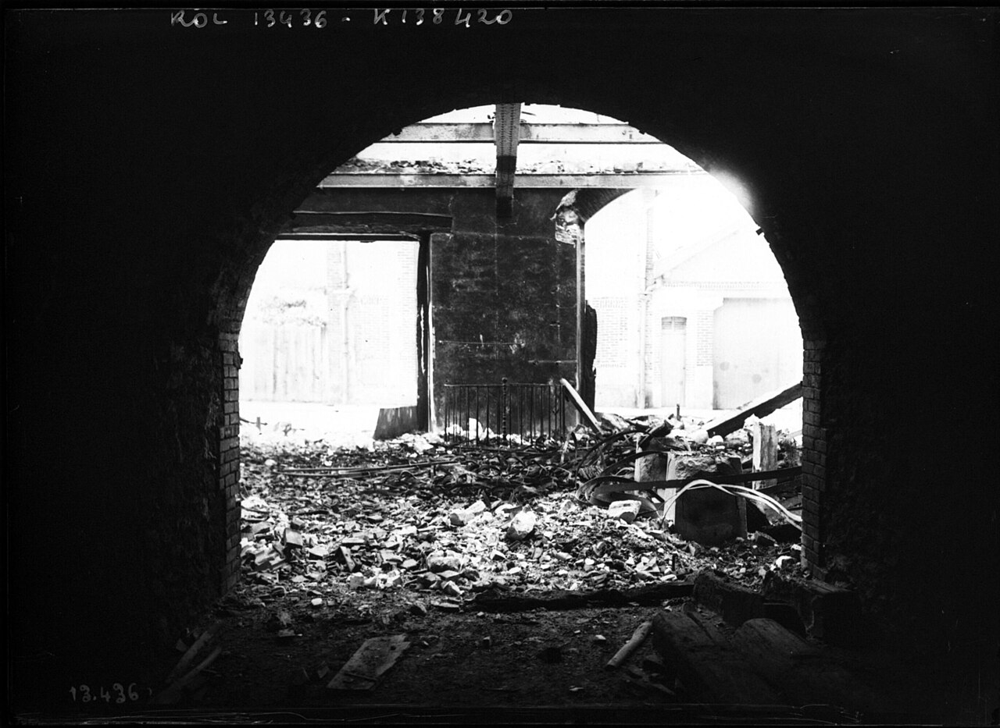
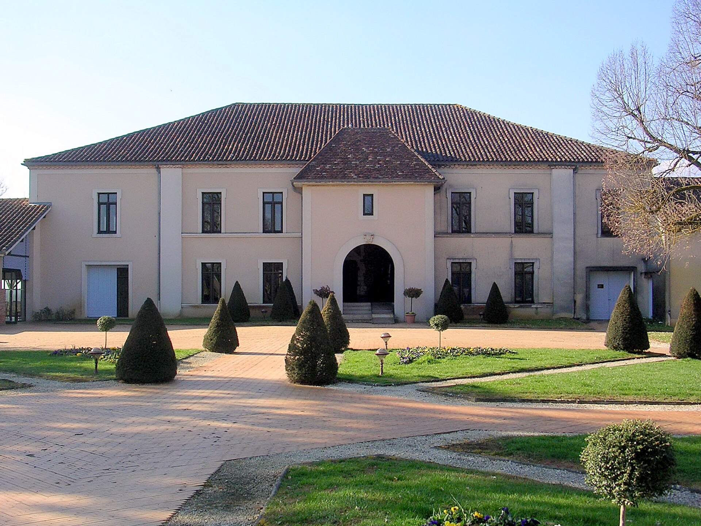

# 香槟暴动 1911：产区边界、葡萄价格与香槟的身份

1911 年的香槟区，不是一场关于“哪种酒更好喝”的争论，而是一场关于土地、价格与名字使用权的冲突。1908 年的行政划界把奥布省（Aube）的大部分葡萄园排除在“香槟”产区之外，当地种植者认为这剥夺了他们的历史身份与市场收入。1911 年 1 月，奥布种植者组织抗议；4 月，马恩省的种植者又因商人收购奥布葡萄而袭击酒商。暴力、罢工与纵火，把香槟从奢侈品变成一个全国性的政治问题。

图：1911 年 4 月阿伊村遭劫掠后的酒窖废墟，Agence Rol 摄。图片：Agence Rol，Public domain，via Wikimedia Commons（[原图页面](https://commons.wikimedia.org/wiki/File:Apr%C3%A8s_le_pillage_d%27Ay%2C_avril_1911_-_btv1b69160215.jpg)）。

## 时代背景

20 世纪初的香槟区正经历多重压力。葡萄根瘤蚜危机之后，葡萄园重植成本高，病害与天气风险仍在；1900 年代后期市场波动，葡萄价格下跌，种植者负债增加。与此同时，香槟酒庄（maisons）与种植者之间的权力不对称加剧：酒庄掌握品牌、陈酿与销售网络，种植者则依赖每年出售葡萄获得现金。产区边界因此不只是地理问题，而是谁有权把酒称为“香槟”、谁能在高价市场分到一杯羹的问题。

奥布省位于香槟区南部，历史上属于香槟省，首府特鲁瓦（Troyes）也是香槟历史的一部分。但 1908 年的划界以马恩省为核心，把奥布大部分葡萄园排除在外。支持划界的人强调土壤、气候与历史销售网络；反对者则认为这是马恩省酒庄与种植者联盟的政治胜利。无论理由如何，划界直接把奥布种植者推向抗议。

## 经过与时间线

1911 年 1 月 29 日，奥布种植者在巴尔叙奥布（Bar-sur-Aube）集会，成立自己的联合会。2 月与 3 月，抗议升级为抗税、游行与市镇议会辞职；大量市镇一度没有正常运作的市政机构。3 月中旬，政府坚持原有划界，奥布种植者在特鲁瓦等地继续示威。4 月 11 日，马恩省爆发更大规模的暴力：种植者认为酒商从奥布收购葡萄，冲击并焚烧被怀疑使用外区原料的商行与酒窖。阿伊（Ay）等地的酒窖遭到劫掠，照片留下了废墟。

为平息局势，政府维持行政划界，同时在 1911 年 6 月 7 日设立“香槟第二区”（Champagne deuxième zone），把奥布部分产区纳入一个次级命名。这个方案没有让奥布满意，因为它意味着“二等香槟”；马恩省则保住了“香槟”主产区的地位。第一次世界大战中断了争论，但问题并未消失。1919 年的法律、1925 年的仲裁与 1927 年 7 月 22 日的最终划界，才逐步把奥布纳入香槟产区体系。

## 关键人物与机构

奥布方面的核心人物是加斯东·谢克（Gaston Cheq），他组织种植者、发动请愿与示威，把地方不满变成全国新闻。马恩省方面，香槟酒庄联盟（Union des Maisons de Champagne）与当地种植者组织形成了暂时的利益同盟，要求保护“香槟”名称、限制外区葡萄进入。法国政府、参议院与农业部则在各方之间斡旋，试图用划界、次级产区与执法措施平息冲突。

机构层面，这场危机暴露了香槟治理的双重结构：一方面是酒庄与种植者的行业组织，另一方面是国家行政划界与法律。香槟的“名字”由市场、王室传统、地理边界与国家法令共同塑造，任何一方都无法单独决定。1911 年的暴动，正是这种多重治理结构在压力下失灵的产物。

## 对酒业的具体改变

第一，产区边界被政治化。香槟不再只是一个历史地名，而是由法令划定、可执行、可排他的原产地命名。第二，种植者组织力量增强。奥布与马恩的种植者通过联合会、罢工与请愿进入国家政治，不再只是酒庄的原料供应者。第三，酒庄与种植者的关系被重新谈判。葡萄价格、收购规则与产区身份成为行业协议的核心议题。第四，“香槟第二区”的制度实验。它试图用次级命名平衡各方，却暴露了命名等级本身的政治性。第五，1927 年最终划界。奥布被纳入香槟产区，但围绕“哪些村庄可以称香槟”的争论并未完全消失，成为后来 AOC 体系的一部分。

## 争议与史料

第一，暴力规模与责任存在争议。不同史料对袭击、纵火与伤亡的细节记载不一，参与者也不只是种植者，还有商人、工人与地方政治人物。第二，奥布与马恩的立场都被简化。奥布并非只讲“历史权利”，马恩也并非只讲“土壤质量”；价格、债务、市场网络与政治联盟同样重要。第三，“香槟暴动”不是单一天。1911 年 1 月至 6 月有多轮抗议与冲突，4 月 11 日是其中最著名的一天。第四，1927 年划界不是暴动的直接结果。它经历了 1919 年法律、1925 年仲裁与长期谈判，暴动只是加速了问题进入国家议程。第五，香槟的身份叙事被商业化。今天的香槟品牌常把 1911 年的冲突简化为“保护传统”的故事，却忽略了种植者的经济困境与产区内部的不平等。

## 常见误读

一，“这是一场香槟酒庄与农民的战斗”。阵营并非铁板一块：马恩省的种植者与酒庄有时结盟，奥布内部也有不同利益。二，“暴动是因为香槟质量下降”。核心是产区边界、葡萄价格与命名权，不是单纯的质量之争。三，“1911 年就决定了今天的香槟边界”。1911 年只是临时安排，1927 年才形成更稳定的划界。四，“奥布一直不属于香槟”。奥布在历史上属于香槟省，1908 年的行政划界才把它排除；历史身份与行政边界并不重合。五，“暴动只是地方新闻”。它惊动法国参议院与全国媒体，成为 20 世纪初法国农业危机的标志性事件之一。

相关条目：[香槟](ref:champagne)、[法国](ref:france)、[香槟法定产区](ref:drink)。

1911 年的暴动不是单纯的酒商欺压农民，而是产区边界、葡萄价格与地方政治交织的结果；把它简化成一次品质之争会漏掉制度层面。

## 另见

- [香槟](ref:champagne)：法国香槟产区的框架与主要村庄。
- [法国](ref:france)：原产地命名制度与农业政治的背景。
- [香槟酒](ref:drink)：香槟的工艺、风格与市场定位。
- [1927 年香槟划界](ref:delim)：1911 年冲突之后的制度化结果。
- [葡萄根瘤蚜大流行](ref:phylloxera)：19 世纪末香槟葡萄园危机的生态背景。

## 相关图像

图：葡萄根瘤蚜大流行：一场重塑欧洲葡萄园的危机类别配图。图片：Jibi44，CC BY-SA 3.0，via Wikimedia Commons（[原图页面](https://commons.wikimedia.org/wiki/File:Arthez_domaine_Ognoas.jpg)）。关联图像：香槟暴动 1911：产区边界、葡萄价格与香槟的身份。
