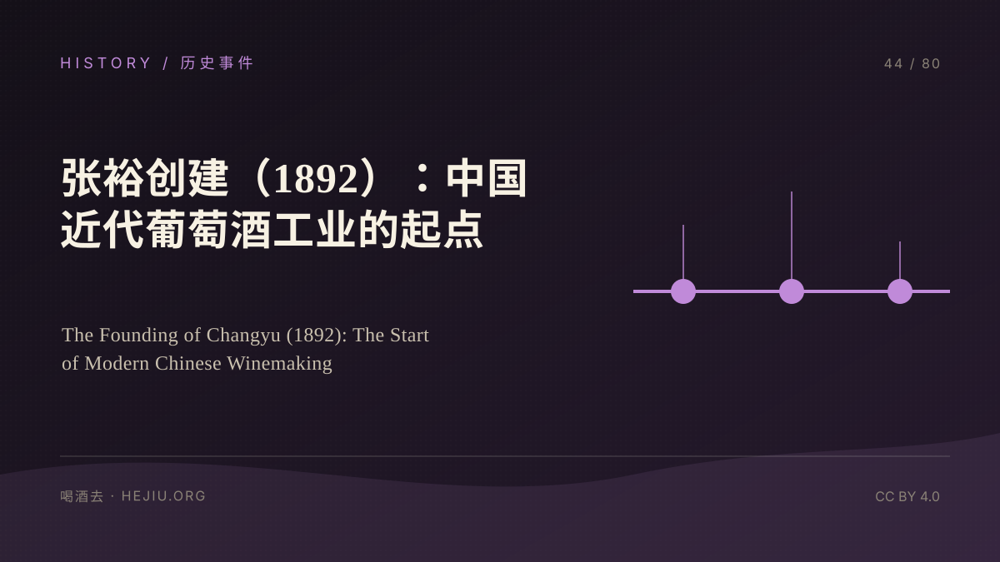

# 张裕创建（1892）：中国近代葡萄酒工业的起点

1892 年，南洋华侨张弼士投资 300 万两白银，在山东烟台芝罘湾畔创办张裕酿酒公司。它被普遍视为中国近代工业化葡萄酒生产的起点：不是一间传统酒坊的扩建，而是一家按工业化方式引种、建窖、聘请酿酒师、组织生产与销售的新式企业。

图：张裕创建（1892）：中国近代葡萄酒工业的起点栏目示意图。项目自产或类别插图，用于酒庄与酒类场馆语境，不是该对象的实拍。

## 时间与地点

创办年份是 1892 年，地点是山东烟台。烟台的海洋性气候、花岗岩风化土壤与港口条件，被张弼士视为适合酿酒葡萄种植与出口的组合。1891 年，他借到烟台商讨铁路与矿山事宜的机会，顺道考察当地的葡萄种植与土壤水文，次年决定投资设厂。

需要区分三个时间点：1892 年是公司创办年；1899 年是公司口径下的首次出酒年；1894 至 1905 年是地下大酒窖的建造周期。把“创办”等同于“投产”，会让时间线失真。

## 背景：晚清的实业与葡萄酒

19 世纪末，清政府在洋务与实业思潮推动下鼓励办厂，沿海通商口岸出现了新的工业门类。葡萄酒是其中之一：它既面向在华外国人与传统黄酒之外的消费群体，也被视为可以替代进口、挽回利权的产业。

当时中国已有零星的葡萄酿酒尝试，多为教会、外资或小规模作坊；张裕的意义在于把种植、酿造、陈贮、销售组织成一家公司，并以工业化标准建设酒窖与引进酿酒师。这一模式与传统的“前店后坊”不同，更接近近代企业的垂直整合。

## 经过：从考察到创办

张弼士的创办过程带有强烈的个人色彩。据张裕酒文化博物馆的叙述，他在 1891 年到烟台考察后，认定当地具备种植酿酒葡萄与酿造葡萄酒的天然条件；1892 年，他拿出 300 万两白银，创办中国历史上第一家葡萄酿酒公司。

公司成立后遇到的第一道难题是原料。创建初期，张裕从欧洲引种了 124 个品种、69 万株苗木，但因水土不服大量死亡；第二年更换采购来源仍然失败；第三年改用与烟台当地山葡萄嫁接的办法，才培育出适应本地风土的酿酒葡萄。三次引种的说法来自企业自身的记录，具体品种名单与存活率需要原始档案才能核实。

第二道难题是人。张弼士曾重金聘请外国酿酒师：第一位来自英国，途中因拔牙不治身亡；第二位来自荷兰，工作两年后被认定不符合要求；最后由奥匈帝国驻烟台副领事巴保男爵出任首任酿酒师。这段“三请酿酒师”的故事在企业叙事中被反复讲述，细节带有传奇色彩，但反映了当时中国缺乏现代酿酒技术人才的现实。

## 建厂：苗、师、窖

张裕的早期建设可以概括为“苗、师、窖”三件事。

“苗”是葡萄品种与苗木。引种、失败、再引种、最后以嫁接适应当地风土，构成了中国近代酿酒葡萄栽培的早期实验。今天山东烟台产区的部分品种谱系，可以追溯到这批引种与选育。

“师”是酿酒技术。巴保男爵带来的不仅是发酵与陈酿技术，还有酒窖设计、温湿度管理与卫生标准；这些内容在传统黄酒作坊中没有对应经验。

“窖”是地下大酒窖。公司资料称，1894 至 1905 年，从土法挖掘到洋法改建，再到中西合璧，历时 11 年建成亚洲首座地下大酒窖。酒窖的意义不只是储酒，它决定了陈酿的温湿度稳定性，也是工业化生产与作坊生产的分水岭。

## 影响：近代葡萄酒工业的起点

第一，它建立了“公司 + 酒窖 + 酿酒师”的组织模板。此后的中国葡萄酒企业，大多沿着引种、建窖、聘师、创品牌的路径展开。

第二，它把烟台推上中国葡萄酒产区的版图。张裕的葡萄基地与酒窖集中在烟台，使这座港口城市成为近代葡萄酒工业的地理原点；今天烟台的葡萄酒旅游与产区叙事，仍以此为基础。

第三，它改变了“第一”的叙述方式。1899 年出酒、1914 年产出白兰地、1915 年在巴拿马太平洋博览会获大金奖，这些节点被企业整理成一条连续的时间线，成为国货叙事的样板。

第四，它留下了可供参观的工业遗产。1992 年，张裕在老厂区开放酒文化博物馆，把企业史、酒窖与品鉴转化为公共文化空间；博物馆与老厂区共同构成烟台葡萄酒工业遗产的核心。

## 史料与争议

第一，“中国第一家葡萄酒企业”需要口径限定。张裕是近代第一家以工业化方式组织生产的葡萄酒公司，但晚清已有外资、教会与小规模酿酒尝试；“第一家”指的是工业化企业，不是“第一瓶葡萄酒”。

第二，创办年与投产年不应混用。企业以 1892 年为创办年，但首次出酒在 1899 年；把 1892 年说成“开始出酒”，或把 1899 年说成“创办”，都会造成时间线错误。

第三，300 万两白银与引种数字来自企业叙事。馆方与公司公开资料提供了这些数字，但原始账册、苗木清单与存活率尚未公开；本页采用这些数字时注明来源，不把它们当作独立审计后的结论。

第四，1915 年奖项的类别需要准确。张裕在巴拿马太平洋博览会获得的是最高等级的大金奖（GRAND PRIZE），不是泛称的“金奖”；奖项细节见本站 1915 年巴拿马太平洋博览会页。

第五，企业叙事容易把“第一”绝对化。中国葡萄酒工业是多家企业、外资与地方作坊共同演化的结果；张裕的起点意义成立，但不应抹去同期其他尝试。

## 时间线

- 1891：张弼士到烟台考察葡萄种植与土壤水文。
- 1892：投资 300 万两白银，创办张裕酿酒公司。
- 1894：地下大酒窖开始建造。
- 1899：公司口径下的首次出酒。
- 1905：地下大酒窖建成。
- 1914：产出白兰地。
- 1915：在巴拿马太平洋博览会获大金奖。
- 1992：张裕酒文化博物馆在老厂区开放。

## 延伸阅读

- [张裕葡萄酒](ref:changyu-wine)：品牌与产品线的当前介绍。
- [张裕酒文化博物馆](ref:changyu-museum)：老厂区改造的工业遗产空间。
- [1915 年巴拿马太平洋博览会](ref:panama-1915)：奖项类别与参展背景。
- [中国酒史](ref:chinese-wine-history)：从传统酒坊到近代工业的连续叙述。
- [中国](ref:china)：中国酒类的产区与品类背景。

相关条目：[中国](ref:china)、[张裕葡萄酒](ref:changyu-wine)、[张裕酒文化博物馆](ref:changyu-museum)。
