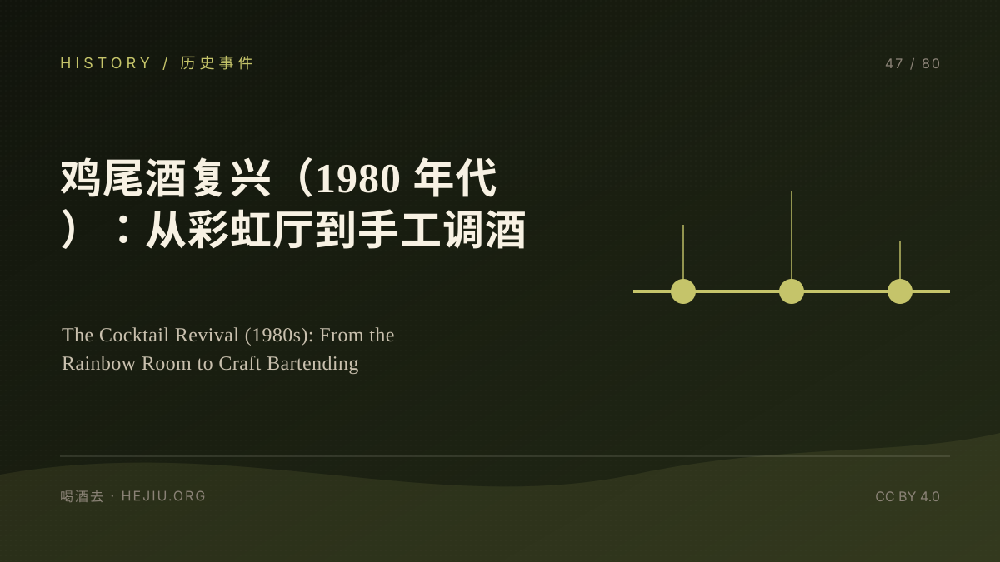

# 鸡尾酒复兴（1980 年代）：从彩虹厅到手工调酒

1970 年代的鸡尾酒市场被甜味预调与迪斯科文化占据，古典配方退到背景。1987 年，戴尔·德格罗夫（Dale DeGroff）在纽约彩虹厅重新开业时回到杰里·托马斯 1862 年的做法：鲜榨果汁、现做糖浆、大块冰与克制的酒单。这场以“把经典做对”为口号的复兴，后来演变为 1990 年代的手工调酒运动。

图：鸡尾酒复兴（1980 年代）：从彩虹厅到手工调酒栏目示意图。项目自产或类别插图，用于酒吧与酒类语境，不是该对象的实拍。

## 背景

1970 年代的酒吧追求速度与视觉：瓶装酸甜液、彩色利口酒、糖浆与果汁粉被大量使用，鸡尾酒变成“冷、甜、快”的饮品。古典配方仍在印刷物中流传，但很少被严格执行；冰块多为碎冰或小方冰，稀释速度快，风味层次被压平。与此同时，迪斯科文化把酒吧变成音乐与社交场所，调酒的表演性增强，技术标准反而下降。到了 1980 年代，随着餐饮业升级、进口烈酒增加与消费者对品质的兴趣回升，一批调酒师开始重新翻阅旧手册，寻找被遗忘的配方与方法。

## 经过与时间线

- 1862 年：杰里·托马斯出版《How to Mix Drinks》，成为古典鸡尾酒配方的重要源头。
- 1951 年：国际调酒师协会（IBA）成立，逐步建立跨国比赛与教育网络。
- 1970 年代：甜味预调、彩色利口酒与迪斯科饮品盛行，古典配方退居次要位置。
- 1987 年：纽约洛克菲勒中心 30 Rock 65 层的彩虹厅（Rainbow Room）重新开业，德格罗夫在餐饮经营者乔·鲍姆（Joe Baum）安排下主持 Rainbow Promenade 酒吧，恢复被遗忘的古典鸡尾酒。
- 1980 年代末至 1990 年代：鲜榨果汁、现做糖浆、苦精收藏、手工冰块与 speakeasy 风格空间从个别酒吧扩散为一种方法。
- 1999 年：萨沙·佩特拉斯基（Sasha Petraske）在纽约开设 Milk & Honey，以预约制、安静空间与严格出品影响后来的手工酒吧。
- 2002 年：德格罗夫出版《The Craft of the Cocktail》，把这些做法写成可传授的框架。
- 2000 年代以后：手工调酒进入更多城市，同时出现价格上升、风格同质化与“手工”标签滥用的问题。

## 关键人物与机构

德格罗夫是复兴最常被提及的人物：他 1970 年代入行，1980 年代末在彩虹厅实践，后来以作者、讲师与比赛评委的身份推动手工调酒。乔·鲍姆是彩虹厅重开的推动者，他要求德格罗夫研究杰里·托马斯 1862 年的手册，为配方重建提供了入口。杰里·托马斯是古典配方的象征性源头；萨沙·佩特拉斯基则把 speakeasy 的空间与服务体系化。机构方面，彩虹厅与洛克菲勒中心提供了高可见度的舞台，IBA 提供了跨国比赛与官方名单，出版与餐饮投资则把方法扩散到更多城市。

## 对酒业的具体改变

第一，配方知识回流。杰里·托马斯 1862 年的手册被重新引用，古典配方重新成为可以讨论的标准，而不是菜单上的装饰名。第二，原料标准上移。鲜榨果汁、现做糖浆与冰块质量成为评价酒吧的指标，预调产品退到次级位置。第三，职业身份变化。调酒师开始以作者、讲师与比赛选手的身份出现，调酒从服务岗位变成一门可展示的手艺。第四，城市夜生活与空间设计。speakeasy 风格的酒吧带动了照明、家具、酒单与音乐的一整套审美。第五，烈酒市场结构变化。手工调酒对威士忌、金酒、朗姆与苦精的品质提出更高要求，推动进口与高端产品增长。第六，价格与消费分层。手工鸡尾酒的价格显著高于普通混合饮品，形成了以城市中产与游客为主的消费群。

## 争议与后续评价

第一，“1980 年代复兴”是概括。不同城市的起点不同，纽约彩虹厅有较明确的年份，伦敦与欧洲其他城市的节点需要分别核对，不能用一个年份概括全部。第二，德格罗夫的个人叙事被媒体放大。调酒学校与场地运营方的文章都强调他的作用，但复兴同时依赖进口烈酒、酒吧投资、出版与比赛，不是单一个人完成的。第三，谁先恢复古典配方难以定论。IBA 的官方名单在 20 世纪后期也在整理经典，欧洲与日本的酒吧各有自己的传承，把起点归给某一间酒吧会过度简化。第四，年代与头衔需要区分。公开报道把彩虹厅重开记在 1987 年，而“King Cocktail”是后来的媒体称号，不是 1987 年当时的身份。第五，后续评价分化：有人认为复兴提升了技术与原料标准，也有人批评它制造怀旧消费、抬高价格并滥用“手工”标签。

## 常见误读

第一，复兴不是发明新鸡尾酒，而是重新做对既有经典；[古典鸡尾酒](ref:old-fashioned)、[干马天尼](ref:dry-martini)与[玛格丽特](ref:margarita)都是被重做的对象。第二，不是德格罗夫一个人完成了复兴，他更像一个高可见度的实践者与传播者。第三，1987 年不是唯一的起点，伦敦、旧金山、东京等地各有自己的时间线。第四，手工调酒不等于“越复杂越好”，克制的酒单与稳定的出品同样重要。第五，speakeasy 风格是对禁酒时代的想象性再造，而不是对历史空间的直接复原。

## 另见

- [国际调酒师协会成立（1951）](ref:iba)：跨国网络与官方名单的来源。
- [戴尔·德格罗夫](ref:degroff)：复兴的核心人物。
- [杰里·托马斯](ref:jerry-thomas)：1862 年手册与古典配方的起点。
- [古典鸡尾酒](ref:old-fashioned)、[干马天尼](ref:dry-martini)、[玛格丽特](ref:margarita)：复兴中最常被重做的几杯。
- [美国](ref:usa)、[英国](ref:uk)：复兴的主要城市背景。
- [酒馆史](ref:taverns)：酒吧空间的长时段变化。

对照阅读：[美国](ref:usa)、[国际调酒师协会成立（1951）：七个协会的圆桌](ref:iba)。

**关键事实。**

| 项目 | 内容 |
| --- | --- |
| 一句话定位 | 1970 年代的鸡尾酒市场被甜味预调与迪斯科文化占据，古典配方退到背景；1987 年，戴尔·德格罗夫在纽约彩虹厅重新开业时回到杰里·托马斯 1862 年的做法：鲜榨果汁、现做糖浆、大块冰与克制的酒单 |
| 时间 | 1980 年代，重点为 1987 年至 2002 年 |
| 地点 | 美国、英国 |
| 历法 | 公历 |

**来源与边界。** 本页关于「鸡尾酒复兴（1980 年代）：从彩虹厅到手工调酒」的关键事实，主要由以下来源交叉核对：Rockefeller Center（1987 年德格罗夫参与彩虹厅重开、在 30 Rock 65 层主持 Rainbow Promenade 酒吧并恢复被遗忘的鸡尾酒；属场地运营方的采访稿）、European Bartender School（交叉核对德格罗夫在 1970 年代入行、1980 年代末至 1990 年代在彩虹厅实践、以及“King Cocktail”称号的来源；属调酒学校的介绍文章）、Dale DeGroff（作者身份、著作与教学信息；未复制配方）等 6 条来源。价格、批次与状态会变，涉及这些字段时以页面所列来源的最新版本为准。正文为项目自写，来源只作核验，不复制原文。
