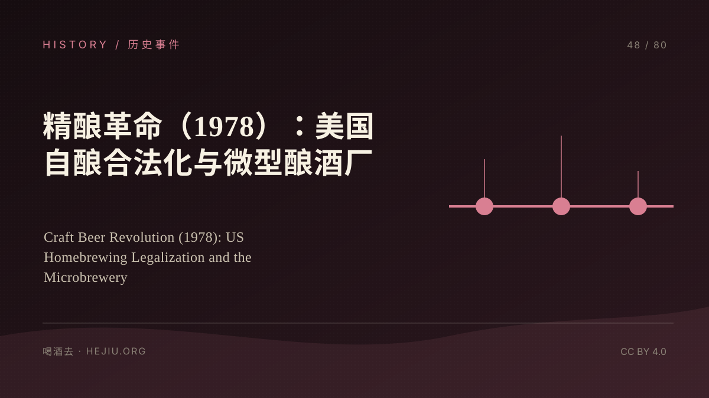

# 精酿革命（1978）：美国自酿合法化与微型酿酒厂

1978 年 10 月 14 日，美国总统吉米·卡特签署 H.R. 1337 税法案。这部法案的主体内容是调整商用车与公共交通的消费税，但其中夹带的一条修正案取消了家庭自酿啤酒的联邦消费税；1979 年 2 月 1 日，这条规定正式生效。此后，家庭酿酒在美国重新成为合法的个人活动，家庭酿酒者、设备商店与小酒厂相互喂养，最终汇成通常被称为“精酿革命”的产业转向。

图：精酿革命（1978）：美国自酿合法化与微型酿酒厂栏目示意图。项目自产或类别插图，用于啤酒语境，不是该对象的实拍。

## 时间与地点

法案在白宫签署，联邦层面的生效日期是 1979 年 2 月 1 日。但“联邦合法”并不等于“处处合法”：美国的酒类管理主要落在各州，许多州直到更晚才修改自己的法律。真正让家酿在全美 50 个州都合法的，是 2013 年亚拉巴马与密西西比的立法。就产业地理而言，这场转向的早期样本集中在旧金山与加州北部的索诺马、奇科一带：1965 年旧金山的蒸汽啤酒厂被重新激活，1976 年索诺马出现第一家从零建起的微型酿酒厂，1980 年奇科的内华达山脉酿酒公司开业。

## 背景：禁酒令之后被遗漏的家庭酿造

1919 年，美国宪法第十八修正案获批，随后进入禁酒时期，制造、销售与运输酒精饮料都被禁止，家庭酿啤酒也在其中。1933 年第二十一修正案废除禁酒令，商业酿酒恢复，但立法给家庭酿葡萄酒留出了空间，却没有给家庭酿啤酒同等的免税待遇。家庭酿啤酒因此在很长时间里处于一种尴尬状态：它未必被刑事追究，却始终缺少明确的联邦税收豁免，设备与原料的流通也受限制。

20 世纪 60 至 70 年代，美国的啤酒市场高度集中，口味趋于一致。1965 年，弗里茨·梅塔格（Fritz Maytag）购入旧金山一家濒临倒闭的蒸汽啤酒厂 51% 的股份，后来把它经营成 Anchor Brewing；他改进卫生、设备与工艺，让蒸汽啤酒重新稳定下来。1976 年，曾在海军核工程领域工作的杰克·麦考利夫（Jack McAuliffe）在索诺马创办新阿尔比恩（New Albion），它被史密森学会的收藏说明称为美国第一家从零建起的微型酿酒厂。与此同时，家庭酿酒者在地下室里互相交换配方，设备商店与俱乐部开始出现。

## 经过：H.R. 1337 与克兰斯顿—施泰格修正案

真正推动家酿合法化的，是加州参议员艾伦·克兰斯顿（Alan Cranston）与威斯康星州众议员威廉·施泰格（William Steiger）。两人把一条修正案挂到 H.R. 1337 上，要求把家庭酿造啤酒与家庭酿造葡萄酒同等对待。修正案的核心不是“允许酿造”，而是“免除联邦消费税”：成年人为个人或家庭使用而酿造啤酒，不再被当作应税生产。

法案给联邦豁免设了上限：每人每年 100 加仑（约 379 升），每户每年 200 加仑（约 757 升）。1978 年 12 月 7 日，查理·帕帕齐安（Charlie Papazian）与查理·马岑（Charlie Matzen）在科罗拉多州博尔德创办美国家庭酿酒者协会（American Homebrewers Association，AHA），并出版第一期《Zymurgy》杂志。协会随后成为家酿者、设备商与小型酒厂之间的组织节点。

## 影响/制度：从家庭厨房到小型酒厂

第一，知识扩散。家酿把配方、温控、卫生与装瓶变成可以家庭操作的流程；设备商店则把原来属于工厂的原料与器材拆成小包装出售。AHA 的刊物与比赛让分散的实践者形成共同体。

第二，小型酒厂的模板。新阿尔比恩只存在了几年，却证明了“小规模、独立所有、以风味而非产量为先”的模式可行。1980 年，肯·格罗斯曼（Ken Grossman）在奇科用回收的乳品设备拼出酿酒车间，创办内华达山脉酿酒公司。按他在《Beyond the Pale》中的说法，1980 年是美国啤酒业的低点，全国只剩约 40 家传统啤酒厂。

第三，州级制度的补课。联邦免税只是第一步，各州仍可禁止或限制家酿。AHA 把州级合法化当作长期任务，逐州推动；直到 2013 年，亚拉巴马与密西西比才完成最后两块拼图。

第四，产业结构的反转。家酿者变成小酒厂主，小酒厂再带动酒花、麦芽、酵母与包装的细分市场。到 21 世纪，精酿成为美国啤酒业中增长最快的一段，并反过来影响中国等海外市场。

## 史料与争议

第一，“卡特让家酿合法”是简化说法。卡特签署的是包含大量税务条款的综合法案，家酿条款由克兰斯顿与施泰格推动；把功劳全部记在总统身上，会遮住国会修正案的实际作用。

第二，1978 与 1979 常被混用。签署日是 1978 年 10 月 14 日，联邦生效日是 1979 年 2 月 1 日；两个日期都能在资料中找到，但指的不是同一件事。

第三，“第一家微型酿酒厂”的归属取决于定义。新阿尔比恩常被称为第一家“从零建起”的微型酒厂；Anchor 则是一家历史更早、被重新救活的酒厂。把两者混为一谈，会得出不同的“第一”。

第四，家酿与精酿的因果关系被夸大。家酿合法化确实提供了人与知识的入口，但精酿的兴起还依赖州法、税收、设备供应链与消费口味的变化，不能归因于单一法案。

第五，来源多为行业协会与企业自述。AHA 与酒厂都有推广自身历史的动机；关于 1978 年立法的细节，最好与国会记录、税法条文交叉核对。

## 时间线

- 1919：第十八修正案获批，禁酒时期开始，家酿被禁。
- 1933：第二十一修正案废除禁酒令，商业酿酒恢复，家酿啤酒仍缺联邦豁免。
- 1965：弗里茨·梅塔格购入旧金山蒸汽啤酒厂 51% 的股份。
- 1976：新阿尔比恩在索诺马开业，被视为第一家从零建起的微型酿酒厂。
- 1978：10 月 14 日签署 H.R. 1337；12 月 7 日 AHA 成立。
- 1979：2 月 1 日联邦家酿豁免生效。
- 1980：内华达山脉酿酒公司在奇科开业。
- 2013：亚拉巴马与密西西比完成州级合法化，全美 50 个州均有家酿法律。

## 延伸阅读

- [美国禁酒令](ref:prohibition)：家酿为何在 20 世纪大部分时间里失去合法空间。
- [2015 年前后的中国精酿啤酒兴起](ref:craft-cn)：同一套“小规模、重风味”的逻辑在另一个市场出现。
- [啤酒](ref:beer)：从工业拉格到精酿的风格背景。
- [美国](ref:usa)：联邦与州分层管理酒类的制度背景。
- [酒馆史](ref:taverns)：啤酒消费空间的长时段变化。

相关条目：[美国](ref:usa)、[啤酒](ref:beer)、[美国禁酒令：1920年至1933年的实验与废止](ref:prohibition)。

## 相关图像

图：美国禁酒令时期，执法人员将酒桶中的酒倒入下水道。。图片：Unknown author，Public domain，via Wikimedia Commons（[原图页面](https://commons.wikimedia.org/wiki/File:5_Prohibition_Disposal(9).jpg)）。关联图像：精酿革命（1978）：美国自酿合法化与微型酿酒厂。
