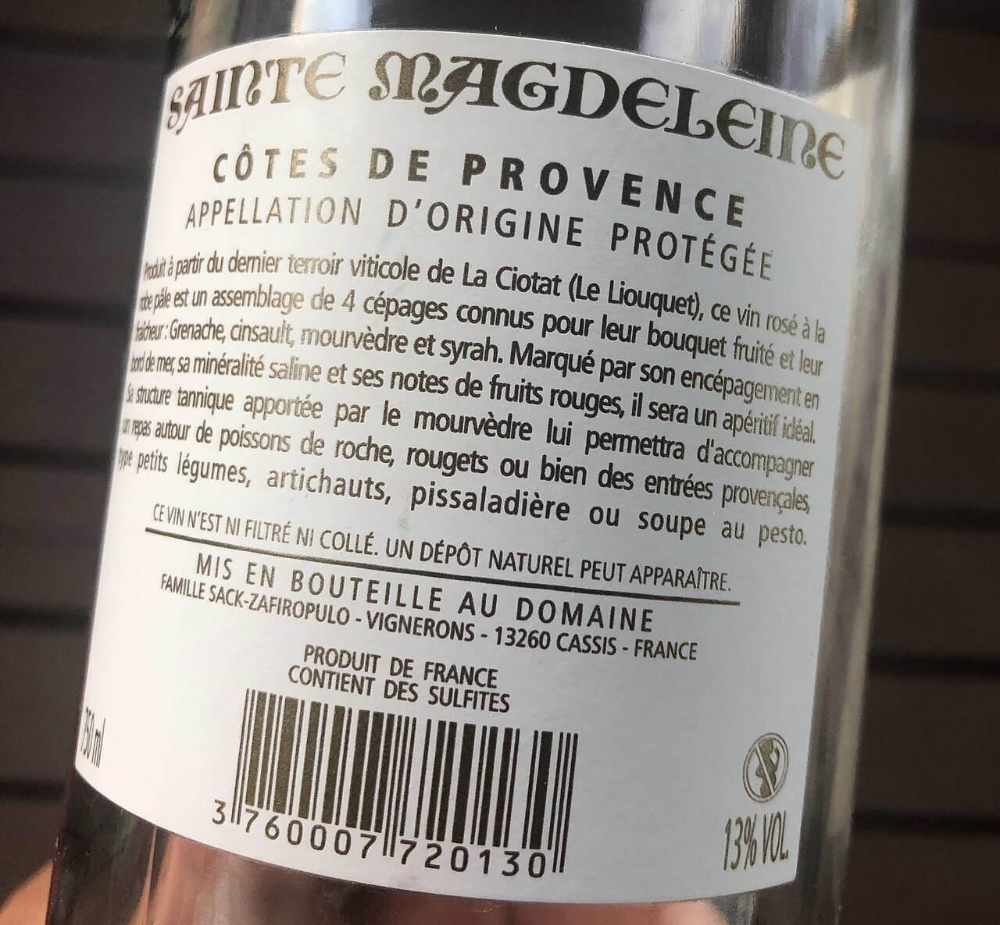

# 2015 年前后的中国精酿啤酒兴起

2015 年前后，精酿啤酒在中国从一个很小的圈层走向更多城市。小型酒厂、前店后厂、精酿酒吧与啤酒节陆续出现，国产厂牌与进口精酿并存。它不是一次统一规划的运动，而是由从业者、消费者与城市商业空间共同推动的分散生长。把它称作“兴起”而非“发明”更准确，因为家酿社群、进口酒商和小型酒厂在此前已经积累了多年。

图："2015 年前后的中国精酿啤酒兴起"的地域背景配图。图片：Jiong Sheng，CC BY-SA 2.0，via Wikimedia Commons（[原图页面](https://commons.wikimedia.org/wiki/File:ShaoxingXianheng.jpg)）。这张照片用于说明"2015 年前后的中国精酿啤酒兴起"所涉事件发生地的环境，不是该事件的现场记录。

## 背景

中国啤酒市场长期以大厂标准化的淡色拉格为主，口味单一、价格低，渠道由少数全国品牌和区域品牌控制。2013 年，全国啤酒产量达到 5061.5 万千升，创下阶段高点；2014 年产量同比下降 0.96%，是十年来的首次下降。总量见顶之后，行业开始寻找新的增长点。与此同时，城市中产与年轻消费者对风味多样性的需求上升，进口精酿、家酿酒馆和国外啤酒书籍提供了最初的样本。[美国](ref:usa)的精酿运动通过比赛、媒体和社交网络传入，美国酿酒商协会“小型、独立、传统”的定义也被广泛引用。

精酿啤酒的进入门槛相对较低：小设备、小场地即可起步，前店后厂还能直接面向消费者。这使它可以绕开传统大经销商体系，但也带来许可、税收、消防与食品安全管理的复杂性。

## 经过与时间线

- 2008 年：高岩在南京成立本土精酿工厂“欧菲啤酒”，被视为中国精酿的早期实践之一。
- 2010 年：大跃啤酒在北京豆角胡同开出第一家门店，强调本地原料与中式风味。
- 2011 年：高岩出版啤酒入门书籍，家酿与精酿知识开始系统传播。
- 2012 年：南京高大师啤酒有限公司成立；京 A 等北京厂牌开始进入市场。
- 2013 年：熊猫精酿在北京创立，国产精酿厂牌数量增加。
- 2015 年：媒体与资本关注明显上升；10 月新修订的《食品安全法》施行，食品生产许可（SC）制度对小型生产者提出更明确的要求；全年进口啤酒 53.83 万千升，同比增长约 59%。
- 2016—2019 年：精酿酒吧、啤酒节和国产厂牌继续增加，部分大厂推出精酿风格产品线。
- 2020 年以后：疫情、成本上升与竞争加剧，行业进入开店的同时伴随关店与并购的调整期。

## 关键人物与机构

高岩是最常被提到的早期推动者之一，他的工厂、著作和培训影响了大量从业者。大跃啤酒、熊猫精酿、京 A、牛啤堂等厂牌分别代表了北京、南京等城市的实践路径。行业组织方面，中国酒业协会与各地啤酒协会提供统计、标准与交流平台；国家统计局与海关总署提供产量和进口数据；地方市场监管部门负责生产许可与食品安全。美国酿酒商协会的定义与比赛，则提供了跨国参照。

## 对酒业的具体改变

第一，丰富了啤酒的风味选择。IPA、小麦啤、酸啤、世涛等风格进入普通消费者的视野，让“啤酒不只有一种味道”成为可体验的事实。第二，改变了饮酒空间。精酿酒吧强调品尝、交流与本地社区，区别于传统大排档与夜场，前店后厂把生产与消费放在同一空间。第三，推动了本土原料与风味实验，茶、花椒、水果、蜂蜜入啤，形成“中式精酿”的探索。第四，给监管提出新问题：小型生产许可、跨区域销售、标签与酒精度标示都需要适配。第五，推动大厂产品结构升级，部分全国品牌推出白啤、IPA 和精酿风格产品线。第六，为后来的国产精酿品牌、出口和啤酒旅游打下基础。消费者若要理解这些变化，可以结合[怎么看酒标](ref:read-label)阅读风格、酒精度与产地信息。

## 争议与后续评价

第一，规模数据。精酿啤酒没有独立的官方统计，常见市场规模数字来自行业机构或研究公司估算，口径差异很大；2015 年的“精酿占比”常被引用，但难以复核。第二，“精酿”定义之争。美国酿酒商协会把“小型”定为年产量不超过 600 万桶，“独立”定为非酒类企业持股低于 25%，但中国从业者对其适用性有不同看法。第三，兴起时间的叙述。把 2015 年当作起点会忽略更早的家酿社群与小酒厂；它更像一个加速点，而不是零起点。第四，成败样本。媒体多报道成功品牌，倒闭与转让的案例较少被记录，容易造成幸存者偏差。第五，后续评价分化：有人认为精酿推动了啤酒高端化与风味教育，也有人认为它被资本和“手工”标签包装，价格与真实价值脱节。

## 常见误读

第一，精酿不等于进口或高价。国产小型酒厂同样属于精酿，价格高低取决于原料、规模与渠道。第二，2015 年不是“从零开始”。2008 年以后已有工厂、家酿社群和进口酒商，2015 年是媒体与资本集中的节点。第三，精酿不等于“所有小厂都好喝”，规模小不保证质量，设备、卫生与稳定性同样重要。第四，精酿也不等于“必须独立”。被大厂收购的品牌是否仍算精酿，取决于采用的定义，而不是单一道德判断。第五，中国没有一部统一的“精酿啤酒法”，相关要求分散在食品安全、生产许可、广告与税收规定中。

## 另见

- [中国](ref:china)：精酿啤酒的主要市场。
- [啤酒](ref:beer)：精酿所属的酒类风格。
- [美国](ref:usa)：精酿运动的重要参照市场。
- [怎么看酒标](ref:read-label)：阅读啤酒标签上的风格、酒精度与产地信息。

对照阅读：[中国](ref:china)、[美国](ref:usa)。

**关键事实。**

| 项目 | 内容 |
| --- | --- |
| 一句话定位 | 2015 年前后，中国精酿啤酒从一线城市的小酒馆与小型酒厂扩展到更多城市，前店后厂、啤酒节与国产厂牌增多；本文说明其背景、形态、监管条件与规模争议 |
| 时间 | 2015 年前后 |
| 地点 | 中国 |
| 历法 | 公历 |

**来源与边界。** 本页关于「2015 年前后的中国精酿啤酒兴起」的关键事实，主要由以下来源交叉核对：中国酿酒工业协会（精酿啤酒的统计口径与行业描述）、国家统计局（规模以上啤酒企业的产量变化）、新华网（精酿酒吧、啤酒节与小酒厂的出现）等 9 条来源。价格、批次与状态会变，涉及这些字段时以页面所列来源的最新版本为准。正文为项目自写，来源只作核验，不复制原文。

## 相关图像

图：普罗旺斯葡萄酒背标，产地、等级、酒精度与装瓶信息都在这里。图片：Wiki.cullin，CC BY-SA 4.0，via Wikimedia Commons（[原图页面](https://commons.wikimedia.org/wiki/File:Wine_Label_-_Back_of_Bottle_-_Sainte_Magdeleine_-_Cotes_de_Provence.jpg)）。关联图像：2015 年前后的中国精酿啤酒兴起。
