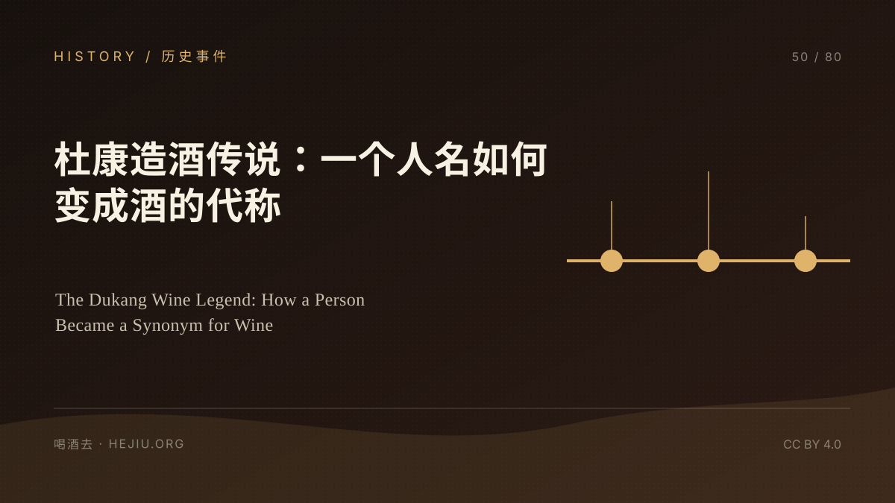
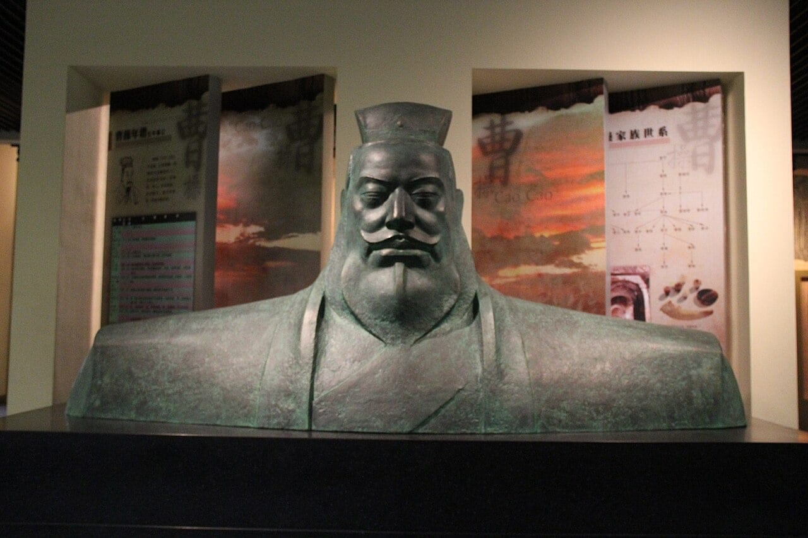

# 杜康造酒传说：一个人名如何变成酒的代称

杜康是另一条酿酒起源传说的主角。东汉《说文解字》说他“作秫酒”，又说“少康，杜康也”；曹操《短歌行》写下“何以解忧，唯有杜康”，让这个名字成了酒的代称。但杜康是谁、属于哪个时代、在哪里造酒，从汉代到今天都没有一致答案。传说提供的是酒祖形象，不是可以断代的人物传记。

图：杜康造酒传说：一个人名如何变成酒的代称栏目示意图。项目自产或类别插图，用于中国酒文化语境，不是该对象的实拍。

## 时间与地点

关于杜康的时代，至少有四种说法：黄帝的宰人、夏代少康、东周人、汉酒泉太守。洛阳地方报刊的梳理文章把这四种说法并列，并指出“黄帝宰人”说文献晚出，清代段玉裁已批评它“为戏之言，未可为典要”。其中影响最大的是“杜康即少康”说，依据是《说文解字·巾部》“少康，杜康也”一句。

地点同样分裂。河南汝阳一带的地方传统把杜康造酒处定在杜康河畔的杜康村，并引《水经注·伊水》的“康水”与《大元一统志·杜康庙》为证；陕西白水的传统则称杜康字仲宁、汉时人，依据是清乾隆四十八年（1783）的《杜公祠碑》。两套说法都建立在晚出的地方文献上，无法互相证实。本页因此只把地点写作“传说地点”，不给坐标。

## 背景：秫酒与“酒祖”

“秫”是黏性的谷物，古书中多指黏粟，也有人释为黏高粱；具体所指本身有分歧。“秫酒”即用这类谷物酿成的酒，属于粮食酒，不是果酒。粮食中的淀粉要先糖化再发酵，工艺比果汁自然发酵复杂，因此谁“始作秫酒”在古人的发明名单里格外显眼。

《世本·作篇》说“少康作秫酒”，《说文解字·酉部》说“杜康作秫酒”，两条材料都把功劳放在同一个人身上。《说文解字·巾部》进一步写“古者少康初作箕帚、秫酒。少康，杜康也”，把两个名字合并。这个合并发生在东汉，距夏代已远，属于后人的历史解释，不是同时代记录。

## 文献里的杜康

| 文献 | 成书年代 | 相关文字 | 它说明了什么 |
| --- | --- | --- | --- |
| 《世本·作篇》 | 战国末至汉初，原书已佚 | “少康作秫酒” | 把秫酒归给少康 |
| 《说文解字·酉部》 | 东汉 | “杜康作秫酒” | 直接用杜康之名 |
| 《说文解字·巾部》 | 东汉 | “少康，杜康也” | 合并两个名字 |
| 《短歌行》 | 汉末 | “何以解忧，唯有杜康” | 以人名代指酒 |
| 《酒诰》 | 晋 | “或云仪狄，一曰杜康” | 仪狄、杜康两说并存 |

从表格可以看出，杜康的名声有很大一部分来自文学。曹操的诗把“杜康”变成酒的代称，后世读诗的人先记住这个名字，再去追他的时代。文学传播与史实考证在这里是两条线，不能互相替代。

## 影响：从酒祖到地名与品牌

杜康被后世尊为“酒祖”，酒坊与酒业行会把他当作祖师供奉。宋代朱翼中《北山酒经》仍写“仪狄作酒醪，杜康作秫酒”，说明这组搭配在酒书传统里长期沿用。

到了近现代，杜康又成为地方文化资源。陕西白水的杜康酒在 1975 年恢复生产，当地把传说、祠碑与酿造工艺合并成一套地方叙事；河南汝阳、伊川一带也以杜康故里自居。这些叙事对地方产业有帮助，但其中的历史部分需要分别核对，不能把品牌故事当成文献证据。

曹操的诗则提供了另一种影响。见[短歌行](ref:duan-ge-xing)与[曹操](ref:cao-cao)可以看到，酒在诗里承担了解忧与求贤的双重含义；当“杜康”被用作酒的代称，人名与酒名就再也分不开了。

## 史料与争议

第一，杜康与少康是否为同一人，只有东汉《说文解字》的一条合并说法。先秦材料只提“少康作秫酒”，没有出现“杜康”；把两者等同，是汉人的整理。

第二，时代矛盾明显。《说文解字》指向夏代，白水《杜公祠碑》却称杜康为“汉时人”，两者相差一千多年。地方碑刻属于清代重修传统，不能用来校正东汉字书。

第三，造酒地点无法判定。汝阳说依靠《水经注》与《大元一统志》的转引，白水说依靠清代碑刻，都是晚出材料；两地的水系、村落与庙宇可以实地考察，但“杜康在此造酒”仍是传说。

第四，考古证据不支持“某一个人首创粮食酒”。贾湖遗址 1984 年至 2001 年出土的陶器，经 1999 年开始的残留物分析，在 2004 年的论文中被判定为公元前 7000 年左右的稻米、蜂蜜与果实混合发酵饮料。夏代二里头文化已有酒器与酒礼，但那是长期积累的结果，不是单点发明。

第五，现代研究对“杜康用曲”的技术解释属于推论。有文章认为杜康的最大贡献是掌握人工培植曲糵，但从传说人物直接推到具体技术发明，中间缺少实物与文字链条。

## 时间线

- 约公元前 7000 年：贾湖遗址出现混合发酵饮料。
- 传说的夏代：少康（一说即杜康）被记为“作秫酒”。
- 战国末至汉初：《世本·作篇》记“少康作秫酒”。
- 东汉：《说文解字》写“杜康作秫酒”，并称“少康，杜康也”。
- 汉末：曹操《短歌行》以“杜康”代指酒。
- 晋：江统《酒诰》并列仪狄、杜康。
- 清乾隆四十八年（1783）：白水《杜公祠碑》称杜康字仲宁、汉时人。
- 1975 年：陕西白水恢复杜康酒生产。
- 1984 年至 2001 年：贾湖遗址发掘；1999 年起残留物分析，2004 年论文发表。

对照阅读：[中国](ref:china)、[短歌行：曹操把酒写成了求贤的忧思](ref:duan-ge-xing)。

## 延伸阅读

- [仪狄造酒传说](ref:yi-di)：另一条更早见于文本的酿酒起源传说。
- [短歌行](ref:duan-ge-xing)：曹操把“杜康”写成酒的代称。
- [曹操](ref:cao-cao)：诗的作者与汉末政治背景。
- [黄酒](ref:yellow-wine)：粮食酒的工艺类型。
- [中国](ref:china)：产区与品类背景。

**关键事实。**

| 项目 | 内容 |
| --- | --- |
| 一句话定位 | 东汉《说文解字》记“杜康作秫酒”，又称“少康，杜康也”；曹操《短歌行》的“何以解忧，唯有杜康”让这个名字成了酒的代称 |
| 时间 | 传说时代（一说夏代少康，一说汉时人，无确切年代） |
| 地点 | 中国 |
| 历法 | 传说纪年 |

**来源与边界。** 本页关于「杜康造酒传说：一个人名如何变成酒的代称」的关键事实，主要由以下来源交叉核对：洛阳日报；蔡运章（杜康身份的四说、段玉裁的批评、《世本》与《说文解字》引文、汝阳杜康河一带的传说地点及二里头与藁城材料；该文观点本页按“作者认为”处理）、陕西省非物质文化遗产保护中心；白水县文化馆（白水地方传统、清乾隆四十八年《杜公祠碑》文字、1975 年恢复生产的记述）、中国社会科学网；邸永君（曹操《短歌行》引文、江统《酒诰》与《说文解字》引文）等 6 条来源。价格、批次与状态会变，涉及这些字段时以页面所列来源的最新版本为准。正文为项目自写，来源只作核验，不复制原文。

## 相关图像

图：许昌博物馆的曹操青铜像，背后是曹操生平与家族世系展板。图片：Gary Todd，CC0，via Wikimedia Commons（[原图页面](https://commons.wikimedia.org/wiki/File:Statue_of_Cao_Cao.jpg)）。关联图像：杜康造酒传说：一个人名如何变成酒的代称。
