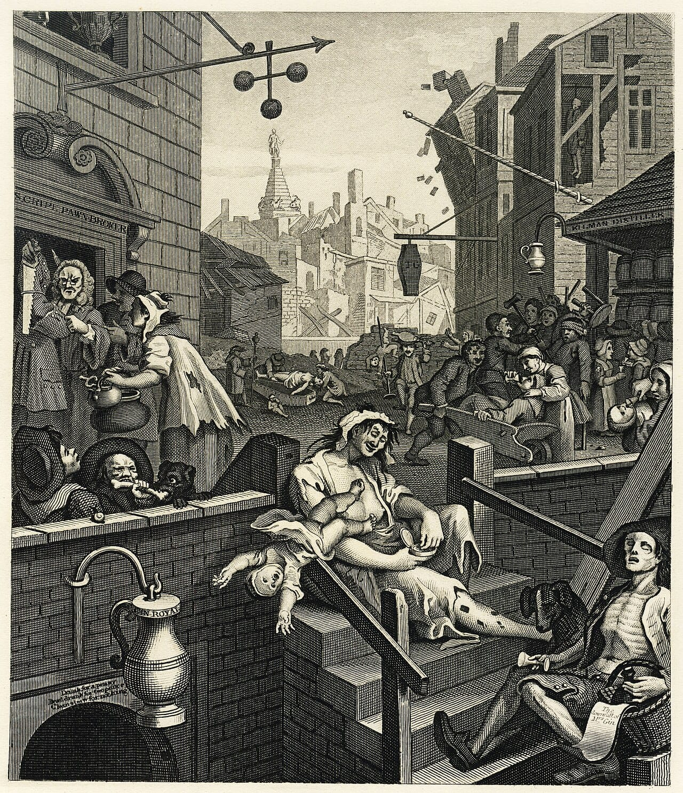

# 金酒热与金酒法：18 世纪英国烈酒危机

18 世纪前半叶的伦敦，廉价金酒在城市贫民区迅速扩散。它比啤酒更烈，比进口烈酒更便宜，又能被小作坊大量生产，因而在谷物价格、战争财政与贫困问题的交织中被放大成一场社会危机。所谓“金酒热”并不是一种酒突然流行那么简单，它同时是税收政策、城市化、贫困救济与道德宣传共同制造的公共议题。1736 年与 1751 年的立法，则是英国国家试图把这种“廉价烈酒”纳入监管的两次关键尝试。

图：霍加斯 1751 年版画《金酒巷》，与《啤酒街》成对出版，正值《金酒法》通过之年。图片：William Hogarth，Public domain，via Wikimedia Commons（[原图页面](https://commons.wikimedia.org/wiki/File:William_Hogarth_-_Gin_Lane.jpg)）。

## 时代背景

金酒在英国的流行与 1688 年后的政治经济环境有关。光荣革命后，英国与法国长期交战，进口法国葡萄酒与烈酒受到限制；政府又希望利用本国谷物蒸馏来增加税收、减少对进口酒的依赖。于是，以谷物为原料的蒸馏酒在英国获得政策空间。到 18 世纪 20 至 30 年代，伦敦出现了大量兼营金酒的小酒馆、杂货店与街头摊贩。金酒价格极低，饮用者往往不是葡萄酒消费阶层，而是码头工人、手工业者、贫民与城市流动人口。

这种消费模式与当时的社会结构相互作用。伦敦人口快速增长，贫民区住房拥挤，清洁水源不足，贫困救济体系薄弱。金酒提供了一种廉价、快速的麻醉方式；而高死亡率、犯罪与家庭破裂又被归因于饮酒。结果，金酒从一种商品变成了社会问题的象征。需要说明的是，当时所谓“金酒”并不等于今天严格意义上的[伦敦干金酒](ref:london-dry)，它更多指以谷物酒精为基底、加杜松子等香料调味的廉价蒸馏酒，质量参差，甚至存在掺假。

## 经过与时间线

金酒热的高峰大致在 1720 年代至 1751 年。1729 年，英国议会开始对蒸馏酒征税并尝试限制零售；1736 年又通过更严厉的《金酒法》，试图用高额许可费和最低销售量把小酒馆挤出市场。然而，1736 年的方案很快失败：许可费过高，合法零售萎缩，地下销售与走私反而扩张，街头骚乱也时有发生。1743 年前后，政府不得不调整税负；到 1740 年代末，金酒消费仍未得到有效控制。

1751 年的《金酒法》（正式名称为 Sale of Spirits Act 1750）改变了策略。它不再只靠一次性重税，而是通过更系统的许可与销售限制，把金酒流通纳入可管理的渠道：蒸馏者不得直接向消费者售卖，零售许可与经营场所受到更严格约束。同年，画家威廉·霍加斯出版《啤酒街》与《金酒巷》一对版画，用视觉宣传支持这场立法。前者描绘健康、富足的啤酒饮用者，后者把金酒区描绘成贫困、堕落与死亡的世界。1751 年之后，金酒消费逐步下降，伦敦的烈酒市场从无序竞争转向更受许可制度约束的格局。

## 关键人物与机构

霍加斯是这场舆论战中最具影响力的视觉作者。他的《金酒巷》并非写实记录，而是把贫民窟、当铺、棺材、弃婴与醉酒母亲压缩进一个道德寓言式的场景。它的力量来自宣传，而不是统计。英国议会与财政部则是制度层面的推动者：他们关心的是税收、治安与谷物政策，而道德改革者关心的是贫困与家庭。两者在 1751 年前后形成暂时同盟。

在行业一侧，伦敦的蒸馏者与小酒馆经营者构成了复杂的利益网络。大蒸馏者希望借许可制度排挤小作坊，小经营者则通过地下交易、掺假与灵活销售维持生存。正因如此，金酒法的效果不能简单归功于某一条法律；它同时改变了税收结构、零售网络与执法方式。18 世纪后期，金酒仍是英国城市文化的一部分，但它的生产与销售已经不再处于 1730 年代那种近乎失控的状态。

## 对酒业的具体改变

第一，许可制度成为烈酒治理的主要工具。政府不再只依赖酒税，而是通过营业执照、经营场所与销售对象来管理市场。第二，蒸馏业走向集中。小型、无照蒸馏者被挤压，拥有资本与合规能力的较大蒸馏厂获得优势。第三，零售形态改变。金酒从街头摊贩与杂货铺的散装销售，逐渐转向受许可约束的酒馆与专门零售。第四，金酒风格分化。18 世纪的廉价谷物烈酒与后来的[老汤姆金酒](ref:old-tom)、伦敦干金酒并不是同一种产品；监管与市场共同推动了配方、甜度与风味的标准化。第五，公共叙事形成。“金酒热”成为英国社会改革话语中的经典案例，也影响了后来对烈酒、贫困与公共卫生的讨论。

## 争议与史料

第一，消费数据并不完整。18 世纪的产量、零售与走私难以精确统计，今天引用的数字往往来自税收记录或当代估算，不能当作精确消费量。第二，因果链被简化。金酒消费与贫困、犯罪、死亡率之间确实有关联，但城市化、粮食价格、住房与医疗条件同样是原因；把社会危机全部归咎于一种酒，是当代宣传的框架。第三，1736 年与 1751 年常被混为一谈。前者是一场失败的重税实验，后者才是更有效的许可制度改革。第四，霍加斯的版画常被当作“历史照片”使用。它是一幅有明确立场的宣传画，画面中的细节经过选择与夸张。第五，金酒热并非英国独有。爱尔兰、北美殖民地与欧洲大陆也出现过度饮用烈酒的问题，但英国的立法路径与城市规模使其成为最常被引用的案例。

## 常见误读

一，“1751 年金酒法禁止了金酒”。它没有全面禁酒，而是通过许可与销售限制压缩廉价金酒的流通。二，“金酒热是因为金酒比其他酒更危险”。当时的问题核心是廉价、高酒精度饮料在贫困城市环境中的可获得性，而不是某种风味成分。三，“霍加斯画的就是当时伦敦的日常”。版画是道德宣传，不能当作社会纪实摄影。四，“金酒法一通过，问题就消失了”。消费下降是渐进的，地下市场、掺假与执法问题持续存在。五，“金酒热只与金酒有关”。它同时牵动谷物政策、殖民贸易、税收结构与英国城市贫困治理，是理解 18 世纪英国国家能力的一个切口。

相关条目：[金酒](ref:gin)。

## 另见

- [金酒](ref:gin)：从荷兰杜松子酒到现代金酒的谱系。
- [伦敦干金酒](ref:london-dry)：当代金酒最具代表性的风格。
- [老汤姆金酒](ref:old-tom)：18 至 19 世纪英国金酒的甜型传统。
- [英国](ref:uk)：理解议会立法与城市酒馆文化的区域背景。
- [苏格兰威士忌税制](ref:scotch)：另一个关于烈酒、税收与走私的英国案例。

## 相关图像

图：伦敦干金。图片：Decatur Wine & Spirits，CC BY-SA 3.0，via Wikimedia Commons（[原图页面](https://commons.wikimedia.org/wiki/File:DecaturGins.jpg)）。关联图像：金酒热与金酒法：18 世纪英国烈酒危机。
