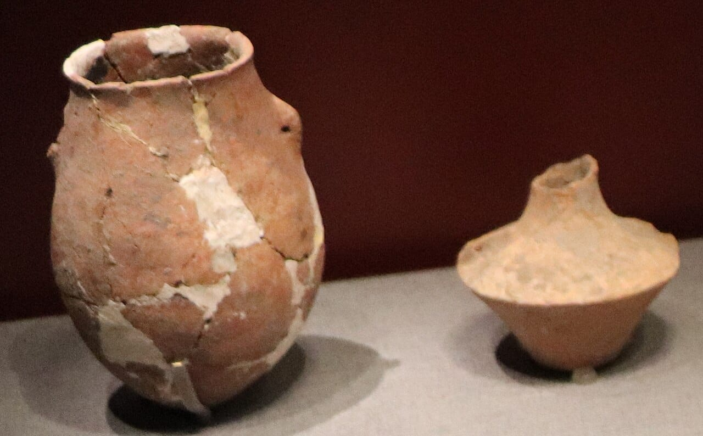
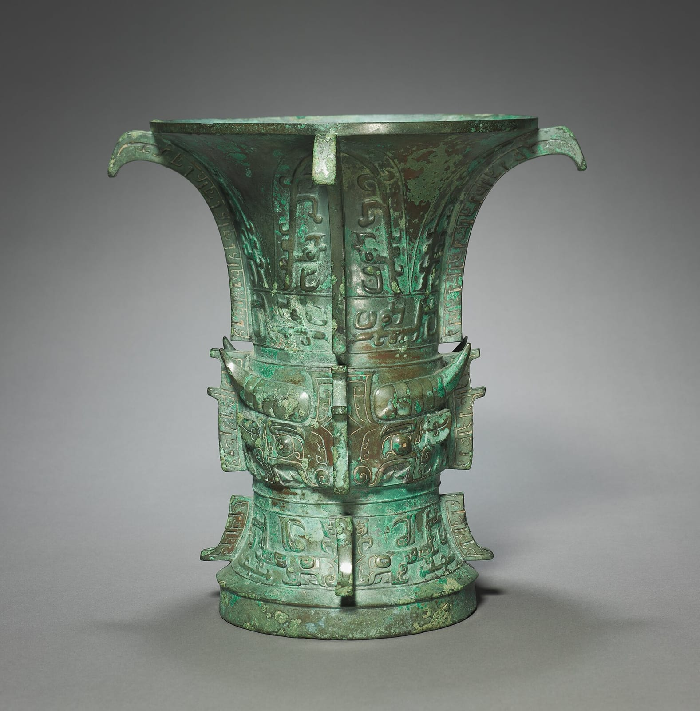

# 贾湖酒遗存 7000 BCE：中国最早的发酵饮料证据

在河南舞阳的贾湖村，考古学家发现了新石器时代早期的村落、稻作遗迹、骨笛与大量陶器。2004 年，一个中美联合研究团队在《美国国家科学院院刊》（PNAS）发表论文：他们从贾湖陶器内壁的残留物中，检测出稻米、蜂蜜与山楂或葡萄类水果的化学特征，认为这些陶器曾盛装一种混合发酵饮料，年代可早至公元前第七千年。这是中国迄今最早的直接化学证据之一，也改变了人们对中国酒史起点的想象。

图：贾湖遗址出土的裴李岗文化陶罐；残留物分析为早期发酵饮料提供了证据。图片：Furius，CC0，via Wikimedia Commons（[原图页面](https://commons.wikimedia.org/wiki/File:Pots%2C_Peiligang_Culture_(6200-5500_BC)%2C_Jiahu_site%2C_Wuyang%2C_Henan.jpg)）。

## 考古背景

贾湖遗址位于淮河上游，年代约距今 9000 至 7800 年，文化面貌与裴李岗文化关系密切。遗址出土了稻作遗存、家猪骨骼、龟甲、骨笛与大量陶器，说明这里已经出现定居农业、仪式活动与复杂的手工业。陶器中有小口双耳壶、深腹罐、钵等器形，部分可能用于储存、发酵或饮用。

新石器时代的发酵并不需要现代酵母。稻米煮熟后，淀粉可以被霉菌或酵母转化为糖，再发酵成酒；蜂蜜提供可发酵糖；山楂与葡萄类水果带来果糖与风味，也可能带入野生酵母。把这些原料混合在一起，可能得到一种甜酸并存、酒精度不高的饮料。它更像今天的米酒、果酒或混合发酵饮料，而不是蒸馏酒。

## 发现与检测

1980 年代以来，贾湖遗址进行了多轮发掘。研究人员从陶器碎片与内壁残留物中采集样本，利用气相色谱、质谱、红外光谱与显微镜观察，寻找酒类特征分子。2004 年的论文报告了稻米、蜂蜜与水果成分的证据，并提出“混合发酵 beverage”的解释。论文作者包括 Patrick E. McGovern、张居中、王昌燧等考古化学家与考古学家。

这项研究的关键不是“找到了一滴 9000 年前的酒”，而是通过残留物化学重建容器曾经装过什么。陶器多孔，会吸收液体中的有机分子；即使酒液早已消失，分子仍可能留在器壁。研究团队还把贾湖样本与商周青铜器中的液体、古代酒配方进行比较，尝试建立中国早期发酵饮料的谱系。

## 关键人物与机构

Patrick McGovern 是美国宾夕法尼亚大学考古与人类学博物馆的考古化学家，长期研究古代酒类；张居中是中国社会科学院考古研究所的贾湖遗址发掘主持人；王昌燧、赵志军等学者参与陶器、稻作与残留物分析。机构层面，贾湖遗址博物馆、河南博物院、中国科学院自然科学史研究所与宾大博物馆共同构成了研究、展示与传播的网络。

这项研究不是单个学科能完成的。考古学提供地层与器物背景，化学提供分子证据，植物学与农学帮助识别稻米、山楂与葡萄，仪器分析则负责检测残留物。正因如此，贾湖酒的结论比“文献记载”更具体，也比“传说”更可检验。

## 对酒史的意义

第一，时间起点前移。此前中国酒史常从商周甲骨文、青铜酒器或汉代文献讲起；贾湖把直接化学证据推到新石器时代早期。第二，酿造方式多元。贾湖不是单一谷物酿酒，而是稻米、蜂蜜与水果的混合发酵，说明早期酿酒者已经在利用不同糖源与风味原料。第三，酒与仪式的关系。陶器、骨笛、龟甲与稻作遗存共同出现，暗示发酵饮料可能用于祭祀、宴享或社群仪式，而不只是日常解渴。第四，技术传承。贾湖之后的仰韶、龙山与商周时期，谷物酿酒继续发展；商周青铜器中的液体与甲骨文中的酒祭，构成了这条长链条的后段。第五，中国酒的世界史位置。贾湖与中东的 barley beer、葡萄 wine 大致同时，说明早期发酵饮料并非某一文明的专利，而是多个农业社会并行发明的技术。

## 争议与史料

第一，年代表述有差异。遗址整体年代约距今 9000—7800 年，但具体陶器样本与发酵证据的年代范围更窄；不同论文与博物馆说明可能使用“9000 年前”“公元前 7000 年”“距今 8600 年”等不同口径。第二，残留物解释存在讨论。化学标记可以提示原料，但不能完全还原配方；蜂蜜、山楂、葡萄与稻米的组合，也可能受到保存条件与污染的影响。第三，是否称“酒”需要限定。它是一种发酵饮料，酒精度可能不高，不是今天的蒸馏白酒；用“酒”作为统称可以，但不能等同于现代意义上的烈酒。第四，陶器用途不唯一。同一类陶器可能用于储存、发酵、盛放或饮用，残留物只能说明“曾接触过”这类液体，不能证明每一件陶器都是酒器。第五，传播范围有限。贾湖是目前最重要的早期证据之一，但不代表中国其他地区没有更早或同期的发酵活动；考古发现受保存条件与发掘范围限制。

## 常见误读

一，“贾湖发现了 9000 年前的葡萄酒”。残留物包含山楂或葡萄类水果，但饮料是混合发酵，不是现代葡萄 wine。二，“这是中国最早的啤酒”。它不以发芽谷物为主，更接近米酒/果酒混合饮料，不能直接称为 beer。三，“这是蒸馏白酒的起源”。新石器时代没有蒸馏技术，贾湖饮料酒精度有限。四，“一罐酒证明了中国酒文化 9000 年”。它提供了重要证据，但“酒文化”的形成是长期过程，不能由一个遗址概括。五，“残留物配方就是今天的米酒”。古今原料、微生物与工艺差异很大，现代米酒不能直接等同于贾湖饮料。

相关条目：[中国](ref:china)、[米酒](ref:rice)、[黄酒](ref:yellow)。

贾湖的化学证据说明的是混合发酵饮料的可能性，不是现代意义上的某种酒；把残留物直接对应到今天的花果酒或米酒，会超出检测能支持的范围。

## 另见

- [中国](ref:china)：中国酒史的地理与考古背景。
- [米酒](ref:rice)：稻米发酵酒的传统与工艺。
- [黄酒](ref:yellow)：中国谷物酿酒的另一条重要脉络。
- [商周酒祭](ref:shang)：贾湖之后，酒与青铜礼器的制度化。
- [汉代酒榷](ref:han)：中国古代酒类国家专卖与税收的早期形态。

## 相关图像

图：商周酒礼：青铜酒器、酒正职官与《酒诰》的饮酒秩序相关实景照片。图片：Wikimedia Commons contributor，CC0，via Wikimedia Commons（[原图页面](https://commons.wikimedia.org/wiki/File:Clevelandart_1951.151.jpg)）。关联图像：贾湖酒遗存 7000 BCE：中国最早的发酵饮料证据。
