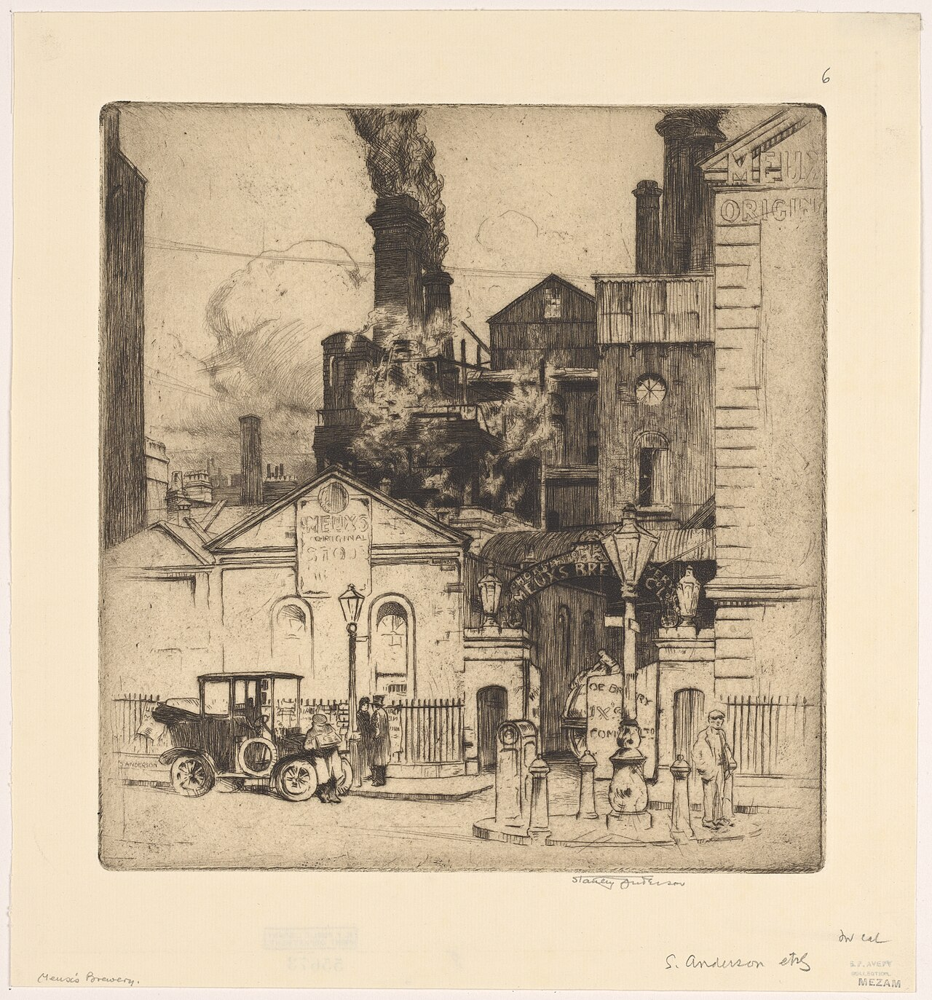

# 伦敦啤酒洪水 1814：巨桶、波特酒与圣吉尔斯贫民区

1814 年 10 月 17 日下午，伦敦托特纳姆法院路的 Meux 马靴啤酒厂发生了一场今天听起来近乎荒诞的事故：一只装满正在发酵的波特啤酒的巨型木桶破裂，酒液冲垮酒厂后墙，涌进圣吉尔斯贫民区。啤酒不是清水，它带着麦芽残渣、木桶碎片与发酵气体，冲击力足以推倒房屋。事故造成多人死亡，也成为 19 世纪伦敦啤酒工业最沉重的一次安全教训。

图：20 世纪初蚀刻版画中的 Meux 马靴啤酒厂；1814 年啤酒洪水即发生于此。图片：Scan by NYPL，Public domain，via Wikimedia Commons（[原图页面](https://commons.wikimedia.org/wiki/File:Meux%27s_Brewery_(NYPL_Hades-1961280-2051850).jpg)）。

## 时代背景

19 世纪初的伦敦是世界最大的啤酒消费城市之一，波特啤酒（porter）尤其流行。它颜色深、酒精度中等、价格相对低廉，适合城市工人日常饮用。为了满足巨大需求，啤酒厂不断放大发酵与陈酿容器。当时的大型木桶可达数米高，由木条与铁箍拼合，容量动辄十几万加仑。啤酒厂之间甚至存在“谁家的桶更大”的竞争，但工程安全并没有跟上。

圣吉尔斯（St Giles）是紧邻酒厂的贫民区，住房密集、地下室低洼，居民多为爱尔兰移民与城市贫民。酒厂与住宅之间只隔着一堵墙，风险被日常生活的拥挤掩盖。那个年代没有现代压力容器标准，也没有系统的结构检测；发酵产生的二氧化碳、木桶老化与铁箍失效，都可能在不被察觉的情况下积累。

## 经过与时间线

1814 年 10 月 17 日下午，一只高约 22 英尺、装有约 135,000 英制加仑波特啤酒的木桶爆裂。酒液冲开桶壁，撞倒其他容器，最终约有 323,000 英制加仑（约 147 万升）啤酒涌出。啤酒波高约 15 英尺，冲垮酒厂后墙，灌入圣吉尔斯的地下室与街道。Tavistock Arms 酒馆的墙体被冲倒，年仅十几岁的女仆 Eleanor Cooper 被埋在瓦砾中；另一处地下室里，一个爱尔兰家庭正在为两岁男孩守灵，五名哀悼者遇难。

当时报纸连续报道这场“可怕的灾难”。验尸陪审团给出的结论是“偶然、意外与不幸”，没有把责任归给酒厂。酒厂因损失巨大濒临破产，后来通过英国消费税对损失啤酒的退税才得以维持。事故后，酿酒业逐渐减少使用超大型木质发酵桶，转向更可控的容器与结构；Meux 啤酒厂在 1921 年迁走，原址后来建起 Dominion Theatre。

## 关键人物与机构

Meux & Co 是酒厂运营方，事故中的巨桶属于其马靴啤酒厂。酒厂老板 Henry Meux 与当时的城市管理者、验尸官、报纸共同构成了事件的公共面向。遇难者大多是圣吉尔斯的平民：女仆、守灵的家庭成员、路过的居民。没有一位遇难者是酒厂的所有者或高级管理者，这种伤亡分布本身就说明了工业风险如何在城市贫民区被转嫁。

在制度层面，英国消费税部门（Excise）既是酒厂税收的监管者，也是事故后退税的裁决者。验尸陪审团则负责判定死因与责任。两者都没有现代意义上的工程安全监管职能，事故因此更像一次“意外”，而不是一次可追溯的工业违法。直到 19 世纪后期，随着锅炉、压力容器与工厂立法的发展，英国才逐步建立起更系统的工业安全监管。

## 对酒业的具体改变

第一，木桶尺寸与结构受到反思。超大型木桶的维护、铁箍更换与发酵压力控制成为酿酒业必须面对的问题。第二，发酵容器材质改变。19 世纪后期，混凝土衬里、铁制与后来的不锈钢容器逐渐取代巨型木桶，安全性与清洁性提高。第三，酒厂选址与城市关系被重新审视。酒厂与密集住宅区相邻的风险，推动了城市规划与工业分区的讨论。第四，保险与责任意识增强。事故后的破产风险与退税争议，让酒厂更重视损失控制与保险。第五，事故成为啤酒史的记忆点。它既被当作奇闻，也被工程与城市史研究者视为 19 世纪工业化风险的典型样本。

## 争议与史料

第一，死亡人数存在两种口径。多数叙述记为 8 人死亡；Historic England 的档案说明把次日因酒精中毒死亡的一人也计入，合计 9 人。本页采用“通常 8 人、档案口径 9 人”的写法，不把两个数字强行统一。第二，啤酒总量存在差异。不同史料给出 128,000 至 323,000 英制加仑的范围，差异来自是否把后续破裂容器的酒液计入。第三，事故原因并不单一。铁箍断裂、木桶老化、发酵压力、容器间连锁破裂都可能参与其中。第四，验尸结论不等于工程结论。陪审团判定“意外”，但现代工程视角会追问设计、维护与监管责任。第五，事故的“荒诞感”遮蔽了受害者。遇难者不是抽象数字，而是贫民区居民、女仆与守灵的家庭；把他们当作奇闻的注脚，是后来叙述常见的偏差。

## 常见误读

一，“人们上街免费喝啤酒”。啤酒波冲进的是房屋、地下室与酒馆，混杂着碎片与污水，不是一场狂欢。二，“9 人当场死亡”。多数记载为 8 人，第 9 人是事后因酒精中毒去世，两个数字对应不同统计口径。三，“酒厂故意破坏”。没有证据支持阴谋论；更合理的解释是结构失效与安全缺失。四，“事故后酒厂立刻关闭”。酒厂濒临破产，但通过退税与经营调整维持下来，直到 1921 年才迁址。五，“这只是一场啤酒笑话”。它本质上是工业灾难，暴露了 19 世纪城市贫民区承受的工业风险。

相关条目：[英国](ref:uk)。

## 另见

- [啤酒](ref:beer)：从原料、发酵到风格的总体框架。
- [英国](ref:uk)：19 世纪伦敦啤酒工业与城市治理的背景。
- [爱尔兰](ref:ireland)：圣吉尔斯爱尔兰移民社区与守灵传统的文化背景。
- [精酿啤酒革命](ref:craft)：20 世纪后期啤酒业对工业标准化的一次反向运动。
- [苏格兰威士忌税制](ref:scotch)：另一段英国酒类税收、走私与执法的历史。

对照阅读：[啤酒](ref:beer)、[爱尔兰](ref:ireland)。

**关键事实。**

| 项目 | 内容 |
| --- | --- |
| 一句话定位 | 1814 年 10 月 17 日，伦敦托特纳姆法院路的 Meux 马靴啤酒厂一只巨型木桶破裂，约 32.3 万英制加仑波特啤酒冲入圣吉尔斯贫民区，冲毁房屋与酒馆，造成多人死亡；事故通常记为 8 人死亡，Historic England 的档案说明把次日因酒精中毒死亡的一人也计入，合计 9 人 |
| 时间 | 1814 年 10 月 17 日 |
| 地点 | 英国 |
| 历法 | 公历 |
