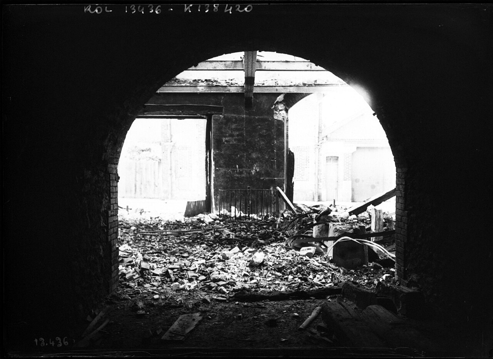

# 自然酒运动：从博若莱的试验到 2020 年标签

自然酒（vin naturel）通常指尽量少干预的葡萄酒：葡萄来自有机或生态种植，使用原生酵母，不添加酿造辅料，也不做过滤、离心或热处理；硫的用量被压到极低，甚至完全不加。这套做法在 20 世纪后半叶由法国博若莱的一小群酿酒者反复试验，逐渐从地方实践变成国际潮流；2020 年，它第一次有了受法国国家承认的标签名称“Vin Méthode Nature”。

图："自然酒运动：从博若莱的试验到 2020 年标签"的地域背景配图。图片：Jean-Marie Hullot from France，CC BY-SA 2.0，via Wikimedia Commons（[原图页面](https://commons.wikimedia.org/wiki/File:Le_Procope_1,_Paris_2010.jpg)）。这张照片用于说明"自然酒运动：从博若莱的试验到 2020 年标签"所涉事件发生地的环境，不是该事件的现场记录。

## 时间与地点

运动的起点在法国中东部的博若莱，尤其是莫尔贡（Morgon）一带。这里是佳美葡萄与“博若莱新酒”的产地，也是化学家兼酒商朱尔·沙维（Jules Chauvet）工作的地方。20 世纪 70 至 80 年代，沙维的年轻追随者在莫尔贡、弗勒里等村庄尝试无硫酿造；此后做法扩散到卢瓦尔河谷、汝拉与罗讷河谷。2020 年获得认可的标签则是全国性的，适用于任何符合条件的法国葡萄酒，不限于博若莱。

## 背景：战后葡萄酒的工业化

二战后的法国葡萄酒业走向标准化：高产品种、化学除草与杀虫、商业选育酵母、过滤与离心、以及用二氧化硫控制氧化与微生物。这套技术让酒更稳定、更一致，也让年份与地块的差异被抹平。博若莱新酒在 20 世纪后半叶成为商业成功，但它的高产与统一风格也成了反面参照。

沙维既是酒商也是研究者。他研究苹果酸—乳酸发酵、二氧化碳浸渍与香气物质，主张在葡萄健康、卫生到位的前提下，少加硫甚至不加硫也能酿出稳定的酒。他的结论不是教条，而是条件性的：原料必须成熟、干净，容器与操作必须严格。这样的技术立场，后来成为自然酒运动的方法基础。

## 经过：四个酒农与一个绰号

马塞尔·拉皮埃尔（Marcel Lapierre）在 1973 年接手家族在莫尔贡的酒庄。20 世纪 70 年代末到 80 年代，他逐步采用沙维的方法：晚收、严格筛选、整串或二氧化碳浸渍、原生酵母、低温发酵、不加硫。1980 年前后，他与让·富亚尔（Jean Foillard）、居伊·布勒东（Guy Breton）、让—保罗·泰弗内（Jean-Paul Thévenet）形成一个小圈子，后来被美国进口商克尔米特·林奇（Kermit Lynch）称为“四人帮”（Gang of Four）。这不是正式组织，而是一组共享方法、互相品评的邻居。

他们的酒经由进口商进入美国、日本与北欧的市场，在重视风味的餐厅与酒商那里获得追随者。自然酒随后出现自己的展会、酒吧与经纪人网络；到 2010 年代，巴黎、伦敦、东京、哥本哈根都出现了以自然酒为招牌的场所，价格与风格的分歧也随之扩大。

## 影响/制度：一个可核查的标签

自然酒长期没有法律定义。法国当局甚至禁止把“vin nature”或“vin naturel”作为商业用语直接标在酒上，因为这类词会暗示一种未被规范的质量等级。行业因此需要一个可核查的名称。

2019 年，一批酿酒者组织起来，成立自然酒保护协会（Syndicat de défense des vins naturels），起草《Vin Méthode Nature》章程；2020 年，章程获得法国竞争、消费和反欺诈总局（DGCCRF）认可。标签的核心规则包括：100% 葡萄来自有机或“自然与进步”认证种植；全部人工采收；只用原生酵母；不添加任何酿造辅料；不做加糖、浓缩、热浸渍等改变葡萄构成的操作；禁止反渗透、过滤、离心、闪蒸杀菌等物理手段；发酵前与发酵中不加硫，成品总硫不得超过 30 mg/L。

标签分两种标识：完全不外加硫的版本，允许成品检测出最多 20 mg/L 的天然来源硫；有过微量外加硫的版本，上限为 30 mg/L。每款酒须在年底前申报，装瓶时提交 COFRAC 认可的六项分析，由协会做内部审核；协会每年随机抽取约 1% 的酒款做外部检查，超过 100 百升的酒款则强制外检。

## 史料与争议

第一，定义并不统一。标签只覆盖签署章程的生产者；未签署的酒农仍可自称在做“自然酒”，但这个词在法国不能作为正式商业标注。消费者看到的“自然”，可能指完全无添加，也可能指“尽量少添加”。

第二，历史叙述带有传奇色彩。沙维的贡献有技术文献支撑，但“他一个人发明了自然酒”是过度简化；无硫酿造在南法、汝拉与意大利都有地方传统。“四人帮”是进口商起的绰号，成员自己也未必使用。

第三，日期存在多种说法。拉皮埃尔接手酒庄是 1973 年，无硫试验常被记为 1980 年前后；协会成立与章程获认可的月份，在不同行业文章中并不一致，本页只取年份。

第四，标签的“国家认可”不等于法定产区式的强制标准。它是受监管的标注用语，遵守靠自愿加入与协会审核；外部抽查比例有限，不能把它当作每一瓶酒的独立保证。

第五，健康与品质主张缺乏统一证据。低硫会降低某些人的过敏风险，但也可能带来氧化、挥发酸与微生物问题；“自然”不等于更安全、更好喝，也不等于适合所有人。

## 时间线

- 1907：朱尔·沙维出生。
- 1950 年代起：沙维在博若莱研究发酵、原生酵母与硫的作用。
- 1973：马塞尔·拉皮埃尔接手莫尔贡的家族酒庄。
- 1980 年前后：“四人帮”形成，无硫酿造进入市场。
- 1989：沙维去世。
- 2019：自然酒保护协会成立，章程成形。
- 2020：章程获 DGCCRF 认可，“Vin Méthode Nature”标签推行。

## 延伸阅读

- [法国](ref:france)：自然酒运动的制度与文化背景。
- [葡萄酒](ref:wine)：从工业酒到低干预酒的风格光谱。
- [1935 年法国 AOC 制度](ref:aoc)：法定产区体系如何定义“正统”葡萄酒。
- [香槟区划界（1927）](ref:champagne)：产区边界与名称保护的另一个案例。
- [波尔多 1855 分级](ref:bordeaux)：等级制度与市场信号的历史对照。

相关条目：[法国](ref:france)、[葡萄酒](ref:wine)、[法国 AOC 制度（1935）：原产地控制命名的诞生](ref:aoc)。

**关键事实。**

| 项目 | 内容 |
| --- | --- |
| 一句话定位 | 20 世纪 70 年代起，法国博若莱的一批酿酒者在化学家朱尔·沙维的影响下尝试不加硫、只用原生酵母的酿造方式；1980 年前后形成的“四人帮”让这种做法进入市场 |
| 时间 | 1970 年代至 2020 年 |
| 地点 | 法国 |
| 历法 | 公历 |

## 相关图像

图：项目配图：香槟区划界（1927）：地名、地块与一场划界战争。图片：Agence Rol，Public domain，via Wikimedia Commons（[原图页面](https://commons.wikimedia.org/wiki/File:Apr%C3%A8s_le_pillage_d%27Ay,_avril_1911_-_btv1b69160215.jpg)）。关联图像：自然酒运动：从博若莱的试验到 2020 年标签。
