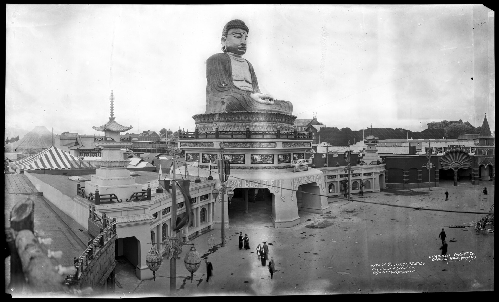

# 1915 年巴拿马太平洋万国博览会

1915 年 2 月 20 日至 12 月 4 日，巴拿马太平洋万国博览会在美国旧金山举办，前后持续约 11 个月。它名义上纪念巴拿马运河开通，实际是展示工业、农业与殖民地商品的大型国际展会。中国以国家馆形式参展，酒类产品随之进入国际评比与报道，也在后来的中国酒史中被反复讲述。

图：1915 年巴拿马太平洋万国博览会相关实景照片。图片：Cardinell-Vincent Company，Public domain，via Wikimedia Commons（[原图页面](https://commons.wikimedia.org/wiki/File:Japan_Beautiful,_Panama-Pacific_International_Exposition,_San_Francisco,_1915.jpg)）。

## 背景

20 世纪初，中国商品在国际市场上以原料与手工制品为主，缺少品牌与统一标准。世界博览会逐渐成为国家展示工业实力与商品质量的场合。1914 年巴拿马运河通航，太平洋贸易预期升温，旧金山希望借博览会宣告自己在 1906 年大地震后的重建成果。

中国方面由农商部牵头筹备，成立专门机构征集展品，各省商会与企业参与送样。展品涵盖丝绸、茶叶、瓷器、农产品与酒类。对当时的中国酒业而言，这是一次罕见的海外亮相；黄酒与烧酒多为作坊生产，包装与分类都未按国际标准整理，参展既是机会，也是压力。

## 经过与时间线

1914 年，中国开始筹备参展，确定展馆方案与展品目录。1915 年 2 月 20 日，博览会开幕；中国馆在会期内开放，展品按农业、工艺、教育等门类陈列。1915 年夏秋之间，评审委员会完成评奖；12 月 4 日博览会闭幕。

评奖规模可以从官方统计看出：整个博览会共评出 25,527 个获奖产品，实发奖章 20,344 枚。中国展品获奖章 1,218 枚，其中大奖章 62 枚、荣誉勋章 54 枚、金质奖章 250 枚，另有银牌、铜牌与奖词；另一常见统计把中国获奖总数记为 1,211 项。两个数字的差异，可能来自“奖章”与“奖项”的口径不同。中国是这届博览会获奖较多的参展国之一。

酒类方面，张裕公司的可雅白兰地、红玫瑰葡萄酒、琼瑶浆味美思与雷司令白葡萄酒获金质奖章，这是企业史与地方志中反复出现的记载。贵州选送的茅台酒以“茅台造酒公司”名义，整合成义、荣和两家作坊的样酒参展；其获奖等级在后世叙述中分歧最大。泸州老窖等产品也进入了高等级奖项的名单。

## 关键人物与机构

陈琪是中国参展事务的关键人物，长期负责博览会筹备与现场协调。张弼士创办的张裕公司是酒类展品中最具规模的企业，其白兰地与葡萄酒的获奖，后来成为品牌史的核心段落。农商部、巴拿马赛会中国筹备事务局与各省商会构成了中国的组织体系；美方则由博览会公司、联邦参展委员会与评审委员会负责场馆、展品分类与评奖。

评审委员会的奖级设置是理解争议的钥匙。大奖章、荣誉勋章、金质奖章、银质奖章与铜质奖章构成一个层级，中文报道常把它们统称为“金奖”。奖级翻译的不统一，使同一枚奖章在不同叙述中可能被写成“大奖”“金奖”或“荣誉奖”，进而影响后人对企业地位的判断。

## 对酒业的具体改变

第一，品牌资产。张裕、泸州老窖、汾酒与茅台都把 1915 年的获奖写进企业史，奖牌图案与“巴拿马”字样进入包装与广告。第二，出口与渠道。博览会期间建立的联系，为部分中国商品进入美国与南洋市场提供了线索，“国际获奖”由此成为推销话术。第三，标准意识。参展暴露了包装、标签、分类与卫生检验的不足，推动了此后商会对出口商品标准的讨论。第四，国货叙事。1915 年之后，“国货获奖”被纳入实业救国的宣传，酒类成为其中易于传播的符号。第五，历史回声。1952 年评酒会在塑造“名酒”谱系时仍援引早期国际获奖经历。

## 争议与后续评价

第一，获奖总数。1,218 枚奖章与 1,211 项奖项并存，统计口径不同。第二，茅台的奖级。企业官网与部分地方史称其获金奖；汾酒方面援引当年资料称，贵州公署选送的酒获得的是银奖，相当于五等奖；另有报道称茅台获得的是“荣誉奖章”，属于二等。三种说法都能找到文本依据。第三，大奖归属。有研究指出，白酒产品中获得最高等级大奖章的是山西、直隶、河南选送的三种高粱酒，其中唯一具有品牌名称的是汾酒。这一说法来自汾酒方面的整理，仍需与原始名录对照。第四，后世放大。企业 1980 年代后重修厂史，倾向于把“参展”“获奖”“金奖”合并叙述。

## 常见误读

一，“茅台在 1915 年获得巴拿马金奖”是毫无争议的事实。实际情况是金奖、银奖与荣誉奖章三种说法并存。二，“巴拿马博览会就是巴拿马运河开通典礼”。博览会以运河为主题，但两者不是同一场活动。三，“参展就等于获奖”。参展是行为，获奖是评审结果，中间还有分类与评审。四，“当年的金奖等于今天的国际金奖”。1915 年的奖级与评审标准都与当代赛事不同。五，“获奖可以证明今天的质量”。奖牌是历史记录，不是长期质量保证。

相关条目：[中国](ref:china)。

## 另见

- [美国](ref:usa)：博览会举办地，也是 1915 年太平洋贸易叙事的中心。
- [中国](ref:china)：参展国与展品来源，理解农商部组织方式的背景。
- [白酒](ref:baijiu)：后世获奖叙事中最常被提及的酒种。
- [黄酒](ref:yellow-wine)：参展的传统谷物酒，代表另一条产品线。
- [1952 年全国评酒会](ref:evaluation-1952)：另一套名酒评价体系，也是 1915 年叙事被再次调用的场合。

对照阅读：[美国](ref:usa)、[白酒](ref:baijiu)。

**关键事实。**

| 项目 | 内容 |
| --- | --- |
| 一句话定位 | 1915 年在旧金山举办的巴拿马太平洋万国博览会，是中国近代商品走向世界的重要场合，酒类展品与获奖说法也由此进入中国酒史叙事；本文说明会期、背景、参展与获奖争议，并区分“参展事实”与“金奖传说” |
| 时间 | 1915 年 2 月 20 日至 12 月 4 日 |
| 地点 | 美国 |
| 历法 | 公历 |

**来源与边界。** 本页关于「1915 年巴拿马太平洋万国博览会」的关键事实，主要由以下来源交叉核对：Encyclopaedia Britannica（会期、举办城市与博览会背景）、U.S. National Archives（联邦参展与档案存藏情况）、新华网（1952 年评酒会与早期获奖叙事的关系）等 6 条来源。价格、批次与状态会变，涉及这些字段时以页面所列来源的最新版本为准。正文为项目自写，来源只作核验，不复制原文。

## 相关图像

图：1952年全国评酒会：八大名酒与评选制度的起点类别配图。图片：M. Weitzel，CC BY-SA 2.5，via Wikimedia Commons（[原图页面](https://commons.wikimedia.org/wiki/File:Tsingdao_Brewery.jpg)）。关联图像：1915 年巴拿马太平洋万国博览会。
