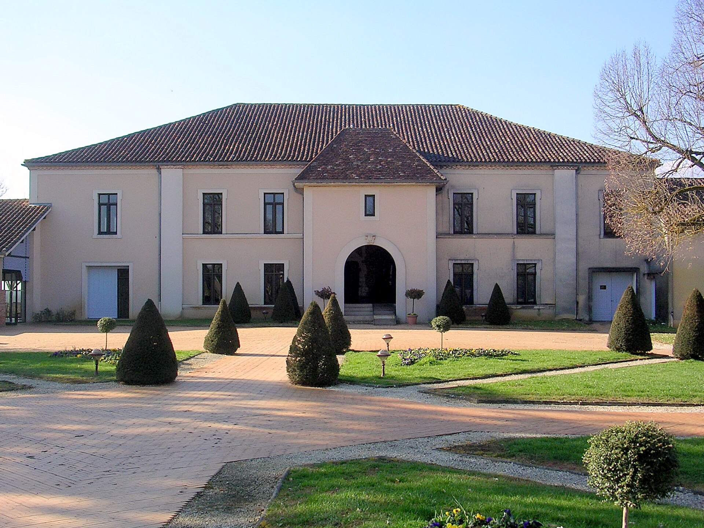

# 葡萄根瘤蚜大流行：一场重塑欧洲葡萄园的危机

葡萄根瘤蚜大流行是 19 世纪下半叶葡萄酒史上影响最深的生态灾难之一。一种原产北美、体长不足一毫米的根瘤蚜，随引进的葡萄苗木进入欧洲，在数十年间摧毁大片葡萄园。它迫使欧洲人重新思考“葡萄该怎么种”，也间接改变了品种结构、苗木产业、产区制度与[葡萄酒](ref:wine)的供给格局。

图：葡萄根瘤蚜大流行：一场重塑欧洲葡萄园的危机的地域背景配图。图片：Jibi44，CC BY-SA 3.0，via Wikimedia Commons（[原图页面](https://commons.wikimedia.org/wiki/File:Arthez_domaine_Ognoas.jpg)）。这张照片用于说明葡萄根瘤蚜大流行：一场重塑欧洲葡萄园的危机所涉事件发生地的环境，不是该事件的现场记录。

## 时间与地理

根瘤蚜原产于北美东部，与当地野生葡萄长期共同演化。19 世纪，欧美之间苗木与葡萄品种交流频繁，根瘤蚜随之跨越大西洋。关于它进入欧洲的具体年份与路径，史料并不完全一致：常引的说法是 19 世纪 60 年代前后传入，法国南部在 1863 年前后确认疫情；也有法国文献把 1865 年作为标志性年份。

地理上，疫情先从法国东南部爆发，再沿罗讷河谷、朗格多克与波尔多方向扩散。1863 年，罗克莫尔（Roquemaure）一带的葡萄园出现异常枯死；随后在波尔多附近的弗卢瓦拉克（Floirac）等地也确认了根瘤蚜。此后，法国几乎所有主要葡萄酒产区都受到影响，西班牙、意大利、德国、奥地利与瑞士等地也相继告急。北美西海岸的加州葡萄园同样未能幸免，只是当地的应对时间与方式不同。

## 病因与传播

根瘤蚜的破坏方式并不直观。它在地面上可以形成虫瘿，但真正致命的是地下部分：昆虫以刺吸式口器取食葡萄根系，伤口成为真菌与细菌侵入的入口，根系逐渐腐烂，植株吸水与吸收养分的能力下降，最终枯死。幼苗、成株与老藤都可能受害，但症状往往在数年后才明显，这使早期发现非常困难。

传播途径包括带根的苗木、土壤、农具、灌溉水与风力短距离扩散。19 世纪的苗木贸易没有现代检疫制度，带虫的插条与根桩可以在无人察觉的情况下跨地区流动。欧洲葡萄（Vitis vinifera）对根瘤蚜普遍缺乏抗性，而北美一些野生葡萄种类在与害虫长期共存中形成了耐受或抗性，这一差异后来成为解决问题的关键。

## 法国的确认与扩散

法国的确认过程伴随激烈争论。早期有人把枯死归因于天气、病害或土壤疲劳；随着观察积累，昆虫学家与葡萄种植者逐渐把根瘤蚜与根系损伤联系起来。1868 年前后，研究者开始系统描述其生活史，防治试验也同步展开。由于缺乏有效的化学药剂，早期的硫磺、二硫化碳与 flooding（淹水）等手段成本高、效果有限，难以在大面积葡萄园推广。

1870 至 1880 年代是损失最集中的阶段。大片葡萄园被拔除或荒废，产量骤降，酒价与进口需求随之波动。灾后缺口催生了替代品与掺假：市场上出现用糖、葡萄干或进口酒勾兑的产品，阿尔及利亚等地的酒大量进入法国。这些现象又反过来推动了对产地命名、产量与工艺的监管讨论，成为后来[法国](ref:france)产区制度的背景之一。

## 应对：嫁接、砧木与杂交

真正可规模化的解法是“嫁接”：把欧洲品种（V. vinifera）的接穗接到抗根瘤蚜的美洲葡萄砧木上。这样，地上部分仍能结出欧洲品种的果实，地下部分则由美洲根系抵御害虫。1870 年代，法国研究者与种植者进行了大量试验；常引的节点是 1874 年米亚尔代（Millardet）与拉利曼（Laliman）成功把多个品种嫁接在美洲砧木上。此后，砧木选育、土壤适应性与嫁接技术逐渐成熟，1880 年代起在法国大面积推广。

另一条路线是培育杂交品种，即直接让欧洲品种与美洲品种杂交，使植株本身带有抗性。Baco 22A（Baco blanc）就是代表之一：它由 Folle Blanche 与 Noah 杂交，1898 年由朗德省教师弗朗索瓦·巴科（François Baco）选育，后来在雅文邑（Armagnac）产区获得长期使用。杂交品种与嫁接砧木不是一回事：前者改变了品种本身的遗传组成，后者保留欧洲品种的接穗，只更换根系。两者在风味、法规与市场接受度上各有争议。

## 重植与产区重构

根瘤蚜危机之后的“重植”不是简单把原有葡萄园再种一遍。首先，苗木产业兴起：抗性砧木的选育、嫁接苗的生产与检疫成为一门专业，葡萄园从“自根苗”时代进入“嫁接苗”时代。其次，种植成本上升，小农难以负担拔园、休耕与重新投资，部分地块被改种其他作物或直接放弃，土地所有权与经营规模随之变化。

第三，品种结构发生调整。一些难以适应砧木或市场需求的品种被减少，适应性更强、产量更稳定的品种扩张；在法国南部，杂交品种一度填补了普通餐酒的缺口。第四，产区制度加速形成。灾后的产量短缺、掺假与价格波动，让“地名—地块—品种—工艺”的绑定变得迫切；1935 年建立的[原产地控制命名制度](ref:aoc)，虽然不能直接归因于根瘤蚜，却把灾后数十年的市场混乱视为重要背景。

第五，关于[风土](ref:terroir)的讨论变得更复杂。嫁接改变了根系与土壤的关系，砧木的吸水、抗性以及对接穗生长势的影响，成为种植者必须考虑的新变量。风土不再只是“这块地的土壤与气候”，还包括砧木选择、嫁接组合与管理方式。今天讨论老藤、根系与地块表达时，根瘤蚜时代留下的这套技术框架仍在起作用。

## 争议与史料

第一，传入年份存在差异。法国官方档案与部分综述常写 1865 年，而 INRAE 的科普资料把首次发现定在 1863 年的罗克莫尔。两种说法对应的是“确认/记录”与“标志性年份”的不同口径，本页用“约 1863 年”并保留 1865 年这一常见说法，不把某一年写成绝对起点。

第二，损失规模难以精确统计。不同地区的拔园面积、产量下降与复种时间差异很大，后世常引的百分比往往来自特定区域或特定年份的估算，不能简单当作全国数据。第三，解决方案并非单一。嫁接、杂交、化学防治、淹水与改种在不同地区并行，效果取决于土壤、气候、资金与市场；把历史简化为“嫁接拯救了欧洲葡萄园”，会忽略推广过程中的失败与代价。

第四，根瘤蚜至今没有消失。它仍在世界多地存在，嫁接苗是大多数产区的常规做法；所谓“战胜根瘤蚜”，更准确的说法是“建立了可持续的管理体系”。这也是为什么今天许多葡萄酒法规仍要求使用抗性砧木，或对自根苗种植设置严格条件。

## 延伸阅读与参考资料

- [葡萄酒](ref:wine)：葡萄酒的定义、工艺与主要类型。
- [法国](ref:france)：法国产区、等级制度与市场背景。
- [美国](ref:usa)：北美葡萄种类与加州酒产业。
- [1935 年 AOC 制度](ref:aoc)：灾后市场混乱与产地命名的制度化回应。
- [风土](ref:terroir)：土壤、气候、品种与人的选择如何共同作用。
- INRAE，Phylloxéra — extraits d'AgroMots，https://www.inrae.fr/sites/default/files/pdf/Extraits-AgroMots_PagesPhylloxera.pdf
- FranceArchives，La vigne et le vin，https://francearchives.gouv.fr/fr/article/128963263
- HAL / INRAE，The Plagues of the Vine，https://hal.inrae.fr/hal-05304641/file/FrancoisDelmotte_conf-clos-vougeot_HAL.pdf
- Bureau National Interprofessionnel de l'Armagnac，Grape varieties and terroirs — Baco，http://www.armagnac.fr/grape-varieties-and-terroirs
