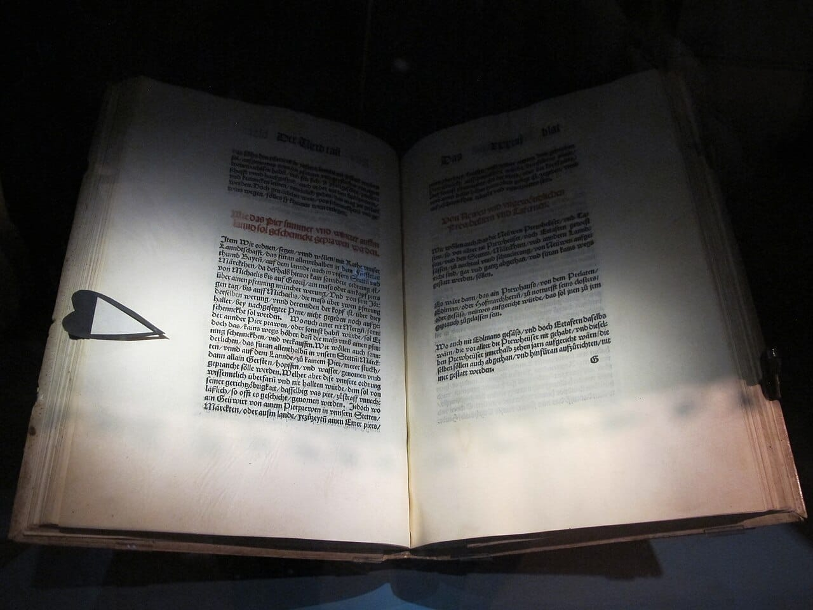

# 德国啤酒纯净法 1516：一部地方条例如何变成国家符号

1516 年 4 月 23 日，巴伐利亚公爵威廉四世与他的弟弟路德维希十世在因戈尔施塔特颁布一部《州法》。其中一段规定，今后在巴伐利亚的城市、集市与乡村，酿造啤酒只能使用大麦、啤酒花与水。这段文字后来被称为“啤酒纯净法”（Reinheitsgebot）。它并不是一部横空出世的“德国啤酒宪法”，而是一部地方性食品与价格条例的一部分；但它在此后五百年里，逐渐成为德国啤酒最著名的身份标签。

图：1516 年巴伐利亚《州法》中的啤酒纯净条款，2016 年拜恩州立展览展出。图片：Luidger，CC BY-SA 3.0，via Wikimedia Commons（[原图页面](https://commons.wikimedia.org/wiki/File:20160516-Aldersbach_Bayerische_Landesausstellung_2016_Bier_in_Bayern_(Reinheitsgebot).JPG)）。

## 时代背景

16 世纪初的巴伐利亚，啤酒是日常主食的一部分，也是城市财政与领主税收的重要来源。当时没有现代食品化学，也没有统一的工业标准；啤酒可以由不同谷物、香料、草药与甜味剂酿成，质量与保存性差异很大。领主颁布条例的动机并不只是“让啤酒更纯”，还包括稳定价格、保障粮食供给、防止酿酒者浪费稀缺谷物，以及通过许可与处罚维持市场秩序。

因此，1516 年文本的完整内容不止“三原料”。它同时规定不同季节的啤酒售价、度量单位与处罚方式，并把“三月啤酒”（Märzen）与一般啤酒区分开来。所谓“纯净”条款，是这部价格与市场条例中的一条，而不是独立的食品安全法。它最初只适用于巴伐利亚公国，并不覆盖今天德国全境，也不覆盖所有啤酒类型。

## 经过与时间线

1516 年 4 月 23 日，条例在因戈尔施塔特颁布。原文允许的原料是 Gerste（大麦）、Hopffen（啤酒花）与 Wasser（水）；酵母没有被列入，因为当时人们对酵母在发酵中的作用尚无现代微生物学认识。酿酒者通常沿用上一批发酵留下的酵母泥，或依赖空气中自然存在的酵母，酵母被视为工艺的一部分，而不是“配方原料”。直到后来，酵母才被明确加入官方口径，形成今天常说的“水、麦芽、啤酒花、酵母”四原料。

这部条例起初只是巴伐利亚的地方规则。19 世纪德国统一进程中，巴伐利亚推动把啤酒纯净要求纳入更大的法律框架；1906 年，它才成为全德适用的规则。20 世纪后期，随着欧洲单一市场与食品法规协调，德国对进口啤酒的配方限制有所调整，但德国酿酒业仍把纯净法作为行业自我承诺与品质叙事。今天，4 月 23 日被德国啤酒业称为“德国啤酒日”，正是为了纪念 1516 年的这次颁布。

## 关键人物与机构

威廉四世（Wilhelm IV）与路德维希十世（Ludwig X）是条例的颁布者。两人共同治理巴伐利亚，因戈尔施塔特是当时的重要宫廷与行政中心。条例不是某位科学家的发明，而是领主、城市议会、酿酒行会与税收官员共同推动的治理工具。它的执行依赖地方司法与市场稽查，而不是现代意义上的食品检验机构。

在 20 世纪，巴伐利亚州政府、德国酿酒业协会与各大啤酒厂共同把纯净法塑造成国家文化符号。1950 年代以后，德国啤酒工业在广告、节庆与出口推广中反复引用“1516”这一年份，使它从一部地方条例变成“德国啤酒传统”的代名词。2016 年的五百周年纪念，进一步把这一符号推向国际传播。

## 对酒业的具体改变

第一，配方边界。大麦、啤酒花与水成为巴伐利亚啤酒的基本框架，促使酿酒者在不使用其他谷物与添加物的情况下，依靠麦芽处理、糖化与发酵技术塑造风味。第二，风格分化。限制并不意味着口味单一：通过麦芽烘烤、啤酒花品种、发酵温度与酵母选择，德国发展出浅色、深色、小麦啤酒、柏林酸小麦等多样风格。第三，市场秩序。价格、度量与处罚条款让啤酒成为可征税、可稽查的日常商品，强化了城市对酿酒与销售的控制。第四，法律符号。20 世纪以后，纯净法成为德国啤酒出口与国内消费的文化卖点，也常被用来区分“德国啤酒”与“国际工业啤酒”。第五，争议空间。它保护了传统工艺，却也限制了创新；在精酿啤酒与风味啤酒兴起后，德国业内外一直在讨论“纯净”与“多样”的边界。

## 争议与史料

第一，适用范围被放大。1516 年文本只适用于巴伐利亚，不是“德国全国法”；“1906 年全德适用”是后来法律整合的结果。第二，原料清单被倒读。原文没有酵母，四原料是后来的表述；把 1516 年文本直接写成“水、麦芽、啤酒花、酵母”是不准确的。第三，例外被忽略。巴伐利亚历史上存在对小麦啤酒、修道院啤酒与特定城市的特许与例外，不能把纯净法理解成从 1516 年起所有啤酒都只准用大麦。第四，文本性质被误读。它首先是价格与市场条例，食品安全与消费者保护是后来的解释框架。第五，“最古老食品法”的说法需要限定。德国酿酒业协会称它是世界上最古老且至今仍有效的食品法规之一，但“最古老”涉及不同地区、不同法规的比较，不能当作无争议的绝对结论。

## 常见误读

一，“1516 年德国就有了纯净法”。1516 年颁布的是巴伐利亚条例，德国作为统一国家要晚得多。二，“纯净法从一开始就规定四种原料”。酵母是后来才被明确列入的。三，“纯净法禁止小麦啤酒”。文本以“大麦”为啤酒原料，但历史上存在小麦啤酒的特许与例外，不能一概而论。四，“纯净法保证啤酒更好喝”。它约束配方，不保证风味；好喝与否取决于原料质量、工艺与新鲜度。五，“纯净法只是营销故事”。它确实是德国啤酒业的重要文化符号，但也有真实的法规史与市场治理功能，二者不能互相取消。

相关条目：[啤酒](ref:beer)、[小麦啤酒](ref:wheat)、[德国](ref:germany)。

## 另见

- [啤酒](ref:beer)：从原料、发酵到风格的总体框架。
- [小麦啤酒](ref:wheat)：巴伐利亚另一条重要的啤酒传统。
- [德国](ref:germany)：联邦制、州法与啤酒市场的区域背景。
- [巴伐利亚](ref:bavaria)：纯净法诞生地与德国啤酒文化核心区。
- [唯森小麦啤酒](ref:weihenstephan)：理解巴伐利亚修道院啤酒与小麦啤酒传统的样本。

## 相关图像

图：唯森小麦白啤相关实景照片。图片：JIP，CC BY-SA 4.0，via Wikimedia Commons（[原图页面](https://commons.wikimedia.org/wiki/File:Weihenstephaner_Hefe_Weissbier_aboard_Viking_Mariella.jpg)）。关联图像：德国啤酒纯净法 1516：一部地方条例如何变成国家符号。
