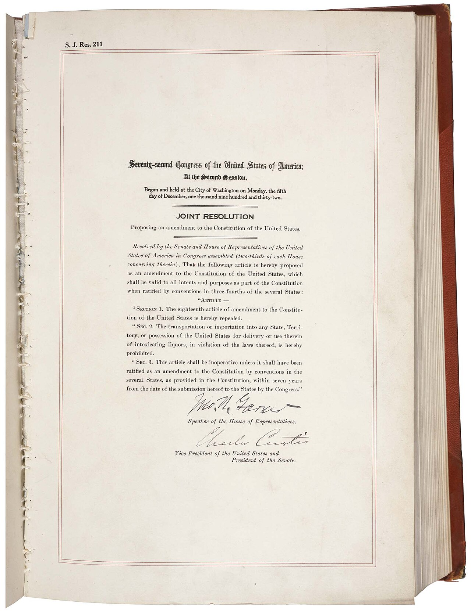
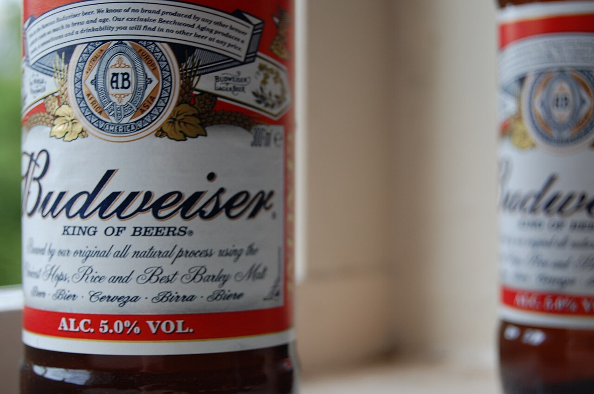

# 禁酒令废除 1933：第 21 条修正案与美国酒类监管的重置

1933 年 12 月 5 日，美国代理国务卿威廉·菲利普斯（William Phillips）认证第 21 条宪法修正案获得足够州批准。这条修正案只有三节，核心一句话是：第 18 条修正案“特此废除”。它结束了近 14 年的全国禁酒令，也让美国酒类监管从“联邦全面禁止”转向“联邦征税、州与地方许可”的复杂体系。禁酒令的废除不是一夜之间的“放开”，而是一场持续数年的政治、财政与制度重组。

图：美国第 21 条宪法修正案联合决议第一页，1933 年 2 月 20 日提出。图片：U.S. Government，Public domain，via Wikimedia Commons（[原图页面](https://commons.wikimedia.org/wiki/File:21st_Amendment_Pg1of1_AC.jpg)）。

## 时代背景

1919 年，美国宪法第 18 条修正案获得批准，禁止制造、销售与运输“致醉酒类”；次年的《沃尔斯特德法》（Volstead Act）把“致醉”门槛定为 0.5% 酒精度。禁酒令并未消灭饮酒，而是把酒类市场推向地下。私酒蒸馏、走私、地下酒吧（speakeasy）与有组织犯罪扩张，联邦与州政府失去酒税收入，执法成本却不断上升。到大萧条时期，恢复酒类生产与税收成为刺激经济、增加就业的政策选项。

1932 年，民主党总统候选人富兰克林·罗斯福把“废除禁酒令”纳入政纲；1933 年 3 月，他签署《卡伦-哈里森法》（Cullen-Harrison Act），允许销售酒精度不超过 3.2% 的啤酒与淡酒。这道法令常被误认为“禁酒令结束”，其实它只是放宽了低酒精度饮料；真正的全国性废除，仍要等第 21 条修正案批准。

## 经过与时间线

1933 年 2 月 20 日，国会通过联合决议，提出第 21 条修正案。与以往修正案不同，它规定由各州“制宪会议”而不是州议会批准；这是为了绕开部分州议会中禁酒派的阻力。批准过程从 1933 年 4 月开始，密歇根、威斯康星、罗德岛等州率先行动。到 12 月 5 日，犹他州成为第 36 个批准州，达到 48 个州中四分之三的门槛。代理国务卿菲利普斯当天认证，修正案生效。

第 21 条修正案第 1 节废除第 18 条修正案；第 2 节禁止把致醉酒类运入违反当地法律的州、领地或属地；第 3 节规定修正案须在七年内由州制宪会议批准。它没有建立统一的联邦酒类许可制度，而是把大部分管理权留给州与地方。这也是为什么今天美国各州的酒类销售规则差异巨大：有的州由州营酒类商店销售，有的州允许超市卖酒，有的县仍然“dry”。

## 关键人物与机构

罗斯福是废除禁酒令的政治象征，但真正的制度推手包括国会中的反禁酒派、酒类行业、财政官员与州级政治人物。威廉·菲利普斯作为代理国务卿完成认证，是法律程序上的关键一环。犹他州作为第 36 个批准州，常被记住为“让修正案跨过门槛的州”；但在此之前，36 个州的批准过程已经持续了八个月。

机构层面，美国国家档案馆保存并展示第 21 条修正案的联合决议；国会、州制宪会议与国务院构成批准链条；联邦财政与酒类税收机构则在废除后重新建立监管。禁酒令的结束不是“政府退出酒类”，而是政府从“禁止”转向“征税、许可与执法”。

## 对酒业的具体改变

第一，啤酒业率先复苏。1933 年 4 月，3.2% 啤酒合法销售，酿酒厂重新开工，广告与品牌竞争回归。第二，葡萄酒业重建。加州与东岸酒厂在禁酒令期间转向葡萄汁、宗教用酒与工业用途；废除后，葡萄酒生产与销售逐步恢复。第三，烈酒业重构。波本、威士忌与进口烈酒重新进入市场，但州级许可、批发层级与地方禁酒区使市场结构比禁酒令前更复杂。第四，税收模式改变。联邦与州政府重新获得酒税，酒类成为财政收入的稳定来源之一。第五，有组织犯罪并未立即消失。废除禁酒令削弱了私酒市场，但犯罪网络转向其他非法行业，执法与腐败问题仍然存在。

## 争议与史料

第一，“废除禁酒令”与“酒类自由化”不是一回事。第 21 条修正案废除了全国禁酒，但第 2 节明确允许州与地方继续限制，甚至维持“dry”政策。第二，批准过程具有政治设计。由州制宪会议批准，是为了避开州议会的阻力；这在美国宪法史上独一无二。第三，3.2% 啤酒常被误认为“禁酒令结束”。它只是 1933 年 3 月的临时放宽，真正的废除在 12 月。第四，禁酒令的失败原因被简化。私酒、犯罪与执法成本确实严重，但禁酒运动也有真实的公共卫生与家庭保护诉求；把它写成“完全荒唐”会遮蔽当时的社会争论。第五，废除的影响被夸大或缩小。它恢复了合法市场，但没有消除酒类滥用、州际差异与行业集中，后续监管仍在演化。

## 常见误读

一，“罗斯福总统一道命令废除了禁酒令”。废除需要宪法修正案，由国会提出、州制宪会议批准，总统不能单独废除。二，“1933 年 4 月啤酒合法，禁酒令就结束了”。4 月只是 3.2% 啤酒合法化，全国禁酒在 12 月 5 日才正式结束。三，“废除后美国酒类完全不受管制”。联邦、州与地方仍有许可、税收、销售时间与年龄限制。四，“第 21 条修正案只是废除禁酒”。它还包含州际运输限制与批准程序，影响了后来的酒类 commerce 与州权争论。五，“禁酒令对酒业没有长期影响”。它重塑了美国酒类生产、分销与品牌结构，许多州级许可制度延续至今。

相关条目：[美国禁酒令：1920年至1933年的实验与废止](ref:prohibition)、[美国](ref:usa)、[啤酒](ref:beer)。

## 另见

- [美国禁酒令](ref:prohibition)：1920—1933 年的全国禁酒制度。
- [美国](ref:usa)：联邦制与州级酒类监管的背景。
- [啤酒](ref:beer)：禁酒令后啤酒业复苏的品类框架。
- [百威](ref:bud)：美国啤酒工业与禁酒令后市场重建的样本。
- [水牛足迹](ref:buffalo)：美国威士忌在禁酒令后重建与扩张的样本。

**关键事实。**

| 项目 | 内容 |
| --- | --- |
| 一句话定位 | 1933 年 2 月 20 日，美国国会提出第 21 条宪法修正案，废除第 18 条修正案；同年 12 月 5 日，犹他州成为第 36 个批准州，代理国务卿威廉·菲利普斯认证修正案生效 |
| 时间 | 1933 年 2 月 20 日—1933 年 12 月 5 日 |
| 地点 | 美国 |
| 历法 | 公历 |

**来源与边界。** 本页关于「禁酒令废除 1933：第 21 条修正案与美国酒类监管的重置」的关键事实，主要由以下来源交叉核对：National Archives Museum（第 21 条修正案 1933 年 2 月 20 日提出、12 月 5 日批准，以及它是唯一由州制宪会议批准的修正案）、U.S. Government Publishing Office（1933 年 12 月 5 日认证、36 个州批准与各州批准日期）、Library of Congress / Constitution Annotated（第 21 条修正案废除第 18 条修正案、结束近 14 年全国禁酒的法律效果）等 5 条来源。价格、批次与状态会变，涉及这些字段时以页面所列来源的最新版本为准。正文为项目自写，来源只作核验，不复制原文。

## 相关图像

图：Budweiser bottle close-up。摄影：Sam，CC BY-SA 2.0，来自 Wikimedia Commons。。图片：Sam，CC BY-SA 2.0，via Wikimedia Commons（[原图页面](https://commons.wikimedia.org/w/index.php?curid=20085117)）。关联图像：禁酒令废除 1933：第 21 条修正案与美国酒类监管的重置。
