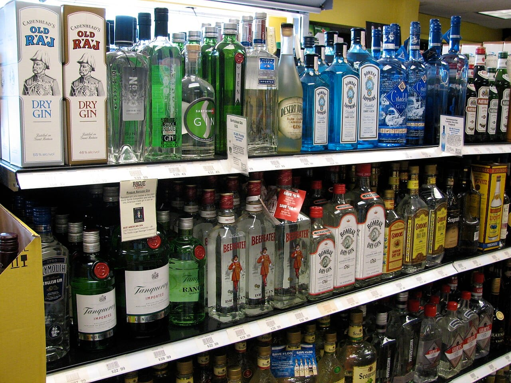

# 苏格兰威士忌税史：从 1644 年消费税到 1823 年《消费税法》

1644 年，苏格兰议会首次对威士忌征税，由此开启了长达 150 余年的私酿与走私时代。到 1820 年代，每年被查获的私酿蒸馏器多达 1.4 万座，超过一半的威士忌没有纳税。1823 年 7 月 18 日通过的《消费税法》改变了方向：它没有继续加码禁令，而是用 10 英镑执照费与按加仑计税，让合法蒸馏变得有利可图。这一转向通常被视为现代苏格兰威士忌产业的起点。

图：苏格兰威士忌税史：从 1644 年消费税到 1823 年《消费税法》的地域背景配图。摄影：Diageo distillery, Leven - geograph.org.uk - 6463659。署名：Bill Kasman，CC BY-SA 2.0，来自 Wikimedia Commons（[来源](https://commons.wikimedia.org/w/index.php?curid=150169452)）。这张照片用于说明苏格兰威士忌税史：从 1644 年消费税到 1823 年《消费税法》所涉事件发生地的环境，不是该事件的现场记录。

## 时间与地点

税史的地理范围是苏格兰，尤其是高地与东北部的乡村。私酿蒸馏分散在农场、山谷与海岸，合法蒸馏则集中在可以获得执照、靠近港口与税收站的城镇。税务官（exciseman，亦称 gauger）与私酿者的追逐，构成了 18 世纪苏格兰乡村的日常图景。

时间上可以分三段：1494 年的最早文献记载；1644 年首次征税到 1823 年的私酿时代；1823 年《消费税法》之后的合法化与产业化。三段的转折点不是技术，而是税制。

## 背景：1494 年的最早记载

苏格兰蒸馏的最早文献记录出现在 1494 年的财政部档案（Exchequer Rolls）。档案中有一笔支出：“Eight bolls of malt to Friar John Cor wherewith to make aqua vitae”，即把八蒲式耳麦芽交给修士约翰·科尔，用来制造“生命之水”。这批麦芽足以生产近 1500 瓶烈性酒。

这条记录说明，15 世纪末的苏格兰已经有以麦芽为原料的蒸馏活动，且与修道院、医药和宫廷消费有关。“生命之水”（aqua vitae）最初是药用的烈酒，后来才逐渐变成日常饮品。早期的蒸馏规模很小，多为家庭或庄园自用，尚未形成全国性产业。

## 经过：1644 年首次征税与私酿时代

1644 年，苏格兰议会对威士忌开征第一批税。征税的初衷是增加财政收入，结果却适得其反：税负越重，私酿越盛。此后 150 余年，走私成为常态；税务官与私酿者之间展开“猫鼠游戏”，私酿酒被藏在地板下、教堂讲道坛后，甚至用棺材运送以躲避检查。

到 1820 年代，矛盾达到顶点：每年被查获的私酿蒸馏器多达 1.4 万座，超过一半的威士忌在逃税状态下被消费。执法成本高昂，税基却在萎缩。继续加税或加强查缉，都无法解决问题。

转折来自一场议会辩论。戈登公爵的土地上出产苏格兰最好的私酿威士忌之一，他在上议院提议：与其让私酿继续泛滥，不如让合法蒸馏变得有利可图。这一提议最终促成了 1823 年的税制改革。

## 1823 年《消费税法》

1823 年 7 月 18 日，《消费税法》（Excise Act 1823）通过。它的核心不是“禁”，而是“引”：用可承受的税率把私酿者吸引到合法体系中来。

具体安排包括：蒸馏器执照费为 10 英镑；对 40 加仑以上的蒸馏器按每加仑 2 先令 3 便士计税；禁止使用低于法定容量的蒸馏器，以堵塞小规模逃税的口子；允许蒸馏者在完税前将酒存入仓库，降低了资金压力；同时简化与强化了税务监管，减少逃税机会。

这套安排的效果很快显现。此后十年，走私几乎绝迹；今天许多著名蒸馏厂，就建在当年私酿者的旧站点上。合法化不仅增加了税收，也让蒸馏从分散的乡村副业，变成可以投资、扩张与出口的产业。

## 影响：私酿退场与出口产业

第一，它奠定了现代苏格兰威士忌的产业基础。合法执照、税收征管与仓储制度，使蒸馏厂可以稳定生产、长期陈酿与跨区域销售。

第二，它推动了技术分化。1831 年，艾尼阿斯·科菲（Aeneas Coffey）发明连续蒸馏器（Patent Still），可以连续生产谷物威士忌；谷物威士忌与麦芽威士忌的调配，扩大了苏格兰威士忌的市场。

第三，它抓住了外部机遇。1880 年代，法国葡萄园遭受根瘤蚜，葡萄酒与白兰地在欧洲市场上几乎消失；苏格兰威士忌趁机填补空缺，成为更受欢迎的烈酒。

第四，它催生了行业组织与法规。1912 年，品牌商在伦敦开会，成立 Wine & Spirit Brand Association，1942 年改名为苏格兰威士忌协会（SWA）。1933 年，英国法律首次给出“苏格兰威士忌”的定义；1988 年出台专门的苏格兰威士忌法，2009 年又颁布新的法规。今天，苏格兰威士忌必须在苏格兰蒸馏、在橡木桶中陈酿至少三年、酒精度不低于 40% abv，才能称为 Scotch。

## 史料与争议

第一，1494 年的记载是“最早文献记录”，不等于“最早蒸馏”。考古与地方志可能显示更早的蒸馏活动，但缺乏可核对的文字证据；本页只用 1494 年作为文献起点。

第二，1823 年税法的具体税率存在版本差异。协会页面给出执照费与“按加仑计税”的原则，地方史网站给出 40 加仑以上蒸馏器每加仑 2 先令 3 便士的细节；不同资料对税率单位与适用范围的处理不完全一致，本页同时标注两类来源。

第三，“1823 年让私酿消失”是概括性叙述。走私在十年内大幅减少，但并未立即绝迹；合法化是一个渐进过程，地区差异明显。

第四，税史容易被写成“英雄叙事”。戈登公爵的提议、科菲的发明、品牌商的出口，都是关键节点，但税制改革也是财政压力、执法成本与地方利益博弈的结果，不宜简化为个人功绩。

## 时间线

- 1494：财政部档案记录修士约翰·科尔用八蒲式耳麦芽制造“生命之水”。
- 1644：苏格兰议会首次对威士忌征税，私酿与走私兴起。
- 1820 年代：每年查获私酿蒸馏器多达 1.4 万座，过半威士忌未纳税。
- 1823：7 月 18 日《消费税法》通过，合法蒸馏以执照费与按加仑计税取代禁令。
- 1831：科菲连续蒸馏器发明，谷物威士忌出现。
- 1880 年代：法国根瘤蚜导致白兰地缺位，苏格兰威士忌扩大市场。
- 1912：Wine & Spirit Brand Association 在伦敦成立。
- 1933：英国法律首次定义“苏格兰威士忌”。
- 1942：协会改名苏格兰威士忌协会（SWA）。
- 1988：苏格兰威士忌法出台。
- 2009：新的苏格兰威士忌法规颁布。

## 延伸阅读

- [威士忌](ref:whisky)：威士忌风格与工艺的当前介绍。
- [蒸馏技术传播](ref:distill-spread)：从蒸馏器到蒸馏酒的长时段技术背景。
- [苏格兰威士忌协会](ref:swa)：行业组织与法规的当前介绍。
- [英国](ref:uk)：英国酒类税制与贸易背景。
- [苏格兰](ref:scotland)：苏格兰产区与蒸馏传统。

相关条目：[英国](ref:uk)、[苏格兰](ref:scotland)、[威士忌](ref:whisky)。

## 相关图像

图：英国类别配图。图片：Decatur Wine & Spirits，CC BY-SA 3.0，via Wikimedia Commons（[原图页面](https://commons.wikimedia.org/wiki/File:DecaturGins.jpg)）。关联图像：苏格兰威士忌税史：从 1644 年消费税到 1823 年《消费税法》。
