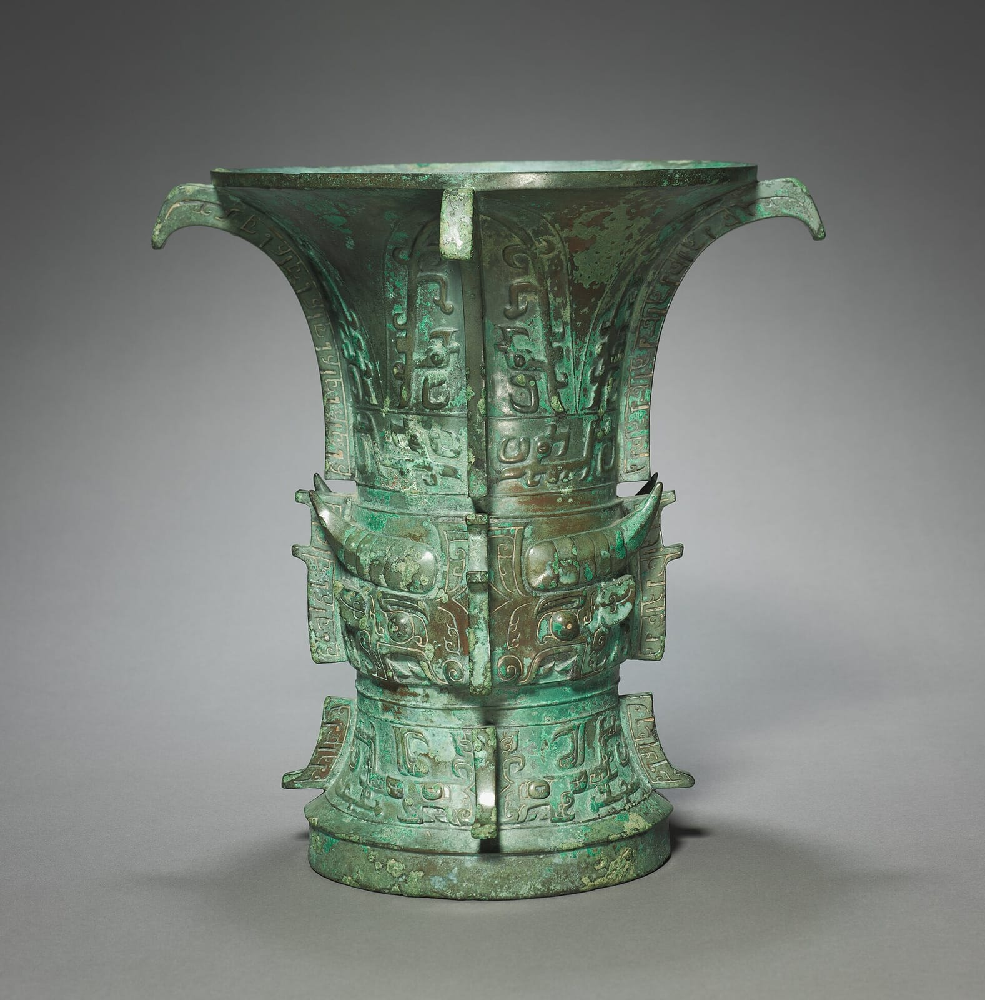
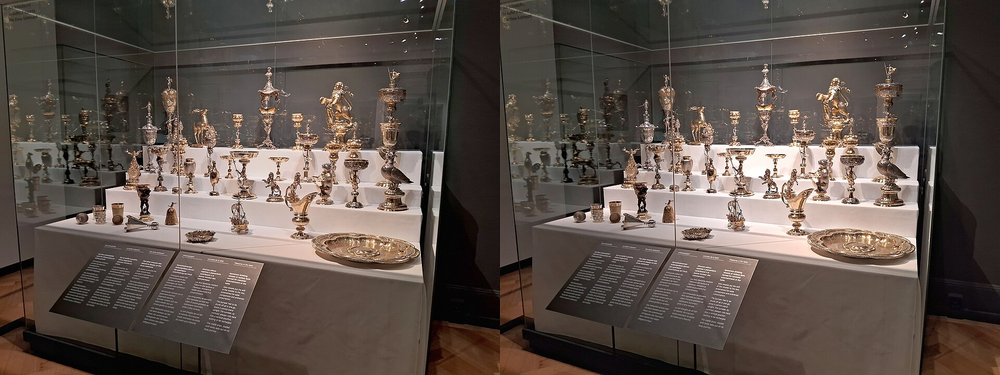

# 商周酒礼：青铜酒器、酒正职官与《酒诰》的饮酒秩序

商代与西周的饮酒不是随意的日常行为，而是嵌在祭祀、宴飨与等级秩序里的礼仪。青铜酒器的组合、周代酒正一类职官的分工、《尚书·酒诰》对饮酒场合的限制，三件事合起来，才构成“酒礼”的实际内容。把它只理解成“古人喝酒很讲究”会漏掉重点：酒礼首先是一套分配与约束的规则。

图：商周酒礼：青铜酒器、酒正职官与《酒诰》的饮酒秩序相关实景照片。图片：，CC0，via Wikimedia Commons（[原图页面](https://commons.wikimedia.org/wiki/File:Clevelandart_1951.151.jpg)）。

## 时间与地点

时段大致从商代到西周，约公元前 1600 年至公元前 771 年，中心区域在黄河中下游。安阳殷墟出土大量青铜酒器，周原与丰镐的礼器组合显示另一套制度。考古材料能证明器物与祭祀的存在，却不能直接证明文献所写的每一次仪节都曾照原样执行；文献与器物必须分开陈述，再谈对应关系。

## 背景：酒为什么先属于神

在商代祭祀中，酒是献给祖先与神祇的供品。青铜器里的爵、觚、斝、尊、卣、壶、罍，分别与温酒、饮酒、盛酒、挹酒等用途相关。器物的数量、大小与组合出现在墓葬中，说明酒器同时是身份标记：谁能用几件、用哪种器，和他在宗族与政治秩序中的位置有关。

周人承继这套器用传统，又把“德”与节制写进饮酒规范。酒礼因此从祭祀技术扩展为政治伦理：酒仍然献给神，但人的饮酒行为开始被拿来讨论德性与国运。《酒诰》正是这种讨论的产物。

## 经过：职官、酒的种类与酿酒要领

《周礼·天官》说“酒正，掌酒之政令，以式法授酒材”，即由酒正掌管酒的政令，按法定标准发放酿酒原料。酒正辨“五齐”之名，又辨“三酒”之物：事酒、昔酒、清酒。五齐指发酵与浊清程度不同的五种酒，三酒按用途与陈放时间区分。

| 五齐 | 郑玄注的关键描述 | 大致形态 |
| --- | --- | --- |
| 泛齐 | 成而滓浮泛泛然 | 最浊，发酵初成 |
| 醴齐 | 汁滓相将 | 汁与滓混合的甜酒 |
| 盎齐 | 翁翁然，葱白色 | 色浅而浊 |
| 缇齐 | 成而红赤 | 色偏红 |
| 沈齐 | 成而滓沉 | 较清，滓已下沉 |

《礼记·月令》另有一套酿酒要领：“乃命大酋，秫稻必齐，麹糵必时，湛炽必洁，水泉必香，陶器必良，火齐必得。”郑玄注说“酒熟曰酋。大酋者，酒官之长也”，即由酒官之长监督谷物、曲糵、浸煮、水质、陶器与火候六项。这套要领把酿酒从家内手艺提升为可由职官检查的公共事务。

《酒诰》则给出饮酒的边界。文中记文王对子弟与官员的教导：“无彝酒”“饮惟祀，德将无醉”，意思是不要经常饮酒，只在祭祀时饮，并以德自持、不至于醉。周公在卫国宣布这篇训诰，反复以殷商因酒失德、失国为戒。它是针对殷遗民与新封卫国的训诫，不能简单理解为西周对全社会下达的全面禁酒令。

## 影响：从礼制到酒政语言

第一，酒礼进入后世礼制。祭祀、宴飨、乡饮酒礼都延续了“酒有等级、饮有场合”的原则；酒器的形制与组合也成为身份与权力的视觉语言，见[酒器史](ref:vessels)。

第二，酒政语言被反复借用。历代禁酒、限酒与专卖的议论常引《酒诰》，把“饮惟祀”当作限制饮酒的经典依据。到汉代，限制转为财政手段，出现官府专卖的榷酒制度，见[汉代酒榷](ref:han-monopoly)。

第三，酒的分类影响了后来的工艺描述。五齐、三酒把酒按浊清、甜度与陈放区分，这种分类方式与后世黄酒的“新酒、陈酒、清酒”等说法有呼应，但具体所指不能直接对应，见[黄酒](ref:yellow-wine)。

## 史料与争议

第一，《周礼》的成书年代有争议。学界多认为它经战国后期整理，可能保存西周旧制，但把全书当作西周制度的实录会过度。因此“酒正”一职的具体实行时间，只能谨慎地说“周代礼制传统中的职官设计”。

第二，《酒诰》的传统系年是西周初年，但文本流传复杂，现代研究对其具体年代与性质有不同看法。更稳妥的读法是：它反映了周初政治集团对殷商亡国的解释，而不是一份可以按条执行的现代禁酒法。

第三，五齐与三酒的解释存在分歧。郑玄用他那个时代的酒作类比，后世注家又有不同理解；把“五齐”当成五种现代酒类，或者把“三酒”当成三个品牌等级，都会错位。

第四，青铜酒器不能直接证明社会酗酒程度。墓葬中的器物组合说明礼制与身份，文献中的“商人好酒”则带有周人的政治批判色彩。两者可以互相参照，但不能互相替代。

《酒诰》限制的是特定场合与群体，不是全面禁酒；青铜器组合也不能直接等同于日常酒俗。

## 时间线

- 商代：青铜酒器与祭祀用酒形成稳定组合。
- 西周初年：周公在卫国宣布《酒诰》，以殷商为鉴限制饮酒。
- 西周：酒正、大酋等职官与五齐、三酒、六法见于礼书传统。
- 战国后期：《周礼》等文本经过整理，形成今天所见的制度描述。
- 汉代：礼制约束之外出现专卖性质的榷酒，见[汉代酒榷](ref:han-monopoly)。

对照阅读：[中国](ref:china)、[酒器史：杯子如何改变喝法](ref:vessels)。

## 延伸阅读

- [酒与礼](ref:ritual)：礼制中酒的角色与当代遗存。
- [酒器史](ref:vessels)：青铜酒器到现代杯型的演变。
- [汉代酒榷](ref:han-monopoly)：从礼制约束到财政专卖。
- [黄酒](ref:yellow-wine)：谷物酒的工艺类型。
- [中国](ref:china)：中国酒类的产区与品类背景。

**关键事实。**

| 项目 | 内容 |
| --- | --- |
| 一句话定位 | 商代与西周的饮酒嵌在祭祀、宴飨与等级秩序里；青铜酒器的组合、周代酒正一类职官的分工、《尚书·酒诰》对饮酒场合的限制，共同构成“酒礼” |
| 时间 | 商代至西周（约公元前 1600 年至公元前 771 年） |
| 地点 | 中国 |
| 历法 | 公历（公元前纪年） |

**来源与边界。** 本页关于「商周酒礼：青铜酒器、酒正职官与《酒诰》的饮酒秩序」的关键事实，主要由以下来源交叉核对：中国哲学书电子化计划（“无彝酒”“饮惟祀，德将无醉”等原文；引用限于必要短句，未复制全文）、陕西师范大学《十三经导读》（“酒正”职掌、五齐与三酒的名称及郑玄注；“大酋”与“秫稻必齐”等六项酿酒要领及郑玄注）、故宫博物院（商代酒器组合、祭祀用酒与“酒”字材料；引用限于必要短句）。价格、批次与状态会变，涉及这些字段时以页面所列来源的最新版本为准。正文为项目自写，来源只作核验，不复制原文。

## 相关图像

图：酒器史：杯子如何改变喝法相关实景照片。图片：VasuVR，CC BY 4.0，via Wikimedia Commons（[原图页面](https://commons.wikimedia.org/wiki/File:SW45-B-18-Bern_History_Museum_Humorous_drinking_vessels_3D.jpg)）。关联图像：商周酒礼：青铜酒器、酒正职官与《酒诰》的饮酒秩序。
