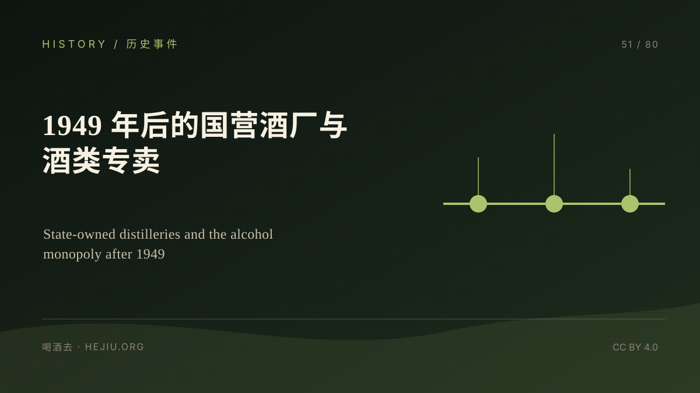

# 1949 年后的国营酒厂与酒类专卖

1949 年以后，中国酒业经历了一次所有制与管理制度的重组：分散的私营酒坊被接管、合并，逐步转为国营或公私合营酒厂；与此同时，酒的生产与销售被纳入专卖体系。这个过程不是一夜完成的，各地节奏不同，直到 1956 年前后才基本定型。

图：1949 年后的国营酒厂与酒类专卖栏目示意图。项目自产或类别插图，用于中国酒文化语境，不是该对象的实拍。

## 背景

战争结束后，酒类生产分散、质量不稳、税源流失。新政权需要粮食统筹、税收与市场供应，酒作为高税商品，自然被纳入统一管理。另一方面，传统酒坊多为前店后厂的小本经营，缺乏标准化能力，难以支撑大规模供应。1949 年至 1952 年是国民经济恢复期，统一财经、稳定物价与整顿税收是优先事项；酒类专卖既能为财政提供稳定收入，也能限制私酿私售。专卖与国营化因此成为两条并行的线索：专卖解决流通与税收，国营化解决生产组织与产权。

## 经过与时间线

- 1949—1950 年：各地接管旧政权留下的酒类机构，对私营酒坊进行登记，限制私酿私售。
- 1951 年 5 月：中共中央批准酒类专卖方针；5 月 5 日，财政部颁发《专卖事业暂行条例（草案）》和《各级专卖事业公司组织规程》。
- 1951—1952 年：中国专卖事业公司及各级机构建立，酒类批发与零售逐步纳入专卖渠道；到 1952 年，除少数地区外全国首先对酒类实行专卖。
- 1953 年：过渡时期总路线提出，对资本主义工商业的社会主义改造全面展开。
- 1954 年：政务院通过《公私合营工业企业暂行条例》，公私合营有了统一规范。
- 1956 年 1 月：北京率先实现全行业公私合营，随后各大中城市跟进。
- 1956 年底：全国原有私营工业 8.8 万余户，99% 实现所有制改造，合并组成 3.3 万多个公私合营工业企业。

## 关键人物与机构

制度设计涉及中共中央、中财委（主任陈云）、财政部与商业部；执行机构是中国专卖事业公司及其省、市、县各级公司。地方层面，国营酒厂、地方工业局与专卖公司共同完成接管、合并与定点生产。企业层面，贵州茅台酒厂、泸州老窖、[汾酒](ref:fenjiu)、绍兴酒厂等在后来的名酒体系中占据重要位置；以山西汾阳为例，传统烧酒作坊在合并后形成国营酒厂，后来成为汾酒集团的前身。类似过程也发生在茅台、泸州、绍兴等产地，但具体年份、合并范围与厂名变更在各地志书中记载不一。

## 对酒业的具体改变

第一，生产集中。小作坊数量减少，国营厂成为主要供给者，产量与质量检验有了统一口径。第二，标准起步。为了管理，企业开始建立原料、工艺与成品检验制度，这为 1952 年及此后的全国评酒会提供了组织基础，[1952 年全国评酒会](ref:evaluation-1952)就是专卖体系内部的一次质量检阅。第三，地方名酒被制度化。原本靠口碑流传的酒，被写入企业名录、产品目录与地方志，名声从此与特定厂牌绑定。第四，流通格局改变。专卖渠道取代了部分自由批发，酒的价格与供应受计划调节。第五，酒种分工强化。[白酒](ref:baijiu)与[黄酒](ref:yellow-wine)被分别归口管理，工艺改进与原料分配围绕国家计划展开。第六，负面影响也存在：部分传统工艺在合并中简化，家庭式小曲、地方特色酒种一度萎缩；产权变更后，老字号的技艺传承出现断层。

## 争议与后续评价

主要史料包括地方志、企业志、工商登记与专卖档案。争议集中在三点。第一，起点时间。有人把 1949 年接管视为国营化的开始，也有人以 1956 年公私合营完成作为节点，两种说法口径不同。第二，名酒企业的前身认定。企业沿革常把多家作坊合并叙述为单一来源，实际关系更复杂。第三，工艺连续性问题。国营化提高了产量与一致性，但是否保留了原有风味，缺乏系统的对照记录。第四，专卖与国营化的关系常被混为一谈：专卖是流通与税收制度，国营化是产权与生产组织，两者时间重叠但并非同一件事。第五，评价分化：一种观点强调国营化在稳定供应、质量管理和技术改造上的作用；另一种观点关注小作坊、地方风味与技艺传承的损失。

## 常见误读

第一，“1949 年一夜之间全国酒坊收归国有”不准确。接管、登记、合并、公私合营分阶段推进，偏远地区的小作坊延续更久。第二，专卖不等于国营。专卖管理的是生产与销售资格，国营化改变的是企业产权，两者不能互换。第三，公私合营不是简单没收。原业主多以入股、定息方式退出经营，具体安排因地区与行业而异。第四，名酒厂的前身往往不是单一作坊，而是多家作坊、酒坊与技术人员合并的结果。第五，不能用一句“建国后收归国有”概括全国，引用时应写明地区与年份。

## 另见

- [中国](ref:china)：国家产区页，提供酒类管理与地理框架。
- [白酒](ref:baijiu)：国营化过程中被重点归口管理的酒种。
- [黄酒](ref:yellow-wine)：另一条以国营厂为主的生产线。
- [汾酒集团](ref:fenjiu)：由地方烧酒作坊合并而来的企业之一。
- [1952 年全国评酒会](ref:evaluation-1952)：国营体系建立后出现的全国性评比。

对照阅读：[中国](ref:china)、[黄酒](ref:yellow-wine)。

**关键事实。**

| 项目 | 内容 |
| --- | --- |
| 一句话定位 | 1949 年以后，各地私营酒坊被接管、合并并逐步转为国营或公私合营酒厂，酒类同时纳入专卖管理；本文说明这一转变的时间跨度、制度安排与对酒业格局的影响 |
| 时间 | 1949 年至 1956 年 |
| 地点 | 中国 |
| 历法 | 公历 |

**来源与边界。** 本页关于「1949 年后的国营酒厂与酒类专卖」的关键事实，主要由以下来源交叉核对：中国社会科学院经济研究所编；中国社会科学出版社（建国初期酒类生产、专卖与私营工商业改造的制度背景）、新华网（1950 年代名酒企业与评酒制度的关系）、中国新闻网（评酒会与专卖体系、企业沿革的叙述；只引短句）等 7 条来源。价格、批次与状态会变，涉及这些字段时以页面所列来源的最新版本为准。正文为项目自写，来源只作核验，不复制原文。

## 相关图像

图：山西杏花村汾酒集团有限责任公司类别配图。图片：Xiaomage de，CC BY-SA 4.0，via Wikimedia Commons（[原图页面](https://commons.wikimedia.org/wiki/File:Vertreter_der_vier_Baijiu_Kategorien.jpg)）。关联图像：1949 年后的国营酒厂与酒类专卖。
