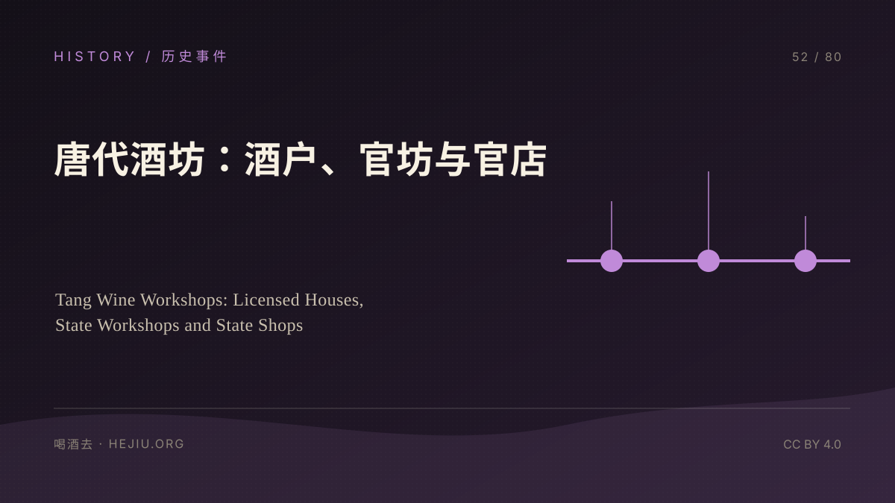

# 唐代酒坊：酒户、官坊与官店

唐前期的酒业以民营为主，朝廷多在灾年才下令禁酒；安史之乱以后军费与财政压力上升，酒从“可以禁止的消费品”变成“可以经营的商品”。广德二年开始量定酒户，建中三年改为官酿，贞元二年在京城与畿县行榷，元和年间又把榷钱摊入两税。酒坊的形态随之分裂：纳税酒户、官营酒坊与官店并存，私营酿造则反复被禁。

图：唐代酒坊：酒户、官坊与官店栏目示意图。项目自产或类别插图，用于中国酒文化语境，不是该对象的实拍。

## 时间与地点

本页聚焦 764 年至 846 年这段记载较密的时期，地点以长安、洛阳、扬州等州县城为主。酒政的空间差异很明显：建中三年“天下悉令官酿”，却特别注明“以京师王者都，特免其榷”；会昌六年只在扬州等八道州府置榷曲与官店。京师与边镇、富庶州府与一般州县，执行的是不同强度的制度。

## 背景：从灾年禁酒到财政榷酒

唐前期的禁酒多与粮食有关。玄宗时期曾因“廪食未优”“京城之中酒价尤贵”而下令京城禁沽酒，只保留光禄寺供进祭祀与宴请蕃客的用酒，麦熟之后才恢复常式。这类禁令是临时的节粮措施，不是长期专卖。

安史之乱后情况改变。军费、赏赐与地方进奉都需要现钱，酒作为消费面广、利润稳定的商品被纳入财政。广德二年十二月的诏书把“酤酒户”从一般民户中单独列出，要求“各量定”并“随月纳税”，其余官私酿造一概禁断。这一步很关键：它承认了一批合法酒户，同时把其余生产者推向非法。

## 经过：酒户、官酿与官坊

建中三年闰正月，“初榷酒，天下悉令官酿”，由州县负责，官方按斛收价，并对“醨薄私酿”设定罪责；京师因为是帝王之都，特免榷。这是唐代第一次全国性的官酿官卖。

贞元二年十二月，度支请求在京城及畿县行榷酒之法，“每斗榷一百五十”，并免除酒户的差役。酒户由此获得一种交换关系：承担酒课，换取免役与合法经营资格。元和六年六月，京兆府又奏请“榷酒钱除出正酒户外，一切随两税青苗钱据贯均率”，说明正酒户之外的民户也要按两税额分摊榷钱，酒课开始并入田赋征收。

元和十四年，湖州刺史李应的奏文把另一面写了出来：当地以官酤代替百姓纳榷，日久弊深，请求允许百姓自行酤卖、仍按旧额入两税。注文说，此前“请置官坊酤酒以代之”，随后“严设酒法”，结果“闾阎之人举手触禁，而官收厚利”。官坊在这里指官营酿酒作坊，它与官店一起构成官府直接经营的一端。

会昌六年九月，武宗敕令在扬州等八道州府“置榷曲并置官店酤酒”，代百姓纳榷酒钱，收入充军费；同时承认禁止私酤“过闻严酷”，规定以后私酤私曲“罪止一身”，不得连累乡井，也不得没入家产。

| 时间 | 措施 | 关键内容 |
| --- | --- | --- |
| 广德二年（764） | 量定酤酒户 | 各州县核定酒户，随月纳税，其余禁断 |
| 大历十四年（779） | 罢天下榷酒 | 德宗即位后一度废止 |
| 建中三年（782） | 初榷酒，天下悉令官酿 | 州县综领，按斛收价，京师特免 |
| 贞元二年（786） | 京城及畿县行榷 | 每斗榷一百五十，酒户免差役 |
| 元和六年（811） | 榷钱随两税均率 | 正酒户之外按两税青苗钱分摊 |
| 元和十四年（819） | 湖州请罢官酤 | 官坊代纳榷钱弊深，请许百姓自酤 |
| 会昌六年（846） | 八道置榷曲、官店 | 代百姓纳榷，充军费；放宽私酤连坐 |

## 影响：三种经营形态

第一种是纳税酒户。他们由官府核定，按月或按额纳榷，合法酿酒卖酒，并在贞元二年获得免差役的待遇。酒户不是纯粹的私营商人，也不是官府的雇员，而是介于两者之间的特许经营者。

第二种是官坊与官店。官府自设作坊酿酒，自设店肆销售，收入直接进入军费或地方财政。官营的好处是利润归公，坏处是质量与效率；湖州的奏文说官酤“岁月既久为弊滋深”，正是这种反弹。

第三种是私酿。它始终存在，也始终被禁。会昌六年敕令承认禁令过严、连累太广，说明私酿的规模已经大到无法用严刑消灭。宋代在此基础上发展出“诸州城内置务、县镇乡闾许民酿而定岁课”的双轨制，见[宋代酒课](ref:song-tax)。

## 史料与争议

第一，建中三年的酒价数字有版本差异。《册府元龟》作“斛收直一千”，《旧唐书》作“斛收直三千，米虽贱不得减二千”。两种读法都能讲通一部分，但无法同时成立；本页因此只记“按斛收价”，不据此换算税率。

第二，“酒户”的性质仍有讨论。广德二年的“量定酤酒户”像是特许经营名单，元和六年的“除出正酒户外”又说明正酒户与一般纳税户有别。正酒户如何取得资格、数量多少、可否世袭，现存记载都不充分。

第三，京师特免榷的含义不只有经济一面。建中三年以“王者都”为由免榷，会昌六年又提到京邑私酿至多、榷利难收。政治象征与实际征收能力在这里纠缠，不能简单说成“照顾首都”。

第四，榷钱摊入两税的效果缺少后续记录。元和六年只是京兆府的奏准，是否推广、摊派后是否引发反抗，史料没有交代；把它当成全国性税制改革会过度。

第五，“酒坊”一词需要区分。唐代材料里的“官坊”指官营作坊，与后世泛指酿酒作坊的“酒坊”不完全相同；地方志与今人叙述常把两者混用，读的时候要看上下文。

## 时间线

- 广德二年（764）：量定酤酒户，随月纳税，其余官私酿造禁断。
- 大历十四年（779）：德宗即位，罢天下榷酒。
- 建中三年（782）：初榷酒，天下悉令官酿，京师特免。
- 贞元二年（786）：京城及畿县行榷，每斗榷一百五十，酒户免差役。
- 元和六年（811）：榷酒钱在正酒户之外随两税青苗钱均率。
- 元和十四年（819）：湖州请罢官酤，许百姓自酤、仍入两税。
- 会昌六年（846）：扬州等八道置榷曲与官店，充军费。

对照阅读：[中国](ref:china)、[汉代酒榷：公元前98年的官营专卖与公元前81年的罢榷](ref:han-monopoly)。

## 延伸阅读

- [中国酒史](ref:chinese-wine-history)：从唐代酒政到后代酒业的连续线索。
- [汉代酒榷](ref:han-monopoly)：更早的官营专卖样本。
- [宋代酒课](ref:song-tax)：务、场与民酿岁课的制度化。
- [中国](ref:china)：中国酒类的产区与品类背景。

相关条目：[中国酒史纲：从谷物发酵到国家名酒](ref:chinese-wine-history)。

## 相关图像

图：宋代酒课：官务、民酿岁课与财政依赖类别配图。图片：Jiong Sheng，CC BY-SA 2.0，via Wikimedia Commons（[原图页面](https://commons.wikimedia.org/wiki/File:ShaoxingXianheng.jpg)）。关联图像：唐代酒坊：酒户、官坊与官店。
