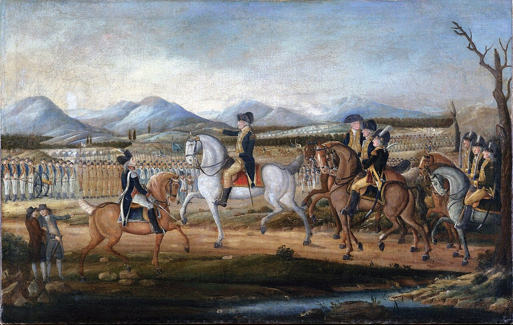
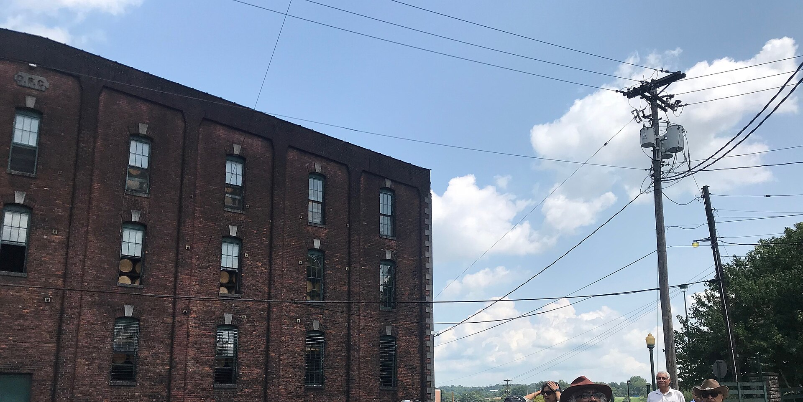

# 威士忌暴乱 1791：美国早期联邦税与边疆政治

1791 年，美国联邦政府为了偿还独立战争债务，对蒸馏酒开征消费税。对东部商人来说，这是一项财政政策；对阿巴拉契亚山以西的农户来说，它却直接打在唯一能把谷物运往市场的产品上。谷物体积大、运输难，蒸馏成威士忌后重量轻、体积小、不易腐坏，也能当作地方货币使用。于是，一项联邦税在边疆被理解为对生存方式的攻击。1794 年的武装抗议与联邦 militia 的西进，后来被称为“威士忌暴乱”。

图：弗雷德里克·凯默尔迈耶绘《华盛顿在坎伯兰堡检阅西征军》，约 1794 年。图片：Attributed to Frederick Kemmelmeyer，Public domain，via Wikimedia Commons（[原图页面](https://commons.wikimedia.org/wiki/File:WhiskeyRebellion.jpg)）。

## 时代背景

独立战争后，美国联邦政府承接了各州债务，财政压力巨大。财政部长亚历山大·汉密尔顿主张以联邦税收建立信用，1791 年 3 月，国会通过蒸馏酒消费税。税法规定按蒸馏器容量或产量征税，并允许以现金支付；但在西部边疆，现金稀缺，农户更习惯以物易物与威士忌交易。更麻烦的是，被指控逃税的人必须前往费城联邦法院应诉，距离往往超过 300 英里，路费与时间成本足以让小农放弃抗辩。

西部宾夕法尼亚的莫农加希拉河谷是当时重要的黑麦威士忌产区。当地农户把黑麦蒸馏成威士忌，沿河流与山路运往东部市场。联邦税不仅提高了成本，也把地方生产纳入一个他们无法控制的行政体系。抗议者因此把税法称为“暴政”，而联邦政府则把它视为检验新宪法能否征税、能否执法的关键。

## 经过与时间线

1791 年税法生效后，西部各县出现拒税、威胁税吏与集会抗议。1792 年，抗议者开始组织通讯委员会，试图协调跨县行动。1794 年夏天，联邦法院向未缴税者发出传票，执法官与税吏遭到围攻。7 月，税吏约翰·内维尔（John Neville）的住宅被武装人群包围，冲突中有人死亡；随后一名联邦法警被扣留，局势进一步升级。

1794 年 8 月 7 日，华盛顿发布公告，把西部抵抗定性为叛乱，并援引 1792 年《民兵法》召集宾夕法尼亚、弗吉尼亚、马里兰与新泽西的民兵。约 13,000 人集结，分两路向西部推进。华盛顿亲自随军到贝德福德，随后返回费城，把野战指挥交给亨利·“轻骑兵哈里”·李。大军压境后，叛乱迅速瓦解，几乎没有发生大规模战斗。少数人被逮捕、审判，后来又被赦免。联邦威士忌税并没有立即消失，直到 1802 年才被废除。

## 关键人物与机构

汉密尔顿是税法的主要设计者，他把消费税视为联邦财政与工业政策的一部分。华盛顿的处理方式则更具象征意义：他既发布公告、动员民兵，又派专员与西部代表谈判，试图把抵抗从“叛乱”转化为“可恢复的秩序”。阿尔伯特·加勒廷（Albert Gallatin）是西部温和派代表，他反对税法，但努力阻止暴力升级，后来成为杰斐逊政府的财政部长。约翰·内维尔与亨利·李则分别代表基层执法与军事镇压的一端。

机构层面，国会、财政部、联邦法院与州民兵共同构成了这场危机的制度链条。税法由国会通过，执法由财政部与联邦法警执行，司法传票由联邦法院发出，军事力量则由总统依据《民兵法》调动。这场危机因此不只是“农民抗税”，也是新联邦体制的一次压力测试。

## 对酒业的具体改变

第一，联邦征税权得到实际确认。政府证明自己不仅能立法，也能把税法推进到边疆。第二，蒸馏业的地理格局被政治化。西部黑麦威士忌产区与联邦政府的关系变得紧张，蒸馏者开始更积极地参与地方政治。第三，税收形式发生调整。1794 年后，税法有所修改，部分以蒸馏器容量为基础的征收方式被调整；1802 年杰斐逊政府最终废除联邦威士忌税。第四，威士忌的象征意义增强。它不再只是商品，也成为边疆自主、抗税与地方身份的符号。第五，政党政治被推动。联邦党与民主共和党围绕税法、民兵与联邦权力的争论，成为 1790 年代美国政治的重要组成部分。

## 争议与史料

第一，死亡人数与冲突规模存在差异。不同史料对 1794 年夏天的最初冲突、伤亡与逮捕人数记载不一，不能用一个数字概括。第二，参与者的构成被简化。抗议者并不都是贫困农户，也包括地方精英、蒸馏者、商人以及反对联邦权力的政治人物；他们的动机各不相同。第三，“叛乱”与“抗议”的标签带有立场。联邦政府称其为叛乱，地方参与者则常把自己描述为合法的抗税与请愿。第四，军事行动的实际作用被夸大或缩小。大军西进确实避免了大规模战斗，但逮捕、审判与赦免的过程同样塑造了结果。第五，税法废除的原因复杂。1802 年废除联邦威士忌税，既与杰斐逊政府的财政政策有关，也与执法成本、边疆政治和战争压力有关，不能简单归因于这场暴乱。

## 常见误读

一，“这是一场真正的战争”。它更像一场武装抗税与联邦军事威慑，双方没有发生大规模会战。二，“华盛顿亲自带兵打仗”。他随军西进并检阅部队，但实际野战指挥由亨利·李承担。三，“暴乱直接导致威士忌税被废除”。税法在 1794 年后仍继续存在，直到 1802 年才被废除。四，“所有西部农户都反对征税”。有人拒税，也有人纳税、观望或反对暴力；边疆社会并非铁板一块。五，“威士忌暴乱只关乎威士忌”。它同时关乎联邦财政、司法管辖、民兵制度与西部政治代表权，是理解美国早期国家建设的一个窗口。

相关条目：[威士忌](ref:whisky)、[水牛足迹](ref:buffalo)、[杰克丹尼老7号](ref:jack)。

## 另见

- [威士忌](ref:whisky)：从谷物蒸馏到橡木桶陈年的基础框架。
- [水牛足迹](ref:buffalo)：美国波本与黑麦威士忌传统的现代样本。
- [杰克丹尼](ref:jack)：田纳西威士忌与美国蒸馏传统。
- [美国](ref:usa)：联邦税制、州权与酒类监管的区域背景。
- [美国禁酒令](ref:prohibition)：另一场联邦政府与饮酒行为的正面冲突。

## 相关图像

图：水牛足迹相关实景照片。图片：Jaimin Trivedi，CC BY-SA 4.0，via Wikimedia Commons（[原图页面](https://commons.wikimedia.org/wiki/File:Buffalo_Trace_Distillery_Barrel_Aging_Warehouse_(outside).jpg)）。关联图像：威士忌暴乱 1791：美国早期联邦税与边疆政治。
