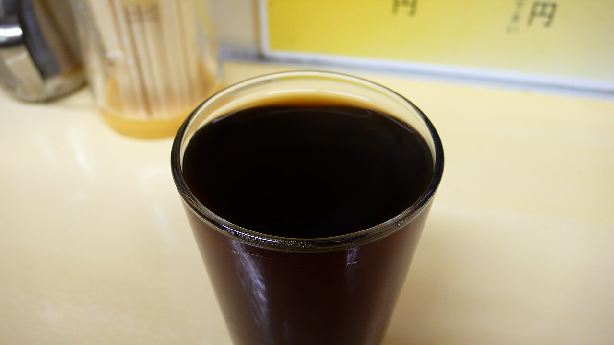

# 仪狄造酒传说：文献里的“始作酒醪”与说不清的时代

仪狄是中国古文献里最早被点名的酿酒者之一。《世本》《吕氏春秋》《战国策》《说文解字》都把“作酒”或“作酒醪”记在他的名下，还附上禹饮而甘之、随后疏远仪狄的故事。这些文本成书于战国至东汉，距传说所指的夏禹时期已隔一两千年，因此它更像古人对酿酒起源的一种解释，而不是能够断代的发明事件。

图："仪狄造酒传说：文献里的“始作酒醪”与说不清的时代"的地域背景配图。图片：M. Weitzel，CC BY-SA 2.5，via Wikimedia Commons（[原图页面](https://commons.wikimedia.org/wiki/File:Tsingdao_Brewery.jpg)）。这张照片用于说明"仪狄造酒传说：文献里的“始作酒醪”与说不清的时代"所涉事件发生地的环境，不是该事件的现场记录。

## 时间与地点

传说把仪狄放在夏禹的时代。《战国策·魏策二》的注说“帝女，尧或舜之女”，又称《博物志》说“仪狄，禹时人”；注文本身出自后世，只能说明汉魏时人如何理解这条传说。文献没有留下可核验的年代，今本《吕氏春秋·勿躬》也只列“仪狄作酒”四字，没有说明造酒的地点。关于仪狄在哪里作酒，早期文本给不出答案；后世地方叙事中的具体地名缺少早期证据，本页因此不作定位。

## 背景：为什么古人把发明记在一个人名下

先秦两汉有一种“圣人制器”的写法：把房屋、舟船、历法、弓箭等事物的起源分别记在一个名字上。《吕氏春秋·勿躬》就是这种体例，它把“仪狄作酒”与“高元作室”“虞姁作舟”并列。这类名单回答的是“谁最早做”，并不提供编年史。

酿酒实际是谷物受潮、发芽、发霉后自然发酵，被人们观察、模仿并逐步稳定的长过程。把漫长过程压缩成一个名字，便于记忆和祭祀，也让酒有了可以追溯的祖师。仪狄的形象因此更接近“发明者的位置”，而不是一个有生平可考的人。

## 文献里的层累

把相关文本按时间排开，可以看到故事一步步变完整。

| 文献 | 成书年代 | 相关文字 | 它增加了什么 |
| --- | --- | --- | --- |
| 《世本·作篇》 | 战国末至汉初，原书已佚 | “仪狄始作酒醪，变五味” | 把酒醪的起源归给仪狄 |
| 《吕氏春秋·勿躬》 | 战国末 | “仪狄作酒” | 只列为发明之一，没有细节 |
| 《战国策·魏策二》 | 西汉刘向整理 | “帝女令仪狄作酒而美，进之禹……遂疏仪狄，绝旨酒” | 加入禹与“绝旨酒”的训诫 |
| 《说文解字·酉部》 | 东汉 | “古者仪狄作酒醪，禹尝之而美，遂疏仪狄” | 复述并定型故事 |
| 《酒诰》 | 晋 | “或云仪狄，一曰杜康” | 承认仪狄、杜康两说并存 |

表格引文据故宫博物院、中国社会科学网与陕西省非遗资料的转引。《世本》原书散佚，今天看到的是辑本与后人引文，不能当作战国原文逐字使用。越往后的文本，故事越完整，细节也越多，这正是传说层累的典型形态。

## 酒醪是什么

“醪”指带糟的酒，汁与滓混在一起，没有经过细滤。《说文解字》把仪狄所作为“酒醪”，与后世常见的清澈酒液不同。酒史研究一般把酒醪看作谷物发酵后未过滤的浊酒，与黄酒、米酒的早期形态相近；但“相近”不等于同一种工艺。

曲的培植、发酵温度与压榨方式都会改变成品，早期酒醪的具体做法没有可靠记录。见[黄酒](ref:yellow-wine)与[黄酒史](ref:yellow-wine-history)可以了解这条工艺线索，但把仪狄的酒醪直接等同于今天的某一种黄酒，仍是跳跃。

## 影响：从酒祖到戒酒训诫

仪狄在后世有两个身份。一个是酒业的祖师，与杜康并称，晋代江统《酒诰》就把“或云仪狄，一曰杜康”并列写出。另一个是反面例子：禹尝了仪狄的酒，觉得甘美，却预言“后世必有以酒亡其国者”，于是疏远仪狄、不再饮甜酒。这个故事后来常被禁酒与节饮的议论引用，成为“酒能误国”的固定说法。

两个身份互相拉扯：同一则传说既把仪狄供为创始人，又把他写成被君主疏远的人。它反映的不是某个历史人物的遭遇，而是古人对酒的双重态度——承认酒的美好，又警惕酒的后果。仪狄在诗文中的出场远少于杜康，这也说明传说能否流传，往往取决于后来有没有一句好诗替它传播。

## 史料与争议

第一，仪狄是否实有其人，没有同时代文字与考古证据支持。商代甲骨文与青铜酒器表明，至迟在商代，酒与酒礼已经相当发达，但这不能证明某一个人“始作酒”。

第二，“帝女”有两种读法：一说是帝女命令仪狄作酒，一说是帝女本人就是仪狄。两种读法都缺少旁证，身份与性别因此无法确定。

第三，考古发现把酿酒的起点推得远比传说更早。河南舞阳贾湖遗址在 1984 年至 2001 年的发掘中出土大批陶器；1999 年起，中美团队对陶片残留物做分析，2004 年发表的论文认为，公元前 7000 年左右，当地已用稻米、蜂蜜和果实制作混合发酵饮料。这说明酿酒实践远早于禹的时代，仪狄不可能是“第一个酿酒的人”，传说只是对更早实践的事后追认。

第四，地点问题没有早期记载。后世地方叙事把仪狄与特定河流、村落相连，属于文化资源的整理，不能当作史料。把这些地名当作“仪狄故里”，等于用晚出的说法回答早期文本没有回答的问题。

## 时间线

- 约公元前 7000 年：贾湖陶器残留显示稻米、蜂蜜与果实的混合发酵饮料。
- 商代：甲骨文与青铜酒器显示酒已进入礼制生活。
- 战国末：《世本》《吕氏春秋》出现“仪狄作酒”的记载。
- 西汉：《战国策》加入禹饮甘之、疏远仪狄的故事。
- 东汉：《说文解字》把仪狄与杜康并列写入字书。
- 晋：江统《酒诰》承认“或云仪狄，一曰杜康”。
- 1984 年至 2001 年：贾湖遗址发掘；1999 年起残留物分析，2004 年论文发表。

对照阅读：[中国](ref:china)、[黄酒史：米、曲、水与绍兴](ref:yellow-wine-history)。

## 延伸阅读

- [杜康造酒传说](ref:du-kang)：另一条酿酒起源传说及其身份争议。
- [黄酒](ref:yellow-wine)：酒醪与后世谷物酒的工艺关系。
- [黄酒史](ref:yellow-wine-history)：从浊酒到现代黄酒的演变。
- [中国](ref:china)：中国酒类的产区与品类背景。

## 相关图像

图：黄酒。图片：udono，CC BY-SA 2.0，via Wikimedia Commons（[原图页面](https://commons.wikimedia.org/wiki/File:Shaoxing_wine_in_a_glass_by_udono_in_Tokyo.jpg)）。关联图像：仪狄造酒传说：文献里的“始作酒醪”与说不清的时代。
