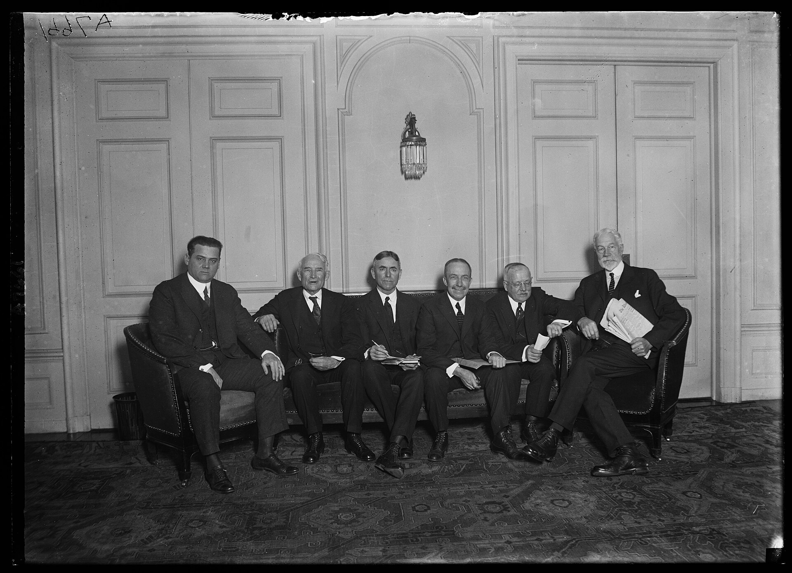

# 反酒馆联盟：把禁酒送入宪法的压力集团

在美国禁酒史上，反酒馆联盟（Anti-Saloon League）是一个绕不开的名字。它不是一个普通的戒酒互助会，也不是一个只做道德劝说的教会团体；它把“禁酒”变成一项可以通过选举、游说和立法推进的政治议程。理解它，能看清一场社会运动如何从地方组织成长为全国性压力集团，又如何在目标实现后失去方向。

图：反酒馆联盟：把禁酒送入宪法的压力集团相关实景照片。图片：Harris & Ewing, photographer，Public domain，via Wikimedia Commons（[原图页面](https://commons.wikimedia.org/wiki/File:Nat%27l_Officers_of_the_Anti-Saloon_League,_now_in_session_LCCN2016887060.jpg)）。

## 它是什么组织

反酒馆联盟是 20 世纪初美国禁酒立法的主要游说组织。它的名字直译是“反酒馆联盟”，目标却不止于关闭酒馆：它要禁止致醉饮料的制造与销售。它主要从新教福音派教会获得支持，在联邦、州与地方各级政府对立法者施压。

这一定位很重要。它既不是政府机构，也不是单纯的慈善团体，而是一个把分散的宗教与道德诉求组织成选票与游说能力的政治组织。它的影响力来自“能把人组织起来”，而不是来自行政权力。

## 1893年在俄亥俄起步

Britannica 的条目记载，反酒馆联盟最早是 1893 年在俄亥俄成立的一个州级团体。两年后的 1895 年，它扩展为全国性组织。这个时间顺序说明，它不是一夜之间出现的全国运动，而是先在地方积累组织经验，再向全国复制。

俄亥俄的起点也提示了它的社会基础：地方教会、小镇社区与戒酒团体。这些网络提供了人员、经费与动员渠道。当同样的方法被推广到其他州，联盟就从一个地方压力团体变成了全国政治力量。

## 从州级团体到全国压力集团

联盟的扩张方式，可以概括为“单议题、跨层级、长期施压”。它不追求一次性说服所有人，而是在每一次选举与每一级立法中，把禁酒议题推到候选人面前。它的支持者可以因为一个候选人对禁酒的态度而投票，这种“单议题投票”让政治人物难以忽视它。

这种策略也带来一个问题：当一个组织把全部政治资本押在一个议题上，它的成败就与这个议题绑定。禁酒令通过时，联盟获得了空前的胜利；禁酒令被废止时，它也失去了继续动员的核心。

## 它与第十八修正案

Britannica 的禁酒条目指出，第十八修正案由反酒馆联盟的韦恩·惠勒（Wayne Wheeler）等人推动，1917 年 12 月在国会通过，1919 年 1 月获得各州批准。联盟在修正案通过后并没有解散，而是转向推动严格执法。

这里可以看到压力集团与宪法修正案的关系：社会运动可以推动修宪，但修宪之后的执行、解释与资源投入，仍然需要持续的政治组织。联盟把“通过修正案”当成阶段性胜利，却很快发现“让修正案真正生效”是另一场更难的战役。

## 它的组织方法与政治影响

从现有材料可以稳妥地说：联盟在各级政府游说，依靠教会网络动员，并把禁酒作为选举中的核心议题。至于它具体的内部预算、会员人数与地方分支数量，本页没有可靠数据，因此不做估算。

它的政治影响可以从结果反推：一个自愿性的道德倡议，最终变成一条写入宪法的禁令。无论人们如何评价禁酒令，联盟展示了组织化少数如何通过制度渠道改变全国政策。这也是它成为政治学与历史学案例的原因。

## 1933年后：衰落与合并

第十八修正案在 1933 年被第二十一修正案废止。 Britannica 条目说，废止之后，反酒馆联盟不再是美国政治中的一支力量。1950 年，它与其他团体合并，组成全国禁酒联盟（National Temperance League）。

这段结局很有代表性：当一个组织的主要目标被撤销，它要么转型，要么萎缩。联盟选择了合并，但“禁酒”作为全国性宪法议题已经结束。它的组织网络与经验仍在，只是不再拥有原来的政治杠杆。

## 常见误读

第一，把反酒馆联盟当成普通的戒酒协会。它确实有道德与宗教背景，但核心工作是大规模政治游说。

第二，把它当成禁酒令的唯一推手。禁酒运动有更长的历史与更多参与者；联盟是其中最有组织力的一支，但不是全部。

第三，把它的成功说成“说服了所有人”。禁酒令的通过是制度与政治联盟的结果，不等于全国共识；禁酒时期的非法饮酒市场也说明执行远非普遍。

第四，把 1933 年当成它立刻消失。它失去了全国影响力，但组织仍然存在，直到 1950 年合并。

它并不是单一教会的附属机构，而是把不同新教教派的禁酒动员组织成全国压力集团；把政教关系简化成教会直接立法，会看错它的运作方式。

## 今天怎样理解这类组织

把反酒馆联盟放回压力集团的历史里看，它提出的问题仍然有效：一个单议题组织如何维持长期动员？当目标写进法律后，它如何转型？当政策被推翻后，它的社会网络还能做什么？

对今天的读者来说，它既是一个历史案例，也是一个提醒：道德诉求可以进入政治，但一旦进入，就必须面对执行成本、反对联盟与政策反噬。若想了解它推动的那段历史，可以读[美国禁酒令](ref:us-prohibition)；若想了解酒馆在城市生活中的角色，可以看[酒馆与城市](ref:pub-and-city)；若想了解禁酒时期受冲击的酒类行业，可以看[威士忌](ref:whisky)。

对照阅读：[美国禁酒令：1920年至1933年的实验与废止](ref:us-prohibition)、[威士忌](ref:whisky)。

## 延伸阅读

- [美国禁酒令](ref:us-prohibition)：1920—1933 年的禁酒实验与废止。
- [酒馆与城市](ref:pub-and-city)：酒吧、街区与城市生活的关系。
- [威士忌](ref:whisky)：禁酒时期受冲击的蒸馏酒行业。

**关键事实。**

| 项目 | 内容 |
| --- | --- |
| 一句话定位 | 反酒馆联盟 1893 年在俄亥俄以州级团体起步，1895 年成为全国组织，主要依托新教福音派教会，在各级政府对禁酒立法施压；第十八修正案通过后它推动严格执法，1933 年废止后失去政治影响力，1950 年并入全国禁酒联盟 |
| 成立 | 1893 |
