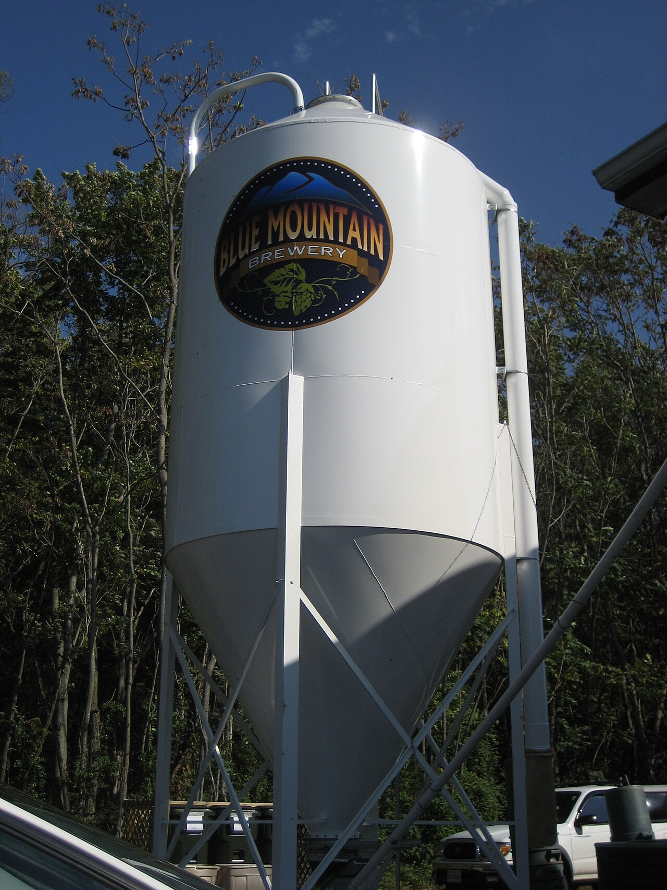

# 美国酿酒师协会：为“小而独立”下定义的行业组织

美国酿酒师协会（Brewers Association，BA）这个名字容易被误解成“所有美国酿酒师的总会”。它实际代表的是美国小型与独立酿酒厂，尤其是精酿啤酒（craft beer）阵营。它既做行业倡导，也做数据统计、赛事组织与消费者教育。理解 BA，关键不是记住它有多少会员，而是理解它如何定义“craft brewer”，以及这个定义为什么有争议。

图：美国蓝山啤酒厂的发酵罐；画面不是美国酿酒师协会的总部，也不是其赛事现场。图片：Schwars1，CC0，via Wikimedia Commons（[原图页面](https://commons.wikimedia.org/wiki/File:Blue_Mountain_Brewery_beer_fermentation_tank.jpg)）。

## 2005 年的合并

BA 的直接前身有两条线。一条是 1978 年 Charlie Papazian 与 Charlie Matzen 在科罗拉多博尔德创办的 American Homebrewers Association（AHA），最初服务家酿爱好者，并出版《Zymurgy》杂志。另一条是更早的小啤酒厂组织，1942 年的 Small Brewers Committee 被视为 Brewers’ Association of America 的前身。

1983 年，Association of Brewers 成立，把 AHA 与 Institute for Brewing and Fermentation Studies 纳入其中，服务新兴的小型啤酒厂运动。2005 年，Association of Brewers 与 Brewers’ Association of America 合并，正式形成今天的 Brewers Association。合并后，BA 把原来分散在家酿、小酒厂与政策倡导之间的力量集中到一个组织里。

## “小而独立”的定义

BA 最广为人知的动作，是给“craft brewer”下定义。这个定义不是法律定义，而是行业组织用来统计与沟通的分类标准。它通常要求酒厂规模小、独立于大型酒类公司，并且以传统或创新方式酿造啤酒。BA 董事会曾多次修订定义，最近一次在 2018 年，把“传统”与“创新”的边界写得更清楚。

定义之所以重要，是因为它决定了谁能被称为“craft brewer”，谁能参加某些项目、使用某些标识、进入某些统计数据。它也为消费者提供了一个快速判断：这家酒厂是独立的，还是属于某个跨国集团。定义不是永恒的，随着并购、合资与市场变化，BA 需要不断调整。

## 会员、治理与华盛顿的倡导

BA 是 501(c)(6) 贸易协会，会员包括酒厂、供应商、分销商、零售商与相关从业者。治理由董事会与委员会负责，日常运营由波尔德总部团队执行。它在美国首都华盛顿做政策倡导，关注联邦税法、酒类监管、贸易与标签规则。

倡导是贸易协会的常规工作，但 BA 的立场有明确边界：它代表小型与独立酿酒厂，不代表所有酒类企业。它与大型啤酒集团、葡萄酒协会、蒸馏酒协会的诉求并不总是一致。读者看到 BA 的政策声明时，应先问“它代表谁”，再判断其论点。

## GABF 与啤酒风格指南

BA 主办 Great American Beer Festival（GABF）。1982 年首届 GABF 在博尔德的 Harvest House 举行，只有 24 家酒厂、47 款啤酒与 800 名观众；1984 年移师丹佛，后来进入 Colorado Convention Center，2026 年改为户外场地。GABF 既是消费者节日，也是行业赛事，评委按 BA 的啤酒风格指南评分。

BA 还维护 Beer Style Guidelines，把啤酒按原料、工艺、风味与历史归类。风格指南不是法律标准，但它影响酒厂如何报名参赛、评委如何打分、消费者如何理解“这是一款什么酒”。指南会随新风格出现而更新，比如近年来加入无酒精啤酒类别。

## 数据与行业统计

BA 定期发布美国精酿啤酒行业数据，包括酒厂数量、产量、销售额、出口与就业。它的统计口径以“craft brewer”定义为基础，因此与政府统计或商业数据库不完全可比。引用时要注意年份、口径与样本范围，不能把 BA 的“精酿”数据直接当成“全美啤酒”数据。

这些数据对行业有实际作用：酒厂用它判断市场温度，投资者用它做尽调，媒体用它写趋势，政策制定者用它理解小企业的处境。数据也会被误读，尤其是把出货量、零售额与产量混为一谈。

## 它如何影响精酿啤酒

BA 的影响主要体现在三件事。第一，定义。它让“craft beer”从一个模糊的营销词变成可操作的分类。第二，赛事。GABF 与 World Beer Cup 为酒厂提供质量信号，也为消费者提供发现新酒的入口。第三，倡导。它把小型酒厂的诉求带到联邦政策讨论中，尤其是在税率、分销与标签方面。

对消费者来说，BA 的标识与赛事奖项可以帮助筛选，但不是质量保证。对酒厂来说，加入 BA 意味着进入一个共同体，也意味着接受其定义与规则。对研究者来说，BA 的数据是理解美国精酿市场的起点，但需要与其他来源交叉核对。

## 边界与常见误读

第一，BA 不是政府机构。它不发放许可证，不制定法律，也不替 FDA 或 TTB 执法。第二，BA 不代表所有美国酒厂。大型啤酒集团、非会员酒厂与进口商不在其核心代表范围内。第三，“craft”不是规模越大越好或越小越纯；定义会随所有权与产量变化。第四，GABF 奖项不是绝对排名，比赛按类别评审，参赛策略与类别选择会影响结果。第五，BA 的数据有口径，不能直接与政府统计混用。

常见误读还有：把 BA 当成“酿酒师工会”；把 craft brewer 定义当成法律；把 GABF 当成“啤酒奥运会”。更准确的理解是：BA 是一个由小型与独立酒厂组成的贸易协会，它用定义、赛事、数据与倡导来维护一个市场细分。想建立自己的啤酒品鉴语言，可参考[啤酒品鉴入门](ref:beer-tasting-intro)；想读懂标签，可参考[酒标很小，线索不少](ref:read-a-label)；它主办的[美国大啤酒节](ref:gabf-event)与[IPA](ref:ipa)等风格，共同塑造了公众对精酿的认知。BA 的故事终究是关于[啤酒](ref:beer)如何在美国被重新做成小规模、独立与有辨识度的生意。

相关条目：[啤酒](ref:beer)、[啤酒品鉴入门：从香气、酒体到苦度](ref:beer-tasting-intro)、[酒标很小，线索不少](ref:read-a-label)。

**关键事实。**

| 项目 | 内容 |
| --- | --- |
| 一句话定位 | 美国酿酒师协会（Brewers Association，BA）由 1978 年成立的 American Homebrewers Association 与更早的小啤酒厂组织演变而来，2005 年由 Association of Brewers 与 Brewers’ Association of America 合并而成；它代表美国小型与独立酿酒厂，维护“cr… |
| 成立 | 2005 |
| 官网 | brewersassociation.org |

**来源与边界。** 本页关于「美国酿酒师协会：为“小而独立”下定义的行业组织」的关键事实，主要由以下来源交叉核对：Brewers Association（BA 的使命、会员构成与“small and independent”定位；craft brewer 的规模、独立性与其他所有权标准）、Great American Beer Festival；Brewers Association（1982 年首届 GABF 在 Boulder 的 Harvest House、24 家酒厂 47 款酒 800 名观众、1984 年移师丹佛）、CraftBeer.com；Brewers Association（2005 年合并后制定的 craft brewer 定义及后续修订）。产品、地址或营业状态变化较快时，以 brewersassociation.org 的最新页面为准；价格、批次与状态会变，涉及这些字段时以页面所列来源的最新版本为准。正文为项目自写，来源只作核验，不复制原文。
