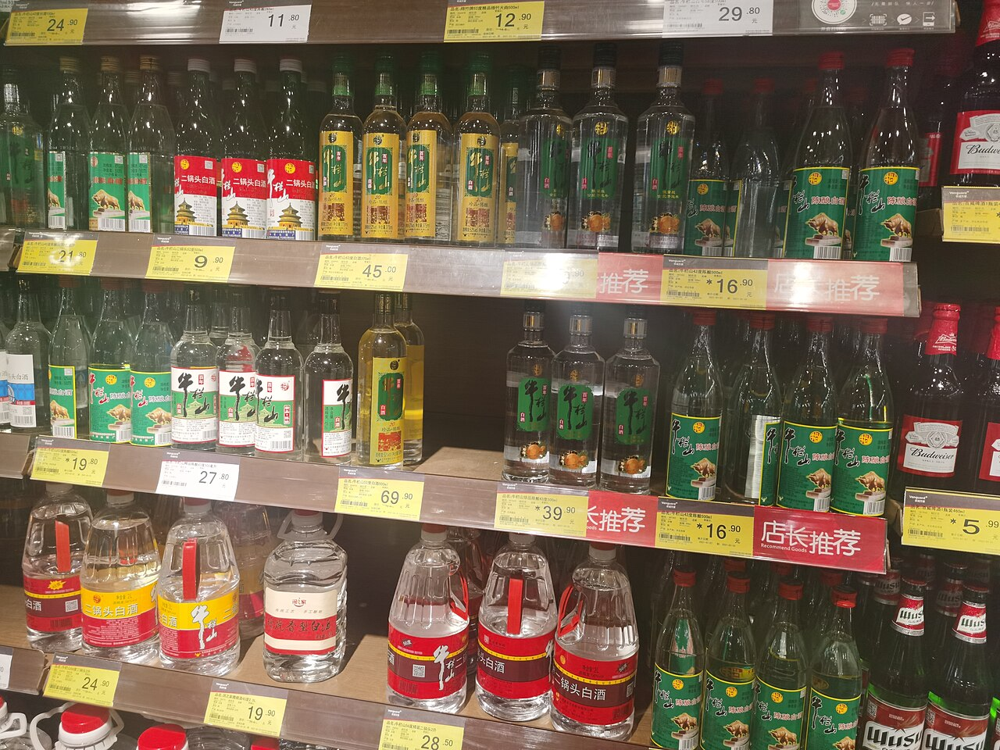

# 中国酒业协会：从酿酒工业协会到跨酒种行业组织

中国酒业协会（China Alcoholic Drinks Association，CADA）常被简称“中酒协”。它的名字里有“酒业”，但它的前身叫“中国酿酒工业协会”，这两个名字之间的变化，正好反映了中国酒类行业从“工业生产”走向“多酒种、全产业链”的过程。理解它，需要先分清它是什么、不是什么。

图：苏州一家超市货架上的牛栏山二锅头；画面不是中国酒业协会总部，也不是协会活动。图：Shwangtianyuan，CC BY-SA 4.0。。图片：Shwangtianyuan，CC BY-SA 4.0，via Wikimedia Commons（[原图页面](https://commons.wikimedia.org/wiki/File:Niulanshan_Erguotou_on_shelves_in_CR_Vanguard_Suzhou_Fangzhou_Road_Store.jpg)）。

## 1992 年的登记与改名

协会官网写得很清楚：中国酒业协会原名中国酿酒工业协会，1992 年 6 月 22 日经原中华人民共和国轻工业部审查同意，由中华人民共和国民政部登记注册成立。这个时间点很重要——它不是在 1949 年就存在的全国性行业组织，而是 1990 年代行业管理体制调整的产物。

后来改名“中国酒业协会”，业务范围也从酿酒工业扩展到白酒、啤酒、葡萄酒、黄酒、露酒、酒精、添加剂、装备、流通与酒文化等更完整的链条。名字的变化不是文字游戏，而是组织定位的变化：从“管生产”的工业协会，转向“服务整个酒类市场”的行业组织。

## 登记管理机关与业务主管单位

在中国，全国性社会团体通常有双重管理结构。协会官网列明：登记管理机关是民政部，党建工作领导机关是中共中央社会工作部，业务主管单位是工业和信息化部。这意味着它要接受民政部门的登记与年检管理，也要接受业务主管单位的业务指导。

但“业务主管单位”不等于“行政机关”。协会本身不是政府机关，不能发放生产许可证，不能代替市场监管部门执法，也不能强制企业加入。它的权力来自会员授权、行业共识与政府委托的项目，而不是行政层级。把协会当成“酒类管理局”是常见误读。

## 它覆盖哪些酒种

从官网与行业活动看，协会的业务覆盖白酒、啤酒、葡萄酒、黄酒、露酒、酒精与相关配套产业。它下设多个专业委员会，分别负责白酒、啤酒、葡萄酒、黄酒、市场、文化、装备、标准等事务。不同酒种的委员会有自己的专家、会员与活动，但都在协会的统一框架下运作。

这种“跨酒种”结构在中国比较特殊。白酒、啤酒、葡萄酒、黄酒的历史、税率、消费场景与产区差异很大，放在同一个协会里，需要平衡各方利益。协会的优势是能统筹行业数据、标准与政策倡导；挑战是不同酒种的诉求可能冲突，协会必须做协调而不是简单相加。

## 团体标准与展会

协会的一个实际职能是组织团体标准。团体标准由社会团体发布，供市场自愿采用，不能替代强制性国家标准。协会设有团体标准审查委员会，标准编号常以 T/CBJ 开头，覆盖白酒产品、工艺、年份酒、酒庄酒等细分领域。标准文本会在协会网站与全国团体标准信息平台公开。

协会还主办或参与组织大型展会，例如中国国际酒业博览会、中国国际黄酒产业博览会、中国国际名酒博览会等。展会既是交易平台，也是行业信息发布、品牌展示与产区推广的场合。对中小企业来说，展会是获得曝光的机会；对协会来说，展会是维持行业网络与收入的重要方式。

## 行业数据与年度报告

协会定期发布行业数据与研究报告。可核对的一组数据来自 2025 年协会与毕马威联合发布的《2025 中国白酒市场中期研究报告》：2024 年，中国规模以上白酒企业 989 家，完成总产量 414.5 万千升，同比下降 1.8%；销售收入 7,963.8 亿元，同比增长 5.3%；利润总额 2,508.7 亿元，同比增长 7.8%。

这组数据常被概括为“量降利升”。它说明行业在收缩产量，但通过结构升级、价格带调整与品牌集中，仍保持了收入与利润增长。引用时要注意口径：这是“规模以上企业”数据，不等于全行业；是 2024 年数据，不是 2025 年全年。协会报告的价值在于提供统一口径，但读者仍应核对统计范围。

## 它如何影响酒业

协会的影响主要体现在四个层面。第一，标准。团体标准把一些细分品类的术语、工艺与质量要求写下来，影响企业生产与消费者认知。第二，数据。协会报告为政府、企业与媒体提供行业参照。第三，展会与活动。协会把酒厂、经销商、产区与媒体聚在一起，促成交易与传播。第四，政策沟通。协会代表行业向主管部门反映诉求，参与法规与标准制定的讨论。

这些职能让协会成为行业基础设施的一部分，但它不是万能的。标准靠企业自愿采用，数据靠会员与统计部门提供，展会靠市场买单，政策沟通靠主管部门采纳。协会的能量取决于会员基础与专业能力，而不是行政命令。

## 边界与常见误读

第一，协会不是行政机关。它不能发生产许可证，不能执法，也不能强制企业加入。第二，团体标准不是国家标准。它不能替代 GB 强制性标准，企业采用与否自愿。第三，协会数据有口径。规模以上企业、销售收入、产量等指标各有边界，不能混用。第四，协会代表的是会员与行业整体，不是每一家企业的个别利益；不同酒种、不同规模企业之间可能存在分歧。第五，协会与政府部门有业务指导关系，但协会的决议不等于政府政策。

常见误读还有：把“中国酒业协会”与“中国酒类流通协会”混为一谈——后者更侧重流通环节，是另一个组织；把协会当成“白酒协会”，忽略它对啤酒、葡萄酒、黄酒等酒种的覆盖；把协会发布的团体标准当成强制法规。更准确的理解是：它是一个在民政部登记、由工信部业务指导的全国性行业组织，用标准、数据、展会与政策沟通来服务酒类行业。想了解白酒怎么入门，可参考[第一次喝白酒怎么选](ref:first-baijiu)；想读懂标签，可参考[酒标很小，线索不少](ref:read-a-label)。协会的工作最终落在[白酒](ref:baijiu)、[黄酒](ref:yellow-wine)、[啤酒](ref:beer)与[葡萄酒](ref:wine)这些具体的酒种上。

相关条目：[白酒](ref:baijiu)、[黄酒](ref:yellow-wine)。
