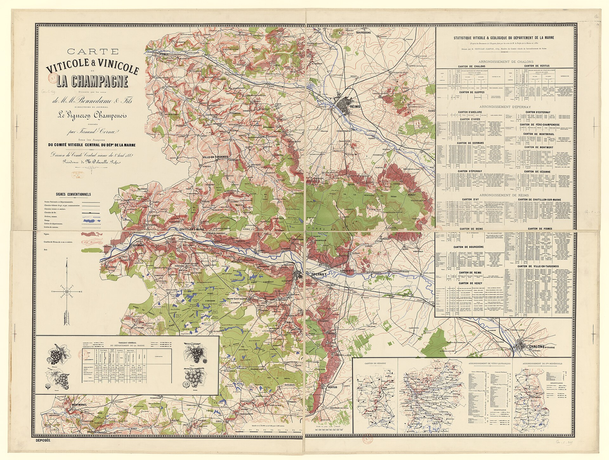

# 香槟协会：种植者与酒商如何共同管理一个产区

香槟是一个把“产区”做成制度的地方。葡萄由成千上万的种植者种，酒由数百家酒商与合作社酿，最后都叫同一个名字。要让这个名字在全世界站得住，单靠任何一方都不够。香槟协会（Comité Champagne，旧称 CIVC）就是让种植者与酒商坐到一起的跨行业组织。

图：香槟协会：种植者与酒商如何共同管理一个产区相关实景照片。图片：Bonnedame, Raphaël-Frédéric (1843-1870). Fonction indéterminée Cornu, Fernand (18..-19..?). Fonction indéterminée Testulat-Gaspar, A. (18..-18..? ; cartographe)，Public domain，via Wikimedia Commons（[原图页面](https://commons.wikimedia.org/wiki/File:Carte_viticole_%26_vinicole_de_la_Champagne_-_dress%C3%A9e_par_les_soins_de_MM._Bonnedame_%26_Fils,_directeurs_du_journal_%22Le_Vigneron_Champenois%22_;_dessin%C3%A9e_par_Fernand_Cornu_Sous_les_auspices_du_Comit%C3%A9_Vinicole_Central..._-_btv1b53020922z.jpg)）。

## 它是什么组织

香槟协会的法文旧称是 Comité Interprofessionnel du Vin de Champagne，简称 CIVC；现在对外多称 Comité Champagne。它 1941 年成立，是法国最早的农业跨行业组织之一。所谓“跨行业”，指它同时代表种植者与酒商，而不是只代表某一个环节。

它的成员包括香槟地区的葡萄种植者、合作社与酒商。2023 年前后的公开资料常提到约 1.6 万名种植者、130 家合作社与 370 家酒商；这些数字会随行业结构变化，不宜当成永久固定的统计。

它与 INAO（法国国家原产地与质量管理局）不同。INAO 负责 AOC 规则的制定与认定，香槟协会负责产区内部的协调、推广与名称保护。把两者混为一谈，是理解香槟体系时常见的错误。

## 从1941年说起

1941 年，法国处于战争与占领之下，香槟产区需要一个能够同时约束种植者与酒商的机构，来处理产量、价格、质量与市场秩序。协会由此成立，最初的职责之一就是保护“Champagne”这个名称，打击未从法定产区出产却冒用名称的气泡酒。

战后，协会的工作逐步扩展到经济、技术、环境与推广。它不再只是“守名字”的机构，也成为产区内部协商产量、储备与市场节奏的平台。名称与办公地址变化不大，任务清单却随市场不断调整。

## 它做什么

第一，协调产区内部事务。种植者与酒商的利益并不总是一致：前者关心收购价与产量，后者关心库存与销售。协会提供协商机制，让双方在产区的共同利益上达成基本共识。

第二，管理产量与储备。香槟的年份差异大，产区通过产量控制与储备制度来平衡供需。具体规则由 AOC 体系授权，协会在产区内部执行与协调；这不是协会单方面可以随意决定的权力。

第三，推广与保护名称。协会面向全球市场做香槟的推广，并在多国维护“Champagne”名称的使用边界。对消费者来说，酒标上能否写“Champagne”，取决于原产地规则，而不是营销文案。

第四，技术与可持续。支持种植与酿造研究，推动减少农药、应对气候变化、管理水资源与碳排放等议题。这类工作往往不直接出现在酒标上，却会影响产区的长期成本与质量。

## 成员与标准

协会的成员来自种植者与酒商两个阵营，具体构成会随行业组织调整而变化，因此不宜写死一个成员数字。

“标准”在这里主要指香槟 AOC 的规则与产区规范。规则的制定与认定由 INAO 等机构负责；协会的角色是让行业理解规则、让市场认识产区，并在产区内部协调执行。酒标上的“Champagne”能否使用，最终取决于原产地认定与相关法规。

## 与读者的关系

对消费者，协会的推广材料是了解香槟的入口之一，但选购时仍应看酒标上的法定信息，并可参考[如何开始喝葡萄酒](ref:first-wine)。香槟是[气泡酒](ref:sparkling-wine)中最著名的一类，但“气泡酒”不等于“香槟”：只有在法国香槟区按规则生产的气泡酒才能使用这个名称。

对从业者，协会的产量与市场信息是判断产区趋势的参考，但不能当成个别酒庄的品质证明。产区是背景，酒庄、年份与调配才是具体变量；理解[风土](ref:terroir)有助于看懂产区内部的差异。

## 常见误读

第一，把香槟协会当成 AOC 执法机构。规则制定与认定主要属于 INAO。

第二，把协会的推广当成品质保证。推广说的是产区整体，不是每一瓶酒。

第三，把“跨行业”当成“只代表大酒商”。它同时包含种植者与酒商，内部也有不同规模的成员。

第四，把所有气泡酒都叫香槟。香槟是受原产地保护的名称，其他产区有自己的名称与规则。

香槟协会是种植者与酒商的跨行业组织，职能是协调产区内部的经济、技术、环境与推广事务，并在海外保护香槟原产地名称；AOC 规则的制定与认定仍由 INAO 负责。它像一个产区议会，不是政府监管机构；理解香槟的集体治理，要同时看协会、INAO 与欧盟规则三层。

对照阅读：[法国](ref:france)、[风土（terroir）](ref:terroir)。

## 延伸阅读

- [法国](ref:france)：AOC 制度与监管框架。
- [气泡酒](ref:sparkling-wine)：香槟在气泡酒谱系中的位置。
- [风土](ref:terroir)：理解香槟区内不同地块差异的钥匙。
- [如何开始喝葡萄酒](ref:first-wine)：读香槟协会：种植者与酒商如何共同管理一个产区前需要的酒标与术语。

**关键事实。**

| 项目 | 内容 |
| --- | --- |
| 一句话定位 | 香槟协会（Comité Champagne，旧称 CIVC）1941 年成立，是香槟产区种植者与酒商的跨行业组织；它协调产区内部的经济、技术、环境与推广事务，并负责香槟原产地名称的海外保护 |
| 成立 | 1941 |
| 官网 | champagne.fr |

**来源与边界。** 本页关于「香槟协会：种植者与酒商如何共同管理一个产区」的关键事实，主要由以下来源交叉核对：Comité Champagne（1941 年成立、跨行业构成与主要职能；协会成立时的原产地保护职责与香槟名称的国际保护）、Oxford University Press；Jancis Robinson、Julia Harding 主编（香槟跨行业组织与 AOC 管理框架；未复制词条）、OIV（补充核对条目背景、术语与制度口径）。产品、地址或营业状态变化较快时，以 champagne.fr 的最新页面为准；价格、批次与状态会变，涉及这些字段时以页面所列来源的最新版本为准。正文为项目自写，来源只作核验，不复制原文。

**并读。** 把「香槟协会：种植者与酒商如何共同管理一个产区」与「法国」、「起泡酒」、「风土（terroir）」放在一起读时，先确认它们是同一层级还是上下游关系：先确认性质与成员，再比较职能、历史与行业位置。本页负责给出机构的基本坐标，对照条目补上具体案例与差异；读完再回到本页，才能分清哪些差别属于机构本身，哪些只是产地、批次或品牌选择。

**适用边界。** 对「香槟协会：种植者与酒商如何共同管理一个产区」而言，组织名称、会员与职能会变；行业立场不等于监管规则。
