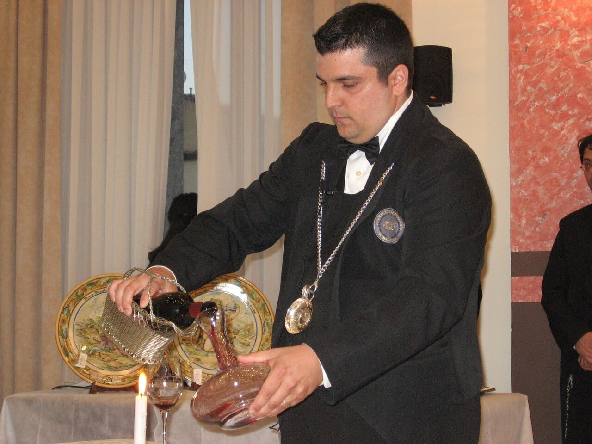

# 侍酒大师公会：把餐厅酒水服务变成一套考试

“Court”这个词容易让人想到宫廷或骑士团。侍酒大师公会其实是一个现代专业考试机构，名字里的 Court 更像是“评议会”而不是“法庭”。它要解决的问题很具体：在一家高级餐厅里，谁来负责酒单、选酒、试酒、温控、醒酒、配餐与向客人解释？这套工作长期靠师徒传授，20 世纪中叶开始被标准化为考试。

图：餐厅中的侍酒师正在为客人倒酒；画面不是侍酒大师公会的考试现场，也不是其总部。图片：Fabio Ingrosso，CC BY 2.0，via Wikimedia Commons（[原图页面](https://commons.wikimedia.org/wiki/File:Sommelier_decanting_and_serving_wine_at_a_restaurant.jpg)）。

## 它不是一个“骑士团”

公会的正式名称是 Court of Master Sommeliers，成员通过考试后获得 Master Sommelier（MS）称号。它没有皇家特许状，也不承担行政监管职能。它不颁发营业执照，不替政府检查餐厅，也不规定某瓶酒能不能卖。它做的事情是设计课程、组织考试、维护称号与行为规范。

这一点决定了它的权力边界。通过考试说明考生掌握了公会认为侍酒师应会的知识与服务动作；餐厅是否雇佣、能否上岗、能否代表某个品牌，仍由雇主、行业监管与市场决定。把 MS 当成“国家认证”是常见误读。

## 1969 年的考试与 1977 年的组织

公会的源头可以追溯到 1969 年。当时伦敦的葡萄酒贸易机构意识到，英国的餐厅酒水服务缺少一套统一的高标准，于是由 Vintners’ Company、Institute of Masters of Wine、英国酒店与餐厅协会等机构推动，在伦敦 Vintners’ Hall 举行了第一次侍酒大师考试。首批通过者是 Cyril Ware、Danny Lydon 与 George Clarke。

考试先有，组织后建。1977 年，Brian Julyan MS 等人把分散的 MS 组织起来，正式成立 Court of Master Sommeliers，Cyril Ware 成为首任主席。1987 年，第一次在英国以外举行的 MS 考试落在美国加州蒙特雷，这被视为公会进入北美市场的起点。今天，考试在欧洲、美洲、亚洲与大洋洲定期举行。

## 四级资格：从入门到大师

公会设置四级资格，难度逐级上升：

第一级是 Introductory Sommelier Certificate，面向刚进入酒水行业的服务人员，重点是主要酒类、基本品鉴与餐厅服务流程。第二级是 Certified Sommelier，要求更完整的产区、品种、酿造与侍酒知识，并考核实际服务。第三级是 Advanced Sommelier Certificate，强调盲品、酒单设计、运营管理与更深的产区细节。第四级是 Master Sommelier Diploma，是公会的最高称号，考试分为理论、盲品与服务三部分。

四级不是“四个学位”，而是四条逐级加码的门槛。越往上，考试越不像背书，越像在模拟一个真实的高级餐厅场景：客人给你一份酒单、一个预算、一桌菜，你要在有限时间里做出可解释的选择。

## 考试考什么

理论部分覆盖葡萄种植、酿造、产区法规、酒类历史、服务与运营。盲品部分要求考生在看不到酒标的情况下，按外观、香气、口感、结论的顺序描述酒，并推断品种、产区、年份或风格。服务部分则考开瓶、醒酒、倒酒、温度控制、酒单沟通与处理突发状况。

盲品不是猜酒名。它的核心是把感官观察转成可复核的语言：颜色深浅、香气类型、酸度、酒体、单宁、余味，每一步都要有依据。服务也不是表演，考的是在不出错的前提下让客人感到被照顾。两者结合，才是侍酒师工作的完整样子。

## 谁在治理，谁在发证

公会是会员制专业机构，由理事会与委员会负责治理，考试由资深 MS 与行业专家命题、监考与评分。它在美国、欧洲等地区设有分支组织，各自承担本地考试与会员事务。分支的存在说明它不是一家全球统一的行政机关，而是由各地专业共同体维护的一套标准。

发证的是公会本身，不是政府。证书的法律效力取决于当地职业 regulation；在多数市场，侍酒师并不是受牌照管理的职业。公会的权威来自行业认可与考试难度，而不是来自行政授权。

## 它如何改变餐厅的酒水服务

在公会出现之前，餐厅酒水服务的知识高度依赖个人经验与师徒关系。公会把选酒、试酒、醒酒、配餐、酒单管理拆成可以教学与考核的模块，让“侍酒师”成为一个有共同语言的职业身份。

这对餐厅有实际影响：招聘时有了参照，培训时有了路径，客人也能通过称号判断服务者的训练背景。对酒商与产区来说，侍酒师是连接酒庄与餐桌的关键节点；对消费者来说，一个训练有素的侍酒师能把复杂的酒单变成可执行的建议。

## 边界与常见误读

第一，MS 不是“世界通用执照”。它证明受过训练，不授予执业资格。第二，公会不是政府机构，也不是国际组织；它的标准靠行业认可维持。第三，考试侧重西方餐厅酒水体系，对其他地区的酒类传统覆盖有限。第四，称号与商业推广之间要保持距离；持证者可能为品牌工作，但称号本身不代表品牌背书。第五，考试费用与时间成本高，可及性并不均衡。

常见误读还有：把 Court 当成法庭；把 MS 当成“葡萄酒博士”；把盲品当成“猜酒比赛”；把服务考试当成“摆盘表演”。更准确的理解是：它是一套把餐厅酒水服务专业化的考试制度，能提高服务的下限，但不能替代真实经验与职业伦理。想从消费者角度练习描述，可参考[第一口，先别急着下结论](ref:first-tasting)；想读懂酒单，可参考[酒标很小，线索不少](ref:read-a-label)；餐厅酒单上的[香槟](ref:champagne)与[起泡酒](ref:sparkling-wine)，也是服务考试最常见的场景之一。侍酒师的服务对象终究是[葡萄酒](ref:wine)与餐桌，而不是一张证书。

相关条目：[第一口，先别急着下结论](ref:first-tasting)。

把侍酒大师公会放回侍酒与品鉴训练，可对照[葡萄酒](ref:wine)与[第一口，先别急着下结论](ref:first-tasting)。

**关键事实。**

| 项目 | 内容 |
| --- | --- |
| 一句话定位 | 侍酒大师公会（Court of Master Sommeliers，CMS）不是中世纪骑士团，而是一个从英国餐厅酒水服务需求中长出来的考试机构；第一次侍酒大师考试在 1969 年的伦敦举行，公会在 1977 年正式成立 |
| 成立 | 1977 |
| 官网 | courtofmastersommeliers.org |

**来源与边界。** 本页关于「侍酒大师公会：把餐厅酒水服务变成一套考试」的关键事实，主要由以下来源交叉核对：Court of Master Sommeliers（1969 年首次考试、1977 年公会成立、四级资格与全球考试网络）、Court of Master Sommeliers Europe（1969 年考试缘起、1977 年由 Brian Julyan 等人组建公会，以及首任主席）、The Court of Master Sommeliers Americas（1969 年伦敦首考、1977 年组织化、1987 年首次在英国以外考试）等 5 条来源。产品、地址或营业状态变化较快时，以 courtofmastersommeliers.org 的最新页面为准；价格、批次与状态会变，涉及这些字段时以页面所列来源的最新版本为准。正文为项目自写，来源只作核验，不复制原文。
