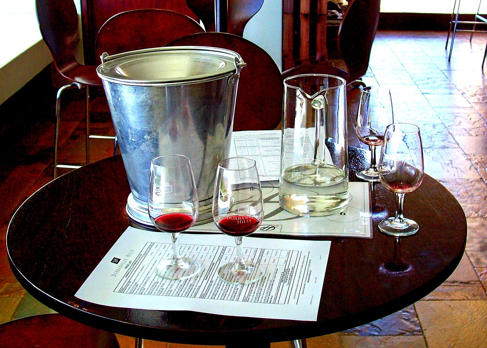

# 葡萄酒大师协会：一个由考试产生的专业共同体

葡萄酒大师（Master of Wine，MW）常被写成“葡萄酒界的博士学位”。这个比喻只对了一半：它确实要求极深的知识与独立研究，但它不是大学学位，也不是政府资格。它是一场由行业协会组织的考试，通过者再加入一个会员制共同体。理解 IMW，关键是理解“考试先于协会”这段历史。

图：品鉴桌上排列的酒杯与吐酒桶；画面不是葡萄酒大师协会的考试现场，也不是其伦敦总部。图片：Randy OHC，CC BY 2.0，via Wikimedia Commons（[原图页面](https://commons.wikimedia.org/wiki/File:Wine_Tasting_set_up.jpg)）。

## 一个由六位通过者创办的协会

1953 年 5 月 11 日，伦敦的 Vintners’ Company 与 Wine and Spirit Association 组织了第一次 MW 考试。当时有 21 人参加，只有 6 人通过：Reg Barrett、Leonard Dennis、Geoffrey Jameson、Rob Kewley、Geoffrey Nobes 与 Kenneth Simonds。这 6 人后来成为首批葡萄酒大师。

两年后的 1955 年，这 6 位首批 MW 创办了 Institute of Masters of Wine。这个顺序很重要：不是先有一个庞大的协会，再设计考试；而是先有一场筛选，再由通过者建立维护标准的组织。IMW 的起源决定了它的气质——它更像一个由同行组成的评议会，而不是一个自上而下的行政机构。

## 1953 年的第一次考试

第一次考试只有 21 人参加，通过率不到三成。这个数字后来被反复引用，用来说明 MW 的难度。但难度不是目的，筛选才是。20 世纪中叶的英国葡萄酒贸易需要一批能独立判断酒质、理解产区、写出可信报告的人；考试就是把这个判断过程标准化。

1970 年，Sarah Morphew Stephen 成为第一位女性 MW。此后女性会员比例持续上升，今天超过三分之一的 MW 是女性。这个变化说明考试本身并不设性别门槛，但行业机会与教育资源的分配长期影响谁能走到考场。

## 三道关卡：理论、盲品、研究论文

MW 考试由三部分组成。第一部分是理论，覆盖葡萄种植、酿造、产区、法规、市场与历史，要求考生把零散知识组织成有论点的回答。第二部分是盲品，考生要在看不到酒标的情况下，判断酒的品种、产区、年份、工艺或质量，并写出推理过程。第三部分是研究论文（Research Paper），考生要选一个对葡萄酒世界有贡献的题目，做独立研究并写成可读的报告。

这三部分对应三种能力：理论考“知道什么”，盲品考“喝得出来并说得清”，论文考“能提出并回答一个真问题”。很多人卡在盲品，因为它既需要记忆，也需要在压力下保持条理；也有人卡在论文，因为从“会喝”到“会研究”是另一种训练。

## 会员制而不是“许可证”

通过考试后，候选人成为 IMW 会员，获得 MW 称号，并签署行为准则。准则要求会员在商业活动中保持高标准，不得以不实方式使用称号。IMW 的治理由理事会、委员会与会员共同维持，日常运营由伦敦总部团队负责。

这里没有“执照”概念。MW 不授权你开酒庄、卖酒或执业，也不替政府监管市场。它授予的是一个专业称号，背后是一个同行共同体对知识、判断与伦理的认可。称号可以被误用，所以协会有准则与投诉机制；但协会本身没有行政处罚权。

## 伦敦总部与全球网络

IMW 的总部在伦敦，但会员与活动遍布全球。伦敦成为总部，是因为它长期是全球葡萄酒贸易的重要节点，也是考试制度的起点。今天，IMW 在全球组织品鉴、讲座、导师计划与地区分会，候选人可以在不同国家参加学习项目与考试。

这种“总部在伦敦、网络在全球”的结构，让 IMW 既能维持统一标准，又能吸收各地产区知识。它也带来一个张力：考试语言与知识框架以英语和西方产区为中心，其他地区的酒类传统需要额外的翻译与补充。

## 它为什么能成为行业标杆

MW 的影响力来自三个因素的叠加。第一，历史长。1953 年至今，考试已经运行七十多年，称号积累了声望。第二，难度高。理论、盲品、论文三关都要求独立判断，不是短期培训能替代。第三，共同体强。MW 之间形成网络，参与教育、评审、写作与咨询，让称号持续出现在行业公共生活中。

对行业来说，MW 提供了一种“可信任的专家”模板：能喝、能写、能研究、能遵守伦理。对消费者来说，MW 的名字常出现在酒评、酒单与媒体文章中，但称号本身不是质量保证，具体判断仍要回到酒与来源。

## 边界与常见误读

第一，MW 不是学位。它不授予本科、硕士或博士头衔，也不属于大学体系。第二，MW 不是监管资格。它不授权执业，不替代产区法规。第三，MW 不是“全能专家”。每位 MW 的研究方向与经验不同，称号不代表对所有酒类都同样熟悉。第四，考试偏好英语与西方产区框架，全球覆盖仍有不均。第五，称号有商业价值，持证者可能为品牌、酒庄或媒体工作，读者应区分个人观点与机构立场。

常见误读还有：把 MW 当成“一次考完就终身有效”的执照；把盲品当成“猜酒名”；把论文当成“读书报告”。更准确的理解是：MW 是一套由行业共同体维护的高级专业训练与认证，它的价值在于判断力与伦理，而不是头衔本身。想先建立自己的品鉴语言，可参考[第一口，先别急着下结论](ref:first-tasting)；想理解产区差异，可从[风土](ref:terroir)入手；想读懂酒标，可参考[酒标很小，线索不少](ref:read-a-label)；盲品训练常从[波尔多](ref:bordeaux)这类经典产区开始。MW 讨论的终究是[葡萄酒](ref:wine)，而不是一张证书。

相关条目：[风土（terroir）](ref:terroir)。

把 IMW 放回葡萄酒教育与风土研究，可对照[葡萄酒](ref:wine)与[风土](ref:terroir)。

**关键事实。**

| 项目 | 内容 |
| --- | --- |
| 一句话定位 | 葡萄酒大师协会（Institute of Masters of Wine，IMW）起源于 1953 年的一次考试；当年 21 人参加，6 人通过，这 6 位首批葡萄酒大师在 1955 年创办了协会 |
| 成立 | 1955 |
| 官网 | mastersofwine.org |

**来源与边界。** 本页关于「葡萄酒大师协会：一个由考试产生的专业共同体」的关键事实，主要由以下来源交叉核对：The Institute of Masters of Wine（会员制、伦敦总部、考试结构、行为准则与 1953 年以来 528 位 MW；1363 年 Vintners’ Company 渊源、1953 年首考、1955 年建会与首位女性 MW）、Oxford University Press；Jancis Robinson、Julia Harding 主编（MW 考试与葡萄酒专业教育背景；未复制词条）。产品、地址或营业状态变化较快时，以 mastersofwine.org 的最新页面为准；价格、批次与状态会变，涉及这些字段时以页面所列来源的最新版本为准。正文为项目自写，来源只作核验，不复制原文。
