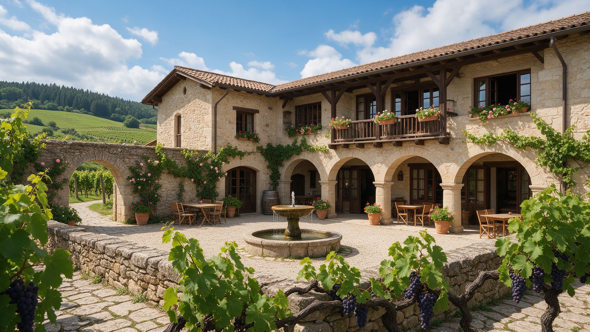

# WSET：把品酒变成可以考试的资格

WSET 常被当作一张证书，其实它先是一套分级课程，然后才是发证机构。理解它的法律身份、治理方式与考试结构，比记住缩写更有用：它能把品酒变成可教的描述，却不会把证书变成执业许可。

图：WSET：把品酒变成可以考试的资格 类型示意图。图片：Doubao Seedream 5.0 AI 辅助绘制（项目自有），不是WSET：把品酒变成可以考试的资格的实拍。

## 从1969年的伦敦说起

1969 年，英国葡萄酒贸易的培训还主要靠师徒传授与酒商内部课程，标准不一。WSET 在伦敦成立，最初服务的就是英国本地的行业从业者：酒商、餐厅、酒店与进口商需要一套共同的语言来判断酒、描述酒、向顾客解释酒。它把品鉴、产区、酿造与法规拆成可以逐级教学的单元，这是它后来能够扩展到其他国家和科目的基础。

## 发证机构、慈善机构与监管承认

WSET 的法律身份有两层。第一，它是发证机构（awarding body），设计并颁发自己的资格。第二，它是注册慈善机构，以非营利方式运作，收入用于教育使命，而不是向股东分红。

它的资格在英国受 Ofqual（资格与考试管理办公室）承认，部分资格因此纳入英国的受监管资格框架；它同时按 ISO 9001:2015 建立质量管理体系。承认与认证说明流程接受外部审核，但不等于政府直接办学，也不等于政府为课程内容背书。

## 治理：没有会员的基金会如何决策

与行业协会不同，WSET 没有“会员企业”这一层。它由受托人组成的董事会治理，日常运营由执行团队负责，课程与考试则由学科团队、命题与审核流程控制。这个结构决定了它的立场：它不需要在种植者与酒商之间平衡，也不替任何产区代言；它要对学员、授权授课机构与监管承认负责。

因此，它的课程更新通常以教学标准、考试有效性与行业需求为理由，而不是以某国产业的短期利益为理由。这一点与跨行业组织的逻辑明显不同。

## 四级课程与考试怎样运作

课程按难度分为四级：第一级是入门，介绍主要酒类与基本品鉴；第二级增加产区、品种、工艺与标签的细节；第三级要求更强的分析能力与系统品鉴；第四级是文凭（Level 4 Diploma in Wines），接近行业专家的知识深度。烈酒、清酒等另有分支资格。

考试形式包括选择题与简答题，部分级别要求盲品。盲品不是猜酒名，而是按外观、香气、口感与结论的顺序，把观察写成可复核的描述。这套方法后来成为许多市场共同的行业语言。

## 可以核对的人数与覆盖

可核对的数据有几组：课程以 15 种以上语言提供，覆盖 70 多个国家和地区；2024 年（WSET 成立 55 周年）考生约 13.4 万人，为历史第二高；同年文凭考生 1,962 人，来自 19 个国家，同比增长约 15%。

这些数字口径不同：语言与国家和地区描述覆盖范围，考生人数描述年度规模，文凭人数描述高阶群体。引用时应连同年份一起给出，不能混成一句“全球有十几万学员”。

## 这套体系为什么有影响

葡萄酒的难点不只是喝，而是把喝到的东西说清楚。WSET 提供了一套可教的描述框架，让不同国家、不同母语的从业者可以讨论同一杯酒。对酒商与餐厅，这意味着招聘与培训有了共同参照；对产区与进口商，这意味着教育市场可以借助现成课程。

它的影响是基础设施式的：不直接改变酒的质量，却改变了行业沟通的效率。一套描述词被广泛采用之后，讨论成本下降，比较也更容易进行。

## 边界与争议

第一，课程不等于产区法规。WSET 讲的是通用框架，具体产区的规则仍要查当地官方资料。第二，证书不等于能力。通过考试说明掌握了描述与知识，真实判断仍需要反复练习。第三，标准化有代价。统一语言便于沟通，也可能压低地方性知识的分量。第四，费用与可及性。课程与考试需要时间和金钱，不同市场的可及性并不相同。第五，商业关系。WSET 与授权授课机构、教材出版之间存在商业链条，读者应区分教育标准与市场推广。

## 常见误读

把 WSET 当成政府或国际组织；把证书当成“品酒师执照”；把盲品当成猜谜；把课程当成产区指南。四种误读都来自同一个混淆：把“教育标准”当成“法律资格”。证书证明受过训练，不授予执业许可。要把课堂知识用到实际标签上，可参考[如何读酒标](ref:read-a-label)；理解产区差异，则要从[风土](ref:terroir)入手。

## 另见

- [葡萄酒](ref:wine)：课程的核心对象。
- [风土](ref:terroir)：产区差异的解释框架。
- [如何读酒标](ref:read-a-label)：把课堂知识用到实际标签上。
- [英国](ref:united-kingdom)：WSET 的成立地与教育传统。

把 WSET 的课程框架放回品鉴与酒标阅读，可对照[葡萄酒](ref:wine)与[如何读酒标](ref:read-a-label)。

**关键事实。**

| 项目 | 内容 |
| --- | --- |
| 一句话定位 | WSET（Wine & Spirit Education Trust）1969 年在伦敦成立，是英国的葡萄酒与烈酒教育机构，兼具发证机构与注册慈善机构身份，其资格受英国 Ofqual 承认；它提供从入门到四级文凭的分级课程，把品鉴、产区、工艺与法规整理成可考核的内容，但资格证书不等于执业许可 |
| 成立 | 1969 |
| 官网 | wsetglobal.com |

**来源与边界。** 本页关于「WSET：把品酒变成可以考试的资格」的关键事实，主要由以下来源交叉核对：Wine & Spirit Education Trust（1969 年成立、伦敦总部、课程体系与全球授课网络；分级资格、考试方式与科目范围）、Oxford University Press；Jancis Robinson、Julia Harding 主编（葡萄酒教育体系与行业背景；未复制词条）、Wine Business（2024 年考生约 13.4 万人、文凭考生 1,962 人及来自 19 个国家）。产品、地址或营业状态变化较快时，以 wsetglobal.com 的最新页面为准；价格、批次与状态会变，涉及这些字段时以页面所列来源的最新版本为准。正文为项目自写，来源只作核验，不复制原文。

**并读。** 把「WSET：把品酒变成可以考试的资格」与「葡萄酒」、「风土（terroir）」、「酒标很小，线索不少」放在一起读时，先确认它们是同一层级还是上下游关系：先确认性质与成员，再比较职能、历史与行业位置。本页负责给出机构的基本坐标，对照条目补上具体案例与差异；读完再回到本页，才能分清哪些差别属于机构本身，哪些只是产地、批次或品牌选择。
