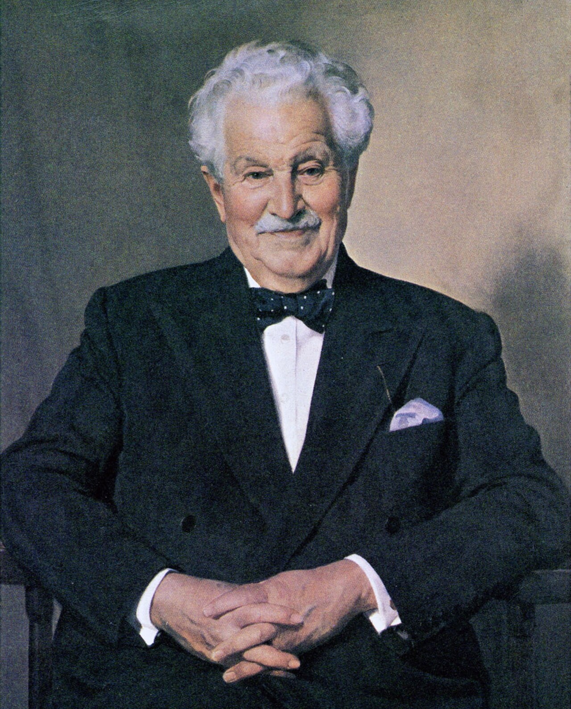

# 安德烈·西蒙

安德烈·西蒙（André Simon，1877–1970）是法国出生的葡萄酒商人、作家与藏书家，长期在英国工作。他的名字在今天听起来更像一个奖或一个协会，而不是一位具体的人；但在 20 世纪上半叶，他同时扮演了进口商、报刊作者、协会创办者与酒史研究者四个角色。要理解他，不能只看“写过很多书”，而要看他把葡萄酒写作从品鉴随笔推向可查档案的那一步。

图：安德烈·西蒙百年纪念画像，国际葡萄酒与美食协会藏；不是现场照片。图片：Unknown author Unknown author，Public domain，via Wikimedia Commons（[原图页面](https://commons.wikimedia.org/wiki/File:Andr%C3%A9_Simon_Centenary_1190.jpg)）。

## 从巴黎到伦敦

西蒙 1877 年 2 月 28 日生于巴黎。1902 年，他来到伦敦，出任香槟酒商 Pommery 的英国代理。第二年，伦敦的《葡萄酒与烈酒贸易评论》约他写十二篇关于英国香槟贸易史的文章；这组文章让他进入写作，也让他发现，酒类贸易的账册、广告、报关单与家族档案，可以拼出一条比品鉴笔记更长的历史线索。

他在英国酒业的活动并不限于卖酒。1908 年，他与朋友创办 Wine Trade Club，三十二岁时被选为首任会长，并在俱乐部里讲授酒类贸易的技术问题。这个俱乐部被后来的资料视为英国酒业职业教育的先声之一。1931 年，他又参与发起 Saintsbury Club，以纪念 George Saintsbury 的《酒窖笔记》；这场纪念活动后来变成了一个持续聚会的餐饮俱乐部。

## 从商人到作家

1931 年英镑脱离金本位，随后大幅贬值，西蒙支付法国香槟货款的能力受到冲击。1932 年，Pommery 结束了与他长达三十余年的代理关系。这次失业没有让他离开酒，反而把他推到全职写作：他与 Constable 出版社签约，编辑一套面向普通读者的酒类读物，并开始把自己积累的贸易档案整理成书。

他的写作量很大。国际葡萄酒与美食协会的会史称他写了“一百多种书与小册子”；其中既有《英国葡萄酒贸易史》这样的三卷本学术著作，也有面向家庭读者的酒类入门、饮食辞典与年度选集。他把“好生活”当作一个整体来写：酒、食物、餐桌礼仪、菜单与旅行见闻放在同一个框架里，而不是把酒孤立成一门技术。

## 葡萄酒与美食协会

1933 年 10 月 20 日，西蒙与 A. J. A. Symons 在伦敦创办 Wine & Food Society，后来发展为 International Wine & Food Society。协会的宗旨是“把对餐桌问题与乐趣有明智兴趣的人聚在一起”，听起来温和，实际做的是三件事：举办晚宴与品鉴、出版季刊、建立分支。

第一场活动是 1933 年 11 月 14 日在 Café Royal 举行的阿尔萨斯午餐，菜单五道，配 Dopff 酒庄的酒，每人 10 先令 6 便士，到场 232 人。这个数字说明，在 大萧条年代的伦敦，酒与食物的“教育型消费”仍有市场。1934 年，西蒙利用美国禁酒令废止后的窗口访问北美，先在波士顿、后在旧金山建立分支；协会逐渐从英国国内组织变成国际网络。

西蒙在协会里的角色是主席兼会刊《Wine and Food》编辑。他负责选酒、定菜单、写导言，也负责把协会的品味标准写成可复述的文字。协会不是单纯的“吃喝俱乐部”：它把酒与食物的知识放进公开讲座、菜单说明与旅行考察里，后来的国际分支延续了这套做法。

## 酒史写作的方法

西蒙最持久的贡献是酒史写作。他的《英国葡萄酒贸易史》分三卷，1906 至 1909 年出版，利用港口记录、关税表、商人书信与报纸广告，重建了中世纪以来英国葡萄酒进口的路线、品种与商业结构。这本书的价值不在“文笔古雅”，而在它把酒史从“名人爱酒”的故事里拉出来，变成可核查的贸易史。

他另一条方法是书目学。他终身收集酒类书籍，编成《Bibliotheca Vinaria》等书目，记录版本、出版地与插图。对后来的研究者来说，这些书目是入口：要知道某一时期的酒类知识如何传播，先要知道当时出版了哪些书、谁在读、谁在抄。西蒙的私人藏书后来成为研究酒史的重要资源，部分资料进入公共机构。

他的写作也有明显的文人趣味。句子讲究节奏，喜欢用轶事与引文，常把酒与文学、政治、旅行放在一起。这种写法扩大了读者群，但也带来一个问题：当轶事与档案混在一起，读者不容易分清哪一句有出处、哪一句是作者的判断。读他的书，最好把“史料”和“随笔”分开看。

## 代表著作

除了《英国葡萄酒贸易史》，他写过《酒与葡萄酒贸易》（Wine and the Wine Trade）、《酒类入门》（A Wine Primer）、《世界之酒》（The Wines of the World）等多卷本读物。二战期间，他编成《简明美食百科全书》（A Concise Encyclopaedia of Gastronomy），以分册形式出版，适应纸张与配给的限制；这套书后来成为英语世界饮食写作的参考之一。

他也写回忆性作品《In the Twilight》，记录与朋友、作者和酒商的交往。这些文字对研究 20 世纪英国酒业的人有用，因为它们保留了职业生活的细节：一笔订单如何谈成、一场晚宴如何排座、一位酒商如何判断年份。但它们毕竟是回忆，不是档案，引用时需要与贸易记录对照。

## 评价与争议

正面评价通常把他称为“英国酒业近半个世纪的魅力型领袖”和“有文化修养的鉴赏家”。这个说法有事实基础：他确实在贸易、写作、协会与书目四个方向同时工作，并且把“酒”与“食物”放在同一张桌子上。对普通读者来说，他的书提供了进入酒世界的路径；对研究者来说，他的书目与贸易史提供了可继续追查的线索。

批评也存在。第一，他的写作带有强烈的欧洲中心视角，尤其是法国与英国；其他产区的酒常被当作“地方风味”，而不是同等复杂的历史主体。第二，他的商人身份与写作身份没有完全分开：他推荐的酒、代理的品牌与协会的活动之间，存在需要读者自行判断的利益关系。第三，他的轶事式写法容易被后来的通俗写作模仿，变成“名人 + 名酒”的重复叙事，反而削弱了他自己建立的档案方法。

## 常见误读

第一，把西蒙当成“法国酒商”，忽略他在英国写作与组织协会的三十年。他的法国出身很重要，但他的职业生命主要在英国。

第二，把 Wine & Food Society 当成单纯的品酒俱乐部。它从一开始就包含出版、讲座、旅行与分支建设，是一套知识传播机制。

第三，把他写的书全部当成“原始研究”。他的贸易史与书目有档案基础，但入门书、选集与回忆录更多是综合与转述，引用时要分清。

第四，把“写了 100 多本书”当成质量保证。数量说明产量与市场，不说明每一本都经过同等程度的核验。

相关条目：[法国](ref:france)、[英国](ref:uk)、[香槟](ref:champagne)。

## 另见

- [法国](ref:france)：西蒙的出生地，也是他早年香槟贸易的起点。
- [英国](ref:uk)：他长期工作与写作的国家，协会与酒史研究的所在地。
- [香槟](ref:champagne)：他代理 Pommery 的经历，是理解其行业位置的入口。
- [葡萄酒](ref:wine)：他写作的中心对象。
- [世界葡萄酒史](ref:world-wine)：把他的贸易史放进更长的时间线。
