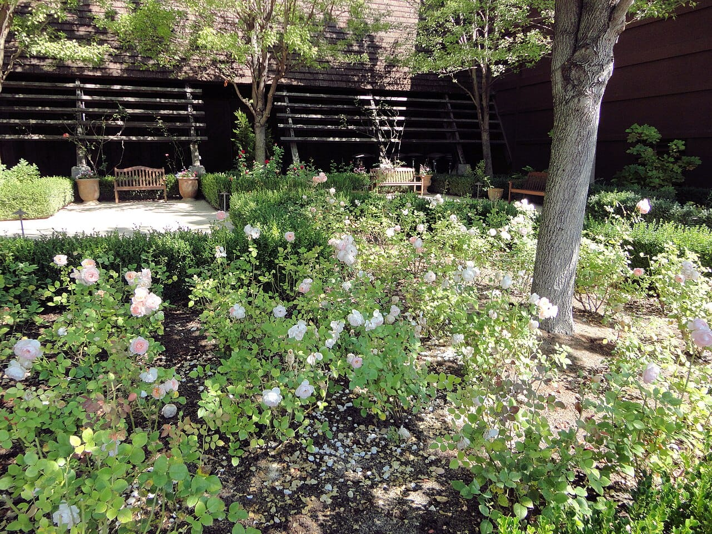

# 安德烈·切列斯切夫

安德烈·切列斯切夫（André Tchelistcheff，1901–1994）是俄裔美国酿酒师，1938 年起在纳帕谷的 Beaulieu Vineyard 任副总裁兼首席酿酒师。纳帕谷的酒业史里，他常被称为“大师”（The Maestro）；这个称号容易让人以为他只是“技艺高超”，但他真正做的事情更具体：把欧洲的微生物学、温控与橡木桶方法，装进一个刚从禁酒令里恢复过来的加州酒厂。

图：纳帕谷卢瑟福丘葡萄园；产区场景，不是 Beaulieu Vineyard 或切列斯切夫本人。图片：Jim G from Silicon Valley, CA, USA，CC BY 2.0，via Wikimedia Commons（[原图页面](https://commons.wikimedia.org/wiki/File:Rutherford_Hill_Vineyards,_Napa_Valley,_California_(8563638730).jpg)）。

## 从俄国到法国

切列斯切夫 1901 年生于俄国。青年时代他加入白军，1921 年在克里米亚作战时重伤，随后流亡。伤愈后，他在法国的 Institut Pasteur 与 Institut National Agronomique 学习微生物学、农学与酿酒，之后在 Moët & Chandon 与 Nicolas 工作。这段经历给了他两样东西：一是实验室训练，知道发酵不是“自然发生”，而是可以观察、测量与控制的微生物过程；二是法国酒业的商业经验，知道酒庄、酒商与买家如何组织生产与销售。

1938 年，Beaulieu Vineyard 的创始人 Georges de Latour 到法国寻找新酿酒师。经人介绍，他见到切列斯切夫，并邀请他到纳帕谷。切列斯切夫当年 9 月抵达，正好赶上 1938 年采收。他到任时，加州的酿酒技术仍处在禁酒令后的恢复期：许多酒厂用高产葡萄、过度硫化、加冰降温，干酒的质量不稳定。

## 在 Beaulieu 的技术改造

切列斯切夫到任后先做“减法”。他停止过度硫化，停止在压榨机里直接加冰，改用更可控的降温方式；他检查发酵罐与管道，替换会带来金属味的铸铁管；他要求葡萄园与酒厂分开管理，不能把“收来的葡萄”直接倒进罐里就算完事。

然后做“加法”。他推广白葡萄酒与桃红葡萄酒的冷发酵，让香气不被高温破坏；他在红葡萄酒里控制苹果酸-乳酸发酵，把尖锐的苹果酸转成更柔和的乳酸；他研究霜冻防护与葡萄病害，减少采收前的损失；他引入小型的法国橡木桶，让 Cabernet Sauvignon 在陈酿中获得更细的纹理，而不是只靠大桶或美国橡木。

他还做了一件对纳帕谷影响更长远的事：把“哪里适合种什么”变成可讨论的问题。他研究 Rutherford 与周边地块的土壤、排水与日照，判断哪些地块能做出结构完整的 Cabernet；他在 Carneros 种 Pinot Noir 与 Chardonnay，后来这一带成为加州重要的凉爽产区；他还向俄勒冈建议种 Pinot Gris，向华盛顿建议种 Cabernet Sauvignon。这些建议不是都立刻成功，但它们把“品种—地点”的匹配放进了加州酒业的议程。

## Georges de Latour Private Reserve

1936 年，de Latour 对切列斯切夫说，那款酒是“我们做过的最好的酒”，并要求所有酒都达到这个水平。切列斯切夫由此集中力量做 Cabernet Sauvignon，形成后来以 Georges de Latour 命名的 Private Reserve。到 1940 年代中期，这款酒被视为加州 Cabernet 的标杆，并进入白宫国宴用酒的行列。

Private Reserve 的意义不只是“名酒”。它证明加州可以做出需要长期陈酿、结构完整的红葡萄酒，而不是只能做甜酒或轻质干酒。它也为纳帕谷建立了一个可复制的模板：选择合适地块、控制产量、温控发酵、小桶陈酿、长期瓶储。后来的纳帕酒庄未必照搬他的配方，但大多继承了这套“把质量写进工序”的思路。

## 实验室、门生与顾问

1947 年，切列斯切夫在圣海伦娜开设 Napa Valley Enological Research Laboratory 与 Napa Valley Enological Center，成员包括 Robert Mondavi、Louis P. Martini、August Sebastiani 等。这个实验室不是学术机构，而是行业互助组织：酒厂可以送样检测、讨论发酵问题、分享设备经验。它把“个人经验”变成“同行可讨论的技术”。

他被称为“大师”，还因为他的门生网络。Robert Mondavi、Louis Martini、Rick Sayre、Rob Davis 等人都曾与他共事或受他指导；他在 1973 年从 Beaulieu 退休，1991 年又以 89 岁高龄回到酒庄做顾问，与新一代酿酒师一起品评 50 个年份的 Private Reserve。这个动作说明，他的影响不是“留下一个配方”，而是“留下一种持续试验的习惯”。

## 评价与争议

正面评价把他视为“纳帕谷历史上最有影响力的酿酒师”，理由是他在禁酒令后重建了质量体系，并把加州 Cabernet 推上国际舞台。这个说法有事实基础：冷发酵、苹果酸-乳酸发酵控制、法国橡木桶、Carneros 的品种试验，都能在他的工作中找到具体节点。

批评也要说清。第一，“大师”叙事容易把酒厂的成功归给一个人；Beaulieu 的所有者、葡萄农、实验室同事与后续酿酒师都参与了结果。第二，他的方法不是全部“发明”：冷发酵、苹果酸-乳酸发酵在欧洲已有先例，他的贡献是把它们系统地应用到纳帕谷的条件里。第三，他的法国橡木桶偏好后来因二战供应中断而转向美国橡木，这说明“传统”本身也会随供应链变化。第四，他的建议并非处处正确；Carneros、俄勒冈与华盛顿的试验有成功，也有需要后人修正的部分。

## 常见误读

第一，把他说成 Beaulieu Vineyard 的创始人。酒庄由 Georges de Latour 于 1900 年创立，切列斯切夫是 1938 年受聘的酿酒师。

第二，把他只当成“Cabernet 专家”。他确实以 Cabernet 闻名，但也做白葡萄酒、桃红、Carneros 的 Pinot 与 Chardonnay，并参与俄勒冈、华盛顿的品种建议。

第三，把“冷发酵”说成他的独创。欧洲早有低温发酵实践；他的贡献是在加州的高温采收与简陋设备条件下，把它变成可执行的工序。

第四，把“大师”当成从不犯错。他的价值在于建立试验与品评机制，而不是提供一套永不出错的配方。

相关条目：[纳帕谷](ref:napa)。

## 另见

- [美国](ref:usa)：切列斯切夫工作与成名的国家。
- [纳帕谷](ref:napa)：Beaulieu Vineyard 与 Private Reserve 的所在地。
- [赤霞珠](ref:cabernet)：他投入最多、影响最大的品种。
- [红葡萄酒](ref:red-wine)：理解 Private Reserve 的结构与陈酿。
- [风土与工艺](ref:place-process)：把他的品种—地块—工序思路放进更广的框架。

对照阅读：[美国](ref:usa)、[赤霞珠](ref:cabernet)。

**关键事实。**

| 项目 | 内容 |
| --- | --- |
| 一句话定位 | 俄裔美国酿酒师（1901–1994），1938 年起任纳帕谷 Beaulieu Vineyard 首席酿酒师，引入冷发酵、苹果酸-乳酸发酵控制与小法国橡木桶，培养多代纳帕酿酒师，被称为“大师” |
| 生卒 | 1901–1994 |
| 身份 | 酿酒师、葡萄酒顾问、微生物学家 |
| 关联地区 | 美国、纳帕谷 |

**来源与边界。** 本页关于「安德烈·切列斯切夫」的关键事实，主要由以下来源交叉核对：Beaulieu Vineyard（Georges de Latour 1938 年招聘、Private Reserve 的创立与 Tchelistcheff 的持续创新）、The Voice of Wine documentary（白军经历、Pasteur 学习、Moët & Chandon 与 Nicolas 工作、冷发酵、苹果酸-乳酸发酵、防霜与葡萄园病害）、Oxford University Press（Tchelistcheff 在纳帕谷酿酒史与加州 Cabernet 风格中的地位；未复制词条）等 5 条来源。价格、批次与状态会变，涉及这些字段时以页面所列来源的最新版本为准。正文为项目自写，来源只作核验，不复制原文。
