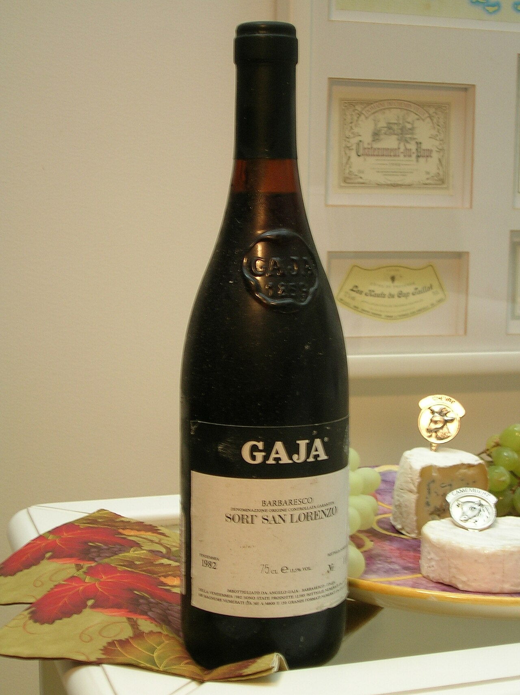

# 安杰洛·嘉雅

安杰洛·嘉雅（Angelo Gaja，1940 年生）是意大利皮埃蒙特的酿酒师与酒庄经营者。嘉雅家族 1859 年在巴巴莱斯科开始酿酒，安杰洛 1961 年接管酒庄时只有二十一岁。他把法国小橡木桶、降低产量、绿色采收、单一园与跨国投资带进皮埃蒙特，让巴巴莱斯科从“意大利北部的传统酒”变成国际拍卖与餐厅酒单上的名字；1996 年，他又把三款最著名的单一园从巴巴莱斯科 DOCG 降为朗格 DOC，引发持续至今的“传统与现代”之争。

图：Gaja 的 Sorì San Lorenzo 酒瓶。图片：Renzo Grosso，CC BY-SA 3.0，via Wikimedia Commons（[原图页面](https://commons.wikimedia.org/wiki/File:Sori_San_Lorenzo_Gaja_-_bottle.jpg)）。

## 从家族酒庄到国际名字

嘉雅家族的历史可以追溯到 1859 年，乔瓦尼·嘉雅（Giovanni Gaja）在巴巴莱斯科开设酒庄。二十世纪初，家族把酒卖到意大利北部与欧洲市场；二战后，巴巴莱斯科仍以传统大桶、长陈酿与混合园为主，国际知名度远不如巴罗洛。安杰洛 1940 年出生，在都灵读经济，1961 年从父亲手中接过酒庄。

他接手后的第一件事是“做减法”。当时很多酒农追求产量，葡萄成熟度不足，内比奥罗的单宁粗糙、酸度高，酒需要长时间在大橡木桶里“磨”。安杰洛减少产量、推迟采收、绿色采收（提前去掉部分葡萄串），让留在树上的果实更集中。他相信，巴巴莱斯科的问题不是品种不好，而是产量与成熟度没有控制好。

第二件事是“换桶”。1970 年代，他开始使用法国小橡木桶（barrique）陈酿内比奥罗，并控制发酵温度、调整浸渍时间。这在当时被传统派视为“背叛”：小桶会带来香草、烘烤与更明显的橡木味，掩盖内比奥罗的玫瑰、樱桃与焦油气息。安杰洛的回应是：桶只是工具，关键是酒有没有足够的果味与结构去承接；如果葡萄不够好，小桶只会暴露缺点。

第三件事是“单一园”。他把家族葡萄园分成 Sorì San Lorenzo、Sorì Tildìn、Costa Russi 等地块，分别酿造、分别标注。Sorì San Lorenzo 1967 年首次单独酿造，Sorì Tildìn 1970 年，Costa Russi 1978 年。单一园不是“更好喝”的保证，而是把风土差异摆到桌面上：同一片巴巴莱斯科丘陵，不同朝向、土壤与海拔会给出不同的成熟节奏与香气。

## 1996 年的降级与“朗格”

1996 年，安杰洛做了一件让意大利酒界震动的事：他把 Sorì San Lorenzo、Sorì Tildìn 与 Costa Russi 三款酒的法定类别从“巴巴莱斯科 DOCG”改为“朗格 DOC”。原因不是酒质下降，而是他在这些葡萄园里种了少量非内比奥罗品种（如巴贝拉），而巴巴莱斯科 DOCG 的规则不允许。为了避免在法律上“作假”，他选择降级，保留葡萄与酒款的真实成分。

这件事有两种读法。传统派认为，这是对巴巴莱斯科产区的背叛：最著名的酒庄主动离开 DOCG，等于告诉消费者“产区标签不重要”。安杰洛的支持者认为，这是对透明度的坚持：如果酒里确实有巴贝拉，就不应该标成 100% 内比奥罗的巴巴莱斯科；降级是诚实，而不是逃避。无论站哪边，1996 年之后，“Gaja 的 Sorì San Lorenzo 是巴巴莱斯科还是朗格”成了酒圈必须解释的问题。

同一时期，嘉雅把版图扩展到意大利其他产区。1994 年收购蒙塔奇诺的 Pieve Santa Restituta，1996 年收购宝格丽的 Ca' Marcanda。前者让嘉雅进入布鲁奈罗（Brunello）的世界，后者让它在托斯卡纳海岸做赤霞珠、梅洛与西拉。加上皮埃蒙特的 Barolo 地块 Sperss 与 Conteisa，嘉雅不再只是“巴巴莱斯科酒庄”，而是一个跨产区的品牌。

## 他的酒怎么喝

嘉雅的 Barbaresco 与 Barolo 以内比奥罗为核心，典型香气是玫瑰、樱桃、红李子、焦油、甘草与香料；单宁强，酸度高，年轻时容易显得紧。饮用时建议醒酒一到两小时，温度在 17–18°C，用较大的郁金香杯。配餐上，内比奥罗适合红肉、炖牛肉、松露、硬质奶酪与野味；不要配太辣的菜，辛辣会放大单宁的苦涩。

Darmagi 是嘉雅在巴巴莱斯科种赤霞珠的产物，名字在皮埃蒙特方言里近似“真可惜”，据说来自父亲当年对这排赤霞珠的摇头。它不是波尔多的复制品：加州式的成熟度、皮埃蒙特的酸度与法国桶的香料，让它更像“在意大利气候里做的赤霞珠”。Sperss 与 Conteisa 则是巴罗洛的不同表达：Sperss 更宽厚、更多黑色水果与松露，Conteisa 更细长、更多花香与矿物。

如果你想判断一款嘉雅是否“过了桶”，可以看三个点：第一，香气里是否只有香草、椰子和烘烤，而没有玫瑰、樱桃与焦油；第二，入口后单宁是否被橡木“包住”而失去颗粒感；第三，余味是否以木质甜味为主。好的嘉雅应该同时有果、有花、有结构，橡木只是背景，不是主角。

## 争议与常见误读

第一，安杰洛·嘉雅不是“巴巴莱斯科的发明者”。巴巴莱斯科在十九世纪已有酒庄与葡萄园，嘉雅家族 1859 年就在此酿酒；安杰洛的贡献是把国际技术、品牌与单一园概念带进来，而不是从零创造产区。第二，他不是“只会用法国桶的现代派”。他同样强调长陈酿、低产量与风土；法国桶只是他工具箱里的一件，不是全部。

第三，1996 年降级不是“酒质变差”。它是法规与种植选择冲突后的合规调整；把降级读成“嘉雅不行了”，会错过真正的问题：当法定规则与真实成分不一致时，酒庄应该怎么选？第四，Darmagi 不是“波尔多混酿”。它主要以赤霞珠为主，风格更接近意大利气候下的国际品种，而不是波尔多左岸的复制。

第五，嘉雅的高价不等于“所有酒都值得买”。酒庄有入门级 Barolo、Barbaresco 与单一园，价格差异很大；单一园的稀缺性与品牌溢价，不等于日常饮用必须买最贵的。第六，安杰洛的“现代”也不是无争议的。传统派至今认为小桶与单一园削弱了巴巴莱斯科的集体身份；这些争论没有唯一答案，读者应把它们当成产区史的组成部分。

## 与本站其他页面的关系

嘉雅的故事连接三条线。第一是[皮埃蒙特](ref:piedmont)的产区史：巴巴莱斯科、巴罗洛、内比奥罗、朗格 DOC 与 1996 年降级。第二是[葡萄酒](ref:wine)的技术：产量控制、绿色采收、小橡木桶、单一园与跨产区品牌。第三是[意大利](ref:italy)的酒业地理：皮埃蒙特、托斯卡纳的蒙塔奇诺与宝格丽，以及南北产区的风格差异。

如果想继续看“传统与现代如何冲突”，可以对照巴罗洛的传统派与现代化派；如果想看“单一园如何改变市场”，可以读勃艮第的克利马体系；如果想看“家族酒庄如何跨产区扩张”，可以读嘉雅的蒙塔奇诺与宝格丽收购。安杰洛不是孤立的改革者，他是二十世纪意大利葡萄酒国际化的关键节点。

## 延伸阅读

- [嘉雅巴巴莱斯科](ref:gaja-place)：巴巴莱斯科、嘉雅酒庄与参观信息。
- [葡萄酒](ref:wine)：内比奥罗、橡木桶、单一园与陈酿的基本框架。
- [皮埃蒙特](ref:piedmont)：巴巴莱斯科、巴罗洛、朗格与内比奥罗的风土。
- [意大利](ref:italy)：皮埃蒙特、托斯卡纳与意大利酒业的地理与制度。

相关条目：[嘉雅巴巴莱斯科酒庄](ref:gaja-place)。
