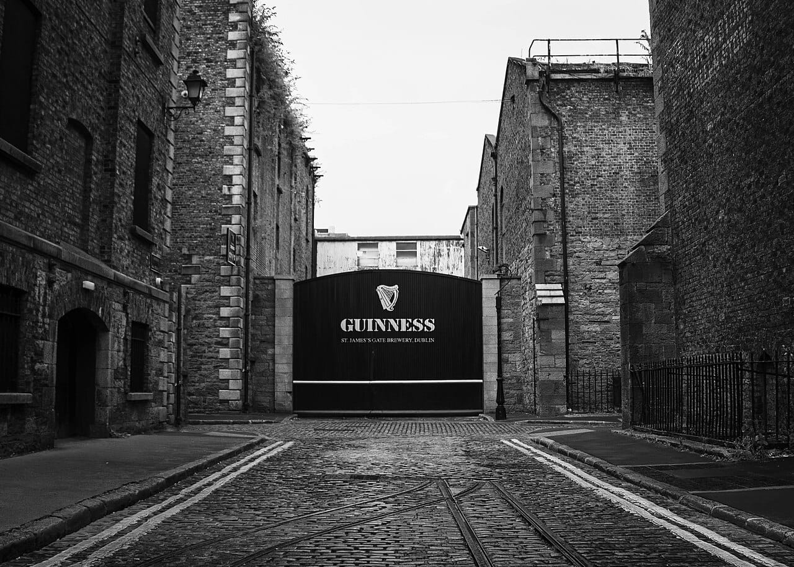

# 阿瑟·健力士

阿瑟·健力士（Arthur Guinness，1725—1803）是爱尔兰酿酒师、企业家与慈善家，健力士（Guinness）品牌的奠基人。1759 年 12 月 31 日，他在都柏林圣詹姆斯门（St James's Gate）签下一份 9000 年的租约，年租金 45 英镑，把一间小啤酒厂变成爱尔兰最具规模的酒业帝国。今天，圣詹姆斯门仍是健力士的总部与参观地，健力士黑啤、波特啤酒与“九千年租约”的故事，仍是都柏林酒文化最常被讲述的部分。

图：都柏林圣詹姆斯门啤酒厂。图片：Jolaus，CC0，via Wikimedia Commons（[原图页面](https://commons.wikimedia.org/wiki/File:St._James_Gate_Brewery,_Dublin,_Eire.jpg)）。

## 从莱克斯利普到圣詹姆斯门

阿瑟·健力士 1725 年生于基尔代尔郡的塞尔布里奇（Celbridge），父亲理查德·健力士是当地大地主、后来成为都柏林大主教的亚瑟·普赖斯（Arthur Price）的管家。普赖斯主教对阿瑟影响很大，据说在遗嘱中给他留下 100 英镑；阿瑟用这笔钱开始酿酒。1755 年，他在莱克斯利普（Leixlip）与兄弟一起开了一间小啤酒厂，生产淡色艾尔与波特啤酒。

1759 年，他决定把业务搬到都柏林。圣詹姆斯门位于都柏林市中心、靠近利菲河与城墙，水源、运输与市场都方便。12 月 31 日，他签下租约：租期 9000 年，年租金 45 英镑，土地约 4 英亩。这个数字在当时看近乎荒诞，却给健力士一个几乎永久的厂址；今天它仍是品牌叙事的一部分。

需要说明的是，“9000 年租约至今有效”是营销简化。租约在 18 至 19 世纪经历过续签、买断与法律调整，圣詹姆斯门的土地后来由健力士家族与公司以不同方式持有；今天的厂址归公司所有，租约本身不再是运营的法律基础。把“9000 年”当成浪漫故事可以，但不要把它当成现行产权文件。

## 波特啤酒与健力士黑啤

十八世纪的都柏林啤酒市场以淡色艾尔、棕色啤酒与波特为主。波特（porter）起源于伦敦，是一种深色、麦芽浓度较高、适合体力劳动者与酒吧长饮的啤酒；阿瑟·健力士不是波特的发明者，但他把波特做成都柏林规模最大、质量最稳定的产品之一。1770 年代，健力士的波特开始在都柏林酒吧、医院与军队供应；到 1799 年，阿瑟决定停止酿造淡色艾尔，专做波特。

健力士黑啤（Guinness Stout）后来从波特演变而来。“Stout”原意是“浓烈”，指酒精度与麦芽浓度更高的波特；健力士在十九世纪把这款深色啤酒做成品牌核心，使用烤焦的大麦、啤酒花、水与酵母，呈现咖啡、黑巧克力、焦糖与轻微酸味。今天的健力士使用大麦、水、啤酒花与酵母四种原料，部分产品仍保留氮气灌装与“泡沫瀑布”的视觉效果。

阿瑟·健力士的经营不只在配方。他懂得利用都柏林的运输网络、酒吧关系与批量采购；他也参与市政，关心穷人教育与医院。健力士家族后来资助圣帕特里克医院、都柏林的城市改善与员工福利，形成“企业慈善”的传统。1803 年阿瑟去世后，儿子们接手，健力士在十九世纪继续扩张，1886 年成为上市公司，二十世纪成为全球品牌。

## 圣詹姆斯门怎么看

如果去都柏林，圣詹姆斯门与健力士仓库（Guinness Storehouse）是理解品牌的核心。参观重点有四层。第一，原料与工艺：大麦、水、啤酒花、酵母，糖化、煮沸、发酵、陈酿；健力士的黑啤与波特使用不同的麦芽烘焙与比例。第二，厂址与租约：圣詹姆斯门的厂门、仓库与铁路支线，展示“啤酒如何从厂区流向爱尔兰与海外”。第三，广告与设计：健力士的兔子、竖琴、 “Guinness is good for you” 等广告，是二十世纪品牌史的样本；仓库顶层的酒吧与城市景观，则是“品牌体验”的典型。第四，品鉴：健力士黑啤的氮气泡沫、咖啡与黑巧克力风味，适合配爱尔兰炖肉、牡蛎、黑面包与硬质奶酪；波特则更甜、更厚重，适合冬季与甜点。

喝健力士时，不要把它当“液体面包”或“越黑越苦”。它的酒精度中等，苦度来自啤酒花与烤麦芽，口感比颜色看起来轻；氮气版本更顺滑，二氧化碳版本更清脆。若在都柏林酒吧点一杯，注意倒酒时的“两段式”与静置，泡沫层是口感的一部分，不要急着喝掉。

## 争议与常见误读

第一，阿瑟·健力士不是波特啤酒的发明者。波特起源于伦敦，阿瑟的贡献是把波特在都柏林做成规模化、标准化与品牌化的产品；把“发明波特”归给他，会抹掉伦敦酒厂与爱尔兰酒吧网络的作用。第二，健力士黑啤不是“波特加色素”。它使用烤焦大麦与特定酵母，颜色与风味来自原料与工艺，不是焦糖色或添加物。

第三，9000 年租约不是“至今仍在付 45 英镑年租金”。租约经历过法律变更与买断，今天的厂址产权与运营结构早已不同；把它当成现行合同，会误导读者。第四，阿瑟不是“只靠租约成功的投机者”。他同时具备配方、产能、渠道、市政关系与慈善网络；租约只是长期投资的地基。

第五，健力士家族与品牌不是同一个概念。家族在十九世纪分裂为不同分支，公司几经合并与股权变化，今天归 Diageo 所有；品牌故事中的“家族企业”与今天的跨国集团不能画等号。第六，阿瑟的出生年份也有 1724 与 1725 两种说法，官方多用 1725 年；写传记时应保留“约”的余地。

## 与本站其他页面的关系

阿瑟·健力士的故事连接三条线。第一是[啤酒](ref:beer)的工艺与风格：波特、黑啤、氮气灌装、烤麦芽与爱尔兰酒吧文化。第二是[爱尔兰](ref:ireland)的地方史：都柏林、圣詹姆斯门、利菲河、啤酒税与十九世纪城市扩张。第三是品牌与空间：健力士仓库如何把工厂变成旅游目的地，如何用广告、建筑与品鉴讲述“九千年”的故事。

如果想继续看“啤酒如何从本地作坊变成全球品牌”，可以对照慕尼黑啤酒节、皮尔森啤酒与荷兰喜力；如果想看“工厂如何变成博物馆”，可以读健力士仓库的展览设计；如果想看“企业慈善如何影响城市”，可以读健力士家族与都柏林的医院、住房与公园。阿瑟不是孤立的酿酒师，他是都柏林城市史与全球啤酒贸易的交汇点。

## 延伸阅读

- [健力士仓库](ref:storehouse)：圣詹姆斯门、展览、顶层酒吧与参观信息。
- [啤酒](ref:beer)：波特、黑啤、氮气灌装与品鉴的基本框架。
- [爱尔兰](ref:ireland)：都柏林、啤酒税、酒吧文化与健力士的地方背景。

相关条目：[健力士仓库：圣詹姆斯门的黑色啤酒叙事](ref:storehouse)、[啤酒](ref:beer)、[爱尔兰](ref:ireland)。
