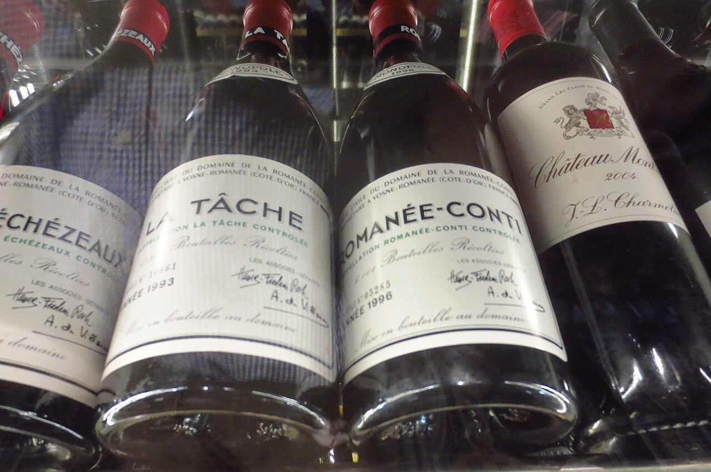

# 奥贝尔·德维兰

奥贝尔·德维兰（Aubert de Villaine，1939— ）是法国酿酒师，也是罗曼尼康帝酒庄（Domaine de la Romanée-Conti，简称 DRC）最长期的面孔之一。他 1965 年回到勃艮第，1974 年代表德维兰家族出任 DRC 联合经理，直到 2021 年底卸任；在这近半个世纪里，他经历了与拉露·比兹-勒桦（Lalou Bize-Leroy）的合作与分手、罗克家族的接替、有机与生物动力种植的推广，以及“勃艮第葡萄园气候”申遗。与此同时，他和妻子帕梅拉在布泽龙（Bouzeron）经营自己的小酒庄，并把阿里高特（Aligoté）这个常被轻视的品种推上了村庄级 AOC 的位置。

图：罗曼尼康帝与拉塔希酒瓶。图片：Arnaud 25，CC BY-SA 3.0，via Wikimedia Commons（[原图页面](https://commons.wikimedia.org/wiki/File:Domaine_de_la_Roman%C3%A9-conti_02.JPG)）。

## 从雷恩到沃恩-罗曼尼

奥贝尔 1939 年 2 月 8 日生于法国雷恩（Rennes），是家中六个孩子里的长子。父亲亨利·德维兰（Henri de Villaine）在二战爆发后参军并被俘，直到 1943 年才回家；奥贝尔的童年因此有一段时间在没有父亲的环境里度过。他后来学习文学与法律，又去纽约工作了九个月，在弗雷德里克·怀尔德曼公司（Frederick Wildman & Co）接触美国市场——这家公司正是 DRC 酒在美国的独家进口商。他在纽约也写稿、做记者，接触到美国市场与媒体。

1965 年，他回到勃艮第，加入祖父埃德蒙·甘丹·德维兰（Edmond Gaudin de Villaine）与父亲亨利共同经营的家族产业。父亲教他酿酒、管园与卖酒；1971 年，家族把产业交到他手上。DRC 不是他“创立”的酒庄：它的历史可以追溯到中世纪，1942 年正式组成民事公司，由德维兰家族与勒桦家族各持一半。奥贝尔的角色，是代表德维兰家族管理这份共同遗产，而不是拥有全部产权。

## 两个家族、一个酒庄

DRC 的架构很容易被误读。它不是一个单一家族酒庄，而是两个家族在 1942 年把各自继承的葡萄园合并成的民事公司。德维兰家族来自雅克-玛丽·杜沃-布洛谢（Jacques-Marie Duvault-Blochet）的继承线，勒桦家族则在 1942 年买下一半股份。1974 年，奥贝尔与拉露·比兹-勒桦同时出任联合经理：一个代表德维兰家族，一个代表勒桦家族。两人都把 DRC 推向“全球最昂贵、最受追捧的葡萄酒”之列，但在管理理念上逐渐分歧；1991 至 1992 年前后，拉露离开管理岗位，由她的侄子查尔斯·罗克（Charles Roch）接替，查尔斯去世后由亨利-弗雷德里克·罗克（Henry-Frédéric Roch）接任。2018 年亨利-弗雷德里克去世，2019 年佩琳·费纳尔（Perrine Fenal）代表勒桦家族接任联合经理。

这段历史常被写成“两个强人的宫斗”，但更准确的说法是：DRC 的所有权结构决定了它必须由两个家族共同治理，任何一方都不能单独决定一切。奥贝尔的长期价值，不在于“打败了拉露”，而在于他把一个家族合资企业维持了近五十年，并在多次交接中保住了酒庄的农法与风格。2021 年底，他卸任联合经理，2022 年转为顾问；接替他的是侄子贝特朗·德维兰（Bertrand de Villaine），与佩琳·费纳尔共同管理。

## 有机与生物动力：把风土变成可验证的农法

DRC 的葡萄园约 25 公顷，几乎全是特级园，核心包括罗曼尼康帝（Romanée-Conti，约 1.81 公顷的独占园）、拉塔希（La Tâche，约 6 公顷的独占园），以及里奇堡（Richebourg）、罗曼尼-圣维旺（Romanée-Saint-Vivant）、大埃雪索（Grands Échézeaux）、埃雪索（Échézeaux）、科通（Corton）、蒙哈榭（Montrachet）等。这些名字在拍卖目录里经常出现，但奥贝尔更愿意谈的是“怎么种”：DRC 从 1985 年起实行有机种植，2002 年开始试行动物动力（生物动力）方法，2007 年全面转用。有机与生物动力不是玄学标签，而是一套可核查的规则：不使用合成除草剂与杀虫剂，用堆肥与覆盖作物恢复土壤活力，按月亮与星象日历安排部分田间工作，接受更低、更不稳定的产量。

这套农法在 1980 至 1990 年代并不主流。勃艮第的许多酒农依赖化肥与农药来提高产量，病害一来就喷药；DRC 的选择意味着更高的风险、更低的产量与更贵的劳动力。奥贝尔的逻辑是：特级园的价值不在“产量”，而在“表达”——同一片土地，如果土壤被压实、微生物被杀死，酒就会失去细节。今天，DRC 的有机与生物动力实践已经成为勃艮第的参照系之一，但它不是“奥贝尔一个人的发明”：酒庄团队、田间工人、研究者与相邻酒农都在参与。

## 布泽龙与阿里高特

奥贝尔与妻子帕梅拉在 1971 年结婚，随后在夏隆内丘（Côte Chalonnaise）的布泽龙建立了 Domaine de Villaine（早期酒标写作 Domaine A. et P. de Villaine）。最初只有约 8 公顷，后来扩展到约 30 公顷，种有阿里高特、黑皮诺与霞多丽；2000 年起，酒庄由侄子皮埃尔·德·伯努瓦（Pierre de Benoist）管理。布泽龙过去以阿里高特闻名，但这种葡萄常被当作“勃艮第的廉价白葡萄酒”原料，种在最好的坡地上也不被重视。奥贝尔夫妇与当地酒农一起推动布泽龙建立独立的村庄级 AOC，1998 年正式获批。

这件事的意义常被低估。阿里高特不是“劣等霞多丽”，它有自己清晰的酸度、白花与矿物感，适合做干型白葡萄酒，也适合做起泡酒的基酒。布泽龙 AOC 的建立，等于给这个品种一个地理身份：只要种在布泽龙的石灰岩坡地、按规矩种植与酿造，就可以标“Bouzeron”，而不必躲在“Bourgogne Aligoté”的大区标签下。奥贝尔自己的酒庄，也因此成了布泽龙阿里高特的样板。

## 申遗：让“气候”成为世界遗产

2007 年，勃艮第成立“勃艮第葡萄园气候协会”（Association des Climats du vignoble de Bourgogne），奥贝尔出任主席。这里的“气候”（climat）不是天气预报里的气候，而是勃艮第特有的“地块”概念：一块被精确边界、土壤、坡度、朝向与历史耕作方式定义的小片葡萄园。中文常把它译成“气候”，容易让人以为是温度与降水；更准确的译法是“葡萄园地块”或“风土地块”。

协会用八年时间准备申遗文件，组织科学家、地方政府、酒农与志愿者；2015 年 7 月 4 日，联合国教科文组织把“勃艮第葡萄园气候与勃艮第葡萄酒文化景观”列入世界遗产。申遗成功不是“给酒做广告”，而是承认勃艮第把土地划分、继承制度、酒农知识与社会组织结合在一起，形成了一种独特的文化景观。奥贝尔在其中扮演的是“召集人”与“公共代言人”，而不是唯一功臣；协会的副主席、科学家、地方政府与 64,000 多名签名支持者都参与了这件事。

## 纳帕的 HdV 与跨大西洋网络

奥贝尔与帕梅拉的另一个项目，是与加州海德家族（Hyde）在纳帕谷卡内罗斯（Carneros）合办的 HdV（Hyde de Villaine）。帕梅拉是海德家族的表亲，拉里·海德（Larry Hyde）在 1979 年买下海德葡萄园；2000 年，德维兰夫妇与海德家族共同创立 HdV，2002 年请来酿酒师斯特凡·维维耶（Stéphane Vivier）。HdV 用卡内罗斯的霞多丽与黑皮诺，做出一种“勃艮第方法、加州果实”的风格：更早采收、更少新橡木、更强调酸度与矿物感。

这个项目把奥贝尔与罗伯特·蒙大维、作品一号那一代人的跨大西洋网络连在一起。1960 至 1970 年代，勃艮第与加州之间的交流不只是商业买卖，还包括葡萄品种、克隆、橡木桶、酿酒师与品鉴标准的互相借用。奥贝尔在纽约卖过 DRC，在加州做过酒，在勃艮第管过特级园；他的职业生涯本身就是“旧世界与新世界如何互相学习”的样本。

## 退休、交接与争议

2021 年底，奥贝尔卸任 DRC 联合经理，结束近半个世纪的任期；2022 年，他转为顾问，贝特朗·德维兰与佩琳·费纳尔接任。这个交接在勃艮第并不常见：很多酒庄在换代时会改变种植密度、采收日期、橡木桶比例与酒款风格，而 DRC 在交接后基本保持了原来的技术路线。原因不是“新经理没有想法”，而是 DRC 的葡萄园、团队与市场位置决定了它不能轻易改风格；任何大变动都会在拍卖价、配额与客户关系上放大。

围绕奥贝尔的争议，主要集中在三件事。第一，DRC 的天价与“稀缺营销”：产量有限、配额分配不透明、拍卖价屡创新高，批评者认为这已经把酒变成金融资产；支持者则认为，特级园的稀缺、低产与长期陈年能力是价格的基础。第二，有机与生物动力的“信仰化”：有人把 biodynamic 当成万能灵药，忽略年份、病害与田间判断；奥贝尔本人更像是一个谨慎的实践者，而不是神秘主义者。第三，“气候”申遗是否过度商业化：申遗成功后，勃艮第的旅游、酒价与土地价格都上涨，批评者担心小酒农被挤出；支持者认为，遗产保护至少给了土地规划一个法律抓手。

## 去勃艮第看什么

如果去勃艮第，可以把 DRC 当成“理解特级园制度的入口”，而不是打卡点。DRC 不对外开放常规旅游，参观需要预约、通过配额客户或特殊渠道；普通游客更适合去沃恩-罗曼尼（Vosne-Romanée）看葡萄园边界，去博讷（Beaune）的勃艮第葡萄酒博物馆了解历史，再去布泽龙看 Domaine de Villaine 的阿里高特。看葡萄园时，重点不是“哪块最贵”，而是坡度、朝向、土壤厚度与排水：同一座山坡上，几十米的位移就能让酒的结构完全不同。

喝 DRC，不必从最贵的罗曼尼康帝开始。可以从村庄级或一级园的其他勃艮第酒建立参照，再体会 DRC 的黑皮诺：红色果香、玫瑰、香料、矿物与极长的余味；年轻时单宁紧、香气封闭，需要长时间醒酒或陈年。配餐上，黑皮诺适合烤鸡、鸭肉、蘑菇、松露与软质奶酪，温度 14–16°C。若只是好奇“天价酒是什么味道”，更理性的做法是参加正规酒展或拍卖预展的品鉴，而不是在餐厅盲目点一瓶。

## 与本站其他页面的关系

奥贝尔的故事连接四条线。第一是[勃艮第](ref:burgundy)的特级园制度：沃恩-罗曼尼、罗曼尼康帝、拉塔希与“气候”地块。第二是[法国](ref:france)的葡萄酒行政与文化遗产：AOC、申遗、酒农组织。第三是[葡萄酒](ref:wine)的农法与陈年：[黑皮诺](ref:pinot)如何表达土壤、有机与生物动力如何影响果实。第四是[纳帕谷](ref:napa)的跨大西洋网络：HdV、卡内罗斯与勃艮第方法的加州版本。

如果想继续看“家族合资酒庄如何治理”，可以对照木桐酒庄与作品一号；如果想看“申遗如何改变产区”，可以读勃艮第“气候”与香槟山坡；如果想看“旧世界酿酒师如何在新世界做酒”，可以关注 HdV 与罗伯特·蒙大维。奥贝尔不是“DRC 的老板”，他是这份双家族遗产的长期守护者之一。

## 延伸阅读

- [勃艮第](ref:burgundy)：沃恩-罗曼尼、特级园与“气候”地块。
- [法国](ref:france)：AOC 制度、葡萄酒产区与文化遗产。
- [葡萄酒](ref:wine)：有机种植、生物动力、橡木桶与陈年。
- [黑皮诺](ref:pinot)：DRC 与布泽龙的核心品种。
- [纳帕谷](ref:napa)：HdV、卡内罗斯与加州的黑皮诺。
