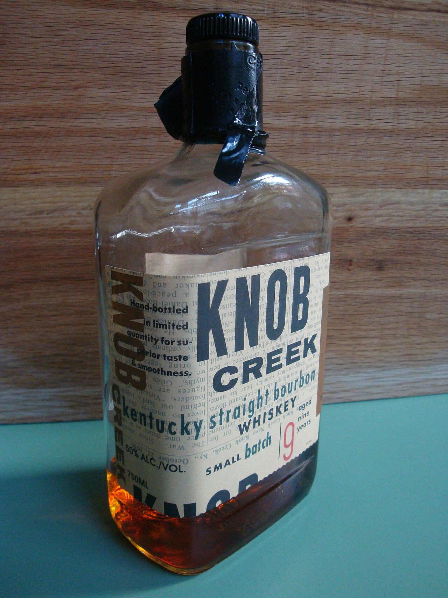

# 布克·诺伊

布克·诺伊（Booker Noe，1929–2004）是 Jim Beam 家族第六代首席酿酒师，也是“小批量波本”这一说法进入主流市场的关键人物。他的本名是 Frederick Booker Noe II，行业里通常只叫“Booker”。他留下的 Booker's 不是一款普通的高端酒，而是一种把“桶强、不过滤、不加水”做成产品身份的做法。

图：Knob Creek 波本酒瓶；Booker Noe 在 1992 年小批量系列中推出的品牌之一，画面不是他本人。图片：LittleGun，Public domain，via Wikimedia Commons（[原图页面](https://commons.wikimedia.org/wiki/File:Knob_creek_bottle.jpg)）。

## 人物小传

诺伊 1929 年出生在肯塔基的 Beam 家族圈子里。他的外祖父是 Jim Beam，母亲 Margaret Beam 嫁入 Noe 家；这层血缘让他从小在酒厂边长大。他常被描述为“鼻子比仪器更准”的选桶人：在仓库里一桶一桶闻，判断哪些桶有足够的焦糖、香草与烤橡木，哪些桶应该留给普通 Jim Beam。1960 年，他被任命为 Beam 位于波士顿（Kentucky 的 Boston，不是马萨诸塞州波士顿）酒厂的首席酿酒师，五年后灌装 Beam 的第一百万桶。

## 家族与酒厂

Jim Beam 在禁酒令后重建 Clermont 酒厂，家族也把酿造知识传给下一代。诺伊的职业生涯正好赶上波本从“战后日常酒”滑向“被伏特加挤压的旧品类”。他没有选择把酒做得更淡，而是回到更老的做法：选特定仓库、特定楼层、特定桶，按桶强装瓶。这种“返祖”后来被市场重新命名为小批量。

## 代表酒款

Booker's 是核心作品：不加水稀释、不过滤、以批次为单位，酒精度随桶而定。它的风味通常厚重，带焦糖、香草、烤橡木与香料。诺伊偏好 6 至 8 年的桶，认为这个区间既有足够的木质风味，又没有失去玉米的甜感；每批酒的桶数与仓库位置都被写进批次标签，形成一种可追踪的“反工业”叙事。1992 年，诺伊把 Baker's、Basil Hayden's 与 Knob Creek 加入 Booker's，组成 Small Batch Bourbon Collection；四个品牌分别对应不同配方、酒精度与价格带，让“小批量”从单一产品变成一组可识别的货架语言。Baker's 是高酒精度、单桶感更强的一款；Basil Hayden's 以高黑麦比例和较轻酒体著称；Knob Creek 则用较长时间陈年与更高酒精度，覆盖更广的日常消费群。

## 方法或制度影响

诺伊的影响在于把“选桶”变成叙事。他会在仓库里逐桶品尝，决定哪些桶进入 Booker's；他也把“批次编号、仓库位置、年份”写进包装与故事，让消费者意识到波本不是完全均质的工业品。这种方法后来被无数酒厂模仿，成为高端波本的常规语言。1992 年，儿子 Fred Noe 接班，成为第七代首席酿酒师。Booker's 的批次通常由几十桶组成，酒龄 6 至 8 年，酒精度多在 120 proof 以上；因为不加水，同一批次不同瓶之间也可能有细微差异，这种“不稳定性”反而成了产品魅力的一部分。

## 评价与争议

正面评价把他视为波本复兴的“产品设计师”：在行业低迷时，他用小批量、桶强与高价格证明波本可以卖得贵。批评则指出，Booker's 的成功也依赖 Jim Beam 的规模、分销与资本，不能简单归功于个人；此外，“小批量”后来被大量品牌滥用，变成营销标签，与原意拉开距离。关于 Booker's 首个年份，官方资料有 1987 与 1988 两种说法，本页并列保留。诺伊 2004 年去世后，Fred Noe 继续担任 Jim Beam 首席酿酒师，Booker's 的批次编号与“布克本人选桶”的传统被保留下来，也成为品牌最难复制的一部分。今天 Booker's 仍是少数坚持不加水、不过滤的主流波本之一，这种产品策略在高价与高酒精度之间维持了微妙的平衡。研究者引用时，最好同时标注“品牌年表 1987”与“日文年表 1988”，而不是替读者强行统一。

## 常见误读

第一，把 Booker's 当成单桶。它通常是多桶调配的批次酒，只是不加水、不过滤。第二，把“小批量”理解成“手工小作坊”。Beam 是大厂，小批量指的是选桶与调配规模，不是公司规模。第三，把诺伊当成 Jim Beam 的直系儿子。他是 Jim Beam 的外孙辈，家族关系要按 Beam—Noe 两支来读。第四，把 1992 年当成 Booker's 的起点。1992 年是系列成型，不是第一款酒。第五，把“桶强”当成“原桶直接装瓶”的同义词。桶强只表示未加水稀释，不同批次的酒精度仍会因桶而异。

对照阅读：[波本威士忌](ref:bourbon)、[肯塔基波本路线：法兰克福、巴兹敦与洛雷托的三座厂区](ref:bourbon-trail)。

## 延伸阅读

Jim Beam 的英文历史页与日文年表在 Booker's 首发年份上并不一致：英文页写 1987，日文页写 1988。品牌官网的其他页面又把 1992 年写成小批量系列正式成型。把这三条并置，可以看出“产品首发”“系列成型”“市场推广”是三个不同节点。阅读时最好保留原始年份，不要用一个“1987/1988”的模糊写法把差异抹平。今天 Booker's 的批次名多取自诺伊的亲友、仓库或酒厂事件，这种命名方式把“家族记忆”变成可收藏的标签，也让每一批酒在二级市场上有不同的辨识度。

相关条目：[肯塔基州](ref:kentucky)。

## 另见

- [波本威士忌](ref:bourbon)：诺伊一生工作的品类。
- [肯塔基州](ref:kentucky)：Beam 与 Noe 家族酒厂的所在地。
- [肯塔基波本路线](ref:bourbon-trail)：把 Clermont、Boston 与 Bardstown 串起来的产区旅行。
- [蒸馏](ref:distillation)：理解桶强波本的技术前提。
- [宾三得利](ref:beam)：Jim Beam 品牌今天的所属集团。

**关键事实。**

| 项目 | 内容 |
| --- | --- |
| 一句话定位 | 肯塔基波本酿酒师（1929–2004），Jim Beam 家族第六代首席酿酒师；1960 年接管 Boston 酒厂，1965 年完成第一百万桶，1987/1988 年推出 Booker's，1992 年建立 Small Batch Bourbon Collection，被视为波本小批量复兴的关键人物 |
| 生卒 | 1929–2004 |
| 身份 | 波本威士忌酿酒师、酒厂首席酿酒师 |
| 关联地区 | 肯塔基州 |

**来源与边界。** 本页关于「布克·诺伊」的关键事实，主要由以下来源交叉核对：Jim Beam（交叉核对 Noe 家族与 Beam 家族的亲属关系、1960 年职位与 Fred Noe 1992 年接班；1929–2004 生卒年、1988 年 Booker's 发布说法、1992 年系列扩充与 Fred Noe 接班）、Voyageur Press（1980–90 年代波本小批量与高端化转向的行业背景；未复制正文）。价格、批次与状态会变，涉及这些字段时以页面所列来源的最新版本为准。正文为项目自写，来源只作核验，不复制原文。

**并读。** 把「布克·诺伊」与「波本威士忌」、「肯塔基州」、「肯塔基波本路线：法兰克福、巴兹敦与洛雷托的三座厂区」放在一起读时，先确认它们是同一层级还是上下游关系：先确认时代与作品，再比较经历、风格与史料边界。本页负责给出人物的基本坐标，对照条目补上具体案例与差异；读完再回到本页，才能分清哪些差别属于人物本身，哪些只是产地、批次或品牌选择。

**适用边界。** 对「布克·诺伊」而言，生卒年与作品系年存在异说；文学或艺术形象不能直接当作历史生活记录。
