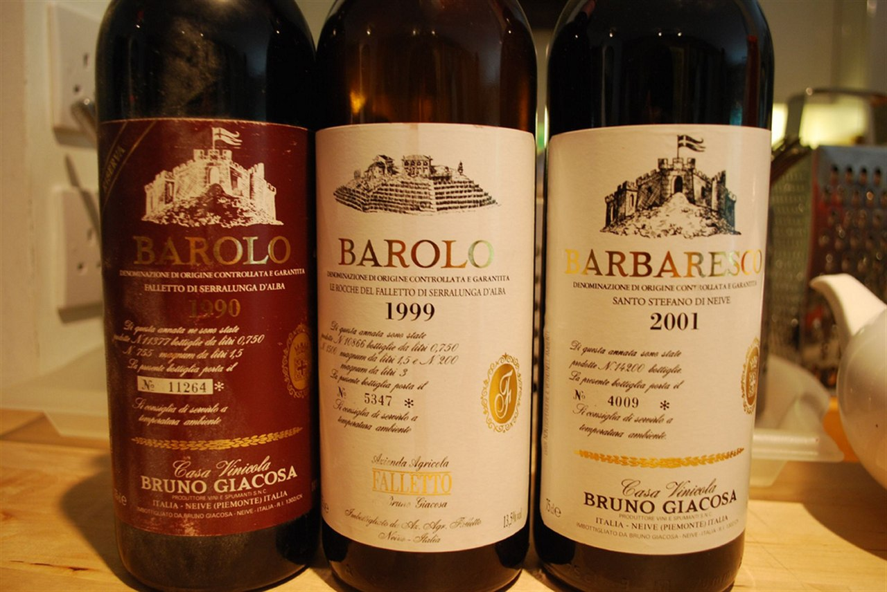

# 布鲁诺·贾科萨

布鲁诺·贾科萨（Bruno Giacosa，1929–2018）是意大利皮埃蒙特 Neive 的酿酒师，以 Barbaresco 与 Barolo 闻名。他被称为“Neive 的天才”，也被视为 20 世纪后期最严格的传统派之一。他的特别之处不只是“酒做得好”，而是他很早就在酒标上写出单一葡萄园的名字，并且在一个年份不达标时，宁可把酒散装卖掉，也不装瓶。

图：三瓶 Bruno Giacosa：Barolo Riserva、Barolo 与 Barbaresco；酒款照片，不是其本人。图片：YKL2006，CC BY 2.0，via Wikimedia Commons（[原图页面](https://commons.wikimedia.org/wiki/File:Bruno_Giacosa_3bottles.jpg)）。

## 从葡萄采购商到酿酒师

贾科萨 1929 年生于 Neive。他的家族不是从零开始种葡萄的农民，而是 commerciante（葡萄采购商/酒商）：祖父 Carlo 与父亲 Mario 长期在 Barbaresco、Barolo 一带收购葡萄，再卖给酒庄或自己酿造。布鲁诺 15 岁离开学校，在二战期间进入家族生意，跟着父亲走遍葡萄园，学会判断地块、品种与成熟度。

这段经历让他拥有一种“地图式”的知识：哪一块坡地朝南、哪一块土壤更暖、哪一个村的 Nebbiolo 更早熟、哪一位农人的葡萄更干净。他后来回忆，自己不是从书本学酒，而是从“走葡萄园、尝葡萄”学酒。1960 年代，他与 Angelo Gaja、Produttori del Barbaresco 一起，被视为把 Barbaresco 潜力展示给国际市场的三位关键人物。

## 单一园标注

1964 年，贾科萨酿造了 Barbaresco Santo Stefano，并在酒标上标出葡萄园名。这在当时的皮埃蒙特并不常见：大多数酒是不同地块、不同村庄的混合，酒标只写产区与酒庄。把“单一园”写进名字，等于向消费者承诺这款酒来自一个具体地方，风味与年份差异都更清楚。

1967 年，他又推出 Barolo Colline Rionda（Vigna Rionda）与 Barbaresco Asili Riserva。这些酒让“cru（地块）”从酒庄内部术语变成市场语言。后来 Barolo 与 Barbaresco 的“附加地理名称”（Menzioni Geografiche Aggiuntive）制度，可以看作这种实践的制度化；贾科萨不是唯一推手，但他属于最早一批把地块写进酒标的人。

## 从收购葡萄到自有园

贾科萨前二十年的职业生涯，主要靠收购优质葡萄。他不拥有大片土地，而是与固定农人建立关系，挑选最好的地块与果实。1982 年，他在 Serralunga d'Alba 买下 Falletto 葡萄园，约 25 英亩；这是他从“酒商”转向“自有园酒庄”的关键一步。1996 年，他又在 Barbaresco 的 Asili 与 Rabajà 买下地块。

他的酒因此分成两类：自有园的酒标为 Azienda Agricola Falletto（di Bruno Giacosa），收购葡萄或租赁园的酒标为 Casa Vinicola Bruno Giacosa。这个双轨结构在今天看来很清楚，但在当时需要消费者理解“酒庄名”与“葡萄来源”不是一回事。它也让贾科萨在扩张时保持灵活性：不必先买地才能做酒，但必须对葡萄来源负责。

## 风格与年份选择

贾科萨的风格以优雅、细线、香气清晰著称，而不是靠力量或新橡木桶。他使用传统的大桶陈酿，浸皮时间较长，但不过度提取；酒的颜色偏淡，香气以玫瑰、红樱桃、甘草、焦油与泥土为主，单宁细而长。他相信 Nebbiolo 的价值在“时间”，不在“即饮”。

他对年份的选择近乎苛刻。若某一年的酒没有达到他的标准，他宁可把整批酒散装卖给其他酒庄，也不装瓶。2010 年 Barolo 是一个被许多酒评人看好的年份，但他的酒庄仍宣布不装瓶该年份的 Barolo，理由是没有达到他的标准。这个决定引起同行争议，却也让“贾科萨装瓶”本身成为一种质量信号。

## 晚年与传承

2006 年，贾科萨中风，虽然恢复，但逐渐减少日常工作；女儿 Bruna Giacosa 逐步接管商业与管理，Dante Scaglione 等酿酒师负责技术。2012 年，慢食大学（University of Gastronomic Sciences）授予他荣誉学位，表彰他把 Langhe 的葡萄园与酒推向国际。2018 年 1 月，他在 Neive 的家中去世，享年 88 岁。

他的去世被意大利酒界视为一个时代的结束：那一代酿酒师靠走葡萄园、尝葡萄、记地块来建立判断，而不是靠实验室数据或市场报告。今天的 Barolo/Barbaresco 酒庄拥有更多技术与市场工具，但“是否愿意在一个好年份放弃装瓶”仍然是贾科萨留下的最难模仿的部分。

## 评价与争议

正面评价把他视为“传统派最后的巨人”之一：他证明了 Barbaresco 可以达到与 Barolo 同等的复杂度；他把单一园标注推向市场；他用“不装瓶”守住了质量底线；他的酒在陈年后展现出香气与结构的层次。

批评主要有三点。第一，“天才”叙事掩盖了团队与农人的贡献：贾科萨依赖长期合作的葡萄农、酿酒师与女儿 Bruna 的管理，不是一个人完成所有判断。第二，他的收购葡萄模式让“酒庄酒”与“酒商酒”的界限变得复杂；消费者需要看清酒标上的 Azienda Agricola 与 Casa Vinicola。第三，“宁可不装瓶”的做法可以被浪漫化，但它也意味着年份波动被转嫁给市场与买家；不是每家酒庄都能承受这种选择。

## 常见误读

第一，把贾科萨当成 Barbaresco 的“创始人”。Barbaresco 作为产区早于他；他是 20 世纪后期把其潜力推向国际的关键人物之一。

第二，把他所有酒都当成“自有园”。他的酒标分 Azienda Agricola Falletto 与 Casa Vinicola Bruno Giacosa，后者使用收购葡萄或租赁园。

第三，把“传统”当成“没有技术”。他使用温控、不锈钢与实验室分析，只是不让技术取代对葡萄与地块的判断。

第四，把“2010 年不装瓶”当成质量差的证明。那是酒庄自己的标准与选择，不等于该年份的 Nebbiolo 在别处不能做出好酒。

相关条目：[巴罗洛](ref:barolo)。

他不反对新橡木桶或现代设备，反对的是用它们抹平年份与园地差异；把传统派理解成拒绝一切新技术，会误读他的选择。

## 另见

- [皮埃蒙特](ref:piedmont)：Neive、Barbaresco 与 Serralunga d'Alba 所在的大区。
- [巴罗洛](ref:barolo)：贾科萨另一条核心产品线，与 Barbaresco 共享 Nebbiolo 传统。
- [内比奥罗](ref:nebbiolo)：理解他的香气、单宁与陈年潜力。
- [红葡萄酒](ref:red-wine)：把他的大桶、长浸皮风格放进红酒工艺。
- [风土与工艺](ref:place-process)：理解单一园标注与“地块—品种—工艺”的关系。

对照阅读：[皮埃蒙特](ref:piedmont)、[内比奥罗](ref:nebbiolo)。

**关键事实。**

| 项目 | 内容 |
| --- | --- |
| 一句话定位 | 意大利皮埃蒙特酿酒师（1929–2018），以 Neive 为基地，1964 年率先在酒标标注 Barbaresco 单一园，坚持传统长陈酿与严格选年份，被称为“Neive 的天才” |
| 生卒 | 1929–2018 |
| 身份 | 酿酒师、酒庄经营者、葡萄采购商 |
| 关联地区 | 意大利、皮埃蒙特 |

**来源与边界。** 本页关于「布鲁诺·贾科萨」的关键事实，主要由以下来源交叉核对：Wine Spectator、Università degli Studi di Scienze Gastronomiche / La Stampa（2012 年荣誉学位、去世与“宁可散装卖也不装瓶不达标的年份”的做法）、Bruno Giacosa（酒庄在 Neive、Falletto 与 Asili/Rabajà 的葡萄园与酒款结构）等 5 条来源。价格、批次与状态会变，涉及这些字段时以页面所列来源的最新版本为准。正文为项目自写，来源只作核验，不复制原文。
