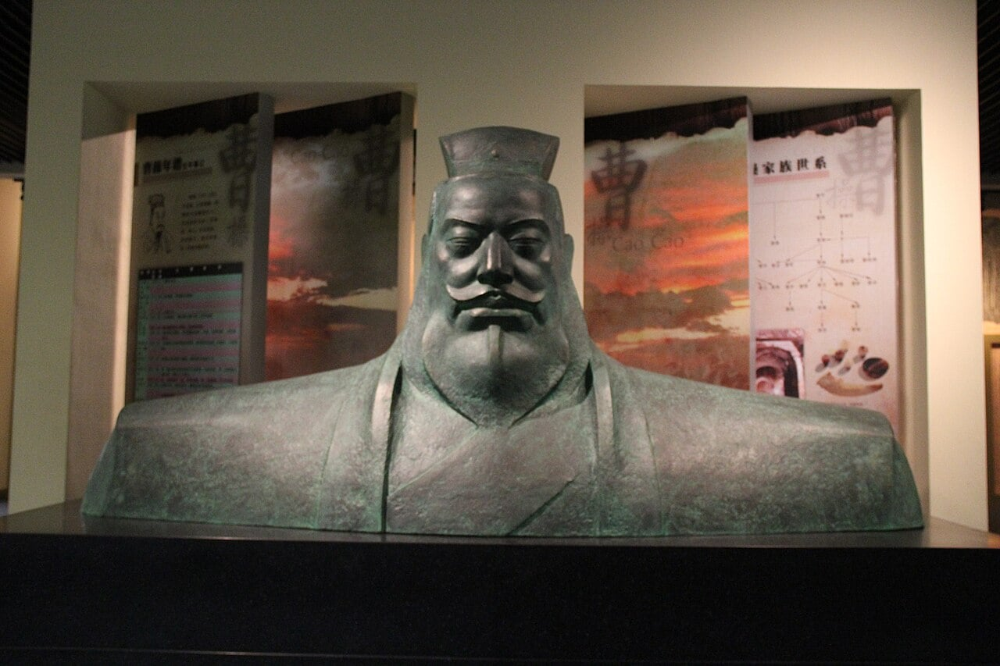

# 曹操

曹操（155—220），字孟德，沛国谯县（今安徽亳州）人，东汉末年的政治家、军事家，也是建安文学的代表诗人。他与酒的关系有三层：诗里把酒当作解忧的入口，政令里下令禁酒，私下又向朝廷献过一套酿酒法。只取其中一面，都会把这个人读窄。

图：许昌博物馆的曹操青铜像，背后是曹操生平与家族世系展板。图片：Gary Todd，CC0，via [原图页面](https://commons.wikimedia.org/wiki/File:Statue_of_Cao_Cao.jpg)。

## 生平与政治节点

曹操生于 155 年。174 年前后，他举孝廉为郎，出任洛阳北部尉；184 年黄巾起事，他以骑都尉参与镇压；196 年，他把汉献帝迎到许县，从此以朝廷名义发号施令；200 年官渡之战击败袁绍，逐步统一北方；208 年赤壁失利，三国鼎立的格局成形；213 年封魏公，216 年进爵魏王；220 年病逝于洛阳，年六十五。其子曹丕称帝后，追尊他为魏武帝。

这些节点说明，曹操首先是一个在乱世中重建秩序的人。酒政、粮政与兵政在他手里是同一套问题：粮食够不够，民心稳不稳，豪强听不听。

## 《短歌行》中的酒与时间

《短歌行》开头八句是：“对酒当歌，人生几何！譬如朝露，去日苦多。慨当以慷，忧思难忘。何以解忧？唯有杜康。”这里的酒不是宴席上的助兴品，而是面对“人生几何”时的第一个动作。诗人端起杯，先承认时间短促，再承认忧思无法排遣。

“杜康”通常解作传说中最早造酒的人，后来成为酒的代称，不是某个现代品牌。诗的后半转入求贤：“青青子衿，悠悠我心”用《诗经·郑风·子衿》的句子，“呦呦鹿鸣，食野之苹。我有嘉宾，鼓瑟吹笙”用《小雅·鹿鸣》的宴饮场景。酒于是与求贤、忧时叠在一起：越是想有所作为，越感到时间不够。

## 禁酒令：粮食、风气与权力

《后汉书·孔融传》说“时年饥兵兴，操表制酒禁”，把禁酒的原因指向战乱中的粮食紧张。酿酒要消耗大量谷物，在军粮优先的年代，限制酿酒是直接的成本选择；同时，饮酒聚宴也容易形成地方声望与人际网络，这对集权者并非无害。

但曹操并不是反对酒本身。他写过《上九酝酒法奏》，向汉献帝献上“九酝春酒”的酿法，里面说到用曲三十斤、流水五石、腊月渍曲、正月冻解后用好稻米酿造，还提到“三日一酿，满九斛米止”。一个愿意把酿酒细节写进奏章的人，显然懂酒，也重视酒的技术。禁酒是治理手段，献酒法是技术兴趣，两者并不互相取消。

## 孔融的反驳与文本证据

孔融写《难曹公表制酒禁书》公开反对。他的论证有两层：酒有祭祀、宴享和医药之用，不能一概禁止；把亡国归罪于酒，在逻辑上站不住脚。他还用了一个尖锐的类比：如果夏桀、商纣因女色亡国，难道连婚姻也要禁止？这句话把禁酒令的伦理基础直接掀开。

这场争论不只是口味之争。孔融是孔子的后代，又是名士领袖，他的反对带有清议与地方声望的分量；曹操则以军国资源为优先。后来孔融被杀，罪名与言论、交游有关，酒禁之争是两人关系恶化的一条线索，但不能简化成“因为反对禁酒而被杀”。

## 酒名、酒器与汉末物质条件

汉末的主流酒是谷物发酵酒，不是今天的高度白酒。酒有清、浊之分，清酒过滤较净，浊酒带渣，价格与身份也不同。《三国志·徐邈传》记徐邈私下饮酒沉醉，有人问政事，他答“中圣人”；鲜于辅解释说，当时醉客把清酒叫“圣人”，浊酒叫“贤人”。这条材料正好说明禁令之下，人们如何用隐语继续饮酒。

“九酝”指反复投料、多次发酵的酿法，追求更高的出酒率与更厚的味道。曹操奏章里的“九酝春酒”是一套具体工艺，不是一句文学形容。今天有酒企把这条记载写成品牌起源，但古代奏章、地方酒名与现代商品之间隔着很长的流传链，不能直接当作连续不断的工艺传承。

## 文学史评价与争议

陈寿在《三国志》里评曹操“抑可谓非常之人，超世之杰矣”，肯定其政治与军事才能。钟嵘《诗品》却把他列在下品，评语是“曹公古直，甚有悲凉之句”：承认其悲凉有力，又嫌其古朴直露，不够华美。这是文学史上对曹操诗最具体的一条批评。

政治评价的分歧更大。许劭说他是“治世之能臣，乱世之奸雄”，《三国演义》又把这句话放大成舞台形象。《后汉书·陶谦传》记初平四年（193）曹操征徐州时“凡杀男女数十万人，鸡犬无余，泗水为之不流”，这段记载历来是评价其功业时无法回避的争议。文学上的“建安风骨”与政治上的残酷，可以同时成立，不必互相洗白。

## 常见误读

第一，把曹操当成纵酒之人。他写酒，也禁酒；文学表达忧思，治理要计算粮食。第二，把“青梅煮酒论英雄”当成史实。那是《三国演义》的情节，正史没有这段细节。第三，把“杜康”当成曹操喝过的某个品牌。它是传说造酒者与酒的代称。第四，用今天的高度白酒想象汉末的酒。当时主流是度数较低的谷物发酵酒。第五，把“九酝春酒”直接等同于今天某款商品。工艺记载与品牌叙事要分开看。

## 年表

- 155 年：出生。
- 174 年前后：举孝廉，任洛阳北部尉。
- 196 年：迎汉献帝，迁都许县。
- 200 年：官渡之战击败袁绍。
- 208 年：赤壁之战失利。
- 213 年：封魏公。
- 216 年：进爵魏王。
- 220 年：病逝于洛阳。

相关条目：[黄酒](ref:yellow-wine)。

## 另见

- [中国酒史](ref:chinese-wine-history)：酒政、禁酒与酿造的长期变化。
- [黄酒](ref:yellow-wine)：谷物发酵酒的工艺谱系。
- [一杯酒里的时间](ref:time-in-a-cup)：酒如何进入诗文与节令。
- [中国](ref:china)：曹操活动的主要地理范围。

补充阅读：[安德烈·西蒙](ref:c-extra-1)。

对照阅读：[中国酒史纲：从谷物发酵到国家名酒](ref:chinese-wine-history)、[一杯酒里的时间](ref:time-in-a-cup)。

**关键事实。**

| 项目 | 内容 |
| --- | --- |
| 一句话定位 | 东汉末年政治家、军事家与诗人，155—220；《短歌行》以“何以解忧，唯有杜康”写时间与忧思，建安年间的禁酒与孔融的争论又让酒成为政治议题 |
| 生卒 | 155–220 |
| 身份 | 政治家、军事家、诗人 |
| 关联地区 | 中国 |

**来源与边界。** 本页关于「曹操」的关键事实，主要由以下来源交叉核对：晋陈寿撰；中华书局点校本（生卒、仕履、建安年间政事与《徐邈传》所记禁酒隐语；由原条目末尾参考资料迁移，未逐条复核访问日期）、南朝宋范晔撰；中华书局点校本（孔融《难曹公表制酒禁书》相关记载与徐州之役；由原条目末尾参考资料迁移，未逐条复核访问日期）、Wikimedia Foundation（比对《短歌行》等通行文本；未复制全篇）等 10 条来源。价格、批次与状态会变，涉及这些字段时以页面所列来源的最新版本为准。正文为项目自写，来源只作核验，不复制原文。
