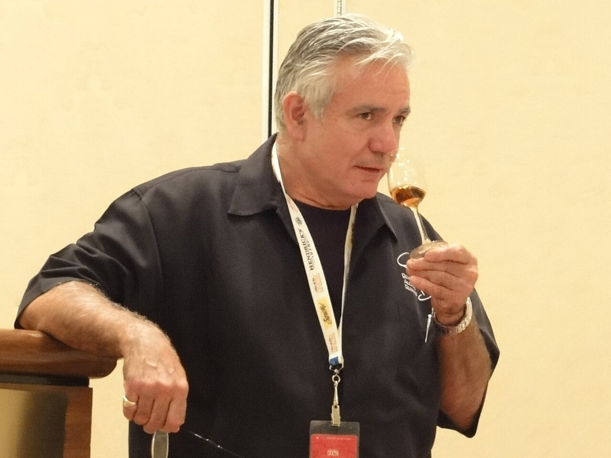

# 戴尔·德格罗夫

戴尔·德格罗夫（Dale DeGroff，1948 年生）是美国当代最有影响力的调酒师之一。他的作用不在发明某杯名酒，而在把“鲜榨果汁、正确冰块、尊重古典配方”变成行业标准。1980 年代后期，他在纽约彩虹厅（Rainbow Room）的吧台，成为后来“鸡尾酒复兴”的起点之一。

图：戴尔·德格罗夫。图片：Editor B，CC BY 2.0，via Wikimedia Commons（[原图页面](https://commons.wikimedia.org/wiki/File:D%C3%A9gustation_d%27Armagnac_aux_USA.jpg)）。

## 人物小传

他生于 1948 年 9 月 21 日。早年在洛杉矶比佛利山酒店（Hotel Bel-Air）等地做调酒，熟悉服务业的节奏与顾客需求。1980 年代中期，他在乔·鲍姆（Joe Baum）主持的餐厅项目中工作。1987 年，他参与纽约洛克菲勒中心彩虹厅的重启，主持 65 层的 Rainbow Promenade 酒吧；彩虹厅于 1998 年关闭。

此后，他把经验写成书、带进课堂。2002 年出版《The Craft of the Cocktail》，2008 年出版《The Essential Cocktail》。2009 年获詹姆斯·比尔德基金会“杰出葡萄酒与烈酒专业人士”奖，2015 年入选该基金会的“Food and Beverage in America”名人录。他也是美国鸡尾酒博物馆（Museum of the American Cocktail）的创会主席，以及酒吧培训项目 Beverage Alcohol Resource 的合伙人。

## 与酒的关系

德格罗夫写酒与做酒，核心是“把鸡尾酒当料理来做”。他坚持鲜榨柑橘汁，反对用预调糖浆与人工香精掩盖原料；他重视冰块的大小、硬度与融化速度，因为稀释会改变一杯酒的结构；他研究古典配方，但不照抄，而是按现代原料与口味调整比例。

这套方法让鸡尾酒从“把几种酒混在一起”变成“用原料、温度、时间与比例做出一道可以重复的饮品”。[老式鸡尾酒](ref:old-fashioned)与[干马天尼](ref:dry-martini)这类经典，在他的菜单与教学里被重新解释：不是复古摆设，而是检验基本功的题目。

## 彩虹厅：职位与任期内的工作

彩虹厅位于洛克菲勒中心 30 号楼 65 层，是纽约的景观餐厅与宴会场所。1987 年重启时，德格罗夫负责酒吧项目：他整理出一份以禁酒令前后经典为主的酒单，要求调酒师现榨果汁、按标准计量、控制冰量与摇荡时间，并让吧台服务与餐厅的正式餐饮相匹配。

他的任期内，酒吧不只是餐前等待区，而是可以独立吸引顾客的目的地。洛克菲勒中心的访谈提到，他以“吧台后面有个人格”的方式经营，让客人愿意与调酒师交谈；这种做法后来被视为“调酒师职业化”的一部分。1998 年彩虹厅关闭，他离开后转向写作、教学与顾问工作。

## 代表贡献与可核验的标准

第一，彩虹厅菜单。1987 年起的酒单把古典鸡尾酒重新带回高端餐饮场景，并推动餐厅酒吧重新重视调酒。

第二，鲜榨与冰块。鲜榨柑橘、现磨香料、规范冰块，后来成为“精调鸡尾酒”的基本要求；这些做法并非他一人首创，但他在纽约的高端场景里把它们系统化、可视化。

第三，尼克与诺拉杯。为复古菜单重新启用一种优雅的杯型，并以电影《瘦人》中的侦探夫妇命名；它不是他的发明，却因他的使用而重新流行。

第四，教学与写作。《The Craft of the Cocktail》把配方、技法与酒吧管理放在一起；《The Essential Cocktail》进一步整理经典与原创酒谱。两本书都把“为什么这样做”放在“放多少”之前。

第五，行业组织。美国鸡尾酒博物馆保存调酒史料，Beverage Alcohol Resource 提供系统培训；这两项工作让“调酒”从个人手艺变成可传承的职业知识。

## 行业影响

德格罗夫的影响在于“标准”而非“神话”。他让餐厅愿意为调酒投入时间与成本，让调酒师愿意研究文献、练习基本功，也让顾客开始在意果汁是否鲜榨、冰块是否合适。这些看似琐碎的细节，构成了 1990 年代以后鸡尾酒复兴的物质基础。

他也提醒行业：鸡尾酒的价值不只在配方，还在服务与空间。[酒馆的历史](ref:taverns)告诉我们，酒吧一直是社交场所；德格罗夫的做法，是把社交场所的饮品质量提高到可以谈论的程度。美国餐饮与城市消费文化在 1980 年代后的变化，则为这种“高端酒吧”提供了市场。

## 评价与争议

“一人复兴鸡尾酒”的说法需要修正。史密森尼学会的文章把现代精调鸡尾酒运动的起点定在 1988 年彩虹厅重开，同时提到同城 Odeon 酒吧的 Toby Cecchini 等人也在做类似的事。这说明复兴是多点发生的，德格罗夫是最有代表性的节点之一，而不是唯一原因。

“King Cocktail”也不是官方头衔，而是媒体与行业对他的称呼。称号有助于传播，却容易把团队、餐厅定位与时代需求压缩成个人传奇。评估他的贡献，应把彩虹厅的团队、乔·鲍姆的项目构想，以及 1980 年代美国餐饮业的升级一起考虑。

## 常见误读

第一，把“King Cocktail”当成他发明了鸡尾酒。鸡尾酒在 19 世纪已经成熟，他做的是复兴与标准化。

第二，把鲜榨果汁当成他的专利。鲜榨是早期酒吧的常见做法，工业化预调汁流行后，他把它重新带回高端场景。

第三，把尼克与诺拉杯当成他的设计。杯型来自 1934 年的电影《瘦人》，他做的是让它在鸡尾酒菜单上重新出现。

第四，把 Rainbow Room 的成功全归功于个人。团队、餐厅定位、时代需求都参与了这件事。

## 怎样理解他的方法

看他的一杯酒，可以按四个变量拆：原料是否新鲜，冰是否合适，稀释是否受控，比例是否稳定。再看他如何把这些变量写进菜单与培训，就能理解“精调”不是昂贵装饰，而是可重复的作业标准。对家庭调酒者来说，这四点比记住某杯酒的配方更有用。

## 延伸阅读

- [老式鸡尾酒](ref:old-fashioned)：古典鸡尾酒的基本结构。
- [干马天尼](ref:dry-martini)：检验比例与温度控制的经典。
- [酒馆的历史](ref:taverns)：酒吧作为社交空间的变化。
- [美国](ref:usa)：1980 年代以后美国餐饮与鸡尾酒市场的背景。

相关条目：[美国](ref:usa)。

**关键事实。**

| 项目 | 内容 |
| --- | --- |
| 一句话定位 | 美国调酒师，1948 年生；1987 年起主持纽约彩虹厅酒吧，用鲜榨果汁、规范冰块与复原的古典配方推动“鸡尾酒复兴”，被称为“King Cocktail” |
| 生卒 | 1948–? |
| 身份 | 调酒师、作者 |
| 关联地区 | 美国 |

**来源与边界。** 本页关于「戴尔·德格罗夫」的关键事实，主要由以下来源交叉核对：Dale DeGroff 著；Clarkson Potter 出版，2002 年（作者身份、方法与作品；本页不复制配方）、Dale DeGroff（职业生涯、彩虹厅任职与教学信息）、Wikimedia Foundation（交叉核对生年、彩虹厅年份与“King Cocktail”称号）等 6 条来源。价格、批次与状态会变，涉及这些字段时以页面所列来源的最新版本为准。正文为项目自写，来源只作核验，不复制原文。
