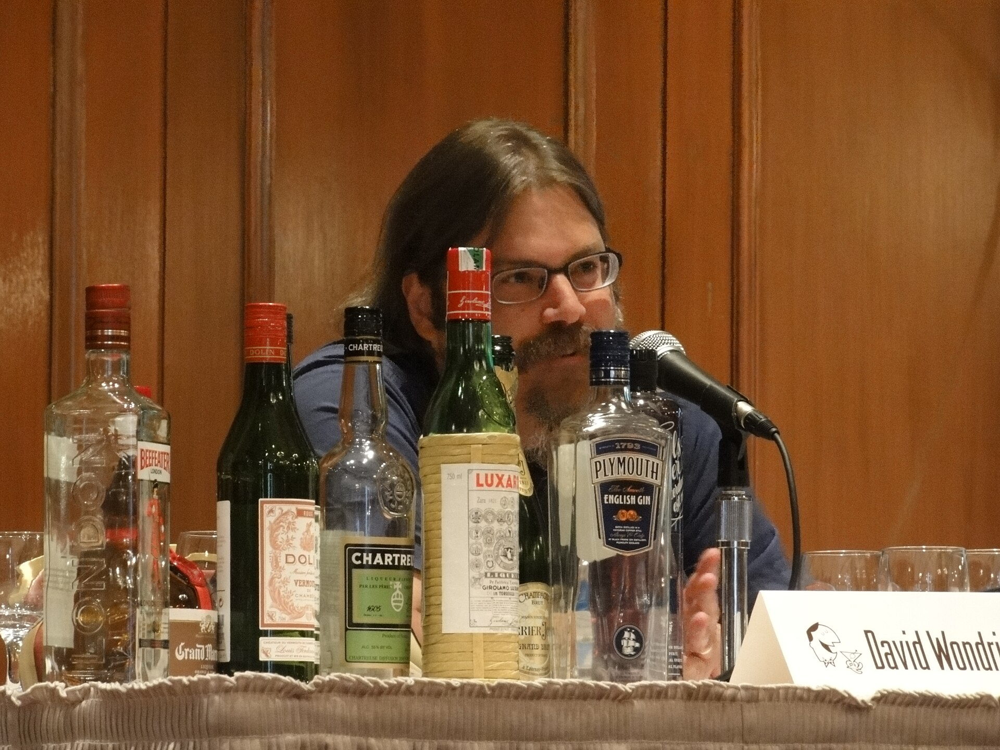

# 大卫·旺德里奇

大卫·旺德里奇（David Wondrich，1961 年生）是美国鸡尾酒史学者、作家与教育者。他的工作方式更像历史学家，而不是调酒师：他翻旧报纸、城市名录、法庭记录与调酒师手册，把鸡尾酒的起源从酒吧传说拉回可引用的文本。他写过《Imbibe!》与《Punch》，主编《牛津烈酒与鸡尾酒指南》，也参与创办 Beverage Alcohol Resource 这一调酒教育机构。他的价值在于把“谁发明了什么”换成“最早在哪份材料里出现”。

图：大卫·旺德里奇人物肖像。图片：Bart Everson，CC BY 2.0，via Wikimedia Commons（[原图页面](https://commons.wikimedia.org/wiki/File:Tales_of_the_Cocktail_-_David_Wondrich.jpg)）。

## 人物小传

旺德里奇 1961 年出生。他在大学里读文学，后来取得比较文学博士学位。毕业后他当过英语教授，但长期对烈酒与鸡尾酒的“冷门知识”感兴趣，最终离开学界，转向写作与酒类研究。

2000 年，他在《Food & Wine》发表第一篇与酒有关的文章；2003 年，他在《Esquire》发表《The Lost Cocktail》，开始系统整理被遗忘的经典配方。此后他成为《Esquire》的酒类通讯员，同时为《Daily Beast》撰写酒类专栏。

## 生平节点

- 1961 年：出生。
- 1990 年代：取得比较文学博士学位，曾在大学任教。
- 2000 年：在《Food & Wine》发表第一篇酒类文章。
- 2003 年：在《Esquire》发表《The Lost Cocktail》。
- 2007 年：《Imbibe!》出版，成为第一本获得 James Beard 奖的鸡尾酒书。
- 2010 年：《Punch》出版。
- 2015 年：《Imbibe!》修订版出版。
- 2021 年：与 Noah Rothbaum 共同主编《牛津烈酒与鸡尾酒指南》。

## 与酒业的实际关系

旺德里奇与酒业的关系有三条线。第一条是写作：他长期担任《Esquire》酒类通讯员，并在《Daily Beast》写专栏；这些文章把鸡尾酒史带给大众，也为调酒师提供了可引用的资料。第二条是教育：他是 Beverage Alcohol Resource（BAR）的创始合伙人，这是一个面向调酒师与酒类从业者的进阶培训机构。第三条是行业组织与公共教育：他是美国鸡尾酒博物馆的创始成员之一，也在史密森学会、美国自然历史博物馆等机构做过讲座。

这三条线让他既不是单纯的“酒吧顾问”，也不是象牙塔里的学者。他的判断会影响酒吧的酒单、调酒师的培训教材，以及消费者对“经典鸡尾酒”的理解。

## 代表作品或制度

《Imbibe!》（2007，2015 修订）以 Jerry Thomas 为线索，梳理 19 世纪美国鸡尾酒的形成。它不是一本简单的配方集，而是把配方放回酒吧、铁路、冰块贸易与城市生活的语境里。这本书是第一本获得 James Beard 奖的鸡尾酒书，这个事实本身说明鸡尾酒写作进入了严肃饮食写作的范畴。

《Punch》（2010）把视线从鸡尾酒拉回到更早的潘趣酒。潘趣酒在 17 世纪随东印度公司贸易扩散，是鸡尾酒之前的“混合饮酒”主流；这本书让读者看到，加糖、加水、加香料、加柑橘的饮法并不是 19 世纪美国人的发明。

《牛津烈酒与鸡尾酒指南》（2021）由旺德里奇与 Noah Rothbaum 共同主编，是一部按条目组织的参考书，覆盖烈酒类别、品牌、调酒师、鸡尾酒与术语。它获得美国图书馆协会的 Dartmouth Medal，说明它被视为参考工具书，而不只是酒吧读物。

此外，他还写过《Stomp and Swerve》（2003）这样的美国音乐史，以及《Esquire Drinks》《Killer Cocktails》等实用书；近年与 Dean Kotz 合作《The Comic Book History of the Cocktail》，用漫画形式讲鸡尾酒史。

## 历史方法

旺德里奇的方法可以概括为“先找最早文本，再谈发明”。他不太接受“某位调酒师在某个夜晚发明了某杯酒”的故事，因为这类故事往往缺少同期证据；他更愿意查配方最早出现在哪本手册、哪份报纸、哪本年鉴里，再比较不同版本的差异。

鸡尾酒的定义就是一个例子。1806 年，美国报纸《The Balance》把 cocktail 定义为“由任何烈酒、糖、水与苦精组成的刺激性饮料”；这是目前可考的最早定义之一。旺德里奇反复引用这条定义，用它说明鸡尾酒在 19 世纪初已经是一种有明确配方的饮品，而不是 20 世纪的发明。他也提醒读者，词源本身没有定论，民间流传的“coquetier（蛋杯）”等说法缺少同期证据。

## 影响

第一，他改变了鸡尾酒史的写法。过去很多鸡尾酒书以配方为主，历史只是点缀；旺德里奇把档案、脚注与版本比较带进来，让“这杯酒从哪来”成为可以讨论的问题。

第二，他推动了经典鸡尾酒的复兴。2000 年代的 craft cocktail 运动需要一套“经典”谱系，旺德里奇的研究提供了可引用的名单与配方，让调酒师在创新时有参照。

第三，他影响了教育。BAR 的课程与他的书，把鸡尾酒从“手艺”变成有历史、有理论、有品鉴方法的学科。

第四，他让潘趣酒重新进入酒吧。2010 年之后，潘趣酒在英美酒吧的回潮，与《Punch》的出版有明显关系。

## 评价与争议

《Imbibe Magazine》称他为“世界上最重要的鸡尾酒史权威之一”，并说他是现代 craft cocktail 运动的创始人之一。这些评价来自行业媒体，带有推广色彩，但也反映了他的实际影响：他的书被调酒师当作工具书，他的文章被研究者引用。

争议主要有两处。第一是“鸡尾酒是否纯属美国发明”。旺德里奇把鸡尾酒的形成放在 19 世纪初的美国，强调 1806 年的定义与 1862 年的 Jerry Thomas 手册；但也有研究者强调英国、加勒比与潘趣酒的更早传统。比较稳妥的说法是：鸡尾酒作为一种“烈酒加糖、水、苦精”的固定格式，在美国被命名并系统化，但混合饮酒的实践远比美国历史更久。第二是“Jerry Thomas 发明了鸡尾酒”的流行说法。旺德里奇本人并不支持这种英雄史观；他笔下的 Thomas 是把既有配方整理、传播并职业化的人，而不是从零开始的发明者。

## 常见误读

第一，旺德里奇是调酒师。他做过与酒吧相关的咨询与教学，但主要身份是历史学者与作家；他的权威来自档案与写作，而不是某家酒吧的从业经历。

第二，《Imbibe!》是一本配方集。它包含配方，但主体是历史叙事与人物重建；把它只当酒单，会漏掉它的论证。

第三，《牛津烈酒与鸡尾酒指南》是旺德里奇一个人写的。它是他与 Noah Rothbaum 共同主编、由众多撰稿人参与的工具书。

第四，旺德里奇“发现”了 1806 年的鸡尾酒定义。他不是第一个引用这条定义的人，但他把它变成了鸡尾酒史的标准起点之一。

第五，鸡尾酒的词源已经定论。没有。旺德里奇的处理是把可考的定义与不可考的轶事分开，而不是给传说盖棺定论。

## 另见

- [金酒](ref:gin)：鸡尾酒中最常用的基酒之一。
- [干马天尼](ref:dry-martini)：鸡尾酒经典的代表。
- [曼哈顿](ref:manhattan)：威士忌类鸡尾酒的基本结构。
- [古典鸡尾酒](ref:old-fashioned)：烈酒、糖、水与苦精的原始结构。
- [鸡尾酒入门](ref:cocktail-basics)：从工具、比例到经典配方。
- [美国](ref:usa)：鸡尾酒史的主要发生地。

对照阅读：[金酒](ref:gin)、[曼哈顿](ref:manhattan)。
