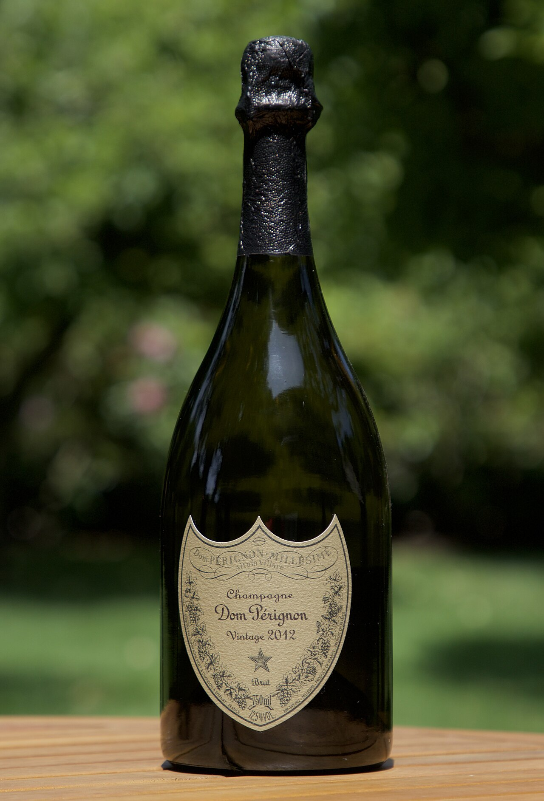

# 唐培里侬

唐培里侬（Dom Pérignon，1638—1714）是法国香槟地区奥特维莱尔（Hautvillers）修道院的本笃会修士。今天这个名字首先指一款高端香槟，其次才指一个历史人物；两者之间隔着一百多年的广告与传说。把人物与品牌分开，是理解他的第一步。

图：唐培里侬。摄影：Dom Pérignon Champagne 2012。署名：Hayden Soloviev，CC BY 4.0，来自 Wikimedia Commons（[来源](https://commons.wikimedia.org/w/index.php?curid=168283495)）。

## 生平节点

- 1638 年生于香槟地区的圣梅内乌尔德（Sainte-Menehould），本名皮埃尔·佩里尼翁；生年以 1638 年为通行说法。
- 1668 年起在奥特维莱尔修道院任职，担任 procureur，负责田产、收益、什一税与酒窖，兼具经济管理与酿酒管理。
- 此后近半个世纪，他都在同一座修道院管理葡萄园与酒窖，直到去世。
- 1714 年在奥特维莱尔去世；部分法文资料记为 1715 年，具体日期史料无定论。
- 1921 年，酩悦香槟（Moët & Chandon）以他的名字酿造首个年份香槟，1936 年上市；从此这个名字主要作为品牌流通。

## 与酒业的实际关系

奥特维莱尔修道院始建于 7 世纪，位于马恩河谷、埃佩尔奈（Épernay）附近。修道院拥有葡萄园、收取什一税，也出售自产的酒。作为管窖执事，唐培里侬的日常工作不是“发明一种酒”，而是决定哪些地块的葡萄进入哪一批酒、何时采摘、如何压榨、账目如何结算。这些决定直接塑造风格，但属于管理，不属于实验室里的发明。

17 世纪的香槟地区以静止酒为主，酒主要卖给巴黎、佛兰德与英国。当地气温偏低，酒在瓶中有时会二次发酵；当时玻璃瓶强度不足，爆瓶常见，起泡往往被视为不稳定甚至缺陷。修道院正处在起泡尚不受欢迎的体系里。

## 代表工作：调配、澄清与酒窖制度

可以归到他名下的工作有三类。第一是调配：把不同地块、不同年份的葡萄汁混合，追求更稳定、更细腻的酒，这是后来香槟酿造的核心方法之一（[调配](ref:blend)）。第二是澄清与压榨：减少果皮带来的颜色与粗糙感，让白葡萄酒更干净。第三是酒窖管理：温度、容器、卫生与库存记录。

需要分清“归到他名下”和“传说归到他名下”。更坚固的玻璃瓶、软木塞与固定风格调配，在 17 世纪的欧洲都在发展；其中一些被追记到他身上，却缺少同时代证据。1662 年，英国医生克里斯托弗·梅雷特（Christopher Merret）已向皇家学会提交论文，描述加糖促使二次发酵的方法，早于唐培里侬在此任职。

## “发明香槟”传说的形成

“唐培里侬发明香槟”的说法在 19 世纪被香槟酒商广泛使用。19 世纪末，香槟从地方产品变成法国的国家象征，传说正好服务于这套叙事。

流传最广的那句“快来，我在喝星星”，在早期文献中找不到可靠出处，通常被视为后来的广告文案。传说还说他晚年失明；这同样缺少同时代史料支撑。把广告词与轶事当成 17 世纪修士的原话，是最常见的误读。

起泡酒的化学原理直到 19 世纪才被解释，他那个时代的人并不理解二氧化碳怎样产生，“发明”之说在技术上也说不通。更准确的说法是：他参与了产区工艺改良，香槟则是区域、时间与许多无名从业者共同塑造的产物。

## 名字如何变成品牌

1921 年，酩悦香槟以唐培里侬之名推出高端年份香槟（[唐培里侬香槟](ref:dom-perignon-wine)），首批酒在 1936 年上市。品牌借用修士的名字，也借用“香槟之父”的传说。

今天看到的唐培里侬属于[起泡酒](ref:sparkling)，产自[法国](ref:france)香槟。它只做年份香槟，风格由年份、调配与酒泥陈年共同决定：年份决定气候条件，调配决定骨架，长期带酒泥陈年带来饼干、坚果与奶油的气息。1936 年，香槟获得法定产区（AOC）地位，产区分界与生产规则被写进法律。

## 评价与争议

历史研究通常把他评价为一位能干的管窖者与调配者：会算账、懂地块、能把不同来源的酒稳定地做成可出售的产品。这种能力很实际，却不容易被写成传奇。

争议集中在“发明权”。香槟行业长期把他说成发明者，《牛津葡萄酒指南》则指出：坚固的玻璃瓶、可靠的软木塞、加糖二次发酵的知识分别在英国与欧洲其他地区发展，不能归功于一个人。也有研究者提醒，关于他的较早叙述出现得较晚，修道院档案又在法国大革命中散失，因此具体细节应当保留余地。

对现代品牌而言，唐培里侬把“修士的传说”转化为稳定的奢侈品牌，价格中包含品牌溢价。

## 常见误读

第一，把品牌等同于人物。品牌是 20 世纪的商业产品，人物是 17 世纪的修士。

第二，把传说当史料。没有可靠的一手文献支持“他发明了香槟”，也没有证据表明他第一次把软木塞用于起泡酒。

第三，把香槟当成他一个人的作品。起泡酒是区域技术积累的结果，涉及玻璃、瓶塞、酒窖与运输。

第四，把“喝星星”当引语。它更像广告，而不是 17 世纪法语。

第五，把卒年当成没有争议的事实。1714 与 1715 两种记载并存。

## 怎样看今天的唐培里侬

喝一款唐培里侬时，可以同时看三件事：年份、调配与陈年。年份告诉你这一年的气候条件；调配告诉你酒庄的风格选择；陈年告诉你酒现在处于什么阶段。还要看除渣日期与补糖量，它们比“香槟之父”的故事更能解释你杯中的味道。

把它当成一款有历史名字的现代商品，比当成“修士的秘方”更准确。

## 另见

- [起泡酒](ref:sparkling)：气泡从哪里来，香槟与其他起泡酒有什么区别。
- [调配](ref:blend)：为什么不同地块的酒要放在一起。
- [法国](ref:france)：香槟在法国葡萄酒版图中的位置。
- [唐培里侬香槟](ref:dom-perignon-wine)：以修士命名的现代年份香槟。

对照阅读：[起泡酒](ref:sparkling)、[法国](ref:france)。

**关键事实。**

| 项目 | 内容 |
| --- | --- |
| 一句话定位 | 法国本笃会修士，1638 至 1714 年在世；长期管理香槟地区奥特维莱尔修道院的酒窖 |
| 生卒 | 1638–1714 |
| 身份 | 本笃会修士、酒窖管理者 |
| 关联地区 | 法国 |

**来源与边界。** 本页关于「唐培里侬」的关键事实，主要由以下来源交叉核对：Encyclopaedia Britannica（生卒、修道院任职与香槟史背景）、Oxford University Press；Jancis Robinson 主编（香槟起泡工艺与 17 世纪技术条件；未复制词条）、Comité Interprofessionnel du Vin de Champagne（产区、起泡酒工艺与年份香槟的基本规则）等 7 条来源。价格、批次与状态会变，涉及这些字段时以页面所列来源的最新版本为准。正文为项目自写，来源只作核验，不复制原文。
