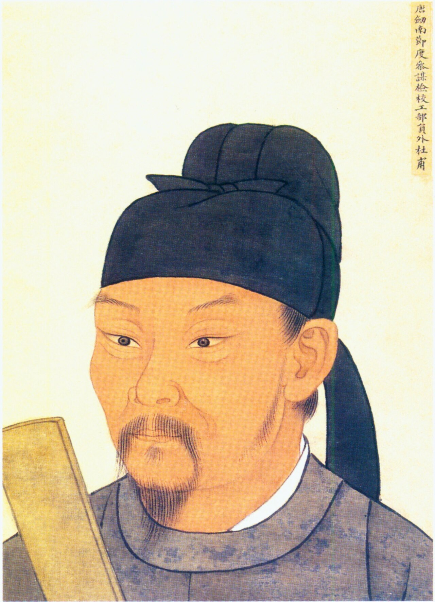

# 杜甫

杜甫（712—770），字子美，自号少陵野老，祖籍京兆杜陵，生于河南巩县。他的诗被后人称为“诗史”，酒在其中出现得极密，却很少被写成单纯的享乐。读杜甫的酒，既要看他何时举杯，也要看他何时把杯子放下。

图：杜甫。图片：Unknown author Unknown author，Public domain，via Wikimedia Commons（[原图页面](https://commons.wikimedia.org/wiki/File:Dufu.jpg)）。

## 人物小传

杜甫出身于一个有文学传统的家庭，祖父杜审言是初唐诗人。他早年漫游吴越、齐赵，746 年前后到长安求仕，困居近十年，直到 755 年才得到一个管理兵甲器杖的小职。安史之乱爆发后，他携家逃难，一度被叛军俘获；757 年脱险至凤翔，任左拾遗，758 年因言事被贬为华州司功参军。

759 年，他弃官入蜀，次年在成都浣花溪畔筑草堂。765 年离开成都，766 年至夔州，768 年出三峡，沿江东下，漂泊湖湘。770 年病逝于湘江舟中。他存诗约一千四百余首，律诗尤其精严，与李白并称“李杜”。

## 生平节点

- 712 年：生于河南巩县。
- 746 年前后：入长安求仕，困居多年。
- 755 年：安史之乱爆发。
- 757 年：脱险至凤翔，任左拾遗。
- 759 年：弃官入蜀。
- 760 年：在成都筑草堂。
- 763 年：闻官军收复河南河北，作诗言“放歌纵酒”。
- 766 年：至夔州；767 年重阳作《登高》。
- 770 年：卒于湘江舟中。

## 酒在杜甫诗中的位置

杜甫没有写过酒论，酒是通过具体生活进入诗的。故人来访，他拿不出好酒；客居异地，他对月独酌；身体衰病，医生要他停杯；听说官军收复失地，他又放歌纵酒。酒在他的诗里承担四种功能：待客、送别、独处与庆贺，而这四种场合都带着具体的处境。

《赠卫八处士》写久别重逢：“主称会面难，一举累十觞。十觞亦不醉，感子故意长。”连饮十觞而不醉，不是因为酒淡，而是因为情重；酒量在这里被写成友情的度量。《春日忆李白》则以“何时一樽酒，重与细论文”收束，把共饮与论文并列，酒是重新交谈的条件。

《闻官军收河南河北》写“白日放歌须纵酒，青春作伴好还乡”。这是杜甫少有的痛快之笔，但“纵酒”仍是为“还乡”服务的：酒是情绪的出口，不是情绪本身。

## 代表作品中的酒

《饮中八仙歌》是杜甫写他人饮酒的名篇。全诗为八个人物各作速写：贺知章“骑马似乘船，眼花落井水底眠”，汝阳王“三斗始朝天”，左相李适之“饮如长鲸吸百川”，李白“一斗诗百篇，长安市上酒家眠。天子呼来不上船，自称臣是酒中仙”，张旭“三杯草圣传，脱帽露顶王公前，挥毫落纸如云烟”，焦遂“五斗方卓然，高谈雄辩惊四筵”。这些“斗”是容量单位，也是夸张的修辞；全诗的重点在性格与姿态，不在酒量统计。

值得注意的还有“长安市上酒家眠”一句。它把李白、酒与长安的酒肆连在一起，说明唐代都城已有成熟的卖酒场所。诗写的是人，顺手留下了酒业的空间线索。

《客至》写故人来访：“盘飧市远无兼味，樽酒家贫只旧醅。”家离市集远，菜只有一样；酒是家里原有的浊酒，不是临时买来的佳酿。这不是风雅的自谦，而是经济处境：酒的质量与家庭的贫富直接相关。

《登高》写在夔州的重阳：“艰难苦恨繁霜鬓，潦倒新停浊酒杯。”晚年多病，医生要求戒酒，这一杯浊酒因此成了不能喝的酒。同一诗人笔下，酒可以是狂欢的证物，也可以是身体衰退的标记。

## 唐代的酒与酒政

唐代日常饮用的是谷物发酵酒，主要有米酒、黍酒一类。按过滤程度，酒有“清酒”与“浊酒”之分；浊酒并非劣质或假酒，只是澄清程度较低，常带酒糟。酒度通常不高，饮用时还常加温。蒸馏酒在唐代是否已经出现，学界仍有争论，但可以肯定的是，它没有成为杜甫时代的主流。

长安的酒业已经有分工。东市、西市及坊曲间有酒肆，卖酒者称酒户；《饮中八仙歌》里的“酒家眠”正是这类场所。764 年，即杜甫去世前六年，唐廷下令“天下州各量定酤酒户，随月纳税”，把卖酒户纳入按月征税的轨道（《旧唐书·食货志》）。这条制度说明，酒在当时已经是需要登记与纳税的行业，而不只是文人杯中的风雅。

杜甫写酒，基本站在饮者一边：他关心的是酒够不够、能不能喝、和谁喝，很少写酿造与买卖。这既是他的长处，也是他的限度。

## 评价与争议

杜甫在世时名声并不显赫，中唐以后逐渐被推为“诗圣”，宋人整理其集，注家辈出。20 世纪的一次著名争议来自郭沫若《李白与杜甫》（1971）：他扬李抑杜，认为杜甫的某些作品表现出地主阶级的生活趣味，对《茅屋为秋风所破歌》等篇也有苛评。这部书在当时影响很大，也引来大量反驳；今天读它，更适合把它当作一部带有时代立场的论战之作，而不是定论。

另一种更具体的局限是史料层面的：杜诗中的酒多为饮者视角，酒价、酒户、酿造工艺只是零星出现。研究者若要用杜诗重建唐代酒业，必须与《旧唐书·食货志》一类制度文献对读，不能把诗句当作行业档案。

## 常见误读

最常见的误解，是把杜甫当成不饮酒的诗人。他写过大量饮酒场面，只是没有把酒浪漫化。

“浊酒”也常被读成劣质酒或假酒。在唐代，它指未充分澄清的谷物酒，与过滤程度有关。

有人把《饮中八仙歌》里的酒量当成史实；那是一组人物速写，重点在性格，不在容量。

“新停浊酒杯”常被解释为彻底的戒酒宣言。原文紧接着“艰难苦恨繁霜鬓”，停杯是疾病与处境的结果，不是一场道德选择。

至于“李白一斗诗百篇”，那是杜甫写李白的旁观之笔，不是自况。

## 引语与出处

“樽酒家贫只旧醅”出自《客至》；“潦倒新停浊酒杯”出自《登高》；“李白一斗诗百篇，长安市上酒家眠”出自《饮中八仙歌》；“白日放歌须纵酒”出自《闻官军收河南河北》；“一举累十觞”出自《赠卫八处士》。引用时应标明诗题与作者，避免把诗中的角色与诗人本人混为一谈。

相关条目：[一杯酒里的时间](ref:time-in-a-cup)、[中国酒史纲：从谷物发酵到国家名酒](ref:chinese-wine-history)、[黄酒](ref:yellow-wine)。

## 另见

- [中国酒史](ref:chinese-wine-history)：唐代酒户、酒税与酿造工艺的长期变化。
- [一杯酒里的时间](ref:time-in-a-cup)：酒如何进入节令与写作。
- [黄酒](ref:yellow-wine)：谷物发酵酒的工艺谱系。
- [中国](ref:china)：杜甫行迹覆盖的地理范围。

补充阅读：[安德烈·西蒙](ref:c-extra-1)。
