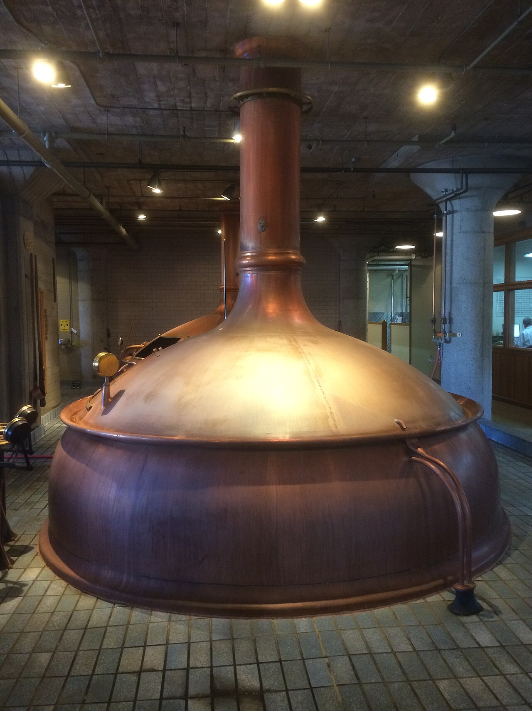

# 弗里茨·梅塔格

弗里茨·梅塔格（Fritz Maytag，1937 年生）不是传统意义上的酿酒学徒。他出身爱荷华州梅塔格洗衣机家族，在斯坦福读的是文学，却在一杯旧金山的蒸汽啤酒里看到了一个即将消失的工艺世界。1965 年，他买下只剩少数人维持的 Steam Beer 酒厂，后来把它变成 Anchor Brewing，也把自己变成了美国精酿啤酒运动的起点人物。

图：旧金山 Anchor Brewing 的铜制糖化锅；酒厂设备，不是弗里茨·梅塔格本人。图片：Picardin，CC BY 4.0，via Wikimedia Commons（[原图页面](https://commons.wikimedia.org/wiki/File:Anchor_Brewing_Company_copper_kettle.jpg)）。

## 人物小传

梅塔格 1937 年生于爱荷华州牛顿镇，家族以洗衣机和蓝纹奶酪闻名。他到旧金山后接触到 Anchor 的蒸汽啤酒，发现这种用开放式发酵、上层酵母、较宽温度带酿成的啤酒，与当时美国主流清淡拉格完全不同。1965 年，他买下酒厂的控制权，开始自学酿造，从清洗、糖化到装瓶都亲手做过。接手时，酒厂只剩极少数员工，设备老旧、配方不稳；他先做的是保种——保住酵母、保住蒸汽啤酒的发酵方式，再谈扩张。

## 从蒸汽啤酒到 Anchor

“Steam beer”是 19 世纪旧金山的地方风格：没有制冷设备时，酿酒师用浅槽、开放式发酵与较高温度完成酿造，再用木桶陈放。Anchor 是这种风格最后几家保存者之一。梅塔格没有把它做成博物馆，而是重新校准配方、稳定酵母、改善卫生与装瓶，让 Steam Beer 从地方遗存变成可重复生产的产品。

## 代表酒款

Anchor Steam Beer 是他的核心作品：琥珀色、泡沫细密、带焦糖与草本啤酒花气息，既能即饮，也能配餐。Anchor 还恢复了波特、大麦酒与淡色艾尔等当时美国少见欧洲风格；1968 年，梅塔格开始使用 Northern Brewer 整锥啤酒花，1973 年又用 Cascade 做试验，把“啤酒花香气”推到美国啤酒的前台。每年的 Christmas Ale 则把配方保密与节日叙事结合，成为旧金山的地方习惯。

## 方法或制度影响

梅塔格的做法证明了三件事：小规模也能盈利；传统工艺不是落后，而是差异化；酒厂可以成为城市文化的一部分。史密森尼把 Anchor 记为“禁酒令后美国第一家微型啤酒厂”，并收藏了他的酵母罐、啤酒花铲、显微镜与工装。1970 至 80 年代，无数想开小酒厂的人以他为模板：先找旧设备，再学工艺，最后在本地卖酒。Anchor 在 1971 年开始以自己名义装瓶销售，1980 年代又通过 Christmas Ale 把“年度配方保密”做成旧金山的节日仪式；这些做法后来被精酿酒厂广泛借用。

## 评价与争议

正面评价把他称为“美国精酿之父”，认为他在啤酒工业最单调的年代保留了工艺多样性。批评则指出，他的起点带有明显的阶层优势：家族资本、斯坦福教育与人脉，让他能承担长时间不盈利的试验；把精酿运动完全归功于个人，会掩盖后来者面对的资金、法规与分销难题。2010 年，他把 Anchor 出售给 Sapporo；2023 年酒厂关闭，2024 年由新东家重启，说明品牌与工艺的延续从来不只靠一位创始人。梅塔格本人后来把精力放在家族奶酪与慈善，但他留下的“小厂也能定义标准”这句话，仍是精酿运动最常被引用的起点。

## 常见误读

第一，把 Anchor 当成“梅塔格从零创办”。他买下的是一家有历史的酒厂，先保存再改造。第二，把 Steam Beer 当成“加了蒸汽的啤酒”。它指的是一套历史工艺与风格，不是蒸汽注入。第三，把 1965 年当成精酿运动的正式起点。它更像一个被后人命名的转折点。第四，把“精酿”当成规模标签；Anchor 后来产量并不小，精酿的核心在所有权、工艺与风味取向。

对照阅读：[啤酒](ref:beer)、[拉格啤酒](ref:lager)。

## 延伸阅读

史密森尼的口述史与藏品记录提供了两个不同视角：口述史讲他如何自学、如何判断啤酒花与酵母；藏品说明则把 Anchor 放进美国啤酒技术史，标注 1965 年收购、1968 年 Northern Brewer 与 1973 年 Cascade。Gastronomica 的研究文章补足了 1971 年装瓶、2010 年出售与精酿运动的社会背景。三者对读，比只看品牌官网更接近历史现场。技术上，Anchor Steam 的关键不只是“上层酵母”，还包括开放式发酵槽、较宽的温度带与桶内二次发酵；这些条件共同造成它干净又带一点面包感的酒体，而不是简单地把拉格与艾尔混在一起。梅塔格还坚持使用整锥酒花与新鲜酵母，拒绝用浓缩浸膏替代，这些选择在当时被视为“昂贵且不必要”，后来却成为精酿的标准语言。1965 年他买下的不只是一套设备，还有一个几乎失传的酵母谱系；这批酵母后来被史密森尼收藏，成为研究美国蒸汽啤酒的活材料。

相关条目：[精酿啤酒](ref:craft)。

## 另见

- [啤酒](ref:beer)：梅塔格工作的基础品类。
- [精酿啤酒](ref:craft)：他常被放进的概念框架。
- [拉格啤酒](ref:lager)：理解 Steam Beer 与主流美式拉格差异的参照。
- [发酵](ref:fermentation)：开放式发酵与上层酵母的技术入口。
- [美国酿酒师协会](ref:brewers)：今天定义“精酿”的行业组织。

**关键事实。**

| 项目 | 内容 |
| --- | --- |
| 一句话定位 | 美国旧金山 Anchor Brewing 的拯救者（1937 年生），1965 年买下濒临倒闭的 Steam Beer 酒厂，以传统工艺、整锥啤酒花与小批量生产重塑 Anchor Steam，被视为美国禁酒令后精酿啤酒运动的第一位微型酿酒者 |
| 生卒 | 1937–? |
| 身份 | 啤酒酿酒师、酒厂所有者、企业家 |
| 关联地区 | united-states |

**来源与边界。** 本页关于「弗里茨·梅塔格」的关键事实，主要由以下来源交叉核对：Smithsonian Institution（1937 年出生、1965 年买下 Anchor、2010 年卸任、自学酿造与旧金山 1960 年代背景）、Smithsonian National Museum of American History（1965 年收购、1968 年 Northern Brewer、1973 年 Cascade 与“禁酒令后第一家微型啤酒厂”的馆方说明）、Gastronomica（1965–2010 年经营期、1971 年 Anchor Steam、史密森尼口述史与精酿运动背景）等 5 条来源。价格、批次与状态会变，涉及这些字段时以页面所列来源的最新版本为准。正文为项目自写，来源只作核验，不复制原文。

**并读。** 把「弗里茨·梅塔格」与「啤酒」、「精酿啤酒」、「拉格啤酒」放在一起读时，先确认它们是同一层级还是上下游关系：先确认时代与作品，再比较经历、风格与史料边界。本页负责给出人物的基本坐标，对照条目补上具体案例与差异；读完再回到本页，才能分清哪些差别属于人物本身，哪些只是产地、批次或品牌选择。

**适用边界。** 对「弗里茨·梅塔格」而言，生卒年与作品系年存在异说；文学或艺术形象不能直接当作历史生活记录。

**更新提示。** 「弗里茨·梅塔格」最近核对于 2026-11-21；生平日期、作品归属与研究文献会更新，引用前以权威机构条目为准。
