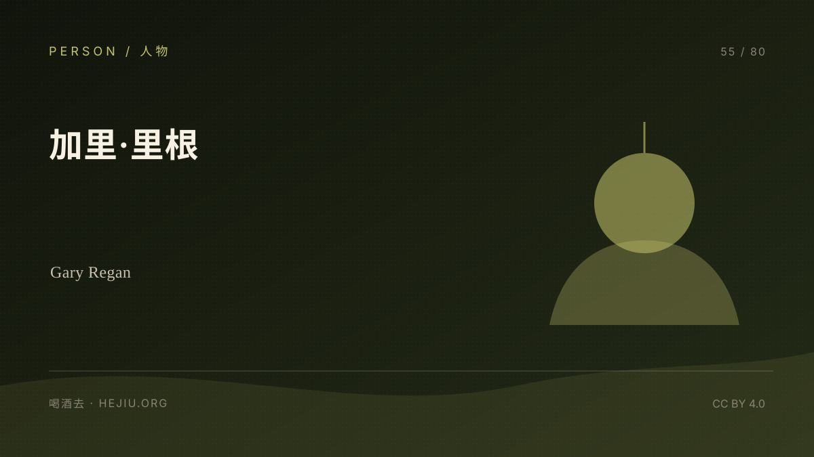

# 加里·里根

加里·里根（Gary Regan，1951—2019），圈内常叫他 Gaz Regan，是英裔美国调酒师、作者与教师。他的贡献不在某一杯具体的酒，而在“怎么把鸡尾酒讲清楚”：他把配方整理成有规则的家族，让调酒师可以推演、修改与教学，而不必死记硬背。他写书、办课、做苦精，也长期在报纸和杂志上记录酒吧生活。

图：加里·里根栏目示意图。项目自产或类别插图，用于酒吧与酒类语境，不是该对象的实拍。

## 生平与职业起点

1951 年，里根出生在英格兰兰开夏郡的罗奇代尔（Rochdale）。他的父母经营博尔顿（Bolton）的 Prince Rupert 酒吧，他还没到合法饮酒年龄就在店里帮忙；后来他到布莱克浦（Blackpool）的 Courtfield Catering College 学习厨艺。22 岁那年，他移居美国，在曼哈顿上东区的一家爱尔兰酒吧开始调酒。

1970 年代，他在纽约南街海港的 North Star Pub 做了四年经理。他后来说，正是在那里，他学会了“讲故事的力量”和“酒与酒吧的娱乐价值”。2019 年 11 月 15 日，他因癌症并发症在纽约纽堡医院去世，享年 68 岁。

## 从调酒到写作

1990 年代初，里根开始为《Food Arts》写酒类专栏；此后他为《Wine Enthusiast》《Cheers》《Malt Advocate》撰稿，并在《San Francisco Chronicle》开设“The Cocktailian”专栏。这个专栏在互联网普及之前，是许多调酒师获取行业信息的重要渠道。

他一生写了 18 本关于酒、调酒与鸡尾酒的书。第一本是 1991 年的《The Bartender's Bible》；与 Mardee Haidin Regan 合著的有《The Book of Bourbon and Other Fine American Whiskey》《The Bourbon Companion》《New Classic Cocktails》《The Martini Companion》；此外还有《The Negroni: A Gaz Regan Notion》和每年一册的《101 Best New Cocktails》。

## 《The Joy of Mixology》的家族分类

2003 年出版的《The Joy of Mixology》是里根最被记住的书，2018 年又出了修订版。它的核心不是配方数量，而是分类：以烈酒、糖、苦精构成的老式类，以烈酒、柑橘、糖构成的酸类，以及高球、柯林斯、菲士等延伸类型。每一类都有基本比例和变化规则。

这种分类的价值在于可推演。调酒师知道一杯酒属于哪个家族，就能判断换一种基酒、换一种柑橘、增减糖浆之后会发生什么。它把“师傅带徒弟”的口传经验，转成了一套可以讨论、可以考核的语言。也正因为它是教学语法，不是历史分类学，读的时候不能把家族当成不可违反的法规。

## 橙味苦精与产品

许多经典鸡尾酒配方都要求橙味苦精，但在 1990 年代，调酒师常常找不到可用的产品。里根因此开发了 Regan's Orange Bitters No. 6，让自己的配方有一个稳定、可复制的配料。这款苦精后来进入许多酒吧的常备清单，成为古典鸡尾酒复兴中的一个具体产品。

橙味苦精的回归不是他一个人的功劳：供应链、酒吧采购、顾客口味与调酒比赛都参与了变化。但里根的作用很具体：他把“配方里需要，但买不到”的问题，变成了一个可以生产、可以流通的商品。

## 教学与“Cocktails in the Country”

2003 年，里根罹患舌癌。治疗之后，他开始在公开场合画单边眼线，用这个动作提醒调酒师“与客人眼神接触很重要”。他搬到纽约康沃尔-on-哈德逊（Cornwall-on-Hudson），开设为期两天的课程“Cocktails in the Country”，把调酒、待客与吧台管理放在一起教。

这套课程在精酿鸡尾酒教育还很稀缺的年代，培养了不少后来成名的调酒师，Jim Meehan 就是其中之一。里根还提出“mindful bartending”的说法，强调调酒师可以感知并引导吧台的能量。2012 年，他获得 Tales of the Cocktail 的终身成就奖；2018 年，他发起 Worldwide Bartender Database，试图为调酒师与酒商建立一个在线的行业名录。

## 行业影响

里根的影响主要在语言层面。他给行业提供了一套可以讨论、可以修改、也可以考核的分类词汇；当调酒从学徒制转向课程、比赛与媒体时，这种语言降低了沟通成本。对初学者，它意味着不必先背下几百个配方，也能理解一杯酒为什么这样构成；对酒吧经营者，它让培训新人有了共同的参照点。[老式鸡尾酒](ref:old-fashioned)与[威士忌](ref:whisky)在他的体系里都是模板，而不是孤立的配方。

他的英国出身也让他的写作带有一层跨大西洋的视角：他熟悉[英国](ref:united-kingdom)酒吧里“一杯酒的场合”，也理解[美国](ref:usa)酒吧的节奏与表演性。他写[酒馆](ref:taverns)与吧台生活，重点常常不在配方细节，而在人如何在吧台前坐下来、开口、被接待。

## 评价与争议

《Wine Enthusiast》的纪念文章引述鸡尾酒史学家 David Wondrich 的评价：里根“把浮夸、俏皮与能量，和扎实的技术能力结合在一起”，而且他“对酒吧生活的兴趣，远大于对调酒细节的兴趣”。这句话既是赞美，也是局限：他的书是实用的行业读物，不是档案式的历史复原；书中的配方常为教学而调整，引用时应核对原始出处。

另一个需要分清的地方是“家族分类”的性质。它是教学工具，不是历史 taxonomy；现代鸡尾酒经常跨家族，低酒精与无酒精饮品也不完全适用。把《The Joy of Mixology》当成配方大全，会错过它真正的方法论；把它当成不可修改的经典，又会违背它自己的教学精神。

## 常见误读

第一，把“Gaz Regan”当成另一个人。那是他的常用昵称。第二，把《The Joy of Mixology》当成配方大全。它更接近方法与结构说明，配方只是例证。第三，把橙味苦精的回归归功于他一人。他推动了它，但供应链、酒吧与顾客口味同样参与了变化。第四，把家族分类当成不可违反的规则。分类是工具，现代鸡尾酒常常跨家族。第五，把他的书当成学术史学。它们是行业写作，引用配方时要回到原始配方书或档案。

## 年表

- 1951 年：出生于英格兰罗奇代尔。
- 1973 年前后：移居美国，在纽约开始调酒。
- 1991 年：《The Bartender's Bible》出版。
- 2003 年：《The Joy of Mixology》出版；同年罹患舌癌。
- 2012 年：获 Tales of the Cocktail 终身成就奖。
- 2015 年：《The Negroni》由 Ten Speed Press 出版。
- 2018 年：《The Joy of Mixology》修订版出版；发起 Worldwide Bartender Database。
- 2019 年：11 月 15 日去世。

## 另见

- [老式鸡尾酒](ref:old-fashioned)：老式类的基本结构。
- [威士忌](ref:whisky)：他反复使用的基酒之一。
- [酒馆的历史](ref:taverns)：酒吧作为职业空间的变化。
- [美国](ref:usa)：他主要工作与写作的地方。
- [英国](ref:united-kingdom)：他的出生地与早期酒吧经验。

对照阅读：[古典](ref:old-fashioned)、[美国](ref:usa)。

**关键事实。**

| 项目 | 内容 |
| --- | --- |
| 一句话定位 | 英裔美国调酒师与作者，1951—2019；《The Joy of Mixology》把鸡尾酒按“家族”分类，Regan's Orange Bitters No. 6 与“Cocktails in the Country”课程影响了一代调酒师 |
| 生卒 | 1951–2019 |
| 身份 | 调酒师、作者、教师 |
| 关联地区 | 英国、美国 |

**来源与边界。** 本页关于「加里·里根」的关键事实，主要由以下来源交叉核对：Gary Regan 著；Clarkson Potter 出版，2003 年；修订版 2018 年（作者身份、鸡尾酒家族分类与写作方法；本页不复制配方）、Gary Regan 著；1991 年出版（早期著作与配方汇编性质）、Wikimedia Foundation（交叉核对生卒年、移居美国与教学经历）等 8 条来源。价格、批次与状态会变，涉及这些字段时以页面所列来源的最新版本为准。正文为项目自写，来源只作核验，不复制原文。
