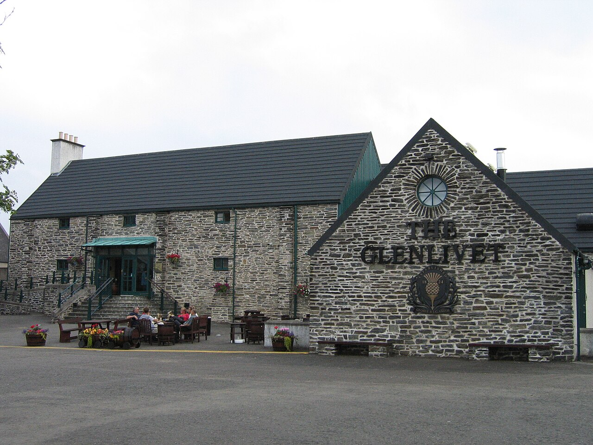

# 乔治·史密斯

乔治·史密斯（George Smith，卒于 1871 年）是苏格兰斯佩塞利威山谷的蒸馏者，也是 The Glenlivet 品牌的起点。他的故事里有一个反复出现的画面：一个刚刚拿到合法执照的人，随身带着一对燧发手枪，在私酿者环伺的山谷里守着自己的酒厂。这个画面未必完全可信，但它准确说明了 1820 年代苏格兰威士忌合法化的冲突。

图：格兰威特蒸馏厂；厂区场景，不是乔治·史密斯本人。图片：Kkonstan，CC BY 3.0，via Wikimedia Commons（[原图页面](https://commons.wikimedia.org/wiki/File:The_Glenlivet_distillery.jpg)）。

## 人物小传

史密斯的早年资料不多。他出生在利威山谷，早年在一个私酿盛行的环境里学习蒸馏；山谷偏远、泉水充足、执法者难以进入，这些条件让“地下酒厂”得以生存。18 世纪末至 19 世纪初，苏格兰高地与斯佩塞的私酿是地方经济的一部分：农户用多余的大麦蒸馏，再通过固定渠道运到低地与英格兰。1822 年 8 月，英王乔治四世访问苏格兰，点名要试 Glenlivet 的威士忌；据说他喝到的还是未纳税的私酿酒。这次皇家背书让山谷的名声越出苏格兰。

## 1824：第一张执照

1823 年，英国通过新的消费税法，降低合法蒸馏的门槛；1824 年，史密斯骑马到 Elgin 申请执照，成为 Glenlivet 教区第一位合法蒸馏者。这个决定激怒了周边私酿者，他收到“连酒厂一起烧掉”的威胁。史密斯没有退让，随身携带燧发手枪，继续扩建酒厂。今天品牌叙事里的“勇气”，指的就是这段合法化初期的对抗。

## 代表酒款与风格

The Glenlivet 的风格通常被描述为“花香、果香、柔和、平衡”：不使用泥煤烘麦，酒体干净，苹果、梨、柑橘与香草感明显。这种风格与斯佩塞产区的定位高度绑定。史密斯时代的酒以壶式蒸馏、发芽大麦与当地泉水为基础；后来品牌把“单一麦芽”做成核心类别，但 19 世纪的酒厂首先是一个农产品的加工场，而不是今天的品牌体验中心。

## 方法或制度影响

史密斯的影响有两层。第一层是“合法化样本”：他证明拿到执照、按章纳税、扩大产能，可以在私酿传统里活下来，并逐渐把对手挤出市场。到 1830 年代末，酒厂每周产量已超过 200 加仑；爱丁堡的 Andrew Usher & Sons 成为销售代理，把酒卖到更大的市场。第二层是“地名品牌化”：Glenlivet 从山谷名变成酒名，后来被无数酒厂借用；1852 年，查尔斯·狄更斯在信中向朋友推荐“rare old Glenlivet”，说明它已进入英国文化名人的餐桌。1884 年，史密斯的儿子 John Gordon Smith 通过法律手段争取到“THE GLENLIVET”的独家使用，品牌与产区的边界才被正式划清。

## 评价与争议

正面评价把史密斯视为苏格兰威士忌从走私经济转向合法产业的代表人物：他抓住 1823 年税制改革，把地方名酒变成可出口的商品。批评则指出，合法化并不是单纯的“进步”——它伴随着对私酿者的排挤、对土地与水源的控制，以及品牌对地名资源的独占。此外，史密斯的生平材料有限，许多细节来自品牌后世的叙述，引用时需要区分档案与传说。

## 常见误读

第一，把史密斯当成 The Glenlivet 的“唯一创始人”。品牌由他建厂起家，但后来的公司化、商标与全球分销是几代人的事。第二，把 1824 年当成威士忌合法化的起点。1823 年税法才是制度节点，1824 年是他的个人执照。第三，把“Glenlivet”当成一个酒厂专属地名。它原本是山谷与教区名，后来才成为品牌。第四，把燧发枪故事当成完全虚构；它可能被润色，但合法化初期的暴力威胁有历史背景。

对照阅读：[单一麦芽苏格兰威士忌](ref:single-malt)、[格兰威特蒸馏厂](ref:glenlivet)。

## 延伸阅读

The Glenlivet 官方历史页把 1824 年执照、私酿者威胁与 1884 年商标串成品牌叙事；FAQ 与“Our Story”页补充了 1822 年皇家到访、1839 年销售代理与 1871 年传承。苏格兰威士忌通史则把 1823 年《消费税法》放在更大的合法化浪潮里。对读之后会发现，史密斯的“第一”是教区层面的第一，而不是苏格兰唯一的第一；品牌叙事里的“勇气”也有后世润色成分。技术上，利威山谷的软泉水、当地大麦与不使用泥煤的烘麦方式，共同塑造了 The Glenlivet 干净、花香、果香的底色；这套风格后来成为斯佩塞单一麦芽的典型，而不是史密斯时代刻意设计的“品牌风味”。1824 年的执照也不是一张“永久保护符”：他仍需按年纳税、接受计量、限制产量，酒厂的生存取决于能否在合规成本与市场价格之间找到平衡。史密斯 1871 年去世后，儿子 John Gordon Smith 接过酒厂；此后品牌几经合并与易主，但“Glenlivet”这个名字始终与利威山谷的泉水、无泥煤麦芽和柔和果香联系在一起。

相关条目：[斯佩塞](ref:speyside)。

## 另见

- [单一麦芽苏格兰威士忌](ref:single-malt)：The Glenlivet 的核心品类。
- [斯佩塞](ref:speyside)：史密斯酒厂所在的产区。
- [格兰威特蒸馏厂](ref:glenlivet)：从 1824 年延续至今的厂址。
- [斯佩塞麦芽威士忌路线](ref:speyside-trail)：把达夫镇、Craigellachie 与 Ballindalloch 串起来的旅行框架。
- [苏格兰威士忌](ref:scotch)：理解壶式蒸馏与单一麦芽工艺的技术入口。

**关键事实。**

| 项目 | 内容 |
| --- | --- |
| 一句话定位 | 苏格兰斯佩塞利威山谷的蒸馏者（卒于 1871 年），1824 年获 Elgin 执照，成为 Glenlivet 教区首位合法蒸馏者；在私酿者威胁中坚持建厂，为 The Glenlivet 的单一麦芽品牌与产区声誉奠定基础 |
| 生卒 | ?–1871 |
| 身份 | 苏格兰威士忌蒸馏者、酒厂创办人 |
| 关联地区 | 英国、斯佩塞 |

**来源与边界。** 本页关于「乔治·史密斯」的关键事实，主要由以下来源交叉核对：The Glenlivet（1822 年乔治四世到访、1824 年 Elgin 执照、私酿者威胁、1830 年代 200 加仑/周、1871 年去世与 1884 年商标；1824 年首位合法执照、Livet 山谷、斯佩塞产区与 1871 年传承）、Cassell Illustrated（19 世纪苏格兰私酿、1823 年消费税法与合法化浪潮的背景；未复制正文）、Oxford University Press（斯佩塞产区、单一麦芽定义与 19 世纪蒸馏技术；未复制词条）。价格、批次与状态会变，涉及这些字段时以页面所列来源的最新版本为准。正文为项目自写，来源只作核验，不复制原文。

**并读。** 把「乔治·史密斯」与「单一麦芽苏格兰威士忌」、「斯佩塞」、「格兰威特蒸馏厂」放在一起读时，先确认它们是同一层级还是上下游关系：先确认时代与作品，再比较经历、风格与史料边界。本页负责给出人物的基本坐标，对照条目补上具体案例与差异；读完再回到本页，才能分清哪些差别属于人物本身，哪些只是产地、批次或品牌选择。
