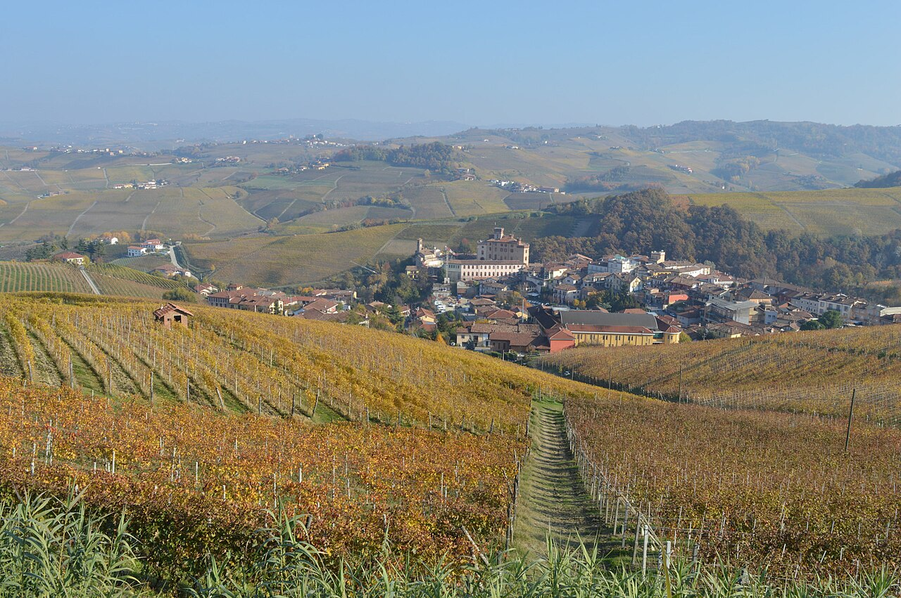

# 吉亚科莫·孔特诺

吉亚科莫·孔特诺（Giacomo Conterno）是意大利皮埃蒙特 Barolo 传统派的代表人物，也是同名酒庄的创立者。他的家族在 Monforte d'Alba 一带已有数代葡萄种植与酒类贸易经验；1908 年，父亲 Giovanni 在 San Giuseppe 村开了一间酒馆，用当地葡萄酿酒供应生意。Giacomo 从一战战场归来后，决定做一件当时很少见的事：把 Barolo 装进带标签的瓶子，而不是散装卖。

图：巴罗洛村与内比奥罗葡萄园；产区场景，不是吉亚科莫·孔特诺本人。图片：Bruno Sulis，CC0，via Wikimedia Commons（[原图页面](https://commons.wikimedia.org/wiki/File:Barolo_Village_(163795471).jpeg)）。

## 从酒馆到装瓶

20 世纪初的 Barolo 多以大桶或 demijohn 散装出售，买家买回去尽早喝掉。Giacomo 的想法相反：Barolo 应该能放几十年，装瓶时甚至“难喝”，二十、三十年后才展开。他第一次做 Riserva 的确切年份，二手资料有 1912 与 1920 两说；1924 年则被一些资料记为第一个商业装瓶并标注 Monfortino 的年份。

Monfortino 的名字来自他的家乡 Monforte d'Alba。这款酒不是普通 Barolo 的“加强版”，而是从葡萄选择、浸皮时间到桶陈都按“长期陈年”设计：更长的浸皮、更大的斯拉沃尼亚橡木桶、更长的桶陈，装瓶后还要在瓶中继续演化。它后来成为意大利最受收藏市场追捧的 Barolo 之一，也成为“传统派”的参照。

二战期间，酒庄的生产受到配给、劳动力短缺与市场中断的影响；Giacomo 仍坚持在能酿酒的年份装瓶，不能达到标准的酒则散装出售。这种“年份筛选”后来成为 Monfortino 的规矩：不是每一年都做储备酒，只有在果实、酸度与单宁都足够的年份才装瓶。

1960 年代，意大利酒标制度开始规范化，Barolo 的产区范围、陈年要求与酒精度下限逐步收紧。孔特诺对这些规则并不完全认同，但他仍然按自己的标准做酒：标签可以简单，酒的陈年能力不能妥协。对当时的酒庄来说，这是一条更难走的路：法规给出最低标准，市场却更愿意为“能长期陈放”的酒付钱，两者并不总是一致。

## 家族传承与两条路线

1934 年，Giovanni 去世，Giacomo 接手酒馆与酒庄。他的两个儿子 Giovanni 与 Aldo 在 1961 年正式接管；Giovanni 从 1959 年起负责酿酒，Aldo 则对更短浸皮、更小橡木桶的“现代”路线感兴趣。1969 年，兄弟分家，Aldo 创立 Poderi Aldo Conterno，Giovanni 留在 Giacomo Conterno，继续传统做法。

这段分家是 Barolo 20 世纪后期“传统 vs 现代”争论的缩影。传统派强调长浸皮、大桶、长时间陈年，让 Nebbiolo 的单宁与酸度慢慢整合；现代派则用更短的浸皮、小 barrique、更早上市，追求更柔顺、更易饮的风格。孔特诺酒庄站在传统一边，但“传统”并不是一成不变：Giovanni 也在 1970 年代调整过发酵温度与桶陈时间，以适应市场与年份变化。

## Cascina Francia 与 Monfortino

1974 年，Giovanni 买下 Serralunga d'Alba 的 Cascina Francia 葡萄园，结束了长期收购葡萄的历史。这片约 14 公顷的西南向坡地，成为酒庄自有果实的核心；1978 年是第一个来自这里的年份。此前，Monfortino 与普通 Barolo 都来自收购葡萄，所以“Monfortino 一直是单一园”并不准确；Cascina Francia 之后，酒庄才拥有稳定的自有地块。

Monfortino 只在优秀年份生产，桶陈时间很长。它使用大橡木桶而非小 barrique，这不是“没有橡木影响”，而是让橡木的氧气交换与纹理更缓慢、更少甜味。酒的颜色偏淡，香气以玫瑰、焦油、樱桃、皮革与泥土为主，单宁强但细，酸度高，适合长期陈放。对不习惯 Nebbiolo 的人来说，它在年轻时可能显得封闭；对收藏者来说，这正是它的价值。

## 酒庄的延续

2004 年，Giovanni 去世，Roberto Conterno 接手。Roberto 在 1988 年就跟随父亲工作，后来买下 Cerretta（2008）与 Arione（2015）地块，扩大自有葡萄园。他保留了传统派的骨架，但在葡萄园管理、发酵控制与卫生标准上更精细。酒庄的 Barolo、Barbera 与 Langhe Nebbiolo 仍然以长浸皮、大桶陈酿为主，Monfortino 只在少数年份生产。

关于 Giacomo 本人的卒年，二手资料存在 1961 与 1971 两种说法；本页不写具体年份，只写“1961 年儿子们正式接管，1969 年兄弟分家”。这类生平细节在酒庄史里常被忽略，但对理解“谁在什么时候做了什么”很重要。

## 评价与争议

正面评价把孔特诺视为“Barolo 传统主义的堡垒”：他的酒不迎合短期口感，强调结构、酸度与陈年能力；Monfortino 与 Cascina Francia 成为后来传统派的参照；Roberto 的接手证明家族风格可以延续，而不是只能靠怀旧。

批评主要有三点。第一，“传统”常被浪漫化：长浸皮与大桶并不自动等于好酒，年份、葡萄成熟度与卫生管理同样关键；孔特诺的成功来自严格筛选，不是单纯“老方法”。第二，Monfortino 的收藏价格与稀缺性，让“传统”变成身份消费；酒的实际饮用体验与市场价格需要分开看。第三，Barolo 的“传统 vs 现代”二分法过度简化：许多酒庄在两者之间调整，孔特诺自己也有技术变化。

## 常见误读

第一，把 Giacomo Conterno 当成现任酿酒师。酒庄如今由 Roberto Conterno 管理；Giacomo 是创立者，Giovanni 是承上启下的一代。

第二，把 Monfortino 当成“一直是单一园”。在 Cascina Francia 之前，酒庄长期收购葡萄；单一园叙事要到 1970 年代后期才成立。

第三，把“大桶”当成“没有橡木味”。大桶仍有氧气交换与木质影响，只是比小桶更慢、更少。

第四，把“传统”当成“从不改变”。孔特诺家族在发酵、葡萄园与设备上都有调整，传统是方法取向，不是冻结的配方。

相关条目：[巴罗洛](ref:barolo)、[皮埃蒙特](ref:piedmont)、[内比奥罗](ref:nebbiolo)。

## 另见

- [巴罗洛](ref:barolo)：孔特诺酒庄与 Monfortino 的核心产区。
- [皮埃蒙特](ref:piedmont)：Monforte d'Alba 与 Serralunga d'Alba 所在的大区。
- [内比奥罗](ref:nebbiolo)：Barolo 的唯一法定红品种，也是 Monfortino 的骨架。
- [红葡萄酒](ref:red-wine)：理解长浸皮、大桶与长期陈年。
- [风土与工艺](ref:place-process)：把“地块—品种—工艺”放进更广的框架。

**关键事实。**

| 项目 | 内容 |
| --- | --- |
| 一句话定位 | 意大利皮埃蒙特 Barolo 传统派酿酒师，20 世纪初在 Monforte d'Alba 创立同名酒庄，以长时间浸皮、斯拉沃尼亚大桶陈酿与 Monfortino 储备酒确立“为陈年而造”的 Barolo 风格 |
| 身份 | 酿酒师、酒庄创始人、酒馆经营者 |
| 关联地区 | 意大利、皮埃蒙特、巴罗洛 |

**来源与边界。** 本页关于「吉亚科莫·孔特诺」的关键事实，主要由以下来源交叉核对：Giacomo Conterno（酒庄位于 Monforte d'Alba、Cascina Francia 与 Monfortino 的基本信息）、The Rare Wine Co.、SommSelect（1908 年创立、1924 年首个商业装瓶 Monfortino、长时间浸皮与大桶陈酿）等 5 条来源。价格、批次与状态会变，涉及这些字段时以页面所列来源的最新版本为准。正文为项目自写，来源只作核验，不复制原文。

**并读。** 把「吉亚科莫·孔特诺」与「巴罗洛」、「皮埃蒙特」、「内比奥罗」放在一起读时，先确认它们是同一层级还是上下游关系：先确认时代与作品，再比较经历、风格与史料边界。本页负责给出人物的基本坐标，对照条目补上具体案例与差异；读完再回到本页，才能分清哪些差别属于人物本身，哪些只是产地、批次或品牌选择。
