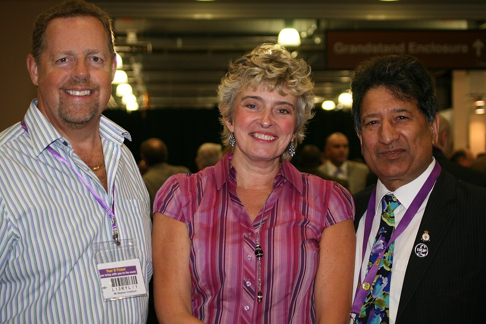

# 哈里·克拉多克

哈里·克拉多克（Harry Craddock，1876—1963）是英裔调酒师，也是 20 世纪最有名的酒吧作者之一。他的名字与伦敦萨伏伊酒店的 American Bar 绑在一起：1925 年他接任首席调酒师，1930 年出版《萨伏伊鸡尾酒书》，把禁酒令时期从美国流入英国的配方、比例与吧台规矩整理成一本可以带走的书。今天酒吧里常见的“干马天尼”“白色佳人”“曼哈顿”等经典，都能在这本书或它的谱系里找到早期版本。理解克拉多克，关键不是把他当成某一杯酒的发明者，而是把他看成一位把调酒职业化的编辑与经营者。

图：哈里·克拉多克。摄影：Steve Craddock Caroline Stephens & Harry Bhuta (15236917799)。署名：Derek Bennett，CC BY 2.0，来自 Wikimedia Commons（[来源](https://commons.wikimedia.org/w/index.php?curid=85019345)）。

## 人物小传

克拉多克 1876 年出生于英格兰格洛斯特郡的斯特劳德，全名哈里·劳森·克拉多克。他年轻时离开英国，在美国的酒店与酒吧工作多年，熟悉了当时美国酒吧的配方与操作。1920 年美国禁酒令生效后，他回到伦敦，加入萨伏伊酒店的 American Bar。

他在 American Bar 先做调酒师，1925 年接替艾达·科尔曼（Ada Coleman）成为首席调酒师。此后十余年，他服务于王室成员、演员与政客，也把酒吧变成伦敦社交生活的一个舞台。1938 年，他转往多切斯特酒店，后来又在布朗酒店工作，1947 年退休。1963 年，他在伦敦去世。

## 生平节点

- 1876 年：生于英格兰格洛斯特郡斯特劳德。
- 1920 年：因美国禁酒令回到伦敦，加入萨伏伊酒店 American Bar。
- 1925 年：接任 American Bar 首席调酒师。
- 1930 年：《萨伏伊鸡尾酒书》由伦敦 Constable 出版。
- 1930 年代：参与创立英国调酒师公会。
- 1938 年：转往多切斯特酒店。
- 1947 年：退休。
- 1963 年：在伦敦去世。

## 与酒业的实际关系

克拉多克与酒业的关系，首先是一个吧台管理者的关系。萨伏伊的 American Bar 不是普通酒吧，它服务的是酒店客人、剧院观众与国际旅客；吧台要有稳定的出品、能应付高峰的速度，还要有让客人记住的“招牌”。克拉多克的工作，就是把这些要求变成一套可执行的配方与流程。

其次，他是跨大西洋调酒经验的搬运者。19 世纪末到 20 世纪初，美国酒吧在冰块、摇酒、装饰与配方上领先；禁酒令让一批美国调酒师流向伦敦、巴黎与哈瓦那。克拉多克在美国工作过，又回到伦敦，正好把两边的做法接在一起。《萨伏伊鸡尾酒书》里的许多配方，因此既有美国酒吧的骨架，也有英国酒店的呈现方式。

第三，他参与了行业组织。1930 年代，他与 William J. Tarling 等人参与创立英国调酒师公会（United Kingdom Bartenders' Guild），把调酒师从酒店雇员变成有职业组织的群体。这一面向常被“传奇调酒师”的故事遮住，但它对职业化更重要。

## 代表作品或制度

《萨伏伊鸡尾酒书》（The Savoy Cocktail Book）1930 年由伦敦 Constable 出版，Gilbert Rumbold 绘制插图，收录的配方超过 750 条。它的结构不是按“基酒”分类的现代酒单，而是按鸡尾酒、Rickeys、Daisies、Slings、Shrubs、Smashes、Fizzes、Juleps、Cobblers、Fixes 等类型编排，保留了 19 世纪调酒书的分类习惯。

这本书的价值有三层。第一层是配方：它记录了禁酒令前后英美酒吧的实际做法，包括干马天尼、曼哈顿、古典鸡尾酒等经典的早期版本。第二层是比例与语言：它用“dash”“glass”“wineglass”等旧单位，让今天的读者看到配方书写的演变。第三层是视觉：Rumbold 的装饰艺术风格插图，使这本书不只是手册，也是一件 1930 年代的设计作品。

在制度层面，这本书确立了一种“酒店酒吧出书”的传统：酒吧不再只靠师傅口传，而是用印刷品把配方、服务与风格固定下来，供同行与客人使用。

## 调酒方法

克拉多克的方法带有明显的酒店酒吧特征：重视速度、稳定与呈现。他留下的名言常被概括为“摇匀马天尼、搅匀黛基里”之类的规矩，但这些说法在网络上版本很多，具体措辞与出处需要谨慎对待。

更可靠的是他在书里体现的取舍：该摇的用摇，该搅的用搅；该用新鲜柑橘的不用瓶装汁；该冰镇的杯子先冰镇。这些原则今天看来平常，但在 1930 年代的酒店吧台，是把“好喝”变成“每次都一样”的关键。

## 影响

第一，他让萨伏伊 American Bar 成为鸡尾酒史的坐标。今天去伦敦的酒吧爱好者，仍会把 American Bar 列为“必去”之一。

第二，他保存了禁酒令时代的配方。美国酒吧在 1920 年代被迫转入地下或海外，许多配方靠伦敦、巴黎与哈瓦那的酒吧保存下来；《萨伏伊鸡尾酒书》是其中影响最大的一本。

第三，他推动了调酒师的职业组织化。英国调酒师公会的成立，使调酒师有了培训、认证与同行交流的制度。

## 评价与争议

萨伏伊酒店官网称他为 American Bar 的“教父”式人物，并明确把 White Lady 的发明记在他名下；Bar Magazine 在报道他的传记时，也把《萨伏伊鸡尾酒书》称为经典。这些评价来自酒店与行业媒体，带有品牌叙事色彩，但与他实际留下的文本相符。

争议主要有三处。第一，他成为首席调酒师的年份：萨伏伊官网写 1925 年，另一些资料写 1926 年；差别可能来自“接任”与“正式头衔”的区分。第二，White Lady 的归属：萨伏伊把配方记在克拉多克名下，但鸡尾酒史上有同名或相近的早期版本，发明权不宜说得过死。第三，干马天尼的归属：克拉多克的书里确有干马天尼的早期配方，但他不是这杯酒的发明者；把“书里收录”当成“本人发明”，是常见的混淆。

## 常见误读

第一，克拉多克发明了干马天尼。他没有；《萨伏伊鸡尾酒书》记录的是当时已经流传的配方，马天尼的谱系比这本书更早、更复杂。

第二，克拉多克是美国人。他出生于英格兰，在美国工作过，后来回到伦敦；把他说成“美国调酒师”，会漏掉他的英国酒店背景。

第三，《萨伏伊鸡尾酒书》只是一本配方集。它同时是 1930 年代的设计作品、酒店服务手册与调酒职业化的文本。

第四，书里的每一杯都是他首创。书是编纂成果，既有他的调整，也有大量来自同行与旧手册的配方。

第五，网络上流传的“永不摇匀马天尼”等临终便条，是可靠史实。这类说法缺少同期档案佐证，宜当作轶事，不宜当作克拉多克的原话。

## 另见

- [干马天尼](ref:dry-martini)：书中最常被引用的经典之一。
- [曼哈顿](ref:manhattan)：威士忌类鸡尾酒的基本结构。
- [萨泽拉克](ref:sazerac)：新奥尔良经典，可见早期配方书的写法。
- [古典鸡尾酒](ref:old-fashioned)：烈酒、糖、水与苦精的原始结构。
- [鸡尾酒入门](ref:cocktail-basics)：工具、比例与经典配方。
- [金酒](ref:gin)：White Lady 与干马天尼的基酒。

对照阅读：[干马天尼](ref:dry-martini)、[萨泽拉克](ref:sazerac)。
