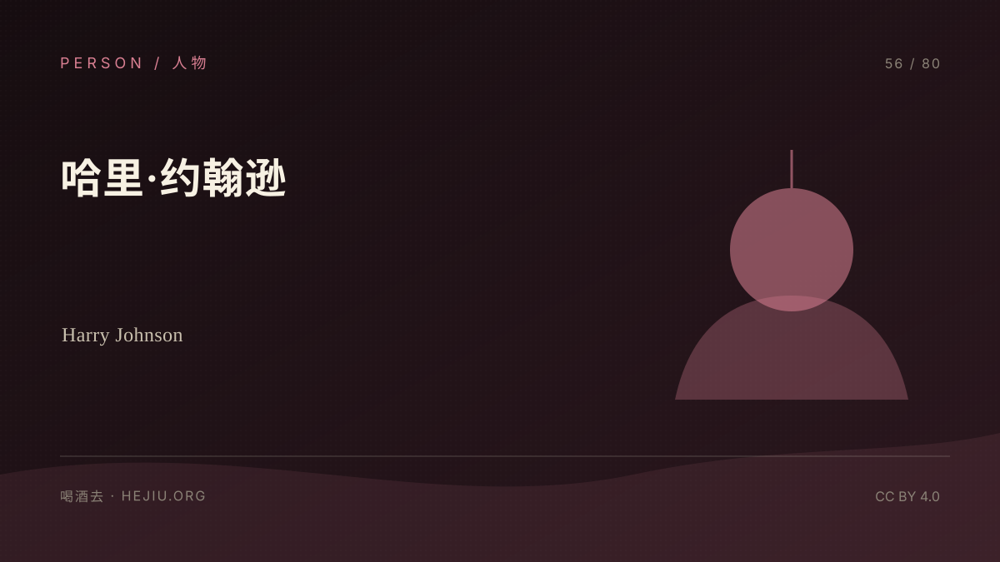

# 哈里·约翰逊

哈里·约翰逊（Harry Johnson，通常记为 1845 年生）是 19 世纪美国调酒师中“把酒吧当成一门生意来写”的人。本页指的是《New and Improved Bartender's Manual》的作者，不是其他同名人物；他的身份可以由 1882 年原书的署名、出版地与双语版本核对。

他的名字常与杰里·托马斯并列，但两人的贡献不同：托马斯让调酒有了剧场性，约翰逊让调酒有了操作手册与管理规范。

图：哈里·约翰逊栏目示意图。项目自产或类别插图，用于酒吧与酒类语境，不是该对象的实拍。

## 身份核验与人物小传

他生于 1845 年 8 月 28 日，出生地记为普鲁士的柯尼斯堡（今俄罗斯加里宁格勒）。少年时出海，1862 年因故滞留旧金山，随后在美国做调酒师与酒吧经营者，先后在纽约、芝加哥、旧金山等地工作。关于他的出生地，也有“生于船上”等不同说法，但 1845 年这个生年较为一致。

他的卒年没有统一结论，常见说法有 1930、1933 与 1936 年；本页因此不填卒年，只在正文说明争议。19 世纪酒吧从业者的档案零散，这类不确定性在研究早期调酒史时很常见。

## 与酒业的关系：职业轨迹

约翰逊既做调酒，也做培训与咨询。1882 年，他自费出版《New and Improved Bartender's Manual; or, How to Mix Drinks in the Present Style》，以英文与德文两种语言发行；1888 年推出增订版，1900 年仍有新版。约在 1890 年前后，他逐渐停止站吧台，转而以“酒吧专家”的身份提供经营咨询。

这条轨迹说明，19 世纪末的美国酒吧已经需要“会开店、会管人、会算账”的人，而不只是动作漂亮的调酒师。约翰逊的“The Dean”称号，正是同行对他资历与教学能力的承认。

## 《Bartender's Manual》的文本与制度

这本书的结构值得注意。它不是从第一页开始列配方，而是先用相当篇幅讨论酒吧的开办与经营：选址、吧台布局、器具清单、原料储存、员工着装、清洁流程、顾客服务。配方部分按酒类与饮法排列，既有当时流行的鸡尾酒，也有潘趣、菲士一类做法。

布里斯托大学的研究介绍指出，1888 年增订版是较早同时记录马天尼（Martini）与 Marguerite 配方的鸡尾酒书，也是最早提供“开店—用人—运营”完整方案的酒吧手册之一。这个“第一”需要限定：它说的是“完整方案”，不是“第一本调酒书”；杰里·托马斯 1862 年的《How to Mix Drinks》更早。

## 书中规范：可核验的管理细节

第一，器具与吧台。他列出开业所需的杯具、量酒器、摇壶、滤冰器、冰槽与储物容器，并说明摆放位置如何影响出杯速度。

第二，员工与卫生。他要求调酒师注意着装、举止与个人清洁，把服务者的体面当成生意的一部分；这些要求在今天看来平常，在 19 世纪却是职业化的标志。

第三，原料与库存。他讨论酒、糖、苦精、水果与冰的储存，强调进货与盘点，目的是减少损耗、保证口味稳定。

第四，服务流程。他把“迎客—点单—调制—结账”拆成步骤，让不同的人做同一杯酒时能保持大致一致。这一思路与[酒馆的历史](ref:taverns)中“酒吧从客栈附属变成独立职业空间”的变化相呼应。

他还特别强调冰的质量：冰要硬、要干净，因为融水会稀释酒；装饰物也不只是装饰，柑橘皮与苦精都在改变味道。把这些细节写进手册，等于把“手感”拆成可以检查的项目。

## 配方与标准

约翰逊记录了大量当时的流行配方，包括以[威士忌](ref:whisky)为基酒的古典做法。与托马斯书中的表演性配方相比，约翰逊更在意稳定性：同样的酒，不同的人做出来应该大致一样，顾客才敢回头。

他也收录了[老式鸡尾酒](ref:old-fashioned)一类的基本结构：烈酒、糖、水、苦精的比例与调制顺序。配方靠文本流传，标准靠管理落地；约翰逊的独特之处，是把两者放在同一本书里。

## 评价与争议

约翰逊的历史地位有两层争议。第一层是生卒年与出生地：1845 年 8 月 28 日生于柯尼斯堡的说法较具体，但“生于船上”等说法仍在流传，卒年也有 1930、1933、1936 三种常见记载。第二层是“第一”的用法：他的书常被介绍为“第一本全面讨论酒吧经营的手册”，这个说法成立；但若说成“第一本调酒书”，就与托马斯 1862 年的书冲突。

还有一个局限是内容的汇编性质。和同时代作者一样，他的配方很多来自同行与更早的实践，并非全部原创。读这本书，应把它当作 19 世纪美国酒吧实践的“汇总与规范化”，而不是一个人的发明清单。

1934 年出现过这本书的重印本，说明它在禁酒令之后仍被行业使用；重印本的页码与广告页和 1882 年原版不完全一致，引用时应注明版本。

## 常见误读

第一，把他的生卒年当成定论。1845 年生较一致，卒年仍有争议，引用时应说明。

第二，把 1882 年当成“第一本调酒书”。托马斯 1862 年的书更早；约翰逊的独特性在经营与管理。

第三，把书里的配方都算成他的发明。他的书是汇编，很多配方来自同行与更早的实践。

第四，把“酒吧管理”当成现代概念。19 世纪的约翰逊已经在写排班、器具与卫生，现代管理只是把它系统化。

## 怎样读这本书

先读经营部分，看一家 19 世纪美国酒吧如何选址、进货、排班；再读配方部分，比较同一杯酒在不同作者笔下的比例差异；最后对照 1882 年原书与 1888 年增订版，看哪些内容被扩充。这样读，才能把“配方书”还原成“行业手册”。[美国](ref:usa)19 世纪城市酒吧的背景，是理解这本书的前提。

对照阅读：[古典](ref:old-fashioned)、[美国](ref:usa)。

## 延伸阅读

- [老式鸡尾酒](ref:old-fashioned)：19 世纪鸡尾酒的基本结构。
- [威士忌](ref:whisky)：约翰逊配方中最常见的基酒之一。
- [酒馆的历史](ref:taverns)：酒吧作为职业空间的变化。
- [美国](ref:usa)：19 世纪美国城市酒吧的背景。

**关键事实。**

| 项目 | 内容 |
| --- | --- |
| 一句话定位 | 19 世纪美国调酒师与酒吧管理作者，通常记为 1845 年生；1882 年自费出版《New and Improved Bartender's Manual》，系统讨论酒吧经营、器具、排班与操作规范，把调酒从表演推向职业管理 |
| 生卒 | 1845–? |
| 身份 | 调酒师、酒吧管理作者 |
| 关联地区 | 美国 |

**来源与边界。** 本页关于「哈里·约翰逊」的关键事实，主要由以下来源交叉核对：Harry Johnson 自费出版，1882 年；后有 1888、1900 等版本（书名、出版年与篇章范围；本页不复制配方原文）、Cocktail Kingdom（1882 年自出版、英德双语与酒吧经营内容）、Wikimedia Foundation（交叉核对生年与卒年的不同说法；具体日期仍有争议；由原条目末尾参考资料迁移，未逐条复核访问日期）等 7 条来源。价格、批次与状态会变，涉及这些字段时以页面所列来源的最新版本为准。正文为项目自写，来源只作核验，不复制原文。
