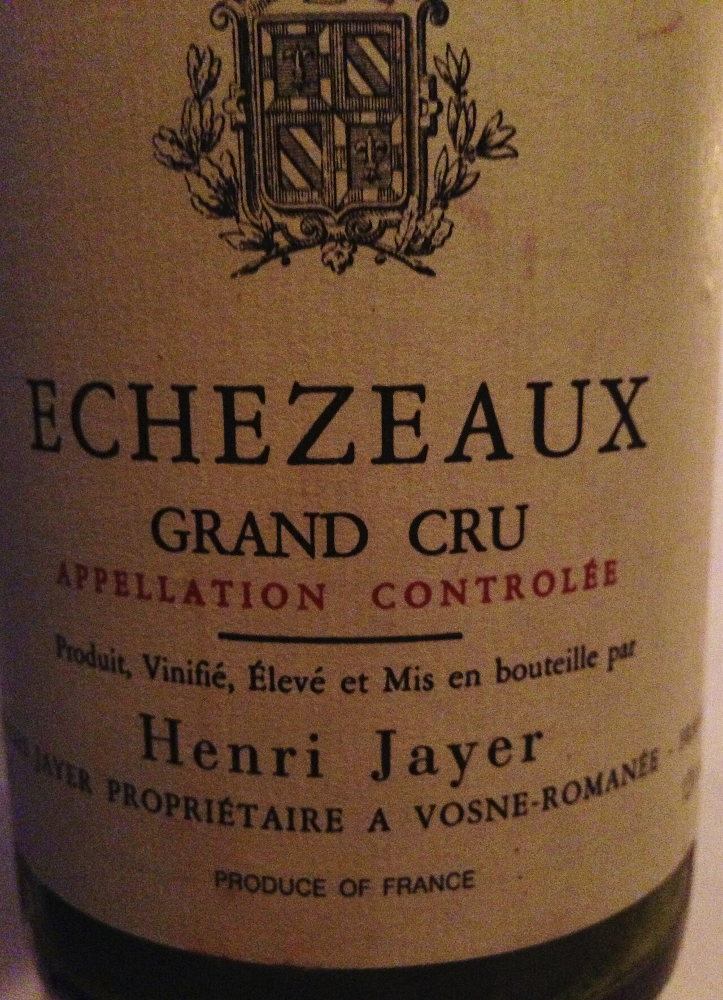

# 亨利·雅耶

亨利·雅耶（Henri Jayer，1922—2006）是勃艮第沃恩-罗曼尼（Vosne-Romanée）的酿酒师与葡萄种植者。他的个人持有面积不到五公顷，却成为同代最受推崇的勃艮第酿酒者之一；Cros Parantoux 这块曾经荒废、种过菊芋的坡地，是他最常被提起的作品。理解他，既要看酒窖里的选择，也要看他与地主之间那种今天几乎消失的租佃关系。

图：亨利·雅耶。图片：Dale Cruse，CC BY 2.0，via Wikimedia Commons（[原图页面](https://commons.wikimedia.org/wiki/File:Jayer_Echezeaux_Grand_Cru_Burgundy.jpg)）。

## 人物小传

1922 年，他生于沃恩-罗曼尼，是家中第三子。父亲在根瘤蚜危机之后购入三小块葡萄园，家底不厚。雅耶 16 岁离开学校；两个兄长从军后，他接手家里的葡萄园，每周向当地一位酿酒师学习种植与酿造，没有进过正规的酿酒学院。

1942 年，他与 Marcelle Rouget 结婚，后来有两个女儿。战后，他开始替卡米泽家族（Camuzet，即后来的 Méo-Camuzet）耕作其名下的葡萄园，并陆续租种其他小地块。1950 年代，他重植了部分地块；1959 至 1976 年间，他按分成租佃的约定，以自己名义少量装瓶 Richebourg。1978 年，他第一次以 Henri Jayer 的名义单独装瓶 Cros Parantoux，这块地从此成为他的标志。

据酒庄与行业资料，卡米泽家族的分成租佃在 1980 年代末结束，Richebourg 的最后一个是 1987 年份，此后该地块由 Méo-Camuzet 收回自酿。雅耶在 1987 年前后考虑退休，1990 年代中期（常记为 1996 年）按法国退休与土地传承规定，把葡萄园交给侄子 Emmanuel Rouget；此后他仍以顾问身份参与，直到 2002 年前后。2006 年 9 月 20 日，他病逝于第戎，享年 84 岁。

## 生平节点

- 1922 年：生于沃恩-罗曼尼，家中第三子。
- 1942 年：与 Marcelle Rouget 结婚。
- 战后：开始替卡米泽家族耕作葡萄园，并租种其他小地块。
- 1950 年代：重植部分地块，逐步形成低产与去梗的做法。
- 1957 年：购入 Cros Parantoux 约 0.72 公顷。
- 1959 至 1976 年：以自己名义少量装瓶 Richebourg。
- 1978 年：首次单独装瓶 Cros Parantoux。
- 1987 年：Richebourg 的最后一个年份；分成租佃结束。
- 1996 年：按退休规定把葡萄园交给侄子 Emmanuel Rouget。
- 2006 年 9 月 20 日：卒于第戎。

## 与勃艮第的实际关系：分成租佃

雅耶的身份不是地主，而是分成租佃的佃农与酿酒师。在 métayage 制度下，地主出地，耕作者出劳力与技艺，收成按比例分成；他因此可以把自己分到的那一半以个人名义装瓶，而地主的那一半则挂着地主的名字出售。这解释了两件事：为什么他的酒名与地块名常常对不上，为什么同一个地块会同时出现两个生产者的标签。

1970 至 1980 年代，勃艮第的租佃关系陆续终止，地主家族收回土地自行经营。雅耶失去 Richebourg 的经营权，却在 Cros Parantoux 与自家小块地上继续工作。这段制度史比“天才酿酒师”的叙事更能说明他的处境：他的名声建立在别人的土地上，也受制于别人的决定。

## Cros Parantoux

Cros Parantoux 位于 Richebourg 上方的坡地，面积约 1.01 公顷。19 世纪末根瘤蚜之后，这块地长期荒废，曾用来种菊芋，土层板结、石块密布。雅耶在战后着手清理，先用手推车搬走大石，后来动用炸药破碎岩层；据常见记述，爆破次数以百计。1957 年，他购入其中约 0.72 公顷，其余部分来自后续购入或租种。

1978 年，他第一次以“Cros Parantoux”单独装瓶，年产量从未超过 300 箱。这块地没有特级园（Grand Cru）的法定等级，只有一级园，却常被拿来与相邻的 Richebourg 比较；价格的倒挂，正是“地块等级不等于品质”的著名例子。今天这块地由 Méo-Camuzet 与 Emmanuel Rouget 两方持有与耕作。

## 酿造方法

雅耶的方法可以拆成五项：

- 低产：春季重剪、疏果，压低产量，让每串果实更集中。
- 全去梗：他倾向 100% 去梗，减少生青味，让果味更纯。
- 低温浸渍：在[发酵](ref:fermentation)前以约 10°C 浸渍一至四天，提取颜色与香气而不过度提取[单宁](ref:tannin)。
- 高比例新桶：顶级酒款使用 100% 新橡木桶，陈酿约 18 个月；他不把新桶当作风味主角，而是当作稳定与微氧化的工具。
- 少干预：装瓶前不过滤，尽量不澄清，保留酒本身的质地。

他还坚持晚采，等到果实成熟度足够再摘；并强调“好酒在葡萄园里就决定了”，酒窖的工作只是不把它做坏。这种说法常被引用，但它并不意味着酒窖不重要——他的酒窖在温度、卫生与提取控制上极为严格。

## 评价与争议

第一项争议是风格。雅耶的全去梗与高比例新桶，与以整串发酵著称的 DRC、Leroy 路线长期分歧。支持者认为他的酒更纯净、果味更精确；批评者认为新桶掩盖了地块差异，使不同园子的酒趋同。这场争论没有胜负，但它提醒我们：所谓“传统”在勃艮第从来不是单一做法。《独立报》讣闻一面称他对年轻酿酒师“影响巨大”，一面指出其做法“算不上革命性”，本意只是保持酒的纯净；把他写成颠覆者，与把他写成守旧者一样，都是简化。

第二项争议是市场。他的[红葡萄酒](ref:red-wine)在拍卖市场价格极高，Richebourg 1959 与 Cros Parantoux 的成交价常被媒体拿来做标题。价格由稀缺、名气与投机共同推高，赝品也随之出现；把拍卖价当成品质证明，是把市场现象误当感官判断。

第三项争议是归因。Cros Parantoux 的成功常被写成一个人的功劳，但 Méo-Camuzet 与 Rouget 在同一地块上的持续耕作同样关键；他 1996 年之后的传承安排，也让“雅耶的酒”在标签与酿造者之间产生复杂关系。把一切都归于个人天才，会掩盖制度、土地与后来者的工作。

## 常见误读

第一，把 Cros Parantoux 的成功全归于地块。没有清理、重植与持续管理，这块荒坡不会自己变成名园。

第二，把“低产”当成唯一秘诀。低产必须配合成熟度、卫生与提取控制，否则只是少收葡萄。

第三，把“整串发酵”当成勃艮第的唯一正统。雅耶倾向去梗，但勃艮第内部做法多样，不能用一个人的选择代表整个[法国](ref:france)产区。

第四，把拍卖价格当成品质的唯一证明。价格由稀缺、名气与市场共同决定。

第五，把他当成“不干预”的原始派。他的新桶比例与提取控制都相当主动；“少干预”指的是不过滤、不频繁倒桶，不是什么都不做。

## 另见

- [红葡萄酒](ref:red-wine)：黑皮诺所属的酒类。
- [法国](ref:france)：勃艮第的地理与制度背景。
- [发酵](ref:fermentation)：低温浸渍所在的工艺环节。
- [单宁](ref:tannin)：提取控制的核心指标。

**关键事实。**

| 项目 | 内容 |
| --- | --- |
| 一句话定位 | 法国勃艮第酿酒师，1922 至 2006 年在世；他长期以分成租佃方式耕作沃恩-罗曼尼的地块，以全去梗、低温浸渍、低产与克制的新桶酿黑皮诺，并把荒废的 Cros Parantoux 做成一级园 |
| 生卒 | 1922–2006 |
| 身份 | 酿酒师、葡萄种植者 |
| 关联地区 | 法国 |
