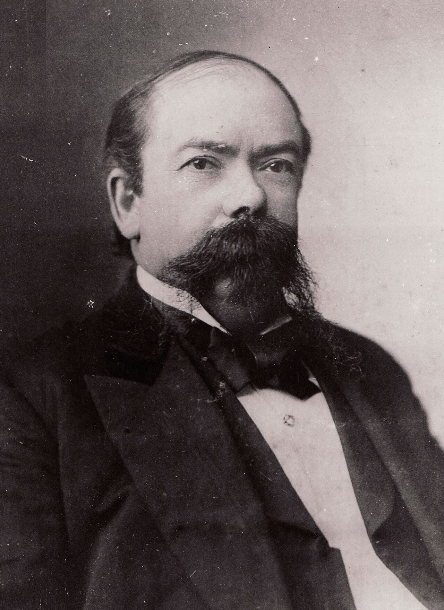

# 杰克·丹尼

杰克·丹尼（Jack Daniel，约 1850—1911），本名贾斯珀·牛顿·丹尼（Jasper Newton Daniel），是美国田纳西州林奇堡的蒸馏酒业者，杰克丹尼（Jack Daniel's）品牌的创办人。1866 年，他在林奇堡登记“第 1 号蒸馏所”（Distillery No. 1），用糖枫木炭过滤新酒，形成后来被称为“林肯县工艺”（Lincoln County Process）的田纳西威士忌做法。1904 年圣路易斯世界博览会上，杰克丹尼获得金牌，品牌从此走向全国。今天它仍是美国威士忌最有辨识度的名字之一。

图：杰克·丹尼肖像。图片：Unknown author Unknown author，Public domain，via Wikimedia Commons（[原图页面](https://commons.wikimedia.org/wiki/File:Jasper_%22Jack%22_Daniel.jpg)）。

## 林奇堡的少年与丹·考尔

杰克·丹尼的出生年份有 1846 与 1850 两种说法，官方与墓碑多采用 1850 年 9 月 5 日；死亡日期为 1911 年 10 月 10 日。他童年家境贫寒，母亲早逝，父亲再婚；十几岁时离家，被路德宗传教士丹·考尔（Dan Call）收留。考尔既是牧师，也经营一间小蒸馏所，杰克在那里学会了磨麦、糖化、发酵、蒸馏与橡木桶陈酿。

近年研究确认，考尔的蒸馏所里有被奴役的酿酒师内森·“最近的”·格林（Nathan "Nearest" Green），他是杰克的实际师傅之一。格林后来获得自由，成为林奇堡社区的重要人物；杰克丹尼品牌在 2016 年公开承认这段关系，并在厂内设立纪念与教育项目。这段历史提醒我们：美国南方威士忌的技术不是某个白人天才的独创，而是种植园、教堂、黑人工匠与市场网络共同积累的结果。

1866 年，考尔决定专心传教，把蒸馏所卖给杰克。杰克在林奇堡的洞穴泉（Cave Spring）旁建厂，登记为林肯县第 1 号蒸馏所。洞穴泉的石灰岩泉水硬度低、铁含量少，适合糖化与发酵；今天酒厂仍用这处泉水。杰克把厂子建在泉边而不是城里，是为了水源、温度与木材供应，也为了避开城镇的火灾与治安问题。

## 林肯县工艺

田纳西威士忌与波本威士忌的关键区别，是“林肯县工艺”：新蒸馏出的酒在装桶前，要缓慢穿过约 10 英尺厚的糖枫木炭层。木炭由糖枫木在厂内烧制、堆叠、点燃，再用水熄火，形成多孔的炭块。酒液经过炭层时，会吸附部分硫化物、杂醇与粗糙的谷物味，让口感更柔顺，也为后续橡木桶陈酿留下更干净的基底。

这套工艺不是杰克·丹尼“发明”的独家秘密。林肯县一带的蒸馏者早就用木炭过滤，杰克丹尼把它工业化、标准化，并随着品牌传播变成田纳西威士忌的定义性步骤。今天美国联邦法规对“田纳西威士忌”有明确要求：在田纳西州生产、用至少 51% 玉米的谷物配方、经林肯县工艺过滤、在新烧焦橡木桶中陈酿；它同时符合“straight bourbon”的技术定义，但品牌与法规都强调“Tennessee whiskey”这一类别。

杰克丹尼的原料以玉米为主，辅以大麦与黑麦；糖化、发酵后用铜制壶式蒸馏器蒸馏，得到“白狗”（white dog）新酒，再经木炭过滤、入新桶陈酿。酒厂不使用二手桶，也不在田纳西以外装瓶。Old No. 7 的名字来源有多种说法，官方没有给出唯一答案；常见的“第七号实验配方”“第七号仓库”等故事都缺乏档案证据，读者不必把它当成事实。

## 从地方酒厂到全国品牌

1880 年代，杰克丹尼的威士忌主要在田纳西与周边销售。1904 年圣路易斯世界博览会，杰克丹尼获得金牌，品牌知名度迅速上升；1905 年，它又在比利时列日世博会上获奖。杰克本人不擅长广告，但他懂得让产品参加展会、让旅行推销员把酒带到城市酒吧。1911 年，他因脚趾受伤引发血液中毒去世，终年约 61 岁；外甥 Lem Motlow 接管酒厂。

Motlow 时期，田纳西在 1916 年实行禁酒，酒厂停产；1933 年联邦禁酒令废除后，Motlow 家族重建业务。1956 年，Brown-Forman 收购杰克丹尼，把品牌推向全球。今天杰克丹尼是全球销量最大的美国威士忌之一，产品线从 Old No. 7 扩展到 Gentleman Jack、Single Barrel、Tennessee Honey 等；酒厂仍在林奇堡，泉、炭、桶与橡木库房仍是参观的核心。

## 去林奇堡看什么

如果去杰克丹尼酒厂，重点看四件事。第一，洞穴泉：泉水温度常年偏低，石灰岩过滤让水适合糖化；泉边的小屋与水流是理解“为什么酒厂建在这里”的起点。第二，糖枫木炭：看木炭如何堆叠、点燃、熄火、筛分，理解“10 英尺炭层”不是营销话术，而是真实的过滤设备。第三，蒸馏与装桶：铜壶蒸馏器、白狗新酒、新烧焦橡木桶与仓库的温湿度，决定酒体的甜度、香料与木质味。第四，品鉴：Old No. 7 的香蕉、香草、焦糖与轻微烟熏，Single Barrel 的更集中香料与橡木，Gentleman Jack 的双重过滤柔顺感，是三条不同的产品逻辑。

喝田纳西威士忌，不必把它当“甜味波本”。Old No. 7 适合加冰、加苏打水或调成可乐鸡尾酒；Single Barrel 适合纯饮，配烤肉、烟熏肋排与黑巧克力；Gentleman Jack 更适合初饮者，配坚果、奶酪与清淡的甜点。若用高球杯，注意苏打水比例，不要用太多冰把香气压死。

## 争议与常见误读

第一，杰克·丹尼不是“波本威士忌的发明者”。波本在肯塔基与周边地区早已成熟，杰克丹尼的独特之处是田纳西的林肯县工艺与品牌化。第二，田纳西威士忌与波本的法律关系常被简化。它符合 straight bourbon 的技术要求，但法规与品牌都把它单列为“Tennessee whiskey”；说“田纳西威士忌就是波本”或“完全不是波本”都不准确。

第三，林肯县工艺不是“杰克·丹尼独家发明”。它是林肯县地区的共同技术，杰克丹尼把它标准化并随品牌传播；把地方知识归功于一个品牌，会抹掉格林、考尔与其他蒸馏者的贡献。第四，Old No. 7 的名字没有唯一官方解释；听到“第七号配方”“第七号仓库”“第七个政府批次”时，要把它当传说而不是档案。

第五，杰克·丹尼的出生年份有争议。1846 年与 1850 年两种说法并存，官方多用 1850 年；写传记时应注明“约”或“官方采用”，不要用单一数字制造精确感。第六，酒厂位于 Moore County 的林奇堡，该县历史上对酒类销售有严格限制；“酒厂在禁酒县”是一个有趣的地方悖论，但不代表酒厂不能生产或参观。

## 与本站其他页面的关系

杰克·丹尼的故事连接三条线。第一是[威士忌](ref:whisky)的技术：谷物配方、壶式蒸馏、木炭过滤、新桶陈酿与橡木桶管理。第二是[田纳西](ref:tennessee)的地方史：洞穴泉、林肯县、禁酒、Motlow 家族与 Brown-Forman 的全球分销。第三是[美国](ref:usa)的酒业制度：波本、田纳西威士忌、禁酒令与 20 世纪的品牌全球化。

如果想继续看“美国威士忌的地图”，可以对照肯塔基波本、田纳西威士忌与黑麦威士忌；如果想看“品牌如何从地方走向全球”，可以读 Brown-Forman 的收购与分销；如果想看“工艺如何被法规定义”，可以读田纳西威士忌的联邦标准与林肯县工艺。杰克·丹尼不是孤立的品牌，它是美国南方历史、黑人酿酒传统与全球市场共同塑造的结果。

## 延伸阅读

- [杰克丹尼酒厂](ref:distillery)：林奇堡、洞穴泉、林肯县工艺与参观信息。
- [威士忌](ref:whisky)：谷物、蒸馏、木桶与风格的基本框架。
- [田纳西](ref:tennessee)：林肯县、禁酒史与杰克丹尼的地方背景。
- [美国](ref:usa)：波本、田纳西威士忌、禁酒令与品牌全球化。

相关条目：[杰克丹尼酒厂](ref:distillery)。
