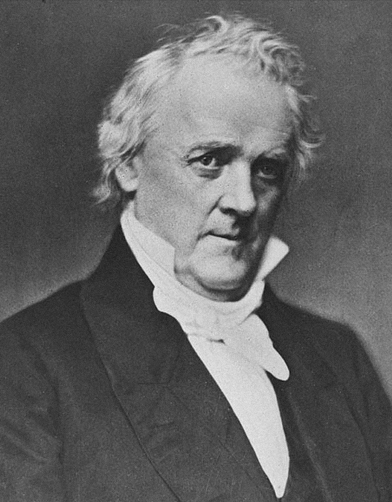

# 詹姆斯·布坎南

詹姆斯·布坎南（James Buchanan，1849 年 8 月 16 日—1935 年 8 月 9 日），第一代伍拉文顿男爵，苏格兰威士忌调配商与品牌创办人。他不是蒸馏师出身，而是把不同酒厂的酒液按比例调成稳定产品，再用瓶装、酒标与广告卖到英格兰与海外。Buchanan's 与后来定名 Black & White 的调配威士忌，都出自这套做法。

图：詹姆斯·布坎南。图片：From Brady daguerreotype (Mathew Brady) (1822-1896)，Public domain，via Wikimedia Commons（[原图页面](https://commons.wikimedia.org/wiki/File:James_Buchanan_(cropped).jpg)）。

## 人物小传

布坎南生于加拿大西部的布罗克维尔（Brockville），父母是苏格兰移民；他出生后不久全家返回英国，他在北爱尔兰安特里姆郡的拉恩（Larne）长大，父亲在采石场任管事。因幼年体弱，他接受的是私人教育，没有进普通学校。十四、五岁时，他进入格拉斯哥的船运公司 William Sloan & Co 做办公室杂役，后升为职员；1868 年转到兄长的谷物生意。1879 年 11 月，他赴伦敦，担任利斯（Leith）调配商 Charles Mackinlay & Co 的代理，由此正式进入威士忌贸易。

1884 年，他自立门户，推出 Buchanan Blend。需要说明的是，他当时并不自己蒸馏：酒液由格拉斯哥的调配商 W. P. Lowrie & Co 替他生产，他负责配方、瓶装、定价与销售。1903 年公司改为私人有限公司时，他的身家已达 75 万英镑；到 1909 年，Buchanan's 已是英格兰销量第一的苏格兰威士忌。此后他一路向上游扩张，也一路把利润换成地产、马匹与捐款。

## 生平节点

- 1849 年 8 月 16 日：生于加拿大布罗克维尔，父母为苏格兰移民。
- 1879 年：赴伦敦，任 Charles Mackinlay & Co 的代理。
- 1884 年：自立门户，推出 Buchanan Blend。
- 1885 年：开始向英国下议院供酒。
- 1898 年：获维多利亚女王、威尔士亲王与约克公爵的皇家认证；同年开设 Glentauchers 麦芽蒸馏厂。
- 1902 年：设巴黎办事处；Black & White 由俗称转为正式品牌名。
- 1906 年：买下长期为其代工的 Lowrie's，并改造格拉斯哥厂区。
- 1915 年：Buchanan's 与 Dewar's 组成联合控股公司 Scotch Whisky Brands Ltd，1919 年改名 Buchanan Dewar Ltd。
- 1920 年：受封从男爵；1922 年：封伍拉文顿男爵。
- 1925 年：三大家与 Distillers Company 合并。
- 1935 年 8 月 9 日：卒于苏塞克斯的 Lavington Park，享年 85 岁。

## 与威士忌业的实际关系

布坎南的职位是调配商、公司主席，核心工作是[调配](ref:blend)：把麦芽威士忌与谷物威士忌按比例混合，使每一批产品的香气、酒体与入口强度保持一致。19 世纪末的英格兰市场偏好柔和、易饮、颜色稳定的酒，调配正好满足这种需求；瓶装也让消费者不必依赖散装酒商，可以认准标签重复购买。

他同时控制上游。1898 年在斯佩塞开设 Glentauchers 蒸馏厂，1906 年买下长期为他供货的 Lowrie's 并改造其格拉斯哥厂区，1907 年又购入制瓶企业的股份与包装公司，把供应链的关键环节握在手里。这套纵向整合让他在价格与供给上比纯贸易商更有余地。

销售上，他擅长把酒变成可识别的商品：黑色瓶身配白色标签，消费者顺口称之为“黑白威士忌”；他驾着红轮马车、带着穿制服的随从在伦敦街头走动，本身就是广告。1885 年起向[英国](ref:united-kingdom)下议院供酒，1898 年拿到皇家认证，这些资质又被用作品质背书。1902 年设巴黎办事处，随后设纽约办事处，出口网络覆盖英帝国市场与美国。

## 品牌与产品

Buchanan Blend 是他的第一个产品，也是今天 Buchanan's 系列的前身：以麦芽与谷物威士忌调和，风格偏柔顺，强调入口的圆润而非泥煤或酒厂的强烈个性。Black & White 的名字来自顾客对黑瓶白标的外观描述，后来被正式采用为品牌名；黑白两只梗犬（黑色苏格兰梗与白色西高地白梗）自 19 世纪 90 年代起用于广告，成为早期威士忌视觉营销的典型案例。

产品线在 20 世纪初开始分层：1905 年推出 Red Seal，1925 年推出 Deluxe 12 年。价格带拉开之后，同一套调配与包装能力可以同时服务大众市场与礼品市场，这也是后来苏格兰威士忌大品牌普遍采用的策略。

## 企业与产业制度

1909 年，布坎南提议把 Buchanan's、Dewar's 与 Walker's 三家合并，没有成功；1914 年再提，1915 年 4 月 Buchanan's 与 Dewar's 先组成联合控股公司 Scotch Whisky Brands Ltd，1919 年改名 Buchanan Dewar Ltd。1925 年，三大家一同并入 Distillers Company（DCL）。合并后他挂名董事，但因年事与健康，只参加过一次董事会——这一点常被忽略：公司做大之后，实际经营已交给职业管理层。

这条时间线也解释了“三巨头”说法的来源。它最初是布坎南本人对行业格局的判断与合并方案，而不是后世统计出来的销售排行榜；把它当成精确排名，会误读这个词的性质。

## 评价与争议

对布坎南的评价长期集中在“卖酒”而非“造酒”。他从未自己蒸馏，早期产品由 Lowrie's 代工；他的长处是配方稳定性、包装、广告与分销。这既是他的贡献，也是批评者的口实：把威士忌变成标准化商品，削弱了单一酒厂与单一桶的个性，让“苏格兰威士忌”第一次成为一个可以跨厂拼配的工业品牌。

另一类争议关于他的封爵。1922 年他获封男爵，后来流传他以 5 万英镑“购买”爵位的说法，并称他把支票日期写在授勋公告之后，以便事情不成时止付；这一轶事见于《每日电讯报》2006 年的回顾报道，属于传闻性质，不宜当作定论。可以确定的是，他确实以巨额捐款支持医院、教堂与大学，1928 年为米德尔塞克斯医院捐建侧翼以纪念亡妻。

还有一点常被忽略：他去世时遗产超过 700 万英镑，是当时英国最富有的商人之一；但由于没有存活的男性继承人，男爵与从男爵爵位在他死后一并断绝。

## 常见误读

第一，生卒年。旧资料常写“1849—1934”，实际卒于 1935 年 8 月 9 日；《牛津国家传记词典》与当年讣闻都作 1935 年。

第二，出生地。他生于加拿大布罗克维尔，不是苏格兰；1935 年部分讣闻写作斯特灵郡，属于异说，引用时应说明来源分歧。

第三，把 Black & White 当成单一麦芽。它是调配威士忌，卖点是稳定与顺口，不是某一家酒厂的个性。

第四，把“调配”当成低端工艺。调配要处理数十种原酒的比例、年份与批次差异，技术难度不低于单桶选酒，只是目标不同。

第五，把品牌成功全归于配方。分销、广告、皇家认证与瓶装体系同样关键；布坎南本人最擅长的恰恰是后者。

相关条目：[威士忌](ref:whisky)、[苏格兰](ref:scotland)。

## 另见

- [威士忌](ref:whisky)：调配威士忌所属的酒类。
- [苏格兰](ref:scotland)：酒厂与产业的所在地。
- [英国](ref:united-kingdom)：他的经营根据地与出口市场背景。
- [调配](ref:blend)：他生意的核心方法。
