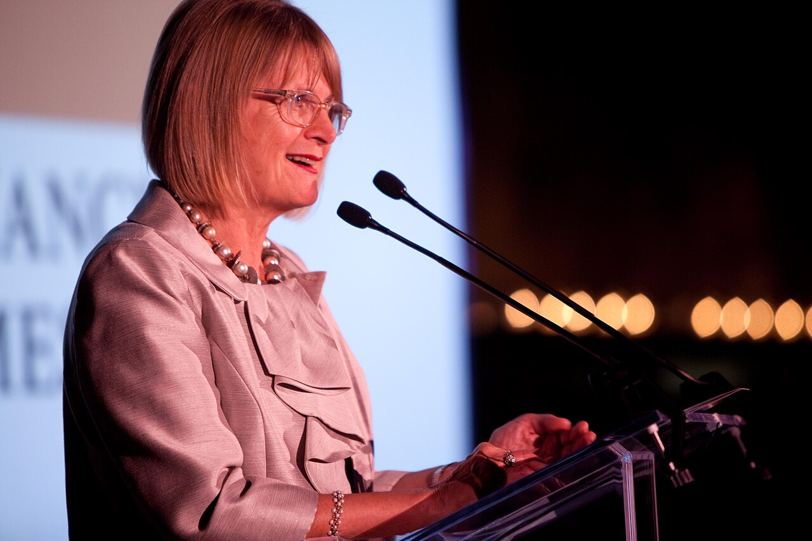

# 杰西斯·罗宾逊

杰西斯·罗宾逊（Jancis Robinson，1950 年生）是英国葡萄酒作家、编辑与评论者。她在葡萄酒出版界的位置，来自三件可以逐一核对的事：1984 年通过葡萄酒大师考试，1989 年起为《金融时报》写每周专栏，以及从 1994 年起主编《牛津葡萄酒指南》。

图：杰西斯·罗宾逊。图片：Financial Times，CC BY 2.0，via Wikimedia Commons（[原图页面](https://commons.wikimedia.org/wiki/File:Jancis_Robinson.jpg)）。

## 生平节点

- 1950 年 4 月 22 日生于英格兰西北部坎布里亚郡，成长在一个只有几十人的村庄，少年时代几乎不接触葡萄酒。
- 在牛津大学读数学与哲学，在校期间才第一次系统接触餐酒。
- 1984 年通过葡萄酒大师（Master of Wine）考试，是当时少数并非出身酒商或酒庄的通过者之一。
- 1989 年起任《金融时报》葡萄酒专栏作家，每周一篇，持续数十年。
- 1994 年主编《牛津葡萄酒指南》第一版，此后主持 1999、2006、2015 等版本的修订。
- 2000 年创办个人网站 JancisRobinson.com，后转为付费订阅制，由她本人担任主编与主要撰稿人。
- 2001 年起与休·约翰逊合著[《世界葡萄酒地图》](ref:world-atlas)，从第五版开始署名两人。
- 2012 年与朱莉娅·哈丁（Julia Harding）、若泽·武伊拉莫兹（José Vouillamoz）合著《Wine Grapes》，系统整理葡萄品种的遗传与同义名。

## 与酒业的实际关系

她不是酿酒师，也不经营酒庄，她的位置在“描述与评判”这一端。具体工作包括：为《金融时报》撰写专栏，把酒放进餐厅、旅行、商业与日常消费的语境；主持《牛津葡萄酒指南》的条目规划与作者组织；以主编身份运营网站，发布品鉴笔记与产区报告；参与国际酒展与比赛的评审。

她的评分使用 20 分制，而不是美国市场更常见的 100 分制。这个选择看似只是刻度不同，实际影响写作方式：20 分制的区分度更粗，评语必须承担更多解释工作，读者不能只看数字。她网站上的品鉴笔记按产区、年份与主题归档，同一款酒在不同年份的评价可以相互对照，这让她早年的判断也能被后来的读者检验。

## 《牛津葡萄酒指南》：主编在做什么

《牛津葡萄酒指南》（The Oxford Companion to Wine）按词条组织产区、品种、术语、法规、人物与历史。它的价值不在某一篇写得漂亮，而在体例：同一个术语在不同条目里指向一致，交叉引用能把读者从“霞多丽”带到“勃艮第”，再带到“橡木桶”。

主编的工作是决定哪些条目值得收录、请谁来写、如何统一口径与交叉引用。这是一项组织工作，不是个人写作。把“主编”理解成“全书作者”，既高估了一个人的产量，也低估了工具书的协作性质。

## 《世界葡萄酒地图》：从第五版开始

《世界葡萄酒地图》最初由休·约翰逊在 1971 年独立出版。2001 年第五版起，罗宾逊成为合著者，此后各版由两人共同署名。这本书用地图把产区、土壤、气候与村庄关系画出来，让读者知道一款酒“从哪里来”。

地图不是装饰，而是一种论证方式：当两个村庄只隔一道坡，风格却不同，地图能让这种差异变得可见。她在地图书里的贡献，更多体现在产区数据的更新、边界与名称的校正，以及把新品种、新产区纳入框架；每一版都要重新核对这些信息，工作量远大于改一版文字。

## 《Wine Grapes》与品种语言

2012 年的《Wine Grapes》把 1300 多个葡萄品种按亲缘关系、别名与栽培分布整理成册，合作者是葡萄遗传学家武伊拉莫兹与编辑哈丁。这本书解决的是葡萄酒写作中的老问题：同一个品种在不同国家有不同名字，同一个名字又可能指不同品种。

说“这是一款[葡萄酒](ref:wine)”，信息量很低；说“这是来自某个村庄、以某个品种为主、在某个年份采收的酒”，读者才能判断风格与价格。她的写作方法，本质上是把模糊的“好喝”拆成可核对的地理、品种与工艺信息。

## 评价与争议

2003 年份的 Château Pavie 是她最著名的一次争议。她给这款圣埃美隆酒打了 12/20，称其“荒唐”，理由是香气过度成熟、带有波特酒似的甜味，失去了干红的轮廓。罗伯特·帕克随即公开反驳，认为她的评价不公正；《Decanter》的詹姆斯·劳瑟（James Lawther MW）则给出四星，认为 12 分并不合理。

这场争论不只是口味之争，也是评分权力的之争：一边是《金融时报》与个人网站的欧洲读者群，一边是《葡萄酒倡导家》在美国市场的影响力。她的批评者常说她的口味偏酸、偏克制，对成熟果味不够宽容；支持者则认为她提供了分数之外的判断理由。

另一条局限来自语言与市场：她的写作以英语读者和欧洲传统产区为默认背景，读新世界酒或非葡萄酒类酒时，仍需要本地资料补充。

## 常见误读

第一，把“主编”当成“全部词条的作者”。《牛津葡萄酒指南》是集体作品，她负责组织与把关。

第二，把地图书当成旅游指南。《世界葡萄酒地图》的核心是产区与地理关系，不是餐厅推荐。

第三，把 MW 当成学位。葡萄酒大师是行业协会组织的资格考试与称号，不是大学学位。

第四，把她的评分当成绝对标准。她的价值在方法：看产地、看年份、看工艺，再谈喜好。

第五，把英国视角当成全球视角。她的写作带有英国媒体与欧洲葡萄酒传统的语境，这一点在读其他产区时必须补上。

相关条目：[英国](ref:uk)。

## 另见

- [葡萄酒](ref:wine)：基础定义与工艺。
- [世界葡萄酒地图](ref:world-atlas)：以地图组织产区知识的工具书。
- [英国](ref:uk)：英国葡萄酒市场与媒体环境的背景。

对照阅读：[葡萄酒](ref:wine)、[世界葡萄酒地图](ref:world-atlas)。

**关键事实。**

| 项目 | 内容 |
| --- | --- |
| 一句话定位 | 英国葡萄酒作家与编辑，1950 年生；1984 年通过葡萄酒大师考试，1989 年起任《金融时报》葡萄酒专栏作家，主编《牛津葡萄酒指南》，2001 年起与休·约翰逊合著《世界葡萄酒地图》 |
| 生卒 | 1950–? |
| 身份 | 葡萄酒作家、编辑、葡萄酒评论家 |
| 关联地区 | 英国 |

**来源与边界。** 本页关于「杰西斯·罗宾逊」的关键事实，主要由以下来源交叉核对：Jancis Robinson（作者身份、著作、专栏与网站沿革；未复制付费内容）、Oxford University Press；Jancis Robinson 主编（主编身份与各版年份；未复制词条）、Encyclopaedia Britannica（生年、职业与主要著作）等 7 条来源。价格、批次与状态会变，涉及这些字段时以页面所列来源的最新版本为准。正文为项目自写，来源只作核验，不复制原文。
