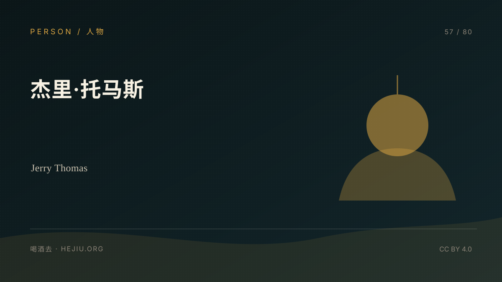

# 杰里·托马斯

杰里·托马斯（Jerry Thomas，1825—1885）是美国 19 世纪最有名的调酒师之一。他的名声来自两件事：一本 1862 年出版的调酒书，以及一套带火焰的调酒动作。前者让配方第一次以书的形式稳定下来，后者让调酒师从柜台后的服务者变成舞台上的表演者。

图：杰里·托马斯栏目示意图。项目自产或类别插图，用于酒吧与酒类语境，不是该对象的实拍。

## 一个被自己的传说包围的人

关于托马斯的多数故事，都能在他自己的书、报纸广告与讣告里找到源头，却很难找到独立旁证。他自称“教授”，也乐于把自己写成传奇；19 世纪的美国酒吧本就擅长制造人物。读他的传记，最好把“他说的”“报纸说的”和“档案能证明的”分开。

生年就是第一个例子。常见资料记他为 1830 年 10 月 30 日生，也有研究依据教区与家谱材料推到 1825 年。本页采用 1825 年，并在正文保留 1830 年这一说，不把争议藏起来。

## 生平节点

- 1825 年（一说 1830 年）生于纽约州萨克茨港，具体日期存疑。
- 少年时在纽约州与康涅狄格州的酒吧学艺，据称十几岁便独立站吧。
- 1849 年前后随淘金热前往加利福尼亚，在旧金山的 El Dorado 赌场酒吧担任主调酒师。
- 1850 年代回到东部，先后在圣路易斯的 Planters' House 旅馆与纽约的 Metropolitan Hotel 任职。
- 1862 年在纽约出版《How to Mix Drinks; or, The Bon-Vivant's Companion》，由 Dick & Fitzgerald 印行。
- 1876 年推出修订版《The Bar-Tender's Guide》，篇幅与配方数量都有增加。
- 1885 年 12 月 15 日在纽约去世，死因为中风。

## 与酒业的实际关系

他的职位始终是酒吧一线的调酒师与酒吧经营者，不是酒厂老板，也不是酒类批发商。这个位置决定了他的贡献形态：不是发明某种酒，而是把吧台的操作写成可复制的文本。

具体工作可以列得很实：在旧金山与纽约的旅馆酒吧负责出品与吧台管理；训练助手；采购酒水与器具；根据客人的口味调整配方；把日常操作整理成书。1862 年的书出版后，他继续在酒吧工作，也经营过自己的店面。这条职业路径，与今天“调酒师—酒吧主理人—作者”的路径已经很接近。

## 1862 年的《How to Mix Drinks》

这本书把当时在酒吧里口耳相传的配方分类整理，涵盖潘趣（punch）、鸡尾酒（cocktail）、酸酒（sour）、菲士（fizz）、朱丽普（julep）、斯马什（smash）、科布勒（cobbler）、托迪（toddy）等类别，并给出分量与步骤。它并不是历史上第一本提到混合饮料的英文书，但它是美国早期影响最大的调酒专著之一，“调酒师有了自己的手册”这件事，比某一道配方更关键。

这本书的意义在于标准化。在此之前，同一款酒在不同城市、不同酒吧会有不同做法；有了文本，配方可以被复制、比较与争论。今天的鸡尾酒书、酒吧培训与配方档案，都可以追溯到这种“把手上功夫写成文字”的做法。

书中的“威士忌鸡尾酒”（Whiskey Cocktail）配方，后来被视为[老式鸡尾酒](ref:old-fashioned)的直系祖先：烈酒、糖、水与苦精的组合，正是老式的基本结构。但“Old-Fashioned”这个名字要到 1880 年代才流行起来，不能把后来的名字安到 1862 年的书上。

## 蓝火：把调酒变成表演

托马斯最常被提到的作品是“蓝火”（Blue Blazer）。做法是把[威士忌](ref:whisky)与沸水在两只金属杯之间来回倾倒并点燃，形成一道火光，最后加入糖与柠檬皮。据说这是他在旧金山 El Dorado 时期创制的招牌动作。

这个配方让调酒带上了杂技与剧场色彩，也成为后来花式调酒与[鸡尾酒复兴](ref:cocktail-revival)的精神来源之一。但它不是一种适合日常操作的技法：明火、沸水与高酒精度的烈酒同时出现，在家尝试有严重的烧伤与火灾风险。它的价值在历史与表演层面，而不是“必须学会的经典配方”。

## “教授”与酒吧的职业身份

“教授”（Professor）这个称号，既是对技术的尊重，也带着 19 世纪美国酒吧的营销色彩。它说明一件事：调酒师开始被视为拥有专门知识的人，而不只是端酒的服务员。酒吧因此不只是卖酒的地方，也可以是展示技艺、传播配方的场所；这一点与[酒馆的历史](ref:taverns)相互印证。

从行业史的角度看，这个称号比任何一款酒都重要。它标志着职业身份的形成：有教材、有师徒、有招牌动作、有可供模仿的表演。

## 评价与争议：史料能证明什么

第一，生年与早年经历存在两说。1825 年与 1830 年各有依据，具体任职年份与酒吧名称在不同资料中也不完全一致。

第二，“首创”之说难以证实。蓝火是否由他发明、他是否在某家酒吧首创某款酒，多依赖他本人晚年的回忆与报纸转述；大卫·温德里奇（David Wondrich）在《Imbibe!》（2007）中重建他的生平时，对不少说法作了保留。

第三，书是汇编而非原创全集。书中大量配方来自同行与更早的出版物，托马斯的贡献是筛选、分类与记录。把“收录”当成“发明”，是后世读者最容易犯的错误。

第四，他与“美国调酒之父”这类称号的关系，是后世追认的结果。称号方便传播，却容易掩盖 19 世纪美国酒吧业的集体性。

## 常见误读

第一，把“教授”当成学位。它是酒吧圈内的称号，不是大学教职。

第二，把书里的每款酒都算在他头上。他的书是汇编，很多配方来自同行与更早的出版物。

第三，把蓝火当成日常技法。它是表演，安全风险很高。

第四，把 1862 年当成“鸡尾酒诞生年”。鸡尾酒在此前已经存在，这本书只是把它写下来。

第五，把生年当成确定事实。1825 年与 1830 年两说并存，引用时应说明依据。

## 另见

- [老式鸡尾酒](ref:old-fashioned)：由书中“威士忌鸡尾酒”演变而来的经典。
- [威士忌](ref:whisky)：蓝火常用的基酒类型。
- [美国](ref:usa)：19 世纪美国酒吧与淘金热城市的背景。
- [酒馆的历史](ref:taverns)：酒吧作为公共空间的变化。
- [1980 年代鸡尾酒复兴](ref:cocktail-revival)：调酒表演与经典配方重新流行的背景。

对照阅读：[古典](ref:old-fashioned)、[美国](ref:usa)。

**关键事实。**

| 项目 | 内容 |
| --- | --- |
| 一句话定位 | 美国调酒师，通常记为 1825 至 1885 年在世（也有 1830 年之说）；1862 年在纽约出版《How to Mix Drinks》，把口耳相传的配方整理成书，人称“教授” |
| 生卒 | 1825–1885 |
| 身份 | 调酒师、配方作者 |
| 关联地区 | 美国 |

**来源与边界。** 本页关于「杰里·托马斯」的关键事实，主要由以下来源交叉核对：Dick & Fitzgerald，纽约，1862 年（托马斯本人出版的调酒书；本页仅据其书目信息与公认的篇章结构说明，未复制配方原文）、Encyclopaedia Britannica（19 世纪美国酒吧与调酒史的通行背景；未检索到独立的托马斯人物条目，故只使用机构首页）、Wikimedia Foundation（交叉核对旧金山任职、生年两说与蓝火鸡尾酒的流行说法；未复制原文，具体细节仍以原始文献为准）等 8 条来源。价格、批次与状态会变，涉及这些字段时以页面所列来源的最新版本为准。正文为项目自写，来源只作核验，不复制原文。
